<div dir="rtl">

<div align="center">


<h1>Mistgate</h1>

<p>پنلی برای یک VPN کوچک که روی سرور خودتان اجرا می‌شود: چند سرور از آنِ خودتان و کسانی که سرورها را با آن‌ها شریک می‌شوید.<br>
Hysteria2، VLESS و AmneziaWG. دو فایل اجرایی Go، به‌علاوهٔ SQLite و systemd.</p>

<p>

<a href="https://github.com/Mistgate/mistgate/releases/latest"></a>
<a href="LICENSE"></a>
<a href="https://github.com/Mistgate/mistgate/actions/workflows/ci.yml"></a>
<a href="go.mod"></a>
</p>

<p><a href="https://mistgate.app/"><b>مستندات</b></a> · <a href="#شروع-سریع"><b>نصب</b></a> · <a href="#پروتکل‌ها"><b>پروتکل‌ها</b></a> · <a href="#آیا-پایدار-است"><b>آیا پایدار است؟</b></a> · <a href="#مقایسه-با-پنل‌های-دیگر"><b>مقایسه</b></a> · <a href="README.md">English</a> · <a href="README.ru.md">Русский</a> · <a href="README.zh.md">简体中文</a> · <a href="README.tr.md">Türkçe</a></p>

<p><sub><b>بتا.</b> تا نسخهٔ 1.0 ممکن است چیزهایی تغییر کند. <a href="https://mistgate.app/roadmap/status/">وضعیت و نقشهٔ راه</a></sub></p>

</div>

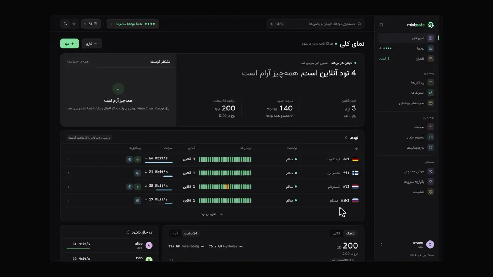

## چه کارهایی می‌کند

پنل را روی یک سرور نصب می‌کنید و سرورهای VPN خود را به‌عنوان نود به آن اضافه می‌کنید. هر نفر یک لینک اشتراک می‌گیرد و برنامه‌اش همهٔ سرورهایی را که اجازهٔ استفاده از آن‌ها را دارد خودش دریافت می‌کند. پنل پیکربندی نودها را درست نگه می‌دارد و آن‌ها را بررسی می‌کند.

همهٔ این‌ها روی داده‌های نمایشی ساختگی اجرا شده‌اند؛ کلیپ‌ها حلقه‌های کوتاهی از پنل مدیریت واقعی‌اند.

<table>
<tr>
<td width="38%" valign="top">
<h3>افزودن سرور از مرورگر</h3>
<p>نشانی IP سرور را بنویسید، انتخاب کنید پنل چگونه وارد شود (با کلید SSH خود پنل که یک بار نزد ارائه‌دهنده اضافه می‌کنید، یا با گذرواژهٔ root) و نصب را تماشا کنید. پنل کلید SSH سرور را ثابت می‌کند، سرور را بررسی می‌کند، پورت‌ها را در UFW یا firewalld فعال باز می‌کند و عامل امضاشده را نصب می‌کند. روی سرور جدید به ترمینال نیازی نیست؛ اگر بخواهید، یک دستور یک‌بارمصرف هم هست.</p>
<p><a href="docs/fa/getting-started/add-node.md">مستندات ←</a></p>
</td>
<td width="62%"><picture><source media="(prefers-color-scheme: dark)" srcset="docs/images/readme/addnode-dark-en.webp"><source media="(prefers-color-scheme: light)" srcset="docs/images/readme/addnode-light-en.webp">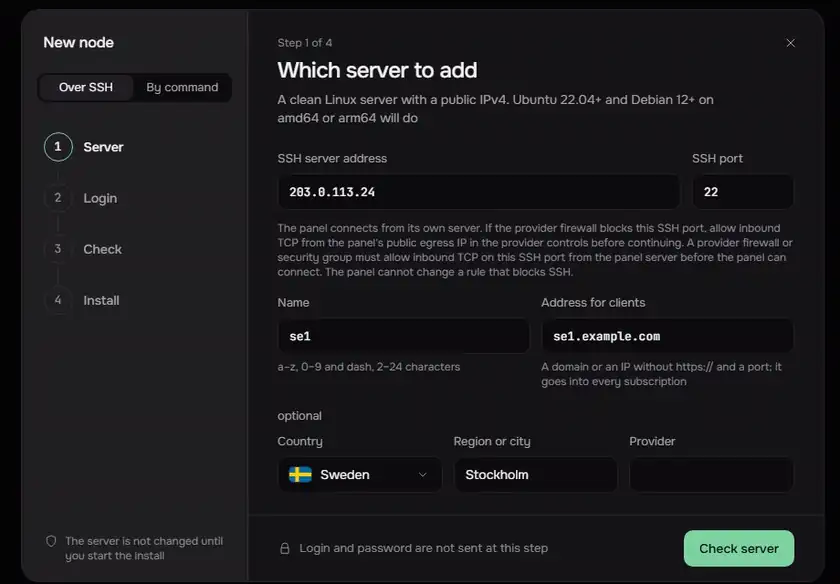</picture></td>
</tr>
<tr>
<td width="38%" valign="top">
<h3>یک پیوند برای هر نفر و صفحهٔ خودش</h3>
<p>هر نفر یک پیوند اشتراک، یک کد QR و صفحه‌ای پشت آن می‌گیرد: راهنما برای پلتفرم خودش، روزهای باقی‌مانده، ترافیک و دستگاه‌های خودش. برنامه‌های مبتنی بر Mihomo همهٔ پروتکل‌ها را از پیوند می‌گیرند، Happ پروتکل‌های Hysteria2 و VLESS را و AmneziaVPN برای هر دستگاه یک کلید از صفحه می‌گیرد. گروه‌ها مشخص می‌کنند هر نفر به کدام سرورها می‌رسد.</p>
<p><a href="docs/fa/guide/user-page.md">مستندات ←</a></p>
</td>
<td width="62%"><picture><source media="(prefers-color-scheme: dark)" srcset="docs/images/readme/link-dark-en.webp"><source media="(prefers-color-scheme: light)" srcset="docs/images/readme/link-light-en.webp">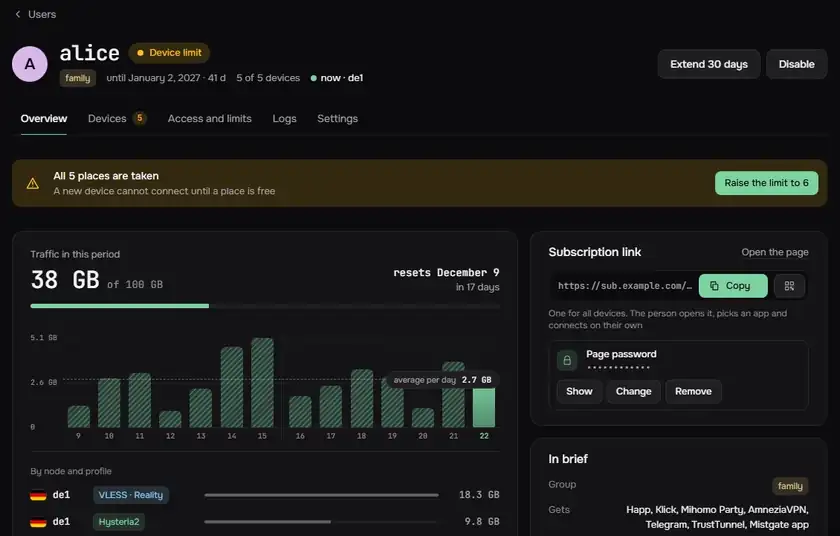</picture></td>
</tr>
<tr>
<td width="38%" valign="top">
<h3>بررسی از دید مشتری</h3>
<p>هر 5 دقیقه پنل مثل یک برنامه به هر پروتکل روی هر نود وصل می‌شود و تأخیر هر تونل را نشان می‌دهد؛ پس از خراب شدن سرور زودتر از کاربران آن خبردار می‌شوید. «دکتر» روی هر نود 22 بررسی از میزبان انجام می‌دهد و ده اصلاح پیشنهاد می‌کند؛ هیچ‌کدام بدون تأیید شما اجرا نمی‌شود.</p>
<p><a href="docs/en/operations/health.md">مستندات ←</a></p>
</td>
<td width="62%"><picture><source media="(prefers-color-scheme: dark)" srcset="docs/images/readme/health-dark-en.webp"><source media="(prefers-color-scheme: light)" srcset="docs/images/readme/health-light-en.webp">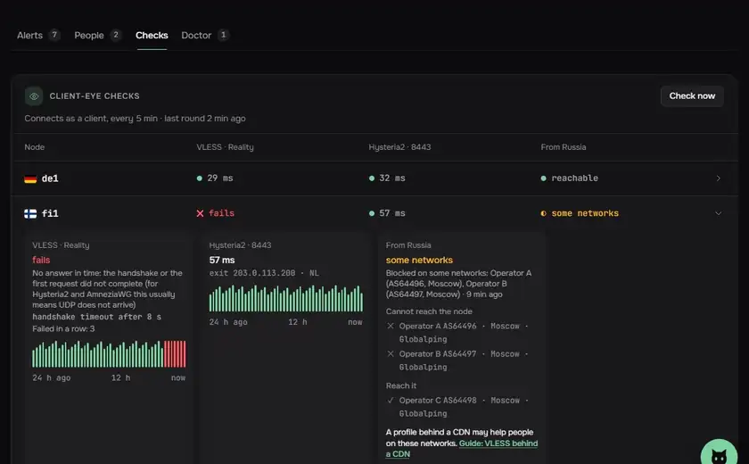</picture></td>
</tr>
<tr>
<td width="38%" valign="top">
<h3>یک TCP 443 برای چند پروتکل</h3>
<p>بسیاری از شبکه‌ها فقط TCP 443 را رد می‌کنند. یک نود می‌تواند VLESS REALITY، VLESS روی TLS، TrustTunnel و MTProto را روی همین یک پورت نگه دارد؛ عامل آن‌ها را از روی نامی که مشتری می‌خواهد جدا می‌کند. وقتی پروفایل دوم را روی پورت گرفته‌شده می‌گذارید، پنل پیشنهاد می‌کند کنار اولی بگذاریدش و رکورد DNS لازم را نشان می‌دهد.</p>
<p><a href="docs/en/guide/shared-port.md">مستندات ←</a></p>
</td>
<td width="62%"><picture><source media="(prefers-color-scheme: dark)" srcset="docs/images/readme/shared-dark-en.webp"><source media="(prefers-color-scheme: light)" srcset="docs/images/readme/shared-light-en.webp"></picture></td>
</tr>
<tr>
<td width="38%" valign="top">
<h3>سایت‌های استتار از روی قالب</h3>
<p>کسی که نود را باز می‌کند باید یک سایت کوچک معمولی ببیند، نه صفحهٔ Mistgate. یک کشور و یکی از ده نوع (صفحهٔ وضعیت، مستندات، وبلاگ، کسب‌وکار کوچک، نمونه‌کار و غیره) را انتخاب کنید تا پنل سایتی به زبان همان کشور با ظاهر و متن خودش بسازد، هر بار متفاوت. نگاهش کنید، نسخهٔ دیگری بخواهید، بعد ذخیره کنید. با کلید رایگان خودتان برای عکس‌ها، سایت عکس‌های واقعی هم می‌گیرد که خود نود ارائه می‌کند.</p>
<p><a href="docs/en/guide/decoy-site.md#a-site-from-a-template">مستندات ←</a></p>
</td>
<td width="62%"><picture><source media="(prefers-color-scheme: dark)" srcset="docs/images/readme/decoys-dark-en.webp"><source media="(prefers-color-scheme: light)" srcset="docs/images/readme/decoys-light-en.webp"></picture><br><picture><source media="(prefers-color-scheme: dark)" srcset="docs/images/readme/decoys-sites-dark-en.webp"><source media="(prefers-color-scheme: light)" srcset="docs/images/readme/decoys-sites-light-en.webp"></picture></td>
</tr>
<tr>
<td width="38%" valign="top">
<h3>به‌روزرسانی با انتشار مرحله‌ای و بازگشت</h3>
<p>نودها خودشان به‌روز نمی‌شوند. انتشار مرحله‌ای اول یک نود قناری را به‌روز می‌کند و 5 دقیقه به آن فرصت می‌دهد بررسی سلامت را بگذراند، بعد دسته‌های کوچک را ادامه می‌دهد. نودی که رد شود نسخهٔ قبلی‌اش را پس می‌گیرد و انتشار متوقف می‌شود. پنل فقط با تأیید شما خودش را به‌روز می‌کند و اگر نسخهٔ جدید دوام نیاورد، فایل اجرایی و داده‌های قبلی را برمی‌گرداند.</p>
<p><a href="docs/en/operations/updates.md">مستندات ←</a></p>
</td>
<td width="62%"><picture><source media="(prefers-color-scheme: dark)" srcset="docs/images/readme/updates-dark-en.webp"><source media="(prefers-color-scheme: light)" srcset="docs/images/readme/updates-light-en.webp">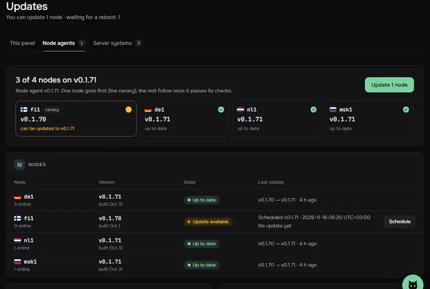</picture></td>
</tr>
<tr>
<td width="38%" valign="top">
<h3>به‌روزرسانی سیستم سرورها</h3>
<p>ببینید کدام سرورها منتظر به‌روزرسانی امنیتی یا راه‌اندازی مجدد هستند، بی‌آنکه به هر کدام وارد شوید. می‌توانید به‌روزرسانی امنیتی را روی یک سرور نصب یا آن را راه‌اندازی مجدد کنید، یا چند سرور را علامت بزنید و مثل یک انتشار مرحله‌ای اجرا کنید: چند تا در هر نوبت، بعد از هرکدام بررسی سلامت، و توقف در اولین شکست.</p>
<p><a href="docs/en/operations/updates.md#server-operating-system">مستندات ←</a></p>
</td>
<td width="62%"><picture><source media="(prefers-color-scheme: dark)" srcset="docs/images/readme/os-dark-en.webp"><source media="(prefers-color-scheme: light)" srcset="docs/images/readme/os-light-en.webp">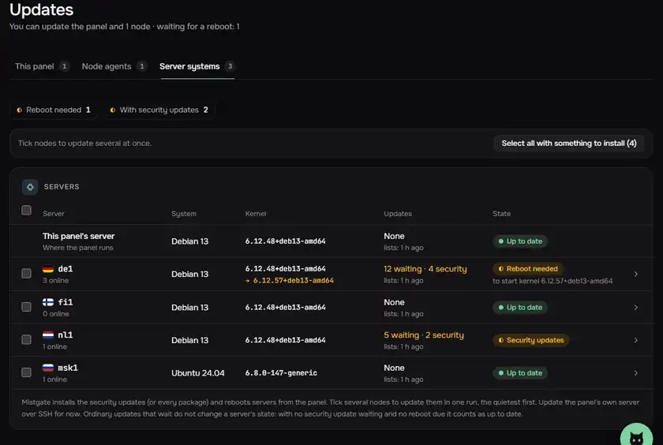</picture></td>
</tr>
<tr>
<td width="38%" valign="top">
<h3>خروجی WARP، همراه با بررسی کار کردنش</h3>
<p>ترافیک یک پروفایل را از Cloudflare WARP بیرون بفرستید، با یک حساب برای هر نود. کارت تونل، ترافیک و بررسی خروجی را نشان می‌دهد؛ پنل همچنین فهرستی از سایت‌ها را از WARP هر نود می‌گیرد و وقتی بعضی از آن‌ها شروع به مسدود کردنش کنند هشدار می‌دهد. پروفایلی که خروجی WARP دارد هرگز به نشانی خود نود برنمی‌گردد.</p>
<p><a href="docs/en/guide/warp.md">مستندات ←</a></p>
</td>
<td width="62%"><picture><source media="(prefers-color-scheme: dark)" srcset="docs/images/readme/warp-dark-en.webp"><source media="(prefers-color-scheme: light)" srcset="docs/images/readme/warp-light-en.webp">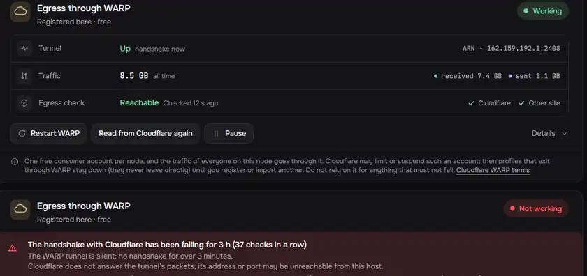</picture></td>
</tr>
<tr>
<td width="38%" valign="top">
<h3>پیش‌تنظیم‌های DNS برای برنامه‌ها</h3>
<p>پیش‌تنظیم مشخص می‌کند برنامهٔ هر نفر از کدام سرورهای DNS و چگونه بپرسد (ساده، DoT یا DoH)، با قاعده‌های جداسازی برای یک کشور یا فهرستی از سایت‌ها، مثلاً سایت‌های روسی مستقیم، و مسدود کردن تبلیغ‌ها در برنامه‌ها. آن را به همه، یک گروه یا یک نفر بدهید؛ ویرایشگر نشان می‌دهد هر برنامه واقعاً چه می‌گیرد.</p>
<p><a href="docs/en/guide/dns.md">مستندات ←</a></p>
</td>
<td width="62%"><picture><source media="(prefers-color-scheme: dark)" srcset="docs/images/readme/dns-dark-en.webp"><source media="(prefers-color-scheme: light)" srcset="docs/images/readme/dns-light-en.webp">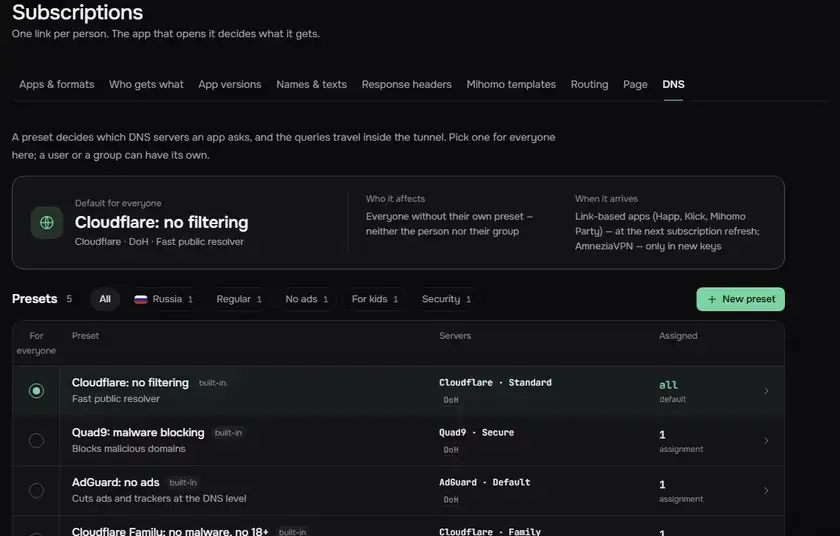</picture></td>
</tr>
<tr>
<td width="38%" valign="top">
<h3>دستیار و MCP، اول طرح</h3>
<p>دستیار داخلی (یک مدل ابری که با کلید خودتان وصل می‌کنید) دربارهٔ نودها و افراد پاسخ می‌دهد و تغییرها را آماده می‌کند. MCP همین را به یک عامل هوش مصنوعی بیرونی می‌دهد: ناوگان را می‌خواند و تغییر طرح می‌کند و هر تغییر پرخطر را پیش از اجرا شما در پنل مدیریت تأیید می‌کنید. یک توکن API در هر ساعت حداکثر 10 نفر را غیرفعال یا بازنویسی می‌کند، مگر محدودیت را بردارید.</p>
<p><a href="docs/en/guide/assistant.md">مستندات ←</a></p>
</td>
<td width="62%"><picture><source media="(prefers-color-scheme: dark)" srcset="docs/images/readme/assistant-dark-en.webp"><source media="(prefers-color-scheme: light)" srcset="docs/images/readme/assistant-light-en.webp">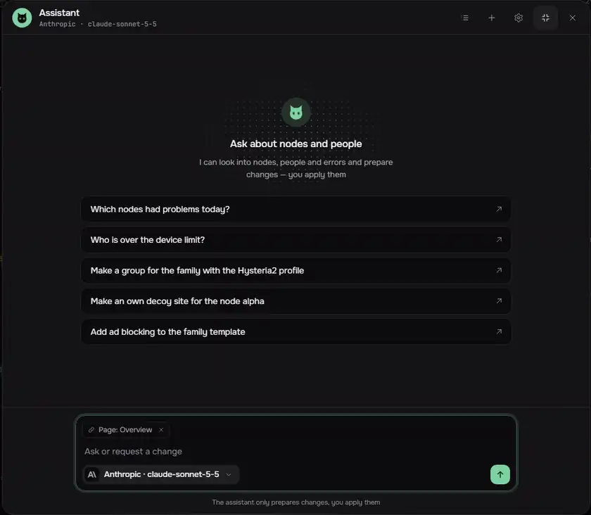</picture></td>
</tr>
<tr>
<td width="38%" valign="top">
<h3>هشدارها در تلگرام</h3>
<p>ربات خودتان را وصل کنید تا پنل وقتی نودی از کار می‌افتد یا برمی‌گردد، بررسی‌ای ناموفق است، پشتیبان‌گیری شکست می‌خورد یا طرح یک عامل منتظر شماست در چتتان بنویسد. فقط هشدار می‌فرستد: از چت چیزی تأیید یا تغییر داده نمی‌شود. هر مدیر چت خودش را وصل می‌کند.</p>
<p><a href="docs/en/operations/telegram-alerts.md">مستندات ←</a></p>
</td>
<td width="62%"><picture><source media="(prefers-color-scheme: dark)" srcset="docs/images/readme/telegram-dark-en.webp"><source media="(prefers-color-scheme: light)" srcset="docs/images/readme/telegram-light-en.webp">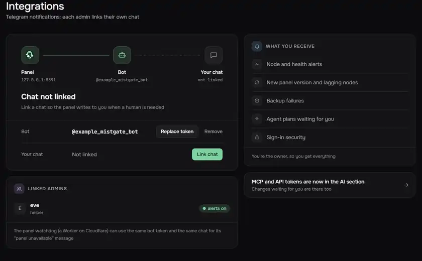</picture></td>
</tr>
<tr>
<td width="38%" valign="top">
<h3>پشتیبان‌های رمزگذاری‌شده و بازیابی محتاطانه</h3>
<p>پشتیبان‌ها به سطل Cloudflare R2 خودتان می‌روند، زمان‌بندی‌شده یا با دکمه، و پیش از خروج از پنل با کلیدی که آفلاین نگه می‌دارید رمزگذاری می‌شوند. بازیابی اول پشتیبان را بررسی می‌کند و آنچه در آن است را با آنچه اکنون دارید مقایسه می‌کند؛ تا تأیید نکنید چیزی عوض نمی‌شود و داده‌های پیش از بازیابی می‌مانند.</p>
<p><a href="docs/en/operations/backups.md">مستندات ←</a></p>
</td>
<td width="62%"><picture><source media="(prefers-color-scheme: dark)" srcset="docs/images/readme/backups-dark-en.webp"><source media="(prefers-color-scheme: light)" srcset="docs/images/readme/backups-light-en.webp">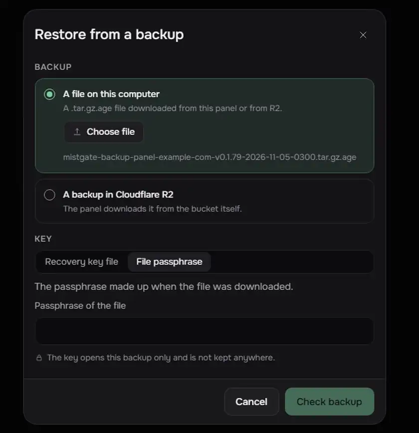</picture></td>
</tr>
</table>

علاوه بر این:

- اگر از برخی شبکه‌ها نتوان به سروری رسید، کاربران از راه نود دیگری از نودهای شما به آن وصل می‌شوند؛ آن نود فقط ترافیک رمزگذاری‌شده را جابه‌جا می‌کند. پنل پیش از روشن کردن مسیر آن را بررسی می‌کند و بعد هم زیر نظرش دارد؛ «مسیرهای ورود» در صفحهٔ نود نموداری است که نشان می‌دهد کاربران چگونه به سرور می‌رسند، و صفحهٔ نودها نقشهٔ همهٔ نودها را دارد. [رله‌ها](docs/en/guide/relays.md)
- بررسی اختیاریِ اینکه سرورهای شما از داخل یک کشور، شبکه به شبکه، باز می‌شوند یا نه: سنجش‌های Globalping در شبکه‌های خانگی و همراه روی IPv4 و IPv6، نقطه‌های سنجش داوطلبان و سیم‌کارت‌ها، فهرست‌های مسدودسازی و یک سنجش TSPU از نود خودتان. بیشتر این منابع فقط در روسیه کار می‌کنند. [دسترس‌پذیری](docs/en/operations/reachability.md)
- بدون Docker و بدون سرور پایگاه داده. پنل در حالت بیکار روی سروری با یک vCPU و یک گیگابایت رم فقط 16 تا 20 MiB حافظه مصرف می‌کند. [بنچمارک‌ها](docs/en/reference/benchmarks.md)، از جمله جاهایی که Mistgate کندتر است.
- غریبه‌ای که نشانی پنل را باز کند یک سایت پوششی می‌بیند؛ پنل مدیریت پشت یک مسیر یا نام میزبان مخفی است.
- هر سرور برای چه کسی است: یک نود برای همه، برای گروه‌های انتخاب‌شده یا فعلاً برای هیچ‌کس است و هر نفر می‌تواند در چند گروه باشد. [گروه‌ها](docs/en/guide/users-and-groups.md)
- یک برنامهٔ دسکتاپ برای ویندوز، [Mistgate](https://github.com/Mistgate/mistgate-client)، با این پنل‌ها و با پیوندهای اشتراک معمولی کار می‌کند.

چیزهایی که هنوز نیست: ربات تلگرام جز هشدار، و نسخهٔ Cloudflare Workers هنوز [پیش‌نمایش](docs/en/getting-started/install-edge.md) است. بعضی پیش‌فرض‌ها به سمت کاربران روسیه است؛ همه تنظیم‌اند.

## پروتکل‌ها

| پروتکل | روی نود | چه چیزهایی قابل تنظیم است |
|--:|--:|--:|
| [Hysteria2](docs/en/guide/hysteria2.md) | هستهٔ رسمی Hysteria2 | روی UDP (QUIC). مبهم‌سازی Salamander (Gecko آزمایشی است)، پرش پورت، گواهی Let's Encrypt یا گواهی خودامضا با اثرانگشت ثابت. |
| [VLESS](docs/en/guide/vless.md) | xray-core | پروتکل REALITY روی XHTTP یا TCP (RAW + Vision)؛ TLS روی XHTTP یا WebSocket، مستقیم یا پشت CDN. |
| [AmneziaWG](docs/en/guide/amneziawg.md) | amneziawg-go در فضای کاربر، یا ماژول کرنل | نسخه‌های 3.1 (پیش‌فرض) و 2.0، با کلید جداگانه برای هر دستگاه. نسخه‌های 1.5 و 1.0 ارائه نمی‌شوند. |
| [TrustTunnel](docs/en/guide/trusttunnel.md) | موتور خود Mistgate در عامل نود | آزمایشی. یک VPN درون HTTPS معمولی (HTTP/2 و در صورت دلخواه HTTP/3) با گواهی واقعی؛ کلیدهای <code dir="ltr">tt://</code> برای برنامه‌های رسمی TrustTunnel. |
| [MTProto](docs/en/guide/mtproto.md) | هستهٔ MTProto خودِ Mistgate | آزمایشی. پروکسی فقط برای برنامهٔ Telegram: Fake TLS با دامنهٔ خود نود یا سایتی دیگر به‌عنوان نام، یک کلید برای هر نفر، و سایت پوششی برای بقیه. |

پروتکل‌های Hysteria2 و VLESS می‌توانند روی یک نود کنار هم کار کنند، حتی روی TCP 443. هر قالب برنامه همهٔ پروفایل‌ها را پشتیبانی نمی‌کند: [چه چیزی کجا کار می‌کند](docs/en/guide/subscriptions.md#what-works-where) را ببینید.

هنوز پشتیبانی نمی‌شوند: VMess، Trojan، Shadowsocks، TUIC و WireGuard ساده. پروتکل‌های بیشتری در برنامه است؛ هر پروتکل تازه از راه قراردادی که در ادامه آمده به همان لینک اشتراک وصل می‌شود.

هر پروتکل دو نیمه دارد که در فایل‌های اجرایی کامپایل می‌شوند. در پنل، یک اینترفیس Go: یک JSON Schema برای تنظیماتش (پنل مدیریت فرم را از روی آن می‌سازد)، اعتبارسنجی، مشخصاتی که نود اجرا می‌کند، صدور اعتبارنامه‌ها، و سهمش در هر قالب اشتراک. روی نود، موتوری که آن مشخصات را اجرا می‌کند، اعتبارنامه‌ها را بدون راه‌اندازی دوباره عوض می‌کند و ترافیک و سلامت را گزارش می‌دهد. پروتکل تازه فقط به ایجنت‌هایی فرستاده می‌شود که پشتیبانی از آن را اعلام کنند، پس ایجنت‌های قدیمی‌تر به کارشان ادامه می‌دهند. [قرارداد افزونهٔ پروتکل](docs/en/reference/architecture.md#the-protocol-plugin-contract) را ببینید.

## آیا پایدار است؟

بتاست و هنوز جوان: برچسب v0.1.0 در 2026-10-03 زده شد و خط 0.2.0 کل رابط را از نو کشیده است. تا نسخهٔ 1.0 ممکن است API، تنظیمات ذخیره‌شده و پروتکل نود تغییر کنند. نسخه‌ها هنوز از آزمون خودکار ارتقا از نسخه‌های قدیمی‌تر نمی‌گذرند؛ این یکی از [شرط‌های رسیدن به 1.0](docs/en/roadmap/status.md) است.

من خودم آن را روی شش سرورم برای خانواده و دوستانم به کار می‌برم.

تونل‌ها به پنل وابسته نیستند: وقتی پنل از کار افتاده است، نود همچنان با آخرین پیکربندی اعمال‌شده سرویس می‌دهد، تغییر یک کاربر سرور را دوباره راه‌اندازی نمی‌کند و ایجنت‌های قدیمی‌تر با پنل جدیدتر کار می‌کنند. در [بنچمارک](docs/en/reference/benchmarks.md)، افزودن و حذف کاربران و راه‌اندازی دوبارهٔ پنل هیچ اتصالی را قطع نکرد.

بررسی‌ها:

- اجرای CI روی هر push و pull request ([ci.yml](.github/workflows/ci.yml)): تست‌های Go و vet، ردیاب race روی نشست پنل و ایجنت، `govulncheck`، lint و تست‌های پنل مدیریت، ساخت مستندات، و نصب‌کننده روی Debian و Ubuntu.
- یک اجرای سرتاسری ([scripts/e2e-wsl.sh](scripts/e2e-wsl.sh)): یک پنل و نود واقعی با کلاینت‌های واقعی Hysteria2، AmneziaWG، Xray، mihomo و sing-box، به‌علاوهٔ به‌روزرسانی و بازگردانی ایجنت و نصب از راه SSH. پیش از هر نسخه، دستی در WSL یا یک ماشین مجازی اجرا می‌شود، نه در CI.
- هر برچسب را GitHub Actions به‌صورت پیش‌نویس می‌سازد. من آن را روی ماشینی که کلید آفلاین امضای نسخه‌ها روی آن است از روی همان برچسب دوباره می‌سازم و فقط فایل‌های اجرایی‌ای را امضا می‌کنم که بایت به بایت یکسان باشند؛ نودها و پنل فقط بیلدهای امضاشده را نصب می‌کنند. [نسخه‌ها و امضا](docs/en/operations/releases.md)

به‌روزرسانی ([به‌روزرسانی‌ها](docs/en/operations/updates.md)):

- نودها هرگز خودبه‌خود به‌روز نمی‌شوند. هر انتشار اول یک نود قناری را به‌روز می‌کند و 5 دقیقه به آن فرصت می‌دهد تا از بررسی سلامت بگذرد، سپس در دسته‌های یک یا دوتایی ادامه می‌دهد. نودی که شکست بخورد بیلد قبلی‌اش را پس می‌گیرد و انتشار متوقف می‌شود.
- ایجنت هم اگر بیلد جدید ظرف 5 دقیقه وصل نشود یا مدام از کار بیفتد، خودش را بازمی‌گرداند. هر نودی را می‌توان دستی بازگرداند.
- نودی که اتصالش به پنل قفل شود می‌تواند دانلود به‌روزرسانی را از GitHub تمام کند. پنل آن را فقط وقتی به‌عنوان منبع دوم پیشنهاد می‌کند که انتشار آنجا با کلید خود پنل امضا شده و همان فایل‌ها را داشته باشد؛ به‌طور پیش‌فرض روشن است، از تنظیمات خاموش می‌شود و GitHub نشانی نود را می‌بیند.
- پنل فقط وقتی شما تأیید کنید خودش را به‌روز می‌کند. اول از داده‌هایش نسخهٔ پشتیبان می‌گیرد و اگر نسخهٔ جدید 45 ثانیه سرپا نماند، فایل اجرایی و داده‌های قبلی را برمی‌گرداند.
- با این حال از <code dir="ltr">/var/lib/mistgate</code> [نسخهٔ پشتیبان رمزگذاری‌شده](docs/en/operations/backups.md) نگه دارید.

کد Mistgate با کمک ایجنت‌های کدنویسی هوش مصنوعی نوشته می‌شود. من آنچه را می‌نویسند بازبینی می‌کنم و تصمیم می‌گیرم چه چیزی ادغام و منتشر شود؛ بررسی‌های بالا برای کد آن‌ها همان است که برای کد هر کس دیگری. کامیت‌هایی که با یک ایجنت ساخته شده‌اند خط `Co-Authored-By` دارند و قواعدی که ایجنت‌ها در این مخزن رعایت می‌کنند در [AGENTS.md](AGENTS.md) آمده است.

## شروع سریع

به یک سرور لینوکس تازه (amd64 یا arm64) با systemd نیاز دارید، یک دامنه که مستقیم به آن اشاره کند (اینجا `panel.example.com`)، پورت‌های TCP 80 و 443 آزاد، و یا `openssh-client` با پشتیبانی از `ssh-keygen -Y verify` یا OpenSSL نسخهٔ 3.2 یا جدیدتر. روی سرور اجرا کنید:

```sh
curl -fsSL https://mistgate.app/install.sh | sudo bash -s -- --public-url https://panel.example.com
```

نصب‌کننده مانیفست امضاشدهٔ پنل را بررسی می‌کند، Mistgate را زیر systemd راه می‌اندازد و نشانی پنل مدیریت را همراه با یک لینک راه‌اندازی یک‌بارمصرف (معتبر به مدت 30 دقیقه) چاپ می‌کند. به فایروال دست نمی‌زند. گزینهٔ <code dir="ltr">--yes</code> پرسش‌ها را رد می‌کند و <code dir="ltr">--dry-run</code> فقط نسخه را بررسی می‌کند؛ نصب دستی و گزینه‌های دیگر در [نصب پنل](docs/en/getting-started/install-panel.md) آمده است.

سپس:

1. لینک راه‌اندازی را باز کنید و حساب مالک را بسازید: با کلید عبور، یا با رمز عبور و کد برنامهٔ احراز هویت.
2. سرورها را در **نودها ← افزودن نود** اضافه کنید، از راه SSH یا با یک فرمان یک‌بارمصرف ([افزودن نود](docs/en/getting-started/add-node.md)).
3. کاربران را اضافه کنید: [نخستین کاربران](docs/en/getting-started/first-users.md).

یک ایجنت هوش مصنوعی که بتواند `ssh` اجرا کند، می‌تواند این گام‌ها را با پرامپت [راهنمای ایجنت هوش مصنوعی](docs/en/getting-started/ai-agents.md#install-mistgate-with-an-ai-agent) انجام دهد؛ حساب مالک را همچنان خودتان می‌سازید.

## مقایسه با پنل‌های دیگر

| | Mistgate | 3x-ui | Remnawave | Hiddify | PasarGuard | s-ui |
|--:|--:|--:|--:|--:|--:|--:|
| اجرا بدون Docker | ✅ | ✅ | ❌ | ✅ | 🟡 تا حدی | ✅ |
| پایگاه داده | SQLite | SQLite یا PostgreSQL | PostgreSQL + Redis | MySQL + Redis | SQLite، MySQL، MariaDB یا PostgreSQL | SQLite |
| رم پنل در حالت بیکار | 16-20 MiB¹ | 68-74 MiB¹ | 426-454 MiB¹ | اندازه‌گیری نشده | 262-265 MiB¹ | اندازه‌گیری نشده |
| افزودن نود از پنل (SSH) | ✅ | ❌ | ❌ | ❌ | ❌ | ? |
| Hysteria2 | ✅ | ✅ | 🟡 تا حدی | ✅ | ✅ | ✅ |
| VLESS REALITY | ✅ | ✅ | ✅ | ✅ | ✅ | ? |
| AmneziaWG | ✅ 2.0 و 3.1 | ✅ 3.1 | ? | ? | ? | ? |
| VMess، Trojan، Shadowsocks | ❌ | ✅ | 🟡 تا حدی | ✅ | ✅ | ✅ |
| اشتراک Xray JSON یا sing-box | ✅ هر دو | Xray JSON | ✅ هر دو | ✅ هر دو | sing-box | sing-box |
| بررسی سلامت و هشدار | ✅ بررسی از دید کلاینت، عیب‌یاب نود، دسترس‌پذیری از داخل یک کشور | ✅ پایش تونل (اختیاری) | ✅ وضعیت، Prometheus | 🟡 تا حدی | 🟡 تا حدی | ? |
| ربات Telegram | 🟡 فقط هشدار | ✅ | 🟡 تا حدی | ✅ | ✅ | ? |
| سرور MCP داخلی برای ایجنت‌های هوش مصنوعی | ✅ | ? | ❌ | ? | ? | ? |

¹ حافظهٔ خصوصی کل گروه پردازه‌های پنل، در حالت بیکار، با 0 تا 200 کاربر و بدون نود متصل، روی یک سرور آزمایشی با یک vCPU و یک گیگابایت رم (برای 3x-ui هستهٔ Xray و fail2ban آن هم حساب شده است). روش، نسخه‌ها و محدودیت‌ها: [بنچمارک‌ها](docs/en/reference/benchmarks.md). علامت «?» یعنی README و مستندات خود آن پروژه چیزی در این باره نمی‌گویند.

پنل‌های دیگر در تنوع پروتکل‌ها، اندازهٔ جامعه و ربات‌های کامل Telegram جلوترند. جدول کامل همراه با منابع، که در 2026-10-09 بررسی شده، در [مقایسه با پنل‌های دیگر](docs/en/reference/comparison.md) آمده است.

## مستندات

همه‌چیز در [mistgate.app](https://mistgate.app/) و در [پوشهٔ `docs`](docs/README.md) هست. مستندات به زبان‌های انگلیسی، روسی و چینی نوشته شده و پیوندهای زیر به نسخهٔ انگلیسی می‌روند. جاهای خوب برای شروع:

- [نمای کلی](docs/en/getting-started/overview.md) و [پیش‌نیازها](docs/en/getting-started/requirements.md)
- [نصب پنل](docs/en/getting-started/install-panel.md)، [نصب نود از راه SSH](docs/en/getting-started/ssh-install.md)، [نخستین کاربران](docs/en/getting-started/first-users.md)
- [سلامت](docs/en/operations/health.md)، [به‌روزرسانی‌ها](docs/en/operations/updates.md)، [نسخهٔ پشتیبان رمزگذاری‌شده](docs/en/operations/backups.md)، [رفع اشکال](docs/en/operations/troubleshooting.md)
- [CLI](docs/en/reference/cli.md)، [API](docs/en/reference/api.md)، [MCP](docs/en/reference/mcp.md)، [معماری](docs/en/reference/architecture.md)

## مشارکت

از گزارش باگ، اصلاح‌ها و بهبود مستندات استقبال می‌شود. فایل [CONTRIBUTING.md](CONTRIBUTING.md) (به انگلیسی) روش ساخت، نقشهٔ کد، بررسی‌هایی که CI اجرا می‌کند و قراردادها را توضیح می‌دهد. ایجنت‌های کدنویسی از [`AGENTS.md`](AGENTS.md) شروع می‌کنند؛ در [راهنمای ایجنت هوش مصنوعی](docs/en/getting-started/ai-agents.md#contribute-with-a-coding-agent) یک پرامپت آماده برای مشارکت هست.

## امنیت

آسیب‌پذیری‌ها را به‌صورت خصوصی گزارش دهید: [SECURITY.md](SECURITY.md) را ببینید. از پوشهٔ دادهٔ پنل (<code dir="ltr">/var/lib/mistgate</code>) نسخهٔ پشتیبان بگیرید: پایگاه داده، کلید اصلی و CA مورد اعتماد نودهای شما در آن است.

## مجوز

نرم‌افزار Mistgate آزاد است و تحت [GNU Affero General Public License v3.0 only](LICENSE) منتشر می‌شود. اگر یک پنل تغییریافته را برای دیگران اجرا می‌کنید، پنل مدیریت آن یک پیوند «کد منبع» (`serve --source-url`) نشان می‌دهد که باید به کد منبع شما اشاره کند.

## تاریخچهٔ ستاره‌ها

<a href="https://www.star-history.com/?repos=mistgate%2Fmistgate&type=date&legend=top-left">
 <picture>
   <source media="(prefers-color-scheme: dark)" srcset="https://api.star-history.com/chart?repos=mistgate/mistgate&type=date&theme=dark&legend=top-left" />
   <source media="(prefers-color-scheme: light)" srcset="https://api.star-history.com/chart?repos=mistgate/mistgate&type=date&legend=top-left" />
   
 </picture>
</a>

</div>
