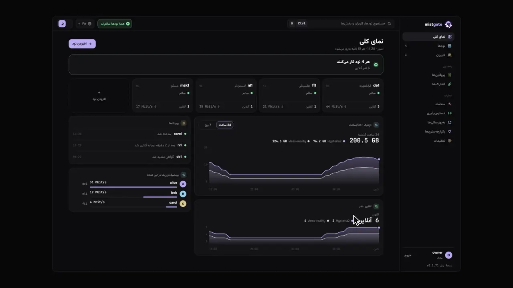
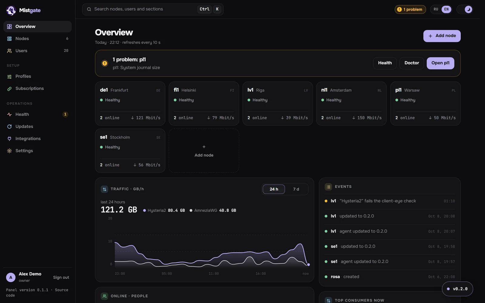
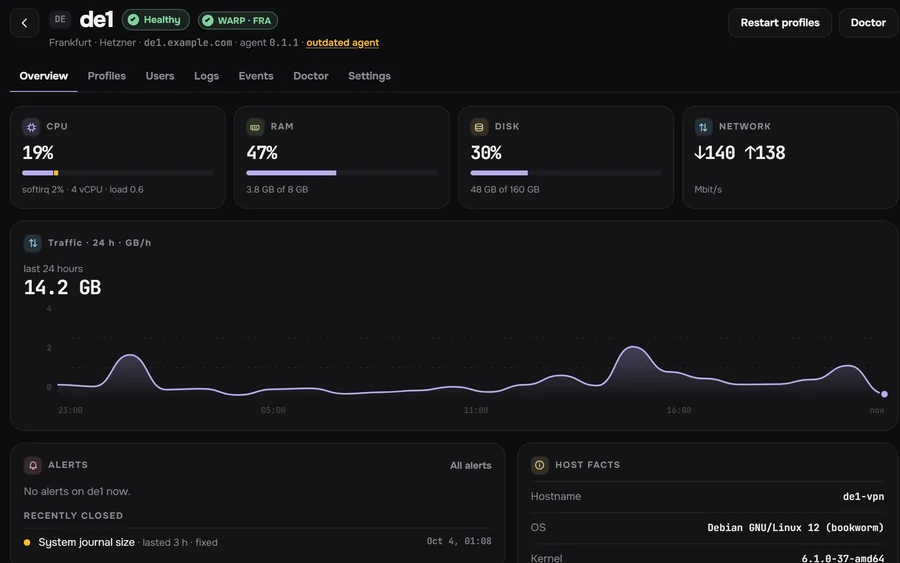
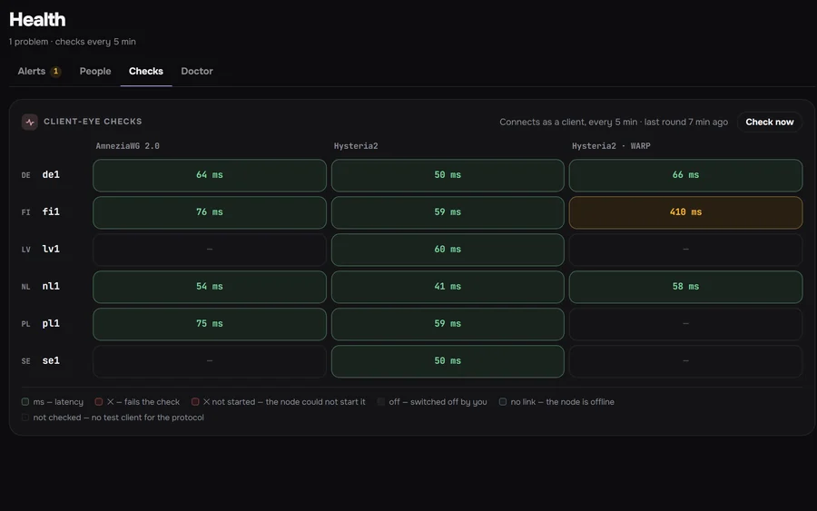
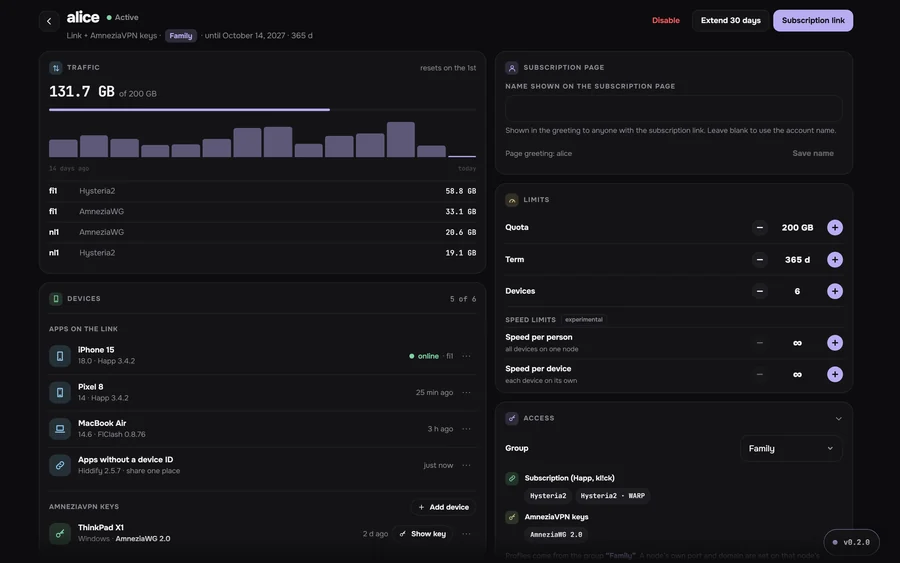
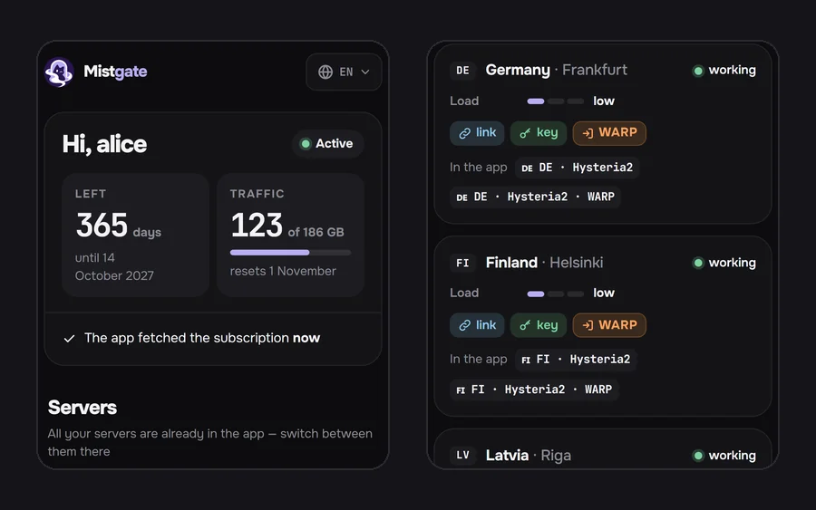

<div dir="rtl">

<div align="center">


<h1>Mistgate</h1>

<p>پنلی برای یک VPN کوچک که روی سرور خودتان اجرا می‌شود: چند سرور از آنِ خودتان و کسانی که سرورها را با آن‌ها شریک می‌شوید.<br>
Hysteria2، VLESS و AmneziaWG. دو فایل اجرایی Go، به‌علاوهٔ SQLite و systemd.</p>

<p>

<a href="https://github.com/Mistgate/mistgate/releases/latest"></a>
<a href="LICENSE"></a>
<a href="https://github.com/Mistgate/mistgate/actions/workflows/ci.yml"></a>
<a href="go.mod"></a>
</p>

<p><a href="https://mistgate.app/"><b>مستندات</b></a> · <a href="#شروع-سریع"><b>نصب</b></a> · <a href="#پروتکل‌ها"><b>پروتکل‌ها</b></a> · <a href="#آیا-پایدار-است"><b>آیا پایدار است؟</b></a> · <a href="#مقایسه-با-پنل‌های-دیگر"><b>مقایسه</b></a> · <a href="README.md">English</a> · <a href="README.ru.md">Русский</a> · <a href="README.zh.md">简体中文</a> · <a href="README.tr.md">Türkçe</a></p>

<p><sub><b>بتا.</b> تا نسخهٔ 1.0 ممکن است چیزهایی تغییر کند. <a href="https://mistgate.app/roadmap/status/">وضعیت و نقشهٔ راه</a></sub></p>

</div>



## چه کارهایی می‌کند

پنل را روی یک سرور نصب می‌کنید و سرورهای VPN خود را به‌عنوان نود به آن اضافه می‌کنید. هر نفر یک لینک اشتراک می‌گیرد و برنامه‌اش همهٔ سرورهایی را که اجازهٔ استفاده از آن‌ها را دارد خودش دریافت می‌کند. پنل پیکربندی نودها را درست نگه می‌دارد و آن‌ها را بررسی می‌کند.

- نود را از مرورگر با IP و کلید SSH خود پنل (یک بار نزد میزبان اضافه‌اش می‌کنید) یا رمز عبور root اضافه می‌کنید. پنل کلید SSH سرور را به خاطر می‌سپارد، سرور را بررسی می‌کند، اگر UFW یا firewalld فعال باشد پورت‌ها را در آن باز می‌کند و ایجنت امضاشده را نصب می‌کند؛ در کارت نود هم رمز را عوض می‌کند و کلیدهای SSH سرور را مدیریت می‌کند. یک فرمان نصب یک‌بارمصرف هم کار می‌کند. [افزودن نود](docs/en/getting-started/add-node.md)
- برای هر نفر یک لینک. برنامه‌های مبتنی بر Mihomo (kl!ck، FlClash و Clash Verge Rev) هر سه پروتکل را از همین لینک می‌گیرند، Happ پروتکل‌های Hysteria2 و VLESS را، و AmneziaVPN برای هر دستگاه یک کلید جداگانه از صفحهٔ کاربر برمی‌دارد. برنامه‌های Mihomo و sing-box خودشان به یک سرور سالم می‌روند. [برنامه‌های کلاینت](docs/en/guide/client-apps.md)
- پنل هر 5 دقیقه یک بار، درست مثل یک برنامه، به هر سرور وصل می‌شود. عیب‌یابِ هر نود 21 بررسی روی میزبان انجام می‌دهد و هشت راه‌حل پیشنهاد می‌کند که فقط پس از تأیید شما اجرا می‌شوند. هشدارها در پنل مدیریت دیده می‌شوند و به Telegram هم فرستاده می‌شوند. [سلامت](docs/en/operations/health.md)
- اگر از برخی شبکه‌ها نتوان به سروری رسید، کاربران از راه نود دیگری از نودهای شما به آن وصل می‌شوند؛ آن نود فقط ترافیک رمزگذاری‌شده را جابه‌جا می‌کند. پنل پیش از روشن کردن مسیر آن را بررسی می‌کند و بعد هم زیر نظرش دارد؛ «مسیرهای ورود» در صفحهٔ نود نموداری است که نشان می‌دهد کاربران چگونه به سرور می‌رسند، و صفحهٔ نودها نقشهٔ همهٔ نودها را دارد. [رله‌ها](docs/en/guide/relays.md)
- بررسی اختیاریِ اینکه سرورهای شما از داخل یک کشور، شبکه به شبکه، باز می‌شوند یا نه: سنجش‌های Globalping در شبکه‌های خانگی و همراه روی IPv4 و IPv6، نقطه‌های سنجش داوطلبان و سیم‌کارت‌ها، فهرست‌های مسدودسازی و یک سنجش TSPU از نود خودتان. بیشتر این منابع فقط در روسیه کار می‌کنند. [دسترس‌پذیری](docs/en/operations/reachability.md)
- بدون Docker و بدون سرور پایگاه داده. پنل در حالت بیکار روی سروری با یک vCPU و یک گیگابایت رم فقط 16 تا 20 MiB حافظه مصرف می‌کند. [بنچمارک‌ها](docs/en/reference/benchmarks.md)، از جمله جاهایی که Mistgate کندتر است.
- غریبه‌ای که نشانی پنل را باز کند یک سایت پوششی می‌بیند؛ پنل مدیریت پشت یک مسیر یا نام میزبان مخفی است.
- دستیار داخلی (یک مدل ابری که با کلید خودتان وصل می‌کنید) دربارهٔ نودها و کاربران پاسخ می‌دهد و تغییرها را به‌صورت کارت‌هایی آماده می‌کند که خودتان اجرا می‌کنید. MCP به ایجنت هوش مصنوعی بیرونی اجازه می‌دهد وضعیت نودها را بخواند، مسیرهای میان نودها را آزمایش کند و تغییر برنامه‌ریزی کند؛ تغییرات پرخطر در پنل مدیریت منتظر تأیید شما می‌مانند. یک توکن API در هر ساعت حداکثر می‌تواند 10 نفر را غیرفعال یا بازنویسی کند، مگر اینکه محدودیت را برای آن بردارید. [دستیار](docs/en/guide/assistant.md)، [MCP](docs/en/reference/mcp.md)

آنچه هنوز نیست: برنامهٔ خودمان (در برنامه است)؛ ربات Telegram فعلاً فقط هشدار می‌فرستد و نسخهٔ Cloudflare Workers هنوز [پیش‌نمایش](docs/en/getting-started/install-edge.md) است. برخی پیش‌فرض‌ها برای کاربران داخل روسیه انتخاب شده‌اند؛ همهٔ آن‌ها در تنظیمات قابل تغییرند.

## پروتکل‌ها

| پروتکل | روی نود | چه چیزهایی قابل تنظیم است |
|--:|--:|--:|
| [Hysteria2](docs/en/guide/hysteria2.md) | هستهٔ رسمی Hysteria2 | روی UDP (QUIC). مبهم‌سازی Salamander (Gecko آزمایشی است)، پرش پورت، گواهی Let's Encrypt یا گواهی خودامضا با اثرانگشت ثابت. |
| [VLESS](docs/en/guide/vless.md) | xray-core | پروتکل REALITY روی XHTTP یا TCP (RAW + Vision)؛ TLS روی XHTTP یا WebSocket، مستقیم یا پشت CDN. |
| [AmneziaWG](docs/en/guide/amneziawg.md) | amneziawg-go در فضای کاربر، یا ماژول کرنل | نسخه‌های 3.1 (پیش‌فرض) و 2.0، با کلید جداگانه برای هر دستگاه. نسخه‌های 1.5 و 1.0 ارائه نمی‌شوند. |
| [MTProto](docs/en/guide/mtproto.md) | هستهٔ MTProto خودِ Mistgate | آزمایشی. پروکسی فقط برای برنامهٔ Telegram: Fake TLS با دامنهٔ خود نود یا سایتی دیگر به‌عنوان نام، یک کلید برای هر نفر، و سایت پوششی برای بقیه. |

پروتکل‌های Hysteria2 و VLESS می‌توانند روی یک نود کنار هم کار کنند، حتی روی TCP 443. هر قالب برنامه همهٔ پروفایل‌ها را پشتیبانی نمی‌کند: [چه چیزی کجا کار می‌کند](docs/en/guide/subscriptions.md#what-works-where) را ببینید.

هنوز پشتیبانی نمی‌شوند: VMess، Trojan، Shadowsocks، TUIC و WireGuard ساده. پروتکل‌های بیشتری در برنامه است؛ هر پروتکل تازه از راه قراردادی که در ادامه آمده به همان لینک اشتراک وصل می‌شود.

هر پروتکل دو نیمه دارد که در فایل‌های اجرایی کامپایل می‌شوند. در پنل، یک اینترفیس Go: یک JSON Schema برای تنظیماتش (پنل مدیریت فرم را از روی آن می‌سازد)، اعتبارسنجی، مشخصاتی که نود اجرا می‌کند، صدور اعتبارنامه‌ها، و سهمش در هر قالب اشتراک. روی نود، موتوری که آن مشخصات را اجرا می‌کند، اعتبارنامه‌ها را بدون راه‌اندازی دوباره عوض می‌کند و ترافیک و سلامت را گزارش می‌دهد. پروتکل تازه فقط به ایجنت‌هایی فرستاده می‌شود که پشتیبانی از آن را اعلام کنند، پس ایجنت‌های قدیمی‌تر به کارشان ادامه می‌دهند. [قرارداد افزونهٔ پروتکل](docs/en/reference/architecture.md#the-protocol-plugin-contract) را ببینید.

## آیا پایدار است؟

بتاست و هنوز جوان: برچسب v0.1.0 در 2026-10-03 زده شد و v0.1.81 هشتادودومین برچسب است. تا نسخهٔ 1.0 ممکن است API، تنظیمات ذخیره‌شده و پروتکل نود تغییر کنند. نسخه‌ها هنوز از آزمون خودکار ارتقا از نسخه‌های قدیمی‌تر نمی‌گذرند؛ این یکی از [شرط‌های رسیدن به 1.0](docs/en/roadmap/status.md) است.

من خودم آن را روی شش سرورم برای خانواده و دوستانم به کار می‌برم.

تونل‌ها به پنل وابسته نیستند: وقتی پنل از کار افتاده است، نود همچنان با آخرین پیکربندی اعمال‌شده سرویس می‌دهد، تغییر یک کاربر سرور را دوباره راه‌اندازی نمی‌کند و ایجنت‌های قدیمی‌تر با پنل جدیدتر کار می‌کنند. در [بنچمارک](docs/en/reference/benchmarks.md)، افزودن و حذف کاربران و راه‌اندازی دوبارهٔ پنل هیچ اتصالی را قطع نکرد.

بررسی‌ها:

- اجرای CI روی هر push و pull request ([ci.yml](.github/workflows/ci.yml)): تست‌های Go و vet، ردیاب race روی نشست پنل و ایجنت، `govulncheck`، lint و تست‌های پنل مدیریت، ساخت مستندات، و نصب‌کننده روی Debian و Ubuntu.
- یک اجرای سرتاسری ([scripts/e2e-wsl.sh](scripts/e2e-wsl.sh)): یک پنل و نود واقعی با کلاینت‌های واقعی Hysteria2، AmneziaWG، Xray، mihomo و sing-box، به‌علاوهٔ به‌روزرسانی و بازگردانی ایجنت و نصب از راه SSH. پیش از هر نسخه، دستی در WSL یا یک ماشین مجازی اجرا می‌شود، نه در CI.
- هر برچسب را GitHub Actions به‌صورت پیش‌نویس می‌سازد. من آن را روی ماشینی که کلید آفلاین امضای نسخه‌ها روی آن است از روی همان برچسب دوباره می‌سازم و فقط فایل‌های اجرایی‌ای را امضا می‌کنم که بایت به بایت یکسان باشند؛ نودها و پنل فقط بیلدهای امضاشده را نصب می‌کنند. [نسخه‌ها و امضا](docs/en/operations/releases.md)

به‌روزرسانی ([به‌روزرسانی‌ها](docs/en/operations/updates.md)):

- نودها هرگز خودبه‌خود به‌روز نمی‌شوند. هر انتشار اول یک نود قناری را به‌روز می‌کند و 5 دقیقه به آن فرصت می‌دهد تا از بررسی سلامت بگذرد، سپس در دسته‌های یک یا دوتایی ادامه می‌دهد. نودی که شکست بخورد بیلد قبلی‌اش را پس می‌گیرد و انتشار متوقف می‌شود.
- ایجنت هم اگر بیلد جدید ظرف 5 دقیقه وصل نشود یا مدام از کار بیفتد، خودش را بازمی‌گرداند. هر نودی را می‌توان دستی بازگرداند.
- نودی که اتصالش به پنل قفل شود می‌تواند دانلود به‌روزرسانی را از GitHub تمام کند. پنل آن را فقط وقتی به‌عنوان منبع دوم پیشنهاد می‌کند که انتشار آنجا با کلید خود پنل امضا شده و همان فایل‌ها را داشته باشد؛ به‌طور پیش‌فرض روشن است، از تنظیمات خاموش می‌شود و GitHub نشانی نود را می‌بیند.
- پنل فقط وقتی شما تأیید کنید خودش را به‌روز می‌کند. اول از داده‌هایش نسخهٔ پشتیبان می‌گیرد و اگر نسخهٔ جدید 45 ثانیه سرپا نماند، فایل اجرایی و داده‌های قبلی را برمی‌گرداند.
- با این حال از <code dir="ltr">/var/lib/mistgate</code> [نسخهٔ پشتیبان رمزگذاری‌شده](docs/en/operations/backups.md) نگه دارید.

کد Mistgate با کمک ایجنت‌های کدنویسی هوش مصنوعی نوشته می‌شود. من آنچه را می‌نویسند بازبینی می‌کنم و تصمیم می‌گیرم چه چیزی ادغام و منتشر شود؛ بررسی‌های بالا برای کد آن‌ها همان است که برای کد هر کس دیگری. کامیت‌هایی که با یک ایجنت ساخته شده‌اند خط `Co-Authored-By` دارند و قواعدی که ایجنت‌ها در این مخزن رعایت می‌کنند در [AGENTS.md](AGENTS.md) آمده است.

## تصاویر

<table>
<tr>
<td colspan="2"><picture><source media="(prefers-color-scheme: dark)" srcset="docs/images/readme/overview-dark-en.webp"><source media="(prefers-color-scheme: light)" srcset="docs/images/readme/overview-light-en.webp"></picture><br><sub><b>نمای کلی.</b> سلامت و ترافیک عبوری همهٔ نودها، مشکلات باز و رویدادهای اخیر.</sub></td>
</tr>
<tr>
<td width="50%"><picture><source media="(prefers-color-scheme: dark)" srcset="docs/images/readme/node-dark-en.webp"><source media="(prefers-color-scheme: light)" srcset="docs/images/readme/node-light-en.webp"></picture><br><sub><b>یک نود.</b> وضعیت، خروجی WARP، بار و ترافیک 24 ساعت گذشته.</sub></td>
<td width="50%"><picture><source media="(prefers-color-scheme: dark)" srcset="docs/images/readme/health-dark-en.webp"><source media="(prefers-color-scheme: light)" srcset="docs/images/readme/health-light-en.webp"></picture><br><sub><b>بررسی از دید کلاینت.</b> هر پروتکل روی هر نود، با تأخیر از درون تونل.</sub></td>
</tr>
<tr>
<td width="50%"><picture><source media="(prefers-color-scheme: dark)" srcset="docs/images/readme/user-dark-en.webp"><source media="(prefers-color-scheme: light)" srcset="docs/images/readme/user-light-en.webp"></picture><br><sub><b>یک کاربر.</b> دستگاه‌ها بر اساس شناسهٔ دستگاه، ترافیکی که از سهمیه کم می‌شود، و محدودیت‌ها.</sub></td>
<td width="50%"><picture><source media="(prefers-color-scheme: dark)" srcset="docs/images/readme/phone-dark-en.webp"><source media="(prefers-color-scheme: light)" srcset="docs/images/readme/phone-light-en.webp"></picture><br><sub><b>لینک خودش در مرورگر.</b> روزهای باقی‌مانده، ترافیک و دستگاه‌هایش.</sub></td>
</tr>
</table>

تصاویر از رابط انگلیسی و با داده‌های نمایشی ساختگی گرفته شده‌اند.

## شروع سریع

به یک سرور لینوکس تازه (amd64 یا arm64) با systemd نیاز دارید، یک دامنه که مستقیم به آن اشاره کند (اینجا `panel.example.com`)، پورت‌های TCP 80 و 443 آزاد، و یا `openssh-client` با پشتیبانی از `ssh-keygen -Y verify` یا OpenSSL نسخهٔ 3.2 یا جدیدتر. روی سرور اجرا کنید:

```sh
curl -fsSL https://mistgate.app/install.sh | sudo bash -s -- --public-url https://panel.example.com
```

نصب‌کننده مانیفست امضاشدهٔ پنل را بررسی می‌کند، Mistgate را زیر systemd راه می‌اندازد و نشانی پنل مدیریت را همراه با یک لینک راه‌اندازی یک‌بارمصرف (معتبر به مدت 30 دقیقه) چاپ می‌کند. به فایروال دست نمی‌زند. گزینهٔ <code dir="ltr">--yes</code> پرسش‌ها را رد می‌کند و <code dir="ltr">--dry-run</code> فقط نسخه را بررسی می‌کند؛ نصب دستی و گزینه‌های دیگر در [نصب پنل](docs/en/getting-started/install-panel.md) آمده است.

سپس:

1. لینک راه‌اندازی را باز کنید و حساب مالک را بسازید: با کلید عبور، یا با رمز عبور و کد برنامهٔ احراز هویت.
2. سرورها را در **نودها ← افزودن نود** اضافه کنید، از راه SSH یا با یک فرمان یک‌بارمصرف ([افزودن نود](docs/en/getting-started/add-node.md)).
3. کاربران را اضافه کنید: [نخستین کاربران](docs/en/getting-started/first-users.md).

یک ایجنت هوش مصنوعی که بتواند `ssh` اجرا کند، می‌تواند این گام‌ها را با پرامپت [راهنمای ایجنت هوش مصنوعی](docs/en/getting-started/ai-agents.md#install-mistgate-with-an-ai-agent) انجام دهد؛ حساب مالک را همچنان خودتان می‌سازید.

## مقایسه با پنل‌های دیگر

| | Mistgate | 3x-ui | Remnawave | Hiddify | PasarGuard | s-ui |
|--:|--:|--:|--:|--:|--:|--:|
| اجرا بدون Docker | ✅ | ✅ | ❌ | ✅ | 🟡 تا حدی | ✅ |
| پایگاه داده | SQLite | SQLite یا PostgreSQL | PostgreSQL + Redis | MySQL + Redis | SQLite، MySQL، MariaDB یا PostgreSQL | SQLite |
| رم پنل در حالت بیکار | 16-20 MiB¹ | 68-74 MiB¹ | 426-454 MiB¹ | اندازه‌گیری نشده | 262-265 MiB¹ | اندازه‌گیری نشده |
| افزودن نود از پنل (SSH) | ✅ | ❌ | ❌ | ❌ | ❌ | ? |
| Hysteria2 | ✅ | ✅ | 🟡 تا حدی | ✅ | ✅ | ✅ |
| VLESS REALITY | ✅ | ✅ | ✅ | ✅ | ✅ | ? |
| AmneziaWG | ✅ 2.0 و 3.1 | ✅ 3.1 | ? | ? | ? | ? |
| VMess، Trojan، Shadowsocks | ❌ | ✅ | 🟡 تا حدی | ✅ | ✅ | ✅ |
| اشتراک Xray JSON یا sing-box | ✅ هر دو | Xray JSON | ✅ هر دو | ✅ هر دو | sing-box | sing-box |
| بررسی سلامت و هشدار | ✅ بررسی از دید کلاینت، عیب‌یاب نود، دسترس‌پذیری از داخل یک کشور | ✅ پایش تونل (اختیاری) | ✅ وضعیت، Prometheus | 🟡 تا حدی | 🟡 تا حدی | ? |
| ربات Telegram | 🟡 فقط هشدار | ✅ | 🟡 تا حدی | ✅ | ✅ | ? |
| سرور MCP داخلی برای ایجنت‌های هوش مصنوعی | ✅ | ? | ❌ | ? | ? | ? |

¹ حافظهٔ خصوصی کل گروه پردازه‌های پنل، در حالت بیکار، با 0 تا 200 کاربر و بدون نود متصل، روی یک سرور آزمایشی با یک vCPU و یک گیگابایت رم (برای 3x-ui هستهٔ Xray و fail2ban آن هم حساب شده است). روش، نسخه‌ها و محدودیت‌ها: [بنچمارک‌ها](docs/en/reference/benchmarks.md). علامت «?» یعنی README و مستندات خود آن پروژه چیزی در این باره نمی‌گویند.

پنل‌های دیگر در تنوع پروتکل‌ها، اندازهٔ جامعه و ربات‌های کامل Telegram جلوترند. جدول کامل همراه با منابع، که در 2026-10-09 بررسی شده، در [مقایسه با پنل‌های دیگر](docs/en/reference/comparison.md) آمده است.

## مستندات

همه‌چیز در [mistgate.app](https://mistgate.app/) و در [پوشهٔ `docs`](docs/README.md) هست. مستندات به زبان‌های انگلیسی، روسی و چینی نوشته شده و پیوندهای زیر به نسخهٔ انگلیسی می‌روند. جاهای خوب برای شروع:

- [نمای کلی](docs/en/getting-started/overview.md) و [پیش‌نیازها](docs/en/getting-started/requirements.md)
- [نصب پنل](docs/en/getting-started/install-panel.md)، [نصب نود از راه SSH](docs/en/getting-started/ssh-install.md)، [نخستین کاربران](docs/en/getting-started/first-users.md)
- [سلامت](docs/en/operations/health.md)، [به‌روزرسانی‌ها](docs/en/operations/updates.md)، [نسخهٔ پشتیبان رمزگذاری‌شده](docs/en/operations/backups.md)، [رفع اشکال](docs/en/operations/troubleshooting.md)
- [CLI](docs/en/reference/cli.md)، [API](docs/en/reference/api.md)، [MCP](docs/en/reference/mcp.md)، [معماری](docs/en/reference/architecture.md)

## مشارکت

از گزارش باگ، اصلاح‌ها و بهبود مستندات استقبال می‌شود. فایل [CONTRIBUTING.md](CONTRIBUTING.md) (به انگلیسی) روش ساخت، نقشهٔ کد، بررسی‌هایی که CI اجرا می‌کند و قراردادها را توضیح می‌دهد. ایجنت‌های کدنویسی از [`AGENTS.md`](AGENTS.md) شروع می‌کنند؛ در [راهنمای ایجنت هوش مصنوعی](docs/en/getting-started/ai-agents.md#contribute-with-a-coding-agent) یک پرامپت آماده برای مشارکت هست.

## امنیت

آسیب‌پذیری‌ها را به‌صورت خصوصی گزارش دهید: [SECURITY.md](SECURITY.md) را ببینید. از پوشهٔ دادهٔ پنل (<code dir="ltr">/var/lib/mistgate</code>) نسخهٔ پشتیبان بگیرید: پایگاه داده، کلید اصلی و CA مورد اعتماد نودهای شما در آن است.

## مجوز

نرم‌افزار Mistgate آزاد است و تحت [GNU Affero General Public License v3.0 only](LICENSE) منتشر می‌شود. اگر یک پنل تغییریافته را برای دیگران اجرا می‌کنید، پنل مدیریت آن یک پیوند «کد منبع» (`serve --source-url`) نشان می‌دهد که باید به کد منبع شما اشاره کند.

## تاریخچهٔ ستاره‌ها

<a href="https://www.star-history.com/?repos=mistgate%2Fmistgate&type=date&legend=top-left">
 <picture>
   <source media="(prefers-color-scheme: dark)" srcset="https://api.star-history.com/chart?repos=mistgate/mistgate&type=date&theme=dark&legend=top-left" />
   <source media="(prefers-color-scheme: light)" srcset="https://api.star-history.com/chart?repos=mistgate/mistgate&type=date&legend=top-left" />
   
 </picture>
</a>

</div>
