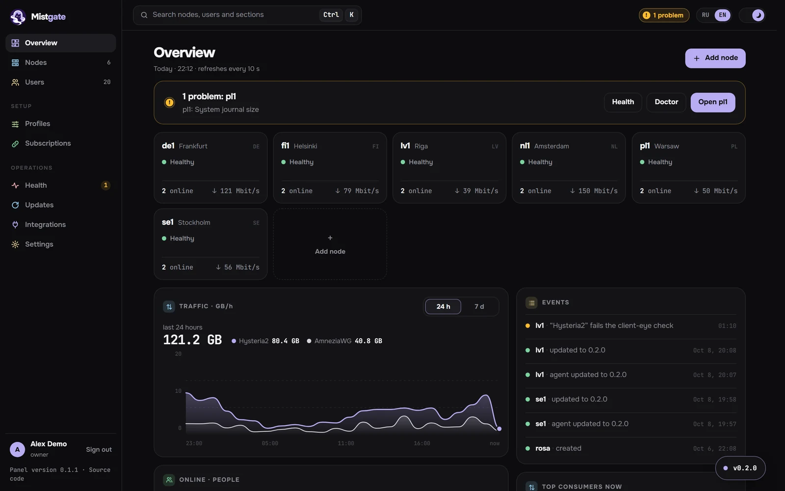
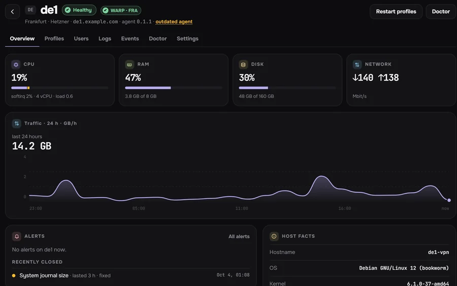
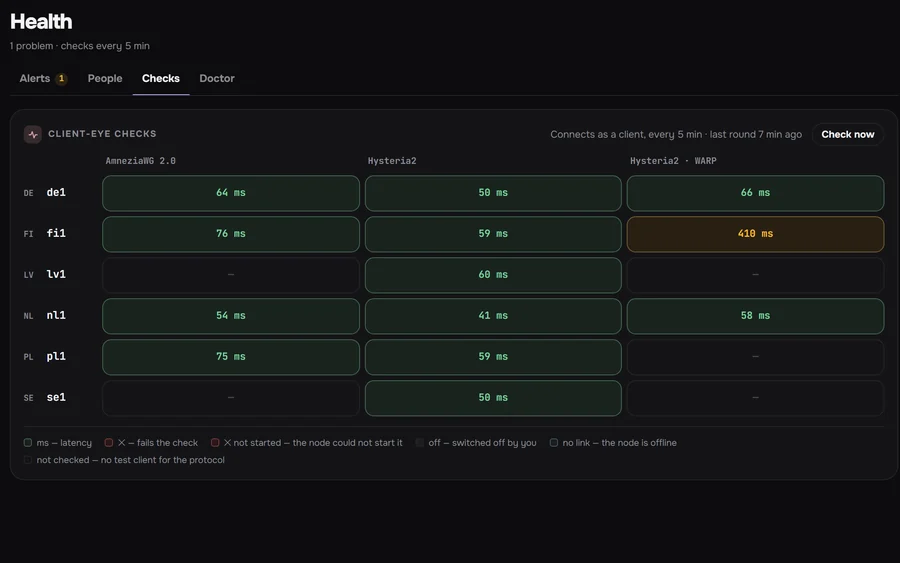
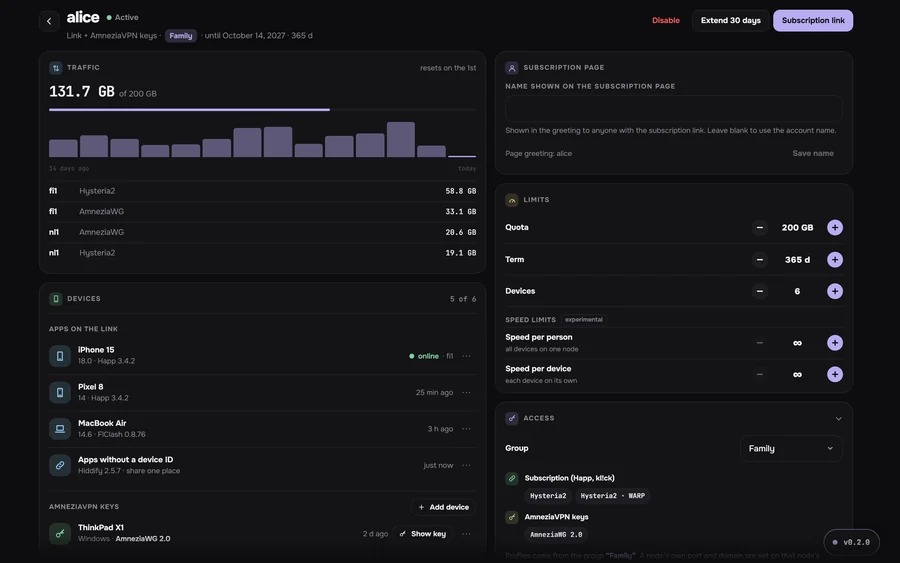
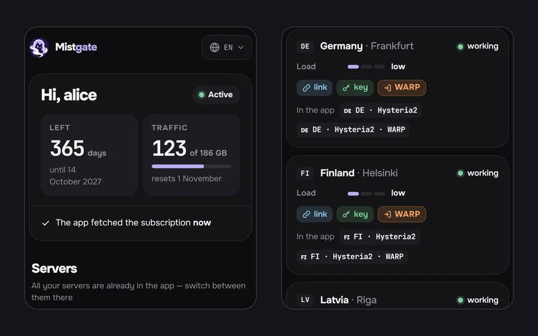

<div align="center">


<h1>Mistgate</h1>

<p>A self-hosted panel for a small VPN: a few servers of your own and the people you share them with.<br>
Hysteria2, VLESS and AmneziaWG. Two Go binaries, SQLite and systemd.</p>

<p>

<a href="https://github.com/Mistgate/mistgate/releases/latest"></a>
<a href="LICENSE"></a>
<a href="https://github.com/Mistgate/mistgate/actions/workflows/ci.yml"></a>
<a href="go.mod"></a>
</p>

<p><a href="https://mistgate.app/"><b>Docs</b></a> · <a href="#quick-start"><b>Install</b></a> · <a href="#protocols"><b>Protocols</b></a> · <a href="#is-it-stable"><b>Is it stable?</b></a> · <a href="#compared-with-other-panels"><b>Compare</b></a> · <a href="README.ru.md">Русский</a> · <a href="README.zh.md">简体中文</a></p>

<p><sub><b>Beta.</b> Expect changes before 1.0. <a href="https://mistgate.app/roadmap/status/">Status and roadmap</a></sub></p>

</div>

<picture>
  <source media="(prefers-color-scheme: dark)" srcset="docs/images/readme/overview-dark-en.webp">
  <source media="(prefers-color-scheme: light)" srcset="docs/images/readme/overview-light-en.webp">
  
</picture>

## What it does

You put the panel on one server and add your VPN servers to it as nodes. Each person gets one subscription link, and their app picks up every server they may use. The panel keeps the nodes configured and checks them.

- Add a node from the browser with its IP and root password. The panel pins the SSH host key, checks the server, opens the ports in an active UFW or firewalld and installs the signed agent. A one-time install command works too. [Add a node](docs/en/getting-started/add-node.md)
- One link per person. Mihomo apps (kl!ck, FlClash, Clash Verge Rev) get all three protocols from it, Happ gets Hysteria2 and VLESS, and AmneziaVPN takes a key per device from the person's page. [Client apps](docs/en/guide/client-apps.md)
- Every 5 minutes the panel connects to every server the way an app does. A doctor on each node runs 17 host checks and offers seven fixes that run only after you confirm. Alerts go to the admin and to Telegram. [Health](docs/en/operations/health.md)
- When some networks cannot reach a server, people get to it through another of your nodes, which only forwards the encrypted traffic. The panel checks the path before switching it on and watches it afterwards; the node page draws every way in as a line from the people to the server. [Relays](docs/en/guide/relays.md)
- Optional checks of whether your servers open from inside a country, network by network: Globalping probes on home and mobile networks over IPv4 and IPv6, volunteer and SIM probes, block lists and a TSPU probe from your own node. Most sources work only in Russia. [Reachability](docs/en/operations/reachability.md)
- No Docker, no database server. The panel idles at 16-20 MiB of memory on a 1 vCPU / 1 GB server. [Benchmarks](docs/en/reference/benchmarks.md), including where Mistgate is slower.
- Strangers who open the panel's address see a decoy site; the admin is behind a secret path or host name.
- A built-in MCP server lets an AI agent read the fleet and plan changes; risky ones wait for your approval in the admin. [MCP](docs/en/reference/mcp.md)

Not there yet: a Telegram bot beyond alerts, and the Cloudflare Workers edition is still a [preview](docs/en/getting-started/install-edge.md). Some defaults lean towards users in Russia; all of them are settings.

## Protocols

| Protocol | On the node | What you can set |
|:--|:--|:--|
| [Hysteria2](docs/en/guide/hysteria2.md) | The official Hysteria2 core | UDP (QUIC). Salamander obfuscation (Gecko is experimental), port hopping, a Let's Encrypt or a pinned self-signed certificate. |
| [VLESS](docs/en/guide/vless.md) | xray-core | REALITY over XHTTP or TCP (RAW + Vision); TLS over XHTTP or WebSocket, direct or behind a CDN. |
| [AmneziaWG](docs/en/guide/amneziawg.md) | amneziawg-go in userspace, or the kernel module | Versions 3.1 (the default) and 2.0, a separate key per device. 1.5 and 1.0 are not offered. |

Hysteria2 and VLESS can share a node, TCP 443 included. Not every app format carries every profile: see [what works where](docs/en/guide/subscriptions.md#what-works-where).

Not supported yet: VMess, Trojan, Shadowsocks, TUIC and plain WireGuard. More protocols are planned; each new one plugs into the same subscription link through the contract below.

A protocol is two halves compiled into the binaries. On the panel, one Go interface: a JSON Schema for its settings (the admin builds the form from it), validation, the spec a node runs, credential issuing, and its piece of each subscription format. On the node, an engine that runs the spec, swaps credentials without a restart and reports traffic and health. A new protocol goes only to agents that announce it, so older agents keep working. See [the protocol plugin contract](docs/en/reference/architecture.md#the-protocol-plugin-contract).

## Is it stable?

It is beta, and young: v0.1.0 was tagged on 2026-10-03, and v0.1.63 (2026-10-27) is the 64th tag. Until 1.0 the API, the stored settings and the node protocol may still change. Releases do not go through an automated upgrade test from older versions yet; that is one of the [conditions for 1.0](docs/en/roadmap/status.md).

I run it on my own six servers for family and friends.

The tunnels do not depend on the panel: a node keeps serving its last applied configuration while the panel is down, a user change does not restart the server, and older agents work with a newer panel. In the [benchmark](docs/en/reference/benchmarks.md), adding and removing users and restarting the panel dropped no connection.

Checks:

- CI on every push and pull request ([ci.yml](.github/workflows/ci.yml)): Go tests and vet, the race detector on the panel-agent session, `govulncheck`, the admin's lint and tests, the docs build, the installer on Debian and Ubuntu.
- An end-to-end run ([scripts/e2e-wsl.sh](scripts/e2e-wsl.sh)): a real panel and node with real Hysteria2, AmneziaWG, Xray, mihomo and sing-box clients, plus agent updates, rollbacks and an install over SSH. It runs by hand before every release, in WSL or a VM, not in CI.
- GitHub Actions builds each tag as a draft. I rebuild it from the tag on a machine with the offline release key and sign only binaries that match byte for byte; nodes and the panel install only signed builds. [Releases and signing](docs/en/operations/releases.md)

Updating ([Updates](docs/en/operations/updates.md)):

- Nodes never update on their own. A rollout updates one canary node first and gives it 5 minutes to pass a health gate, then goes on in batches of one or two. A node that fails gets its previous build back, and the rollout pauses.
- The agent also rolls itself back if a new build does not connect within 5 minutes or keeps crashing. Any node can be rolled back by hand.
- The panel updates itself only when you confirm. It backs up its data first and restores the old binary and data if the new one does not stay up for 45 seconds.
- Keep [encrypted backups](docs/en/operations/backups.md) of `/var/lib/mistgate` anyway.

Mistgate is written with AI coding agents. I review what they write and decide what is merged and released; the checks above are the same for their code as for anyone's. Commits made with an agent carry a `Co-Authored-By` line, and the rules agents follow in this repository are in [AGENTS.md](AGENTS.md).

## Screenshots

<table>
<tr>
<td width="50%"><picture><source media="(prefers-color-scheme: dark)" srcset="docs/images/readme/node-dark-en.webp"><source media="(prefers-color-scheme: light)" srcset="docs/images/readme/node-light-en.webp"></picture><br><sub><b>A node.</b> Status, WARP exit, load and 24 hours of traffic.</sub></td>
<td width="50%"><picture><source media="(prefers-color-scheme: dark)" srcset="docs/images/readme/health-dark-en.webp"><source media="(prefers-color-scheme: light)" srcset="docs/images/readme/health-light-en.webp"></picture><br><sub><b>Client-eye checks.</b> Every protocol on every node, latency through the tunnel.</sub></td>
</tr>
<tr>
<td width="50%"><picture><source media="(prefers-color-scheme: dark)" srcset="docs/images/readme/user-dark-en.webp"><source media="(prefers-color-scheme: light)" srcset="docs/images/readme/user-light-en.webp"></picture><br><sub><b>A person.</b> Devices by device ID, the traffic that counts against the quota, and the limits.</sub></td>
<td width="50%"><picture><source media="(prefers-color-scheme: dark)" srcset="docs/images/readme/phone-dark-en.webp"><source media="(prefers-color-scheme: light)" srcset="docs/images/readme/phone-light-en.webp"></picture><br><sub><b>Their link in a browser.</b> Days left, traffic and their devices.</sub></td>
</tr>
</table>

The screenshots use invented demo data.

## Quick start

You need a fresh Linux server (amd64 or arm64) with systemd, a domain that points directly at it (here `panel.example.com`), TCP ports 80 and 443 free, and either `openssh-client` with `ssh-keygen -Y verify` support or OpenSSL 3.2 or newer. On the server, run:

```sh
curl -fsSL https://mistgate.app/install.sh | sudo bash -s -- --public-url https://panel.example.com
```

The installer verifies the signed panel manifest, starts Mistgate under systemd and prints the admin URL with a one-time setup link (valid for 30 minutes). It leaves the firewall alone. `--yes` skips the questions, `--dry-run` only verifies the release; manual installation and other options are in [Install the panel](docs/en/getting-started/install-panel.md).

Then:

1. Open the setup link and create the owner: a passkey, or a password with an authenticator code.
2. Add servers in **Nodes → Add node**, over SSH or with a one-time command ([Add a node](docs/en/getting-started/add-node.md)).
3. Add people: [First users](docs/en/getting-started/first-users.md).

An AI agent that can run `ssh` can do these steps with the prompt in the [AI agent guide](docs/en/getting-started/ai-agents.md#install-mistgate-with-an-ai-agent); you still create the owner account yourself.

## Compared with other panels

| | Mistgate | 3x-ui | Remnawave | Hiddify | PasarGuard | s-ui |
|:--|:--|:--|:--|:--|:--|:--|
| Runs without Docker | ✅ | ✅ | ❌ | ✅ | 🟡 partial | ✅ |
| Database | SQLite | SQLite or PostgreSQL | PostgreSQL + Redis | MySQL + Redis | SQLite, MySQL, MariaDB or PostgreSQL | SQLite |
| Panel RAM, idle | 16-20 MiB¹ | 68-74 MiB¹ | 426-454 MiB¹ | not measured | 262-265 MiB¹ | not measured |
| Add a node from the panel (SSH) | ✅ | ❌ | ❌ | ❌ | ❌ | ? |
| Hysteria2 | ✅ | ✅ | 🟡 partial | ✅ | ✅ | ✅ |
| VLESS REALITY | ✅ | ✅ | ✅ | ✅ | ✅ | ? |
| AmneziaWG | ✅ 2.0 and 3.1 | ✅ 3.1 | ? | ? | ? | ? |
| VMess, Trojan, Shadowsocks | ❌ | ✅ | 🟡 partial | ✅ | ✅ | ✅ |
| Xray JSON or sing-box subscriptions | ✅ both | Xray JSON | ✅ both | ✅ both | sing-box | sing-box |
| Health checks and alerts | ✅ client-eye checks, node doctor, reachability from a country | ✅ tunnel monitor (opt-in) | ✅ status, Prometheus | 🟡 partial | 🟡 partial | ? |
| Telegram bot | 🟡 alerts only | ✅ | 🟡 partial | ✅ | ✅ | ? |
| Built-in MCP server for AI agents | ✅ | ? | ❌ | ? | ? | ? |

¹ Private memory of the whole panel group, idle, 0 to 200 users, no node attached, on a 1 vCPU / 1 GB test server (3x-ui includes its Xray core and fail2ban). Method, versions and limits: [Benchmarks](docs/en/reference/benchmarks.md). "?" means the project's own README and docs do not say.

Others are ahead in protocol breadth, community size and full Telegram bots. The full table with sources, checked on 2026-10-09, is in [Comparison with other panels](docs/en/reference/comparison.md).

## Documentation

Everything is at [mistgate.app](https://mistgate.app/) and in [`docs/`](docs/README.md). Good places to start:

- [Overview](docs/en/getting-started/overview.md) and [Requirements](docs/en/getting-started/requirements.md)
- [Install the panel](docs/en/getting-started/install-panel.md), [Install a node over SSH](docs/en/getting-started/ssh-install.md), [First users](docs/en/getting-started/first-users.md)
- [Health](docs/en/operations/health.md), [Updates](docs/en/operations/updates.md), [Encrypted backups](docs/en/operations/backups.md), [Troubleshooting](docs/en/operations/troubleshooting.md)
- [CLI](docs/en/reference/cli.md), [API](docs/en/reference/api.md), [MCP](docs/en/reference/mcp.md), [Architecture](docs/en/reference/architecture.md)

## Contributing

Bug reports, fixes and documentation are welcome. [CONTRIBUTING.md](CONTRIBUTING.md) has the build, the code map, the checks CI runs and the conventions. Coding agents start with [`AGENTS.md`](AGENTS.md); the [AI agent guide](docs/en/getting-started/ai-agents.md#contribute-with-a-coding-agent) has a ready prompt for contributing.

## Security

Report vulnerabilities privately: see [SECURITY.md](SECURITY.md). Back up the panel's data directory (`/var/lib/mistgate`): it holds the database, the master key and the CA your nodes trust.

## Licence

Mistgate is free software under the [GNU Affero General Public License v3.0 only](LICENSE). If you run a modified panel for others, its admin shows a "Source code" link (`serve --source-url`) that should point to your source.

## Star History

<a href="https://www.star-history.com/?repos=mistgate%2Fmistgate&type=date&legend=top-left">
 <picture>
   <source media="(prefers-color-scheme: dark)" srcset="https://api.star-history.com/chart?repos=mistgate/mistgate&type=date&theme=dark&legend=top-left" />
   <source media="(prefers-color-scheme: light)" srcset="https://api.star-history.com/chart?repos=mistgate/mistgate&type=date&legend=top-left" />
   
 </picture>
</a>
