<div align="center">


<h1>Mistgate</h1>

<p>A self-hosted panel for a small VPN: a few servers of your own and the people you share them with.<br>
Hysteria2, VLESS and AmneziaWG. Two Go binaries, SQLite and systemd.</p>

<p>

<a href="https://github.com/Mistgate/mistgate/releases/latest"></a>
<a href="LICENSE"></a>
<a href="https://github.com/Mistgate/mistgate/actions/workflows/ci.yml"></a>
<a href="go.mod"></a>
</p>

<p><a href="https://mistgate.app/docs/"><b>Docs</b></a> · <a href="#quick-start"><b>Install</b></a> · <a href="#protocols"><b>Protocols</b></a> · <a href="#is-it-stable"><b>Is it stable?</b></a> · <a href="#compared-with-other-panels"><b>Compare</b></a> · <a href="README.ru.md">Русский</a> · <a href="README.zh.md">简体中文</a> · <a href="README.fa.md">فارسی</a> · <a href="README.tr.md">Türkçe</a></p>

<p><sub><b>Beta.</b> Expect changes before 1.0. <a href="https://mistgate.app/roadmap/status/">Status and roadmap</a></sub></p>

</div>

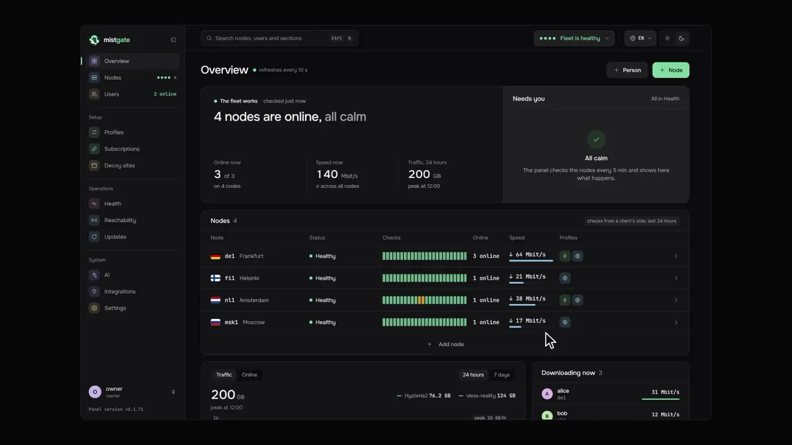

## What it does

You put the panel on one server and add your VPN servers to it as nodes. Each person gets one subscription link, and their app picks up every server they may use. The panel keeps the nodes configured and checks them.

<p align="center"></p>

Everything here runs on invented demo data; the clips are short loops of the real admin.

<table>
<tr>
<td width="38%" valign="top">
<h3>Add a server from the browser</h3>
<p>Type the server's IP, choose how the panel logs in (its own SSH key, added once at your hoster, or the root password) and watch the install. The panel pins the server's SSH host key, checks the host, opens the ports in an active UFW or firewalld and installs the signed agent. No terminal on the new server; a one-time command is there if you prefer it.</p>
<p><a href="docs/en/getting-started/add-node.md">Docs →</a></p>
</td>
<td width="62%"><picture><source media="(prefers-color-scheme: dark)" srcset="docs/images/readme/addnode-dark-en.webp"><source media="(prefers-color-scheme: light)" srcset="docs/images/readme/addnode-light-en.webp">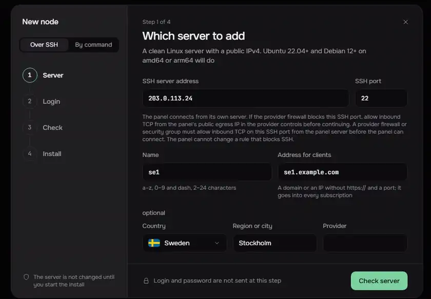</picture></td>
</tr>
<tr>
<td width="38%" valign="top">
<h3>One link per person, and a page of their own</h3>
<p>Each person gets one subscription link, a QR code and a page behind it with instructions for their platform, days left, traffic and their own devices. Mihomo apps get all protocols from the link, Happ gets Hysteria2 and VLESS, AmneziaVPN takes a key per device from the page. Groups decide which servers each person reaches.</p>
<p><a href="docs/en/guide/user-page.md">Docs →</a></p>
</td>
<td width="62%"><picture><source media="(prefers-color-scheme: dark)" srcset="docs/images/readme/link-dark-en.webp"><source media="(prefers-color-scheme: light)" srcset="docs/images/readme/link-light-en.webp">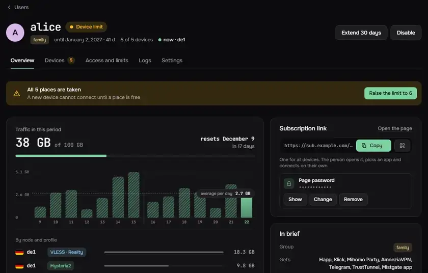</picture></td>
</tr>
<tr>
<td width="38%" valign="top">
<h3>Checks from the client's side</h3>
<p>Every 5 minutes the panel connects to every protocol on every node the way an app does and shows the delay through each tunnel, so you hear about a broken server before the people on it do. A doctor on each node runs 23 host checks and offers ten fixes; none of them runs without your confirmation.</p>
<p><a href="docs/en/operations/health.md">Docs →</a></p>
</td>
<td width="62%"><picture><source media="(prefers-color-scheme: dark)" srcset="docs/images/readme/health-dark-en.webp"><source media="(prefers-color-scheme: light)" srcset="docs/images/readme/health-light-en.webp">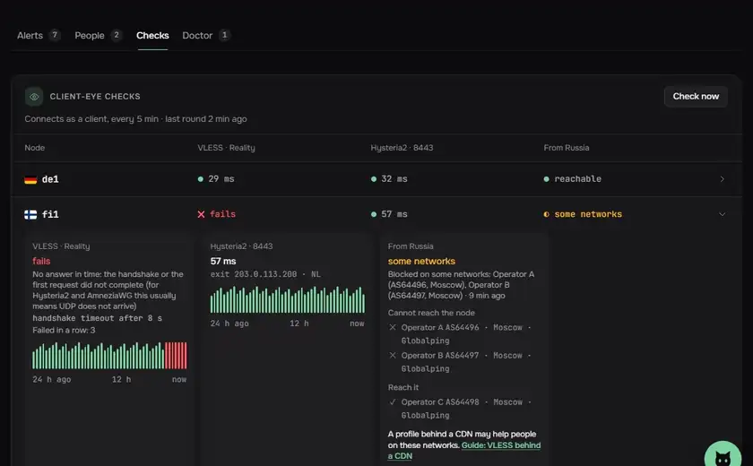</picture></td>
</tr>
<tr>
<td width="38%" valign="top">
<h3>One TCP 443 for several protocols</h3>
<p>Many networks let through only TCP 443. A node can keep VLESS REALITY, VLESS over TLS, TrustTunnel and MTProto on that one port: the agent tells them apart by the name the client asks for. When you put a second profile on a taken port, the panel offers to put it beside the first and shows the DNS record to add.</p>
<p><a href="docs/en/guide/shared-port.md">Docs →</a></p>
</td>
<td width="62%"><picture><source media="(prefers-color-scheme: dark)" srcset="docs/images/readme/shared-dark-en.webp"><source media="(prefers-color-scheme: light)" srcset="docs/images/readme/shared-light-en.webp"></picture></td>
</tr>
<tr>
<td width="38%" valign="top">
<h3>Decoy sites from a template</h3>
<p>A stranger who opens a node should see an ordinary small site, not a Mistgate page. Pick a country and one of ten kinds (a status page, documentation, a blog, a small business, a portfolio and more) and the panel builds a site in that country's language, with its own look and texts, different every time. Look at it, ask for another variant, then save. With your own free photo key a site gets real photographs, served from the node itself.</p>
<p><a href="docs/en/guide/decoy-site.md#a-site-from-a-template">Docs →</a></p>
</td>
<td width="62%"><picture><source media="(prefers-color-scheme: dark)" srcset="docs/images/readme/decoys-dark-en.webp"><source media="(prefers-color-scheme: light)" srcset="docs/images/readme/decoys-light-en.webp"></picture><br><picture><source media="(prefers-color-scheme: dark)" srcset="docs/images/readme/decoys-sites-dark-en.webp"><source media="(prefers-color-scheme: light)" srcset="docs/images/readme/decoys-sites-light-en.webp"></picture></td>
</tr>
<tr>
<td width="38%" valign="top">
<h3>Updates that roll out and roll back</h3>
<p>Nodes never update on their own. A rollout installs one canary node first and gives it 5 minutes to pass a health check, then goes on in small batches. A node that fails gets its previous build back and the rollout pauses. The panel updates itself only when you confirm, and puts the old binary and data back if the new one does not stay up.</p>
<p><a href="docs/en/operations/updates.md">Docs →</a></p>
</td>
<td width="62%"><picture><source media="(prefers-color-scheme: dark)" srcset="docs/images/readme/updates-dark-en.webp"><source media="(prefers-color-scheme: light)" srcset="docs/images/readme/updates-light-en.webp">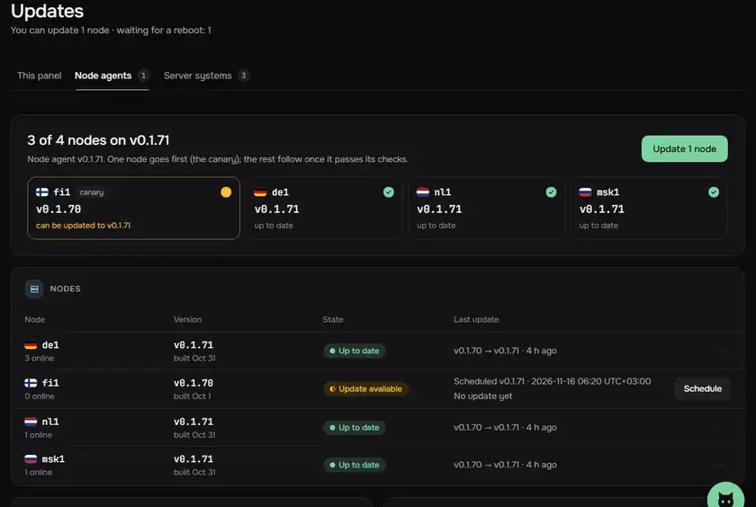</picture></td>
</tr>
<tr>
<td width="38%" valign="top">
<h3>Updates of the servers' systems</h3>
<p>See which servers wait for security updates or a reboot, without logging in to each of them. Install security updates or reboot one server, or tick several and run them as a rollout: a few at a time, each node health-checked afterwards, a stop at the first that fails.</p>
<p><a href="docs/en/operations/updates.md#server-operating-system">Docs →</a></p>
</td>
<td width="62%"><picture><source media="(prefers-color-scheme: dark)" srcset="docs/images/readme/os-dark-en.webp"><source media="(prefers-color-scheme: light)" srcset="docs/images/readme/os-light-en.webp">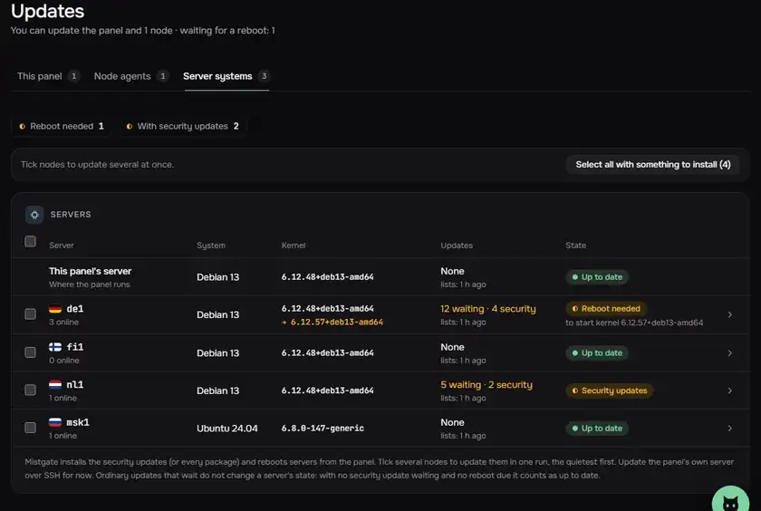</picture></td>
</tr>
<tr>
<td width="38%" valign="top">
<h3>WARP exit, with a check that it works</h3>
<p>Send a profile's traffic out through Cloudflare WARP, with one account per node. The card shows the tunnel, the traffic and an egress check; the panel also fetches a list of sites through each node's WARP and raises an alert when some of them start to block it. A profile with the WARP exit never falls back to the node's own address.</p>
<p><a href="docs/en/guide/warp.md">Docs →</a></p>
</td>
<td width="62%"><picture><source media="(prefers-color-scheme: dark)" srcset="docs/images/readme/warp-dark-en.webp"><source media="(prefers-color-scheme: light)" srcset="docs/images/readme/warp-light-en.webp">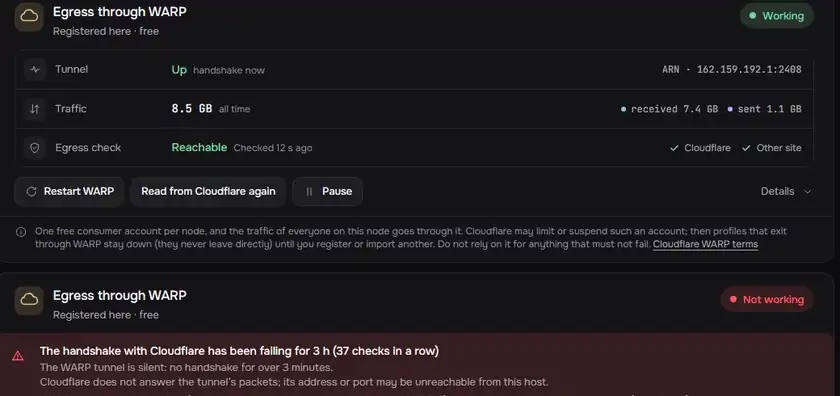</picture></td>
</tr>
<tr>
<td width="38%" valign="top">
<h3>DNS presets for the apps</h3>
<p>A preset says which DNS servers a person's app asks and how (plain, DoT or DoH), with split rules for a country or a list of sites, such as Russian sites direct, and ads blocked in the apps. Give one to everybody, to a group or to one person; the editor shows what each app will really get.</p>
<p><a href="docs/en/guide/dns.md">Docs →</a></p>
</td>
<td width="62%"><picture><source media="(prefers-color-scheme: dark)" srcset="docs/images/readme/dns-dark-en.webp"><source media="(prefers-color-scheme: light)" srcset="docs/images/readme/dns-light-en.webp">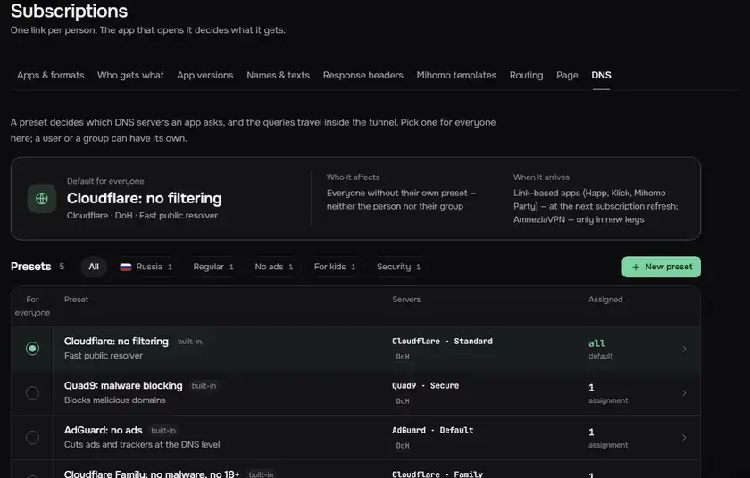</picture></td>
</tr>
<tr>
<td width="38%" valign="top">
<h3>An assistant and MCP, with a plan first</h3>
<p>A built-in assistant (a cloud model you connect with your own key) answers about your nodes and people and prepares changes. MCP gives an outside AI agent the same: it reads the fleet and plans changes, and you approve each risky one in the admin before it is applied. An API token can disable or rewrite at most 10 people an hour unless you lift the limit.</p>
<p><a href="docs/en/guide/assistant.md">Docs →</a></p>
</td>
<td width="62%"><picture><source media="(prefers-color-scheme: dark)" srcset="docs/images/readme/assistant-dark-en.webp"><source media="(prefers-color-scheme: light)" srcset="docs/images/readme/assistant-light-en.webp">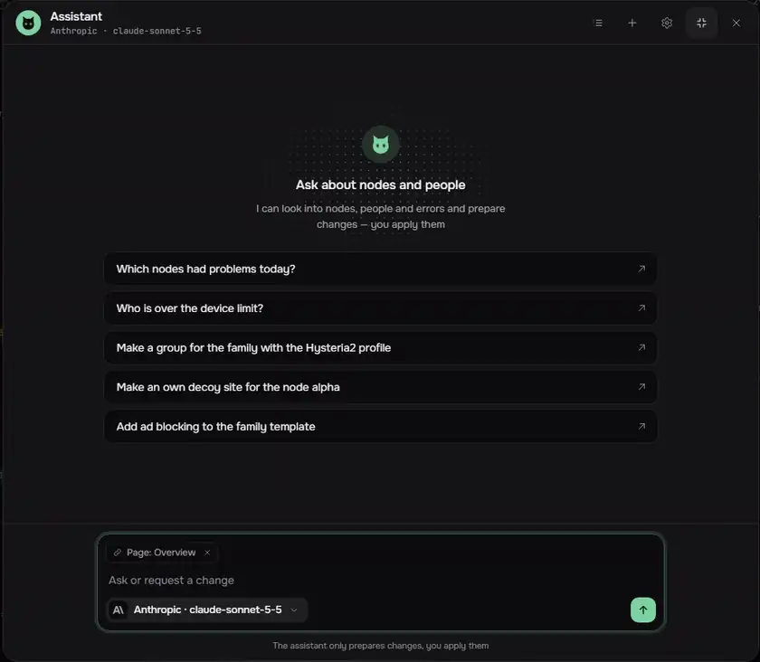</picture></td>
</tr>
<tr>
<td width="38%" valign="top">
<h3>Alerts in Telegram</h3>
<p>Connect your own bot and the panel writes to your chat when a node goes down or comes back, a check fails, a backup fails or an agent's plan waits for you. It only sends alerts: nothing is approved or changed from the chat. Each admin links their own chat.</p>
<p><a href="docs/en/operations/telegram-alerts.md">Docs →</a></p>
</td>
<td width="62%"><picture><source media="(prefers-color-scheme: dark)" srcset="docs/images/readme/telegram-dark-en.webp"><source media="(prefers-color-scheme: light)" srcset="docs/images/readme/telegram-light-en.webp">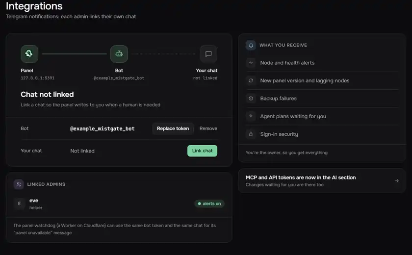</picture></td>
</tr>
<tr>
<td width="38%" valign="top">
<h3>Encrypted backups and a careful restore</h3>
<p>Backups go to your own Cloudflare R2 bucket, on a schedule or on demand, encrypted before they leave the panel with a key you keep offline. A restore checks the backup first and shows what it holds against what you have now; nothing changes until you confirm, and the data from before the restore is kept.</p>
<p><a href="docs/en/operations/backups.md">Docs →</a></p>
</td>
<td width="62%"><picture><source media="(prefers-color-scheme: dark)" srcset="docs/images/readme/backups-dark-en.webp"><source media="(prefers-color-scheme: light)" srcset="docs/images/readme/backups-light-en.webp">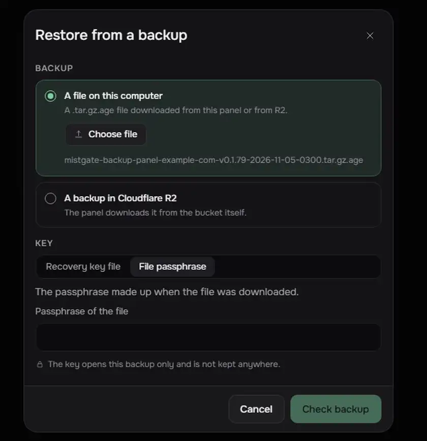</picture></td>
</tr>
</table>

Also in the box:

- When some networks cannot reach a server, people get to it through another of your nodes, which only forwards the encrypted traffic. The panel checks the path before switching it on and watches it afterwards; Ways in on the node page is a graph of how people reach the server, and the Nodes page maps the whole fleet. [Relays](docs/en/guide/relays.md)
- Optional checks of whether your servers open from inside a country, network by network: Globalping probes on home and mobile networks over IPv4 and IPv6, volunteer and SIM probes, block lists and a TSPU probe from your own node. Most sources work only in Russia. [Reachability](docs/en/operations/reachability.md)
- No Docker, no database server. The panel idles at 16-20 MiB of memory on a 1 vCPU / 1 GB server. [Benchmarks](docs/en/reference/benchmarks.md), including where Mistgate is slower.
- Strangers who open the panel's address see a decoy site; the admin is behind a secret path or host name.
- Who gets which server: a node goes to everyone, to chosen groups or to nobody yet, and a person can be in several groups. [Groups](docs/en/guide/users-and-groups.md)
- A desktop app for Windows, [Mistgate](https://github.com/Mistgate/mistgate-client), works with these panels and with plain subscription links.

Not there yet: a Telegram bot beyond alerts, and the Cloudflare Workers edition is still a [preview](docs/en/getting-started/install-edge.md). Some defaults lean towards users in Russia; all of them are settings.

## Protocols

| Protocol | On the node | What you can set |
|:--|:--|:--|
| [Hysteria2](docs/en/guide/hysteria2.md) | The official Hysteria2 core | UDP (QUIC). Salamander obfuscation (Gecko is experimental), port hopping, a Let's Encrypt or a pinned self-signed certificate. |
| [VLESS](docs/en/guide/vless.md) | xray-core | REALITY over XHTTP or TCP (RAW + Vision); TLS over XHTTP or WebSocket, direct or behind a CDN. |
| [AmneziaWG](docs/en/guide/amneziawg.md) | amneziawg-go in userspace, or the kernel module | Versions 3.1 (the default) and 2.0, a separate key per device. 1.5 and 1.0 are not offered. |
| [TrustTunnel](docs/en/guide/trusttunnel.md) | Mistgate's own engine in the node agent | Experimental. A VPN inside ordinary HTTPS (HTTP/2, HTTP/3 optional) with a real certificate; `tt://` keys for the official TrustTunnel apps. |
| [MTProto](docs/en/guide/mtproto.md) | Mistgate's own MTProto core | Experimental. A proxy for the Telegram app only: Fake TLS with the node's own domain or another site as the name, a key per person, the decoy site for everyone else. |

Hysteria2 and VLESS can share a node, TCP 443 included. Not every app format carries every profile: see [what works where](docs/en/guide/subscriptions.md#what-works-where).

Not supported yet: VMess, Trojan, Shadowsocks, TUIC and plain WireGuard. More protocols are planned; each new one plugs into the same subscription link through the contract below.

A protocol is two halves compiled into the binaries. On the panel, one Go interface: a JSON Schema for its settings (the admin builds the form from it), validation, the spec a node runs, credential issuing, and its piece of each subscription format. On the node, an engine that runs the spec, swaps credentials without a restart and reports traffic and health. A new protocol goes only to agents that announce it, so older agents keep working. See [the protocol plugin contract](docs/en/reference/architecture.md#the-protocol-plugin-contract).

## Is it stable?

It is beta, and young: v0.1.0 was tagged on 2026-10-03, and the 0.2.0 line redraws the whole interface. Until 1.0 the API, the stored settings and the node protocol may still change. Releases do not go through an automated upgrade test from older versions yet; that is one of the [conditions for 1.0](docs/en/roadmap/status.md).

I run it on my own six servers for family and friends.

The tunnels do not depend on the panel: a node keeps serving its last applied configuration while the panel is down, a user change does not restart the server, and older agents work with a newer panel. In the [benchmark](docs/en/reference/benchmarks.md), adding and removing users and restarting the panel dropped no connection.

Checks:

- CI on every push and pull request ([ci.yml](.github/workflows/ci.yml)): Go tests and vet, the race detector on the panel-agent session, `govulncheck`, the admin's lint and tests, the docs build, the installer on Debian and Ubuntu.
- An end-to-end run ([scripts/e2e-wsl.sh](scripts/e2e-wsl.sh)): a real panel and node with real Hysteria2, AmneziaWG, Xray, mihomo and sing-box clients, plus agent updates, rollbacks and an install over SSH. It runs by hand before every release, in WSL or a VM, not in CI.
- GitHub Actions builds each tag as a draft. I rebuild it from the tag on a machine with the offline release key and sign only binaries that match byte for byte; nodes and the panel install only signed builds. [Releases and signing](docs/en/operations/releases.md)

<p align="center"></p>

Updating ([Updates](docs/en/operations/updates.md)):

- Nodes never update on their own. A rollout updates one canary node first and gives it 5 minutes to pass a health gate, then goes on in batches of one or two. A node that fails gets its previous build back, and the rollout pauses.
- The agent also rolls itself back if a new build does not connect within 5 minutes or keeps crashing. Any node can be rolled back by hand.
- A node whose link to the panel stalls can finish the download from GitHub. The panel offers it as a second source only when the release there is signed by the panel's own key and has the same files; it is on by default, a switch in Settings turns it off, and GitHub sees the node's address.
- The panel updates itself only when you confirm. It backs up its data first and restores the old binary and data if the new one does not stay up for 45 seconds.
- Keep [encrypted backups](docs/en/operations/backups.md) of `/var/lib/mistgate` anyway.

Mistgate is written with AI coding agents. I review what they write and decide what is merged and released; the checks above are the same for their code as for anyone's. Commits made with an agent carry a `Co-Authored-By` line, and the rules agents follow in this repository are in [AGENTS.md](AGENTS.md).

## Quick start

You need a fresh Linux server (amd64 or arm64) with systemd, a domain that points directly at it (here `panel.example.com`), TCP ports 80 and 443 free, and either `openssh-client` with `ssh-keygen -Y verify` support or OpenSSL 3.2 or newer. On the server, run:

```sh
curl -fsSL https://mistgate.app/install.sh | sudo bash -s -- --public-url https://panel.example.com
```

The installer verifies the signed panel manifest, starts Mistgate under systemd and prints the admin URL with a one-time setup link (valid for 30 minutes). It leaves the firewall alone. `--yes` skips the questions, `--dry-run` only verifies the release; manual installation and other options are in [Install the panel](docs/en/getting-started/install-panel.md).

Then:

1. Open the setup link and create the owner: a passkey, or a password with an authenticator code.
2. Add servers in **Nodes → Add node**, over SSH or with a one-time command ([Add a node](docs/en/getting-started/add-node.md)).
3. Add people: [First users](docs/en/getting-started/first-users.md).

An AI agent that can run `ssh` can do these steps with the prompt in the [AI agent guide](docs/en/getting-started/ai-agents.md#install-mistgate-with-an-ai-agent); you still create the owner account yourself.

## Compared with other panels

| | Mistgate | 3x-ui | Remnawave | Hiddify | PasarGuard | s-ui |
|:--|:--|:--|:--|:--|:--|:--|
| Runs without Docker | ✅ | ✅ | ❌ | ✅ | 🟡 partial | ✅ |
| Database | SQLite | SQLite or PostgreSQL | PostgreSQL + Redis | MySQL + Redis | SQLite, MySQL, MariaDB or PostgreSQL | SQLite |
| Panel RAM, idle | 16-20 MiB¹ | 68-74 MiB¹ | 426-454 MiB¹ | not measured | 262-265 MiB¹ | not measured |
| Add a node from the panel (SSH) | ✅ | ❌ | ❌ | ❌ | ❌ | ? |
| Hysteria2 | ✅ | ✅ | 🟡 partial | ✅ | ✅ | ✅ |
| VLESS REALITY | ✅ | ✅ | ✅ | ✅ | ✅ | ? |
| AmneziaWG | ✅ 2.0 and 3.1 | ✅ 3.1 | ? | ? | ? | ? |
| VMess, Trojan, Shadowsocks | ❌ | ✅ | 🟡 partial | ✅ | ✅ | ✅ |
| Xray JSON or sing-box subscriptions | ✅ both | Xray JSON | ✅ both | ✅ both | sing-box | sing-box |
| Health checks and alerts | ✅ client-eye checks, node doctor, reachability from a country | ✅ tunnel monitor (opt-in) | ✅ status, Prometheus | 🟡 partial | 🟡 partial | ? |
| Telegram bot | 🟡 alerts only | ✅ | 🟡 partial | ✅ | ✅ | ? |
| Built-in MCP server for AI agents | ✅ | ? | ❌ | ? | ? | ? |

¹ Private memory of the whole panel group, idle, 0 to 200 users, no node attached, on a 1 vCPU / 1 GB test server (3x-ui includes its Xray core and fail2ban). Method, versions and limits: [Benchmarks](docs/en/reference/benchmarks.md). "?" means the project's own README and docs do not say.

Others are ahead in protocol breadth, community size and full Telegram bots. The full table with sources, checked on 2026-10-09, is in [Comparison with other panels](docs/en/reference/comparison.md).

## Documentation

Everything is at [mistgate.app](https://mistgate.app/docs/) and in [`docs/`](docs/README.md). Good places to start:

- [Overview](docs/en/getting-started/overview.md) and [Requirements](docs/en/getting-started/requirements.md)
- [Install the panel](docs/en/getting-started/install-panel.md), [Install a node over SSH](docs/en/getting-started/ssh-install.md), [First users](docs/en/getting-started/first-users.md)
- [Health](docs/en/operations/health.md), [Updates](docs/en/operations/updates.md), [Encrypted backups](docs/en/operations/backups.md), [Troubleshooting](docs/en/operations/troubleshooting.md)
- [CLI](docs/en/reference/cli.md), [API](docs/en/reference/api.md), [MCP](docs/en/reference/mcp.md), [Architecture](docs/en/reference/architecture.md)

## Contributing

Bug reports, fixes and documentation are welcome. [CONTRIBUTING.md](CONTRIBUTING.md) has the build, the code map, the checks CI runs and the conventions. Coding agents start with [`AGENTS.md`](AGENTS.md); the [AI agent guide](docs/en/getting-started/ai-agents.md#contribute-with-a-coding-agent) has a ready prompt for contributing.

## Security

Report vulnerabilities privately: see [SECURITY.md](SECURITY.md). Back up the panel's data directory (`/var/lib/mistgate`): it holds the database, the master key and the CA your nodes trust.

## Licence

Mistgate is free software under the [GNU Affero General Public License v3.0 only](LICENSE). If you run a modified panel for others, its admin shows a "Source code" link (`serve --source-url`) that should point to your source.

## Star History

<a href="https://www.star-history.com/?repos=mistgate%2Fmistgate&type=date&legend=top-left">
 <picture>
   <source media="(prefers-color-scheme: dark)" srcset="https://api.star-history.com/chart?repos=mistgate/mistgate&type=date&theme=dark&legend=top-left" />
   <source media="(prefers-color-scheme: light)" srcset="https://api.star-history.com/chart?repos=mistgate/mistgate&type=date&legend=top-left" />
   
 </picture>
</a>
