<div align="center">


<h1>Mistgate</h1>

<p>Панель для своего небольшого VPN: несколько своих серверов и люди, с которыми вы ими делитесь.<br>
Hysteria2, VLESS и AmneziaWG. Два бинарника на Go, SQLite и systemd.</p>

<p>

<a href="https://github.com/Mistgate/mistgate/releases/latest"></a>
<a href="LICENSE"></a>
<a href="https://github.com/Mistgate/mistgate/actions/workflows/ci.yml"></a>
<a href="go.mod"></a>
</p>

<p><a href="https://mistgate.app/ru/docs/"><b>Документация</b></a> · <a href="#быстрый-старт"><b>Установка</b></a> · <a href="#протоколы"><b>Протоколы</b></a> · <a href="#насколько-это-стабильно"><b>Насколько это стабильно</b></a> · <a href="#сравнение-с-другими-панелями"><b>Сравнение</b></a> · <a href="README.md">English</a> · <a href="README.zh.md">简体中文</a> · <a href="README.fa.md">فارسی</a> · <a href="README.tr.md">Türkçe</a></p>

<p><sub><b>Бета.</b> До 1.0 возможны изменения. <a href="https://mistgate.app/ru/roadmap/status/">Статус и план</a></sub></p>

</div>

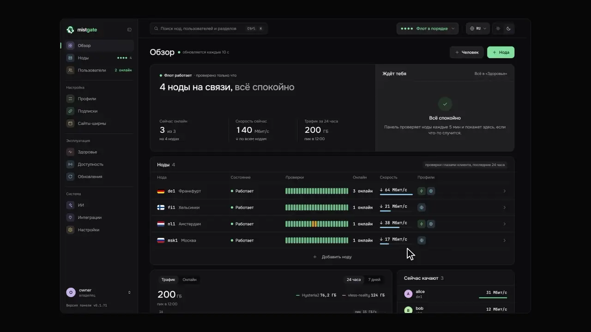

## Что умеет

Панель ставится на один сервер, а VPN-серверы добавляются в неё как ноды. Каждый человек получает одну ссылку-подписку, и приложение само подтягивает все положенные ему серверы. Панель держит ноды настроенными и проверяет их.

<p align="center"></p>

Всё здесь показано на выдуманных демо-данных; ролики — короткие петли настоящей админки.

<table>
<tr>
<td width="38%" valign="top">
<h3>Добавление сервера из браузера</h3>
<p>Введите IP сервера, выберите, как панель входит на него (собственным SSH-ключом, который вы один раз добавляете у хостера, или паролем root), и следите за установкой. Панель запоминает SSH-ключ сервера, проверяет его, открывает порты во включённом UFW или firewalld и ставит подписанный агент. На новом сервере не нужен терминал; если удобнее, есть одноразовая команда.</p>
<p><a href="docs/ru/getting-started/add-node.md">Документация →</a></p>
</td>
<td width="62%"><picture><source media="(prefers-color-scheme: dark)" srcset="docs/images/readme/addnode-dark-en.webp"><source media="(prefers-color-scheme: light)" srcset="docs/images/readme/addnode-light-en.webp">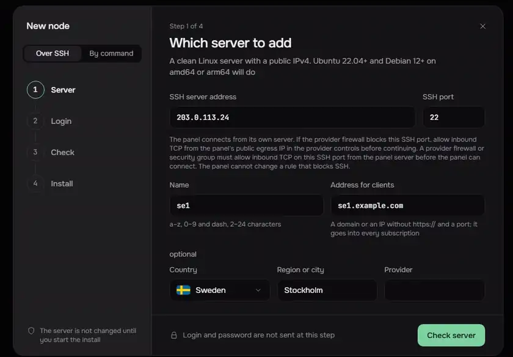</picture></td>
</tr>
<tr>
<td width="38%" valign="top">
<h3>Одна ссылка на человека и своя страница</h3>
<p>Каждый человек получает одну ссылку-подписку, QR-код и страницу за ними: инструкции для его платформы, сколько дней осталось, трафик и его устройства. Приложения на Mihomo берут по ссылке все протоколы, Happ — Hysteria2 и VLESS, а AmneziaVPN берёт ключ на каждое устройство со страницы. Группы решают, до каких серверов человек доходит.</p>
<p><a href="docs/ru/guide/user-page.md">Документация →</a></p>
</td>
<td width="62%"><picture><source media="(prefers-color-scheme: dark)" srcset="docs/images/readme/link-dark-en.webp"><source media="(prefers-color-scheme: light)" srcset="docs/images/readme/link-light-en.webp">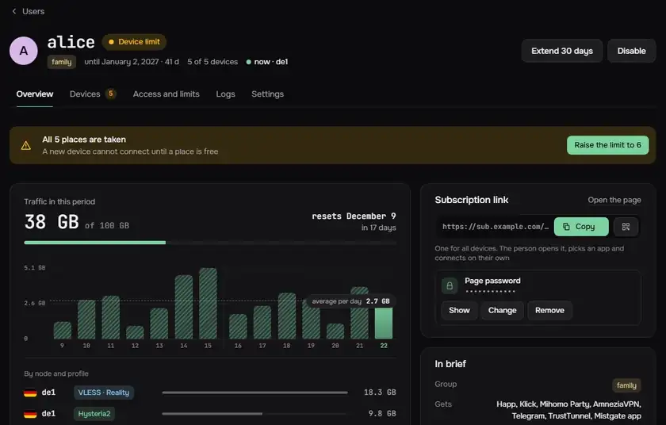</picture></td>
</tr>
<tr>
<td width="38%" valign="top">
<h3>Проверки глазами клиента</h3>
<p>Каждые 5 минут панель подключается к каждому протоколу на каждой ноде, как приложение, и показывает задержку через каждый туннель, так что о сломанном сервере вы узнаёте раньше, чем те, кто им пользуется. Доктор на каждой ноде делает 23 проверки хоста и предлагает десять исправлений; без вашего подтверждения ни одно не запускается.</p>
<p><a href="docs/ru/operations/health.md">Документация →</a></p>
</td>
<td width="62%"><picture><source media="(prefers-color-scheme: dark)" srcset="docs/images/readme/health-dark-en.webp"><source media="(prefers-color-scheme: light)" srcset="docs/images/readme/health-light-en.webp">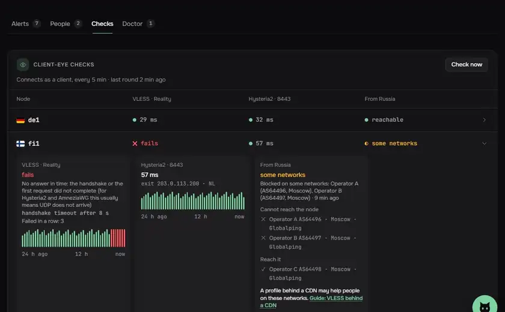</picture></td>
</tr>
<tr>
<td width="38%" valign="top">
<h3>Один TCP 443 на несколько протоколов</h3>
<p>Во многих сетях проходит только TCP 443. На одном порту нода может держать VLESS REALITY, VLESS поверх TLS, TrustTunnel и MTProto: агент различает их по имени, которое запрашивает клиент. Если вы ставите второй профиль на занятый порт, панель предложит поставить его рядом с первым и покажет DNS-запись, которую нужно добавить.</p>
<p><a href="docs/ru/guide/shared-port.md">Документация →</a></p>
</td>
<td width="62%"><picture><source media="(prefers-color-scheme: dark)" srcset="docs/images/readme/shared-dark-en.webp"><source media="(prefers-color-scheme: light)" srcset="docs/images/readme/shared-light-en.webp"></picture></td>
</tr>
<tr>
<td width="38%" valign="top">
<h3>Сайты-ширмы из шаблона</h3>
<p>Посторонний, открывший ноду, должен увидеть обычный небольшой сайт, а не страницу Mistgate. Выберите страну и один из десяти видов (статус сервиса, документация, блог, малый бизнес, портфолио и другие), и панель соберёт сайт на языке этой страны со своим видом и текстами, каждый раз новый. Посмотрите, попросите другой вариант и сохраните. Со своим бесплатным ключом к фотографиям на сайте появятся настоящие снимки, которые отдаёт сама нода.</p>
<p><a href="docs/ru/guide/decoy-site.md#сайт-из-шаблона">Документация →</a></p>
</td>
<td width="62%"><picture><source media="(prefers-color-scheme: dark)" srcset="docs/images/readme/decoys-dark-en.webp"><source media="(prefers-color-scheme: light)" srcset="docs/images/readme/decoys-light-en.webp">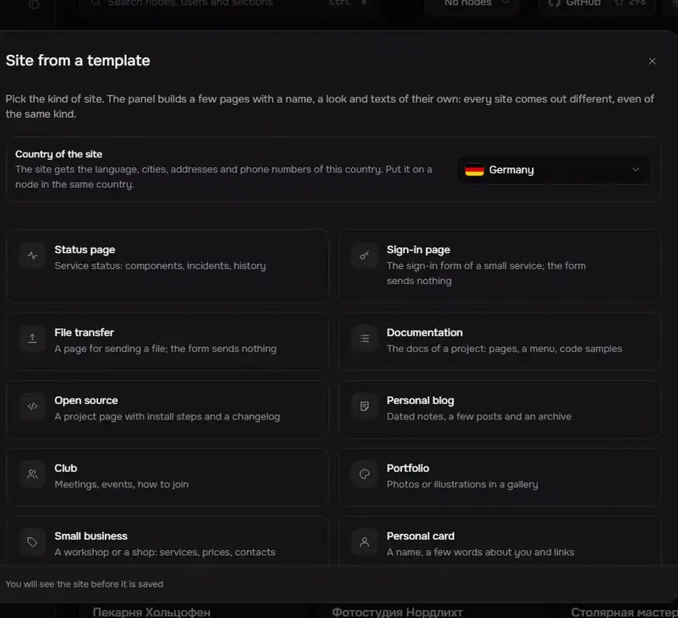</picture><br><picture><source media="(prefers-color-scheme: dark)" srcset="docs/images/readme/decoys-sites-dark-en.webp"><source media="(prefers-color-scheme: light)" srcset="docs/images/readme/decoys-sites-light-en.webp"></picture></td>
</tr>
<tr>
<td width="38%" valign="top">
<h3>Обновления с раскаткой и откатом</h3>
<p>Ноды сами не обновляются. Раскатка сначала обновляет одну ноду-канарейку и даёт ей 5 минут пройти проверку здоровья, потом идёт небольшими пачками. Нода, не прошедшая проверку, получает прежнюю сборку, а раскатка встаёт на паузу. Панель обновляет себя только с вашего подтверждения и возвращает старый бинарник и данные, если новая версия не удержалась.</p>
<p><a href="docs/ru/operations/updates.md">Документация →</a></p>
</td>
<td width="62%"><picture><source media="(prefers-color-scheme: dark)" srcset="docs/images/readme/updates-dark-en.webp"><source media="(prefers-color-scheme: light)" srcset="docs/images/readme/updates-light-en.webp">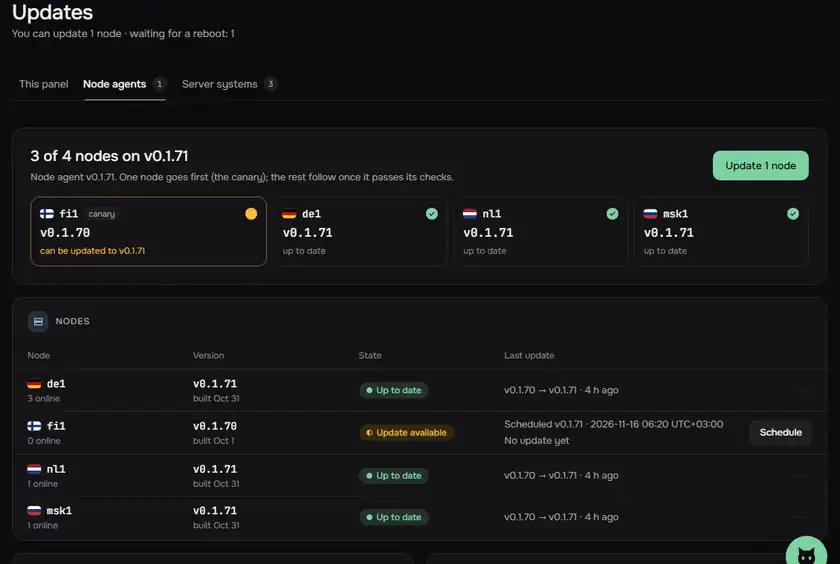</picture></td>
</tr>
<tr>
<td width="38%" valign="top">
<h3>Обновления системы на серверах</h3>
<p>Видно, каким серверам нужны обновления безопасности или перезагрузка, и не нужно заходить на каждый. Можно поставить обновления безопасности или перезагрузить один сервер, а можно отметить несколько и пустить их раскаткой: по несколько, после каждого проверка здоровья, на первом сбое остановка.</p>
<p><a href="docs/ru/operations/updates.md#операционная-система-серверов">Документация →</a></p>
</td>
<td width="62%"><picture><source media="(prefers-color-scheme: dark)" srcset="docs/images/readme/os-dark-en.webp"><source media="(prefers-color-scheme: light)" srcset="docs/images/readme/os-light-en.webp">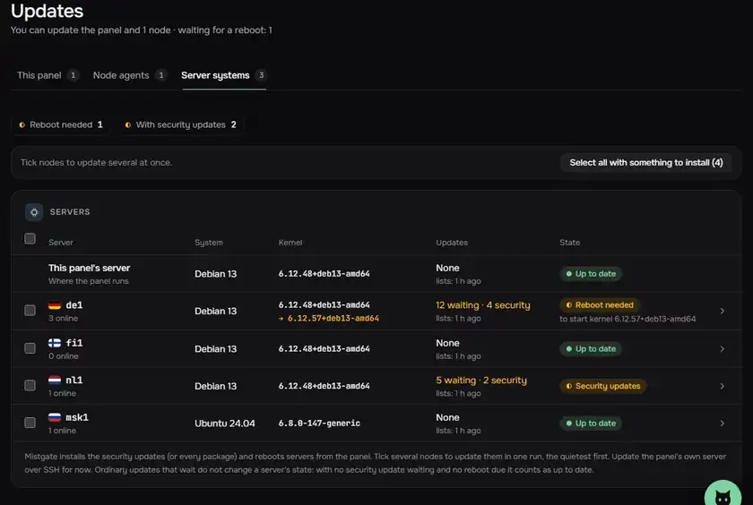</picture></td>
</tr>
<tr>
<td width="38%" valign="top">
<h3>Выход через WARP и проверка, что он работает</h3>
<p>Пустите трафик профиля через Cloudflare WARP, по одному аккаунту на ноду. Карточка показывает туннель, трафик и проверку выхода; кроме того, панель открывает список сайтов через WARP каждой ноды и поднимает алерт, если какие-то из них начинают его блокировать. Профиль с выходом через WARP никогда не переключается на адрес самой ноды.</p>
<p><a href="docs/ru/guide/warp.md">Документация →</a></p>
</td>
<td width="62%"><picture><source media="(prefers-color-scheme: dark)" srcset="docs/images/readme/warp-dark-en.webp"><source media="(prefers-color-scheme: light)" srcset="docs/images/readme/warp-light-en.webp">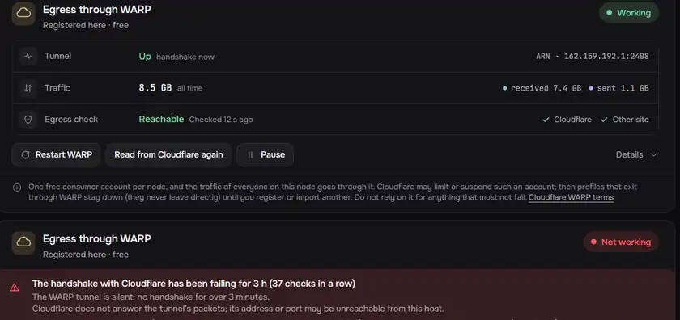</picture></td>
</tr>
<tr>
<td width="38%" valign="top">
<h3>DNS-пресеты для приложений</h3>
<p>Пресет задаёт, какие DNS-серверы спрашивает приложение человека и как (обычный DNS, DoT или DoH), с правилами для страны или списка сайтов, например «российские сайты напрямую», и блокировкой рекламы в приложениях. Его можно дать всем, группе или одному человеку; редактор показывает, что на самом деле получит каждое приложение.</p>
<p><a href="docs/ru/guide/dns.md">Документация →</a></p>
</td>
<td width="62%"><picture><source media="(prefers-color-scheme: dark)" srcset="docs/images/readme/dns-dark-en.webp"><source media="(prefers-color-scheme: light)" srcset="docs/images/readme/dns-light-en.webp">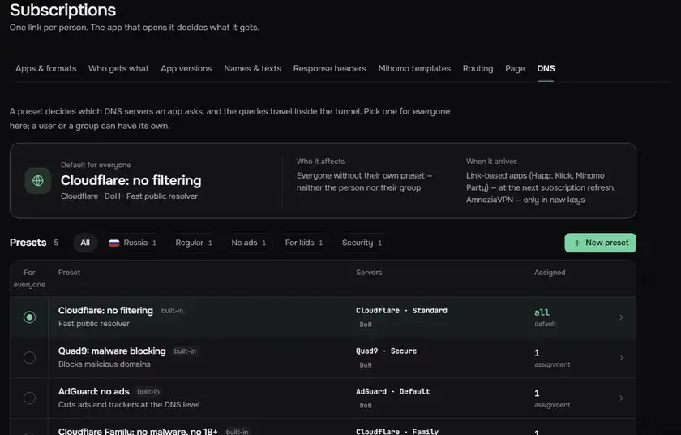</picture></td>
</tr>
<tr>
<td width="38%" valign="top">
<h3>Ассистент и MCP: сначала план</h3>
<p>Встроенный ассистент (облачная модель, которую вы подключаете своим ключом) отвечает про ваши ноды и людей и готовит изменения. MCP даёт то же внешнему ИИ-агенту: он читает флот и планирует изменения, а каждое рискованное вы одобряете в админке до применения. API-токен может отключить или переписать не больше 10 человек в час, пока вы не снимете лимит.</p>
<p><a href="docs/ru/guide/assistant.md">Документация →</a></p>
</td>
<td width="62%"><picture><source media="(prefers-color-scheme: dark)" srcset="docs/images/readme/assistant-dark-en.webp"><source media="(prefers-color-scheme: light)" srcset="docs/images/readme/assistant-light-en.webp">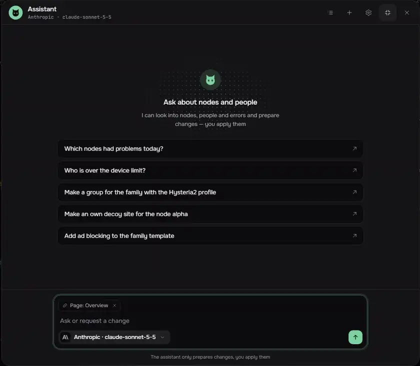</picture></td>
</tr>
<tr>
<td width="38%" valign="top">
<h3>Оповещения в Telegram</h3>
<p>Подключите своего бота, и панель напишет вам в чат, когда нода упала или вернулась, проверка не прошла, не удался бэкап или план агента ждёт вашего решения. Бот только присылает оповещения: из чата ничего не одобряется и не меняется. Каждый администратор подключает свой чат.</p>
<p><a href="docs/ru/operations/telegram-alerts.md">Документация →</a></p>
</td>
<td width="62%"><picture><source media="(prefers-color-scheme: dark)" srcset="docs/images/readme/telegram-dark-en.webp"><source media="(prefers-color-scheme: light)" srcset="docs/images/readme/telegram-light-en.webp">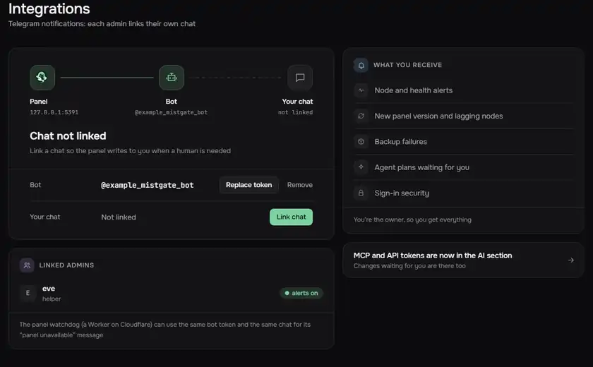</picture></td>
</tr>
<tr>
<td width="38%" valign="top">
<h3>Зашифрованные бэкапы и аккуратное восстановление</h3>
<p>Бэкапы уходят в ваш бакет Cloudflare R2 по расписанию или по кнопке и шифруются ещё в панели ключом, который вы храните офлайн. Перед восстановлением панель проверяет копию и показывает, что в ней и что у вас сейчас; пока вы не подтвердите, ничего не меняется, а данные, что были до восстановления, остаются.</p>
<p><a href="docs/ru/operations/backups.md">Документация →</a></p>
</td>
<td width="62%"><picture><source media="(prefers-color-scheme: dark)" srcset="docs/images/readme/backups-dark-en.webp"><source media="(prefers-color-scheme: light)" srcset="docs/images/readme/backups-light-en.webp">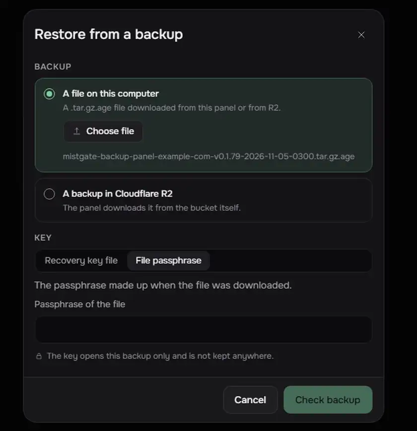</picture></td>
</tr>
</table>

Ещё в комплекте:

- Если из каких-то сетей сервер не открывается, люди попадают на него через другую вашу ноду, которая только пересылает зашифрованный трафик. Панель проверяет путь до включения и следит за ним потом; «Входы» на странице ноды — граф того, как люди попадают на сервер, а страница «Ноды» показывает карту всего флота. [Ретрансляции](docs/ru/guide/relays.md)
- Необязательная проверка, открываются ли ваши серверы изнутри страны, по сетям: пробы Globalping в домашних и мобильных сетях по IPv4 и IPv6, пробы добровольцев и SIM-пробы, списки блокировок и ТСПУ-зонд с вашей ноды. Большинство источников работает только в России. [Доступность](docs/ru/operations/reachability.md)
- Без Docker и без сервера БД. В простое панель занимает 39-44 МиБ памяти на сервере с 1 vCPU и 1 ГБ. [Бенчмарки](docs/ru/reference/benchmarks.md), в том числе где Mistgate медленнее.
- Посторонний по адресу панели видит сайт-ширму; админка — за секретным путём или именем хоста.
- Кому какой сервер: нода достаётся всем, выбранным группам или пока никому, а человек может состоять в нескольких группах. [Группы](docs/ru/guide/users-and-groups.md)
- Приложение для Windows, [Mistgate](https://github.com/Mistgate/mistgate-client), работает с этими панелями и с обычными ссылками-подписками.

Чего пока нет: Telegram-бот только присылает оповещения, а версия для Cloudflare Workers — [предварительная](docs/ru/getting-started/install-edge.md). Часть настроек по умолчанию рассчитана на пользователей в России; все их можно поменять.

## Протоколы

| Протокол | На ноде | Что настраивается |
|:--|:--|:--|
| [Hysteria2](docs/ru/guide/hysteria2.md) | Официальное ядро Hysteria2 | UDP (QUIC). Обфускация Salamander (Gecko — экспериментально), port hopping, сертификат Let's Encrypt или закреплённый самоподписанный. |
| [VLESS](docs/ru/guide/vless.md) | xray-core | REALITY поверх XHTTP или TCP (RAW + Vision); TLS поверх XHTTP или WebSocket, напрямую или за CDN. |
| [AmneziaWG](docs/ru/guide/amneziawg.md) | amneziawg-go в userspace или модуль ядра | Версии 3.1 (по умолчанию) и 2.0, отдельный ключ на каждое устройство. Версий 1.5 и 1.0 нет. |
| [TrustTunnel](docs/ru/guide/trusttunnel.md) | Собственный движок Mistgate в агенте ноды | Экспериментально. VPN внутри обычного HTTPS (HTTP/2, HTTP/3 по желанию) с настоящим сертификатом; ключи `tt://` для официальных приложений TrustTunnel. |
| [MTProto](docs/ru/guide/mtproto.md) | Собственное ядро MTProto в Mistgate | Экспериментально. Прокси только для приложения Telegram: Fake TLS с доменом самой ноды или другим сайтом в рукопожатии, ключ на человека, остальным отвечает сайт-ширма. |

Hysteria2 и VLESS уживаются на одной ноде, даже на общем TCP 443. Не каждый формат подписки передаёт любой профиль: [Что где работает](docs/ru/guide/subscriptions.md#что-где-работает).

Пока не поддерживаются: VMess, Trojan, Shadowsocks, TUIC и обычный WireGuard. Новые протоколы будут: каждый подключается к той же ссылке подписки через контракт, описанный ниже.

Протокол — это две половины, вкомпилированные в бинарники. На панели это один Go-интерфейс: JSON Schema настроек (по ней админка строит форму), проверка, спецификация сервера для ноды, выдача ключей и кусок каждого формата подписки. На ноде это движок: запускает спецификацию, меняет ключи без перезапуска и отдаёт трафик и состояние. Новый протокол получают только агенты, которые его заявили, так что старые продолжают работать. Подробнее: [Контракт протокольного плагина](docs/ru/reference/architecture.md#контракт-протокольного-плагина).

## Насколько это стабильно

Это бета, и проект молодой: тег v0.1.0 поставлен 3 октября 2026 года, а линия 0.2.0 перерисовала весь интерфейс. До 1.0 ещё могут меняться API, хранимые настройки и протокол ноды. Автоматического теста обновления со старых версий релизы пока не проходят, это одно из [условий для 1.0](docs/ru/roadmap/status.md).

Сам я держу на Mistgate шесть своих серверов для семьи и друзей.

Туннели не зависят от панели: пока она лежит, нода работает на последней применённой конфигурации; изменение пользователя не перезапускает сервер; старые агенты работают с новой панелью. В [бенчмарке](docs/ru/reference/benchmarks.md) добавление и удаление пользователей и перезапуск панели не оборвали ни одного соединения.

Проверки:

- CI на каждый push и pull request ([ci.yml](.github/workflows/ci.yml)): тесты и vet на Go, race-детектор на сессии панели с агентом, `govulncheck`, линт и тесты админки, сборка документации, установщик на Debian и Ubuntu.
- Сквозной прогон ([scripts/e2e-wsl.sh](scripts/e2e-wsl.sh)): настоящие панель, нода и клиенты Hysteria2, AmneziaWG, Xray, mihomo и sing-box, плюс обновление агента, откаты и установка по SSH. Запускается вручную перед каждым релизом, в WSL или на виртуалке, не в CI.
- GitHub Actions собирает каждый тег в черновик релиза. Я пересобираю его из тега на машине с офлайн-ключом релизов и подписываю только бинарники, совпавшие байт в байт; ноды и панель ставят только подписанные сборки. [Релизы и подпись](docs/ru/operations/releases.md)

<p align="center"></p>

Обновление ([Обновления](docs/ru/operations/updates.md)):

- Ноды сами не обновляются. Раскатка сначала обновляет одну ноду-канарейку и даёт ей 5 минут пройти проверку, потом идёт пачками по одной-две. Нода, не прошедшая её, получает прежнюю сборку, а раскатка встаёт на паузу.
- Агент откатывается и сам, если новая сборка не подключилась за 5 минут или падает при запуске. Любую ноду можно откатить вручную.
- Нода, у которой связь с панелью зависла, может докачать обновление с GitHub. Панель предлагает его вторым источником, только если выпуск там подписан её собственным ключом и содержит те же файлы; включено по умолчанию, выключается в настройках, а GitHub видит адрес ноды.
- Панель обновляет себя только с вашего подтверждения: сначала сохраняет копию данных, а если новая версия не продержалась 45 секунд, возвращает старый бинарник и данные.
- [Зашифрованные бэкапы](docs/ru/operations/backups.md) `/var/lib/mistgate` всё равно делайте.

Mistgate пишется с помощью ИИ-агентов. Я читаю то, что они пишут, и решаю, что попадёт в main и в релиз; проверки выше для их кода те же, что для любого другого. Коммиты, написанные с агентом, помечены строкой `Co-Authored-By`, а правила для агентов в этом репозитории — в [AGENTS.md](AGENTS.md).

## Быстрый старт

Нужен чистый Linux-сервер amd64 или arm64 с systemd, доменом, который указывает прямо на него (здесь `panel.example.com`), свободными TCP-портами 80 и 443 и `openssh-client` с поддержкой `ssh-keygen -Y verify` либо OpenSSL версии 3.2 или новее. На сервере выполните:

```sh
curl -fsSL https://mistgate.app/install.sh | sudo bash -s -- --public-url https://panel.example.com
```

Установщик проверит подписанный манифест панели, запустит Mistgate под systemd и напечатает адрес админки с одноразовой ссылкой настройки на 30 минут. Firewall он не трогает. `--yes` убирает вопросы, `--dry-run` только проверяет релиз; ручная установка и остальные параметры: [Установка панели](docs/ru/getting-started/install-panel.md).

Затем:

1. Откройте ссылку настройки и создайте аккаунт владельца: с passkey или с паролем и кодом приложения-аутентификатора.
2. Добавьте серверы в **Ноды → Добавить ноду**, по SSH или одноразовой командой ([Добавление ноды](docs/ru/getting-started/add-node.md)).
3. Добавьте людей: [Первые пользователи](docs/ru/getting-started/first-users.md).

ИИ-агент, который умеет запускать `ssh`, пройдёт эти шаги по промпту из [инструкции для AI-агента](docs/ru/getting-started/ai-agents.md#установка-mistgate-с-ai-агентом); аккаунт владельца создаёте вы сами.

## Сравнение с другими панелями

| | Mistgate | 3x-ui | Remnawave | Hiddify | PasarGuard | s-ui |
|:--|:--|:--|:--|:--|:--|:--|
| Работает без Docker | ✅ | ✅ | ❌ | ✅ | 🟡 частично | ✅ |
| База данных | SQLite | SQLite или PostgreSQL | PostgreSQL + Redis | MySQL + Redis | SQLite, MySQL, MariaDB или PostgreSQL | SQLite |
| Память панели в простое | 39-44 МиБ¹ | 73-76 МиБ¹ | 436-464 МиБ¹ | не измеряли | 273-277 МиБ¹ | не измеряли |
| Добавить ноду из панели (SSH) | ✅ | ❌ | ❌ | ❌ | ❌ | ? |
| Hysteria2 | ✅ | ✅ | 🟡 частично | ✅ | ✅ | ✅ |
| VLESS REALITY | ✅ | ✅ | ✅ | ✅ | ✅ | ✅ |
| AmneziaWG | ✅ 2.0 и 3.1 | ✅ 3.1 | ❌ | ❌ | ❌ | ❌ |
| TrustTunnel | ✅ экспериментально | ❌ | ❌ | ❌ | ❌ | ❌ |
| Прокси для Telegram (MTProto) | ✅ экспериментально | ✅ | ❌ | ✅ | ✅ в исходниках | ❌ |
| WireGuard | ❌ | ✅ | 🟡 только через конфиг ядра | ✅ | ✅ | ✅ |
| TUIC | ❌ | ✅ | ❌ | ✅ | 🟡 ядро sing-box, только в исходниках | ✅ |
| VMess, Trojan, Shadowsocks | ❌ | ✅ | 🟡 частично | ✅ | ✅ | ✅ |
| Подписки Xray JSON или sing-box | ✅ обе | Xray JSON | ✅ обе | ✅ обе | ✅ обе | sing-box |
| Ретрансляция через ноду входа | ✅ | 🟡 цепочка исходящих | 🟡 мост вручную | ✅ домены-реле | ? | ? |
| Сайт-ширма | ✅ | 🟡 только Hysteria2 | ? | ✅ | ? | ? |
| Лимит устройств | ✅ | ✅ | ✅ | ? | ✅ | ? |
| Несколько админов с ролями | ❌ один админ | ? | ❌ | ✅ | ✅ | ? |
| Проверки и алерты | ✅ проверки глазами клиента, доктор, доступность из страны | ✅ монитор туннеля (включается отдельно) | ✅ статус, Prometheus | 🟡 частично | 🟡 частично | 🟡 только статус |
| Telegram-бот | 🟡 только алерты | ✅ | 🟡 частично | ✅ | ✅ | 🟡 только сторонний бот |
| Встроенный MCP-сервер для ИИ-агентов | ✅ | ❌ | ❌ | ? | ? | ? |

¹ Приватная память всей группы панели в простое, 0–200 пользователей, без подключённой ноды, на тестовом сервере с 1 vCPU и 1 ГБ (у 3x-ui в группе есть его ядро Xray и fail2ban). Методика, версии и ограничения: [Бенчмарки](docs/ru/reference/benchmarks.md). «?» значит, что в README и документации проекта об этом не сказано. «❌» у другого проекта значит, что он сам так говорит или что в его исходном коде возможность не упоминается (поиск по коду 24 ноября 2026 года).

Другие панели впереди по числу протоколов, размеру сообщества, ролям админов и полноценным Telegram-ботам. Полная таблица с источниками, проверенная 9 октября 2026 года и частично повторно 24 ноября 2026 года: [Сравнение с другими панелями](docs/ru/reference/comparison.md).

## Документация

Вся документация на [mistgate.app/ru](https://mistgate.app/ru/docs/) и в [`docs/`](docs/README.md). С чего начать:

- [Обзор](docs/ru/getting-started/overview.md) и [Требования](docs/ru/getting-started/requirements.md)
- [Установка панели](docs/ru/getting-started/install-panel.md), [Установка ноды по SSH](docs/ru/getting-started/ssh-install.md), [Первые пользователи](docs/ru/getting-started/first-users.md)
- [Здоровье](docs/ru/operations/health.md), [Обновления](docs/ru/operations/updates.md), [Зашифрованные бэкапы](docs/ru/operations/backups.md), [Решение проблем](docs/ru/operations/troubleshooting.md)
- [CLI](docs/ru/reference/cli.md), [API](docs/ru/reference/api.md), [MCP-сервер](docs/ru/reference/mcp.md), [Архитектура](docs/ru/reference/architecture.md)

## Участие в разработке

Баг-репорты, исправления и правки документации приветствуются. В [CONTRIBUTING.md](CONTRIBUTING.md) (на английском) описаны сборка, устройство кода, проверки CI и соглашения. Coding-агентам начинать с [`AGENTS.md`](AGENTS.md), а в [инструкции для AI-агента](docs/ru/getting-started/ai-agents.md#доработка-кода-с-coding-агентом) есть готовый промпт для доработки кода.

## Безопасность

Об уязвимостях сообщайте закрыто, см. [SECURITY.md](SECURITY.md). Делайте резервные копии каталога данных панели (`/var/lib/mistgate`): там база, мастер-ключ и CA, которому доверяют ноды.

## Лицензия

Mistgate распространяется как свободное ПО под [GNU Affero General Public License v3.0 only](LICENSE). Если вы запускаете изменённую панель для других, ссылка «Исходный код» в её админке (`serve --source-url`) должна вести на ваши исходники.

## История звёзд

<a href="https://www.star-history.com/?repos=mistgate%2Fmistgate&type=date&legend=top-left">
 <picture>
   <source media="(prefers-color-scheme: dark)" srcset="https://api.star-history.com/chart?repos=mistgate/mistgate&type=date&theme=dark&legend=top-left" />
   <source media="(prefers-color-scheme: light)" srcset="https://api.star-history.com/chart?repos=mistgate/mistgate&type=date&legend=top-left" />
   
 </picture>
</a>
