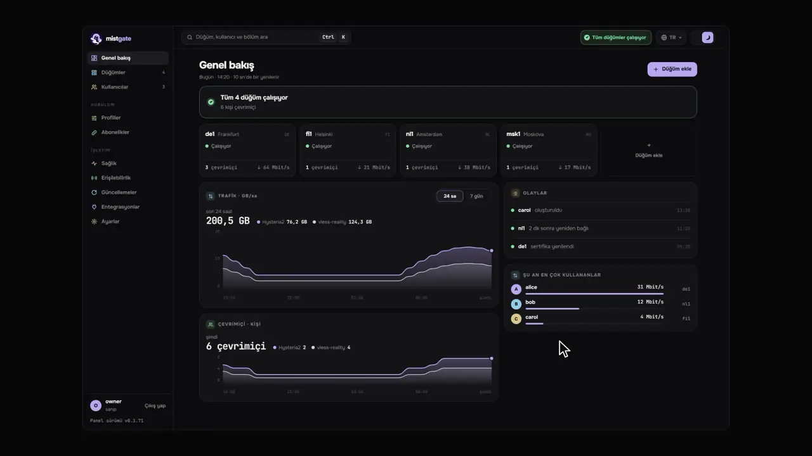
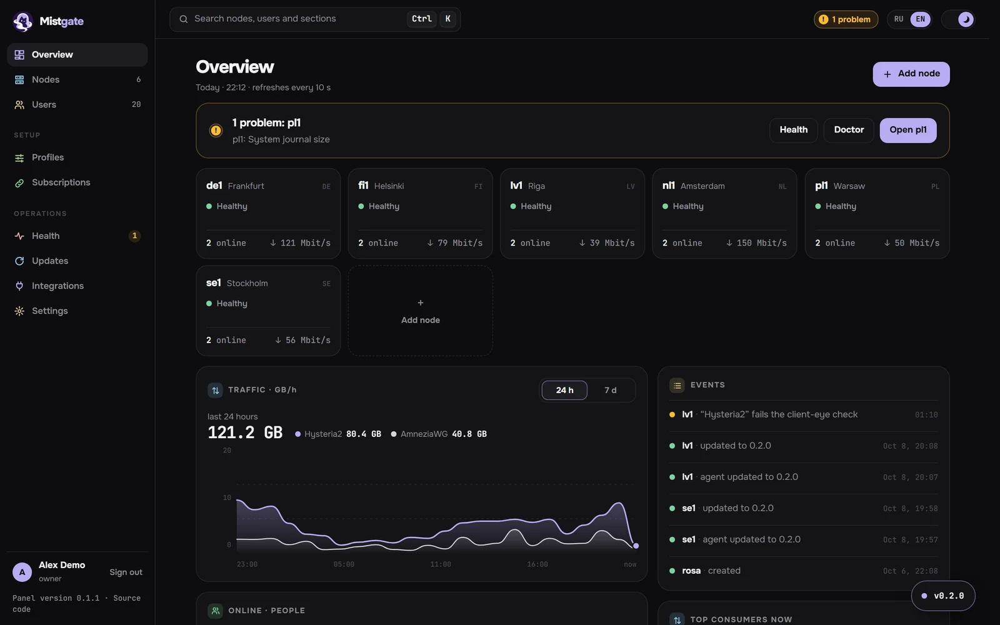
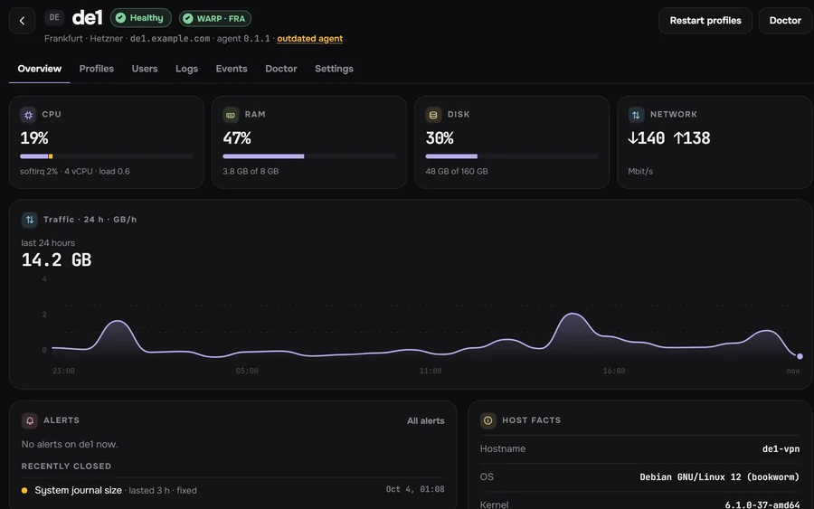
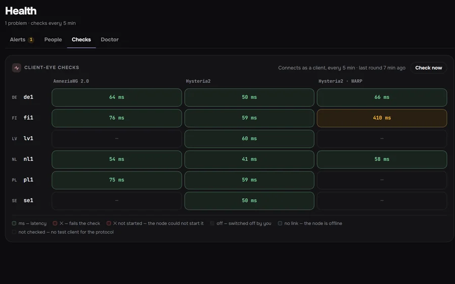
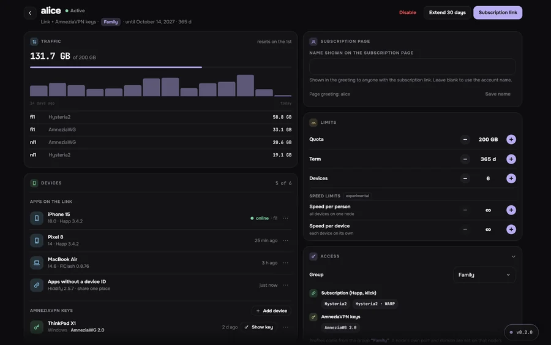
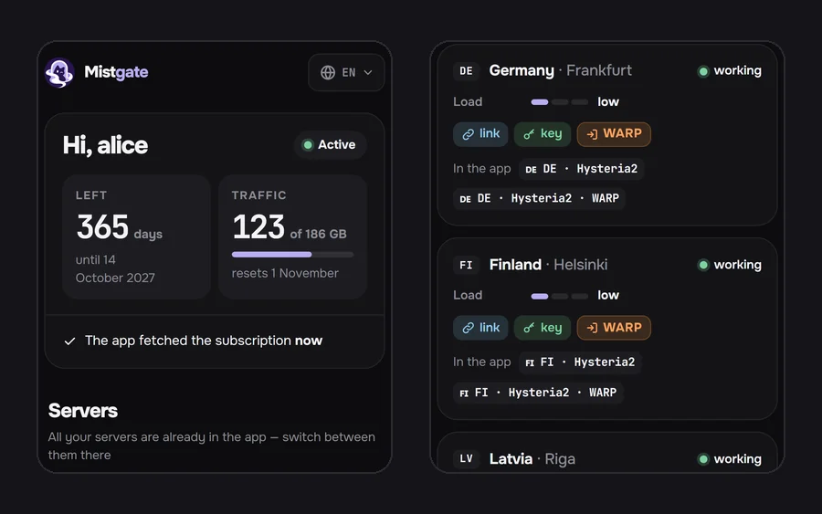

<div align="center">


<h1>Mistgate</h1>

<p>Küçük bir VPN için kendi sunucunuzda çalışan bir panel: size ait birkaç sunucu ve onları paylaştığınız insanlar.<br>
Hysteria2, VLESS ve AmneziaWG. İki Go ikili dosyası, SQLite ve systemd.</p>

<p>

<a href="https://github.com/Mistgate/mistgate/releases/latest"></a>
<a href="LICENSE"></a>
<a href="https://github.com/Mistgate/mistgate/actions/workflows/ci.yml"></a>
<a href="go.mod"></a>
</p>

<p><a href="https://mistgate.app/"><b>Belgeler</b></a> · <a href="#hızlı-başlangıç"><b>Kurulum</b></a> · <a href="#protokoller"><b>Protokoller</b></a> · <a href="#kararlı-mı"><b>Kararlı mı?</b></a> · <a href="#diğer-panellerle-karşılaştırma"><b>Karşılaştırma</b></a> · <a href="README.md">English</a> · <a href="README.ru.md">Русский</a> · <a href="README.zh.md">简体中文</a> · <a href="README.fa.md">فارسی</a></p>

<p><sub><b>Beta.</b> 1.0'a kadar değişiklikler olabilir. <a href="https://mistgate.app/roadmap/status/">Durum ve yol haritası</a></sub></p>

</div>



## Neler yapar

Paneli bir sunucuya kurar, VPN sunucularınızı ona düğüm olarak eklersiniz. Her kişi tek bir abonelik bağlantısı alır ve uygulaması, kullanabileceği bütün sunucuları kendiliğinden çeker. Panel düğümlerin yapılandırmasını güncel tutar ve onları kontrol eder.

- Düğümü tarayıcıdan, IP adresiyle, panelin kendi SSH anahtarıyla (sağlayıcınıza bir kez eklersiniz) ya da root parolasıyla eklersiniz. Panel sunucunun SSH anahtarını sabitler, sunucuyu kontrol eder, etkin bir UFW ya da firewalld varsa portları açar ve imzalı ajanı kurar; düğüm kartında parolayı değiştirir ve sunucunun SSH anahtarlarını yönetir. Tek kullanımlık bir kurulum komutu da olur. [Düğüm ekleme](docs/en/getting-started/add-node.md)
- Kişi başına tek bağlantı. Mihomo tabanlı uygulamalar (kl!ck, FlClash, Clash Verge Rev) bu bağlantıdan üç protokolün hepsini alır, Happ Hysteria2 ve VLESS'i alır, AmneziaVPN ise kişinin sayfasından her cihaz için ayrı bir anahtar alır. Mihomo ve sing-box uygulamaları çalışan bir sunucuya kendileri geçer. [İstemci uygulamaları](docs/en/guide/client-apps.md)
- Panel her 5 dakikada bir, tıpkı bir uygulama gibi her sunucuya bağlanır. Her düğümdeki Teşhis 21 sunucu kontrolü yapar ve sekiz düzeltme önerir; bunlar ancak siz onayladıktan sonra çalışır. Uyarılar yönetim panelinde görünür ve Telegram'a da gelir. [Sağlık](docs/en/operations/health.md)
- Bazı ağlardan bir sunucuya ulaşılamıyorsa kişiler ona başka bir düğümünüz üzerinden bağlanır; o düğüm yalnızca şifreli trafiği iletir. Panel yolu açmadan önce kontrol eder, sonra da izlemeye devam eder; düğüm sayfasındaki Giriş yolları, kişilerin sunucuya nasıl ulaştığını gösteren bir grafiktir; Düğümler sayfasında ise tüm düğümlerin haritası vardır. [Aktarıcılar](docs/en/guide/relays.md)
- İsteğe bağlı olarak, sunucularınızın bir ülkenin içinden açılıp açılmadığını ağ ağ kontrol edebilirsiniz: ev ve mobil ağlarda IPv4 ve IPv6 üzerinden Globalping ölçümleri, gönüllü ve SIM ölçüm noktaları, engelleme listeleri ve kendi düğümünüzden bir TSPU ölçümü. Kaynakların çoğu yalnızca Rusya'da çalışır. [Erişilebilirlik](docs/en/operations/reachability.md)
- Docker yok, veritabanı sunucusu yok. Panel boştayken 1 vCPU / 1 GB'lık bir sunucuda 16-20 MiB bellek kullanır. [Performans testleri](docs/en/reference/benchmarks.md), Mistgate'in daha yavaş kaldığı yerler dahil.
- Panelin adresini açan yabancılar bir kamuflaj sitesi görür; yönetim paneli gizli bir yolun ya da ana bilgisayar adının arkasındadır.
- Yerleşik asistan (kendi anahtarınızla bağladığınız bir bulut modeli) düğümleriniz ve kişiler hakkındaki sorulara yanıt verir ve değişiklikleri sizin uygulayacağınız kartlar olarak hazırlar. MCP, dışarıdaki bir yapay zekâ ajanının düğümlerin durumunu okumasına, düğümler arasındaki yolları sınamasına ve değişiklik planlamasına izin verir; riskli olanlar yönetim panelinde sizin onayınızı bekler. [Asistan](docs/en/guide/assistant.md), [MCP](docs/en/reference/mcp.md)

Henüz olmayanlar: kendi uygulamamız (planlandı); Telegram botu şimdilik yalnızca uyarı gönderir, Cloudflare Workers sürümü de hâlâ bir [önizleme](docs/en/getting-started/install-edge.md). Bazı varsayılanlar Rusya'daki kullanıcılara göre seçilmiştir; hepsi ayarlardan değiştirilebilir.

## Protokoller

| Protokol | Düğümde | Neler ayarlanabilir |
|:--|:--|:--|
| [Hysteria2](docs/en/guide/hysteria2.md) | Resmî Hysteria2 çekirdeği | UDP (QUIC). Salamander gizleme (Gecko deneysel), port atlama, Let's Encrypt sertifikası ya da parmak izi sabitlenmiş kendinden imzalı sertifika. |
| [VLESS](docs/en/guide/vless.md) | xray-core | XHTTP ya da TCP (RAW + Vision) üzerinden REALITY; XHTTP ya da WebSocket üzerinden TLS, doğrudan veya bir CDN arkasında. |
| [AmneziaWG](docs/en/guide/amneziawg.md) | Kullanıcı alanında amneziawg-go ya da çekirdek modülü | 3.1 (varsayılan) ve 2.0 sürümleri, her cihaz için ayrı anahtar. 1.5 ve 1.0 sunulmaz. |
| [MTProto](docs/en/guide/mtproto.md) | Mistgate'in kendi MTProto çekirdeği | Deneysel. Yalnızca Telegram uygulaması için bir proxy: ad olarak düğümün kendi alan adını ya da başka bir siteyi kullanan Fake TLS, kişi başına bir anahtar, geri kalan herkese kamuflaj sitesi. |

Hysteria2 ve VLESS, TCP 443 dahil, aynı düğümü paylaşabilir. Her uygulama biçimi her profili taşımaz: [ne nerede çalışır](docs/en/guide/subscriptions.md#what-works-where).

Henüz desteklenmeyenler: VMess, Trojan, Shadowsocks, TUIC ve düz WireGuard. Başka protokoller de planlanıyor; her yenisi aşağıdaki sözleşme aracılığıyla aynı abonelik bağlantısına eklenir.

Bir protokol, ikili dosyalara derlenmiş iki yarıdan oluşur. Panel tarafında tek bir Go arayüzü: ayarları için bir JSON Schema (yönetim paneli formu bundan oluşturur), doğrulama, düğümün çalıştıracağı tanım, kimlik bilgilerinin verilmesi ve her abonelik biçimindeki kendi parçası. Düğüm tarafında ise bu tanımı çalıştıran, kimlik bilgilerini yeniden başlatmadan değiştiren, trafiği ve sağlık durumunu bildiren bir motor. Yeni bir protokol yalnızca onu desteklediğini bildiren ajanlara gönderilir; böylece eski ajanlar çalışmaya devam eder. Ayrıntılar: [protokol eklentisi sözleşmesi](docs/en/reference/architecture.md#the-protocol-plugin-contract).

## Kararlı mı?

Beta aşamasında ve henüz genç: v0.1.0 etiketi 2026-10-03'te atıldı, v0.1.81 ise 82. etiket. 1.0'a kadar API, kayıtlı ayarlar ve düğüm protokolü değişebilir. Sürümler henüz eski sürümlerden otomatik bir yükseltme testinden geçmiyor; bu, [1.0 koşullarından](docs/en/roadmap/status.md) biri.

Ben kendi altı sunucumda, ailem ve arkadaşlarım için kullanıyorum.

Tüneller panele bağlı değildir: panel kapalıyken düğüm son uygulanan yapılandırmayla hizmet vermeyi sürdürür, bir kullanıcı değişikliği sunucuyu yeniden başlatmaz ve eski ajanlar daha yeni bir panelle çalışır. [Performans testinde](docs/en/reference/benchmarks.md) kullanıcı ekleyip çıkarmak ve paneli yeniden başlatmak hiçbir bağlantıyı koparmadı.

Kontroller:

- Her push ve pull request'te CI ([ci.yml](.github/workflows/ci.yml)): Go testleri ve vet, panel-ajan oturumunda yarış dedektörü, `govulncheck`, yönetim panelinin lint ve testleri, belgelerin derlenmesi, Debian ve Ubuntu'da kurulum betiği.
- Uçtan uca bir çalıştırma ([scripts/e2e-wsl.sh](scripts/e2e-wsl.sh)): gerçek Hysteria2, AmneziaWG, Xray, mihomo ve sing-box istemcileriyle gerçek bir panel ve düğüm; ayrıca ajan güncellemeleri, geri almalar ve SSH üzerinden kurulum. Her sürümden önce WSL'de ya da bir sanal makinede elle çalıştırılır, CI'da değil.
- GitHub Actions her etiketi taslak olarak derler. Ben onu çevrimdışı sürüm anahtarının bulunduğu bir makinede etiketten yeniden derler ve yalnızca bayt bayt eşleşen ikili dosyaları imzalarım; düğümler ve panel yalnızca imzalı derlemeleri kurar. [Sürümler ve imzalama](docs/en/operations/releases.md)

Güncelleme ([Güncellemeler](docs/en/operations/updates.md)):

- Düğümler asla kendiliğinden güncellenmez. Bir dağıtım önce tek bir kanarya düğümünü günceller ve sağlık kontrolünü geçmesi için ona 5 dakika tanır, sonra birer ya da ikişer düğümlük gruplarla devam eder. Başarısız olan düğüm önceki derlemesine döner ve dağıtım duraklar.
- Yeni derleme 5 dakika içinde bağlanamazsa ya da sürekli çökerse ajan kendini de geri alır. Her düğüm elle de geri alınabilir.
- Panel kendini yalnızca siz onayladığınızda günceller. Önce verilerini yedekler; yeni sürüm 45 saniye ayakta kalamazsa eski ikili dosyayı ve verileri geri yükler.
- Yine de `/var/lib/mistgate` dizininin [şifreli yedeklerini](docs/en/operations/backups.md) alın.

Mistgate yapay zekâ kodlama ajanlarıyla yazılıyor. Yazdıklarını ben gözden geçiriyor, neyin birleştirilip yayımlanacağına ben karar veriyorum; yukarıdaki kontroller onların kodu için de herkesin kodu için olduğu gibi aynıdır. Bir ajanla yapılan commit'ler bir `Co-Authored-By` satırı taşır; ajanların bu depoda uyduğu kurallar [AGENTS.md](AGENTS.md) dosyasındadır.

## Ekran görüntüleri

<table>
<tr>
<td colspan="2"><picture><source media="(prefers-color-scheme: dark)" srcset="docs/images/readme/overview-dark-en.webp"><source media="(prefers-color-scheme: light)" srcset="docs/images/readme/overview-light-en.webp"></picture><br><sub><b>Genel bakış.</b> Tüm düğümlerin sağlığı ve aktarım hızı, açık sorunlar ve son olaylar.</sub></td>
</tr>
<tr>
<td width="50%"><picture><source media="(prefers-color-scheme: dark)" srcset="docs/images/readme/node-dark-en.webp"><source media="(prefers-color-scheme: light)" srcset="docs/images/readme/node-light-en.webp"></picture><br><sub><b>Bir düğüm.</b> Durum, WARP çıkışı, yük ve 24 saatlik trafik.</sub></td>
<td width="50%"><picture><source media="(prefers-color-scheme: dark)" srcset="docs/images/readme/health-dark-en.webp"><source media="(prefers-color-scheme: light)" srcset="docs/images/readme/health-light-en.webp"></picture><br><sub><b>İstemci gözüyle kontroller.</b> Her düğümde her protokol, tünelden geçen gecikme.</sub></td>
</tr>
<tr>
<td width="50%"><picture><source media="(prefers-color-scheme: dark)" srcset="docs/images/readme/user-dark-en.webp"><source media="(prefers-color-scheme: light)" srcset="docs/images/readme/user-light-en.webp"></picture><br><sub><b>Bir kişi.</b> Cihaz kimliğine göre cihazlar, kotadan düşen trafik ve sınırlar.</sub></td>
<td width="50%"><picture><source media="(prefers-color-scheme: dark)" srcset="docs/images/readme/phone-dark-en.webp"><source media="(prefers-color-scheme: light)" srcset="docs/images/readme/phone-light-en.webp"></picture><br><sub><b>Tarayıcıda kendi bağlantısı.</b> Kalan günler, trafik ve cihazları.</sub></td>
</tr>
</table>

Ekran görüntüleri İngilizce arayüzden, uydurma demo verileriyle alınmıştır.

## Hızlı başlangıç

Gerekenler: systemd'li, temiz kurulmuş bir Linux sunucusu (amd64 ya da arm64), doğrudan ona yönlendirilmiş bir alan adı (burada `panel.example.com`), boş TCP 80 ve 443 portları ve `ssh-keygen -Y verify` destekli `openssh-client` ya da OpenSSL 3.2 veya üstü. Sunucuda şunu çalıştırın:

```sh
curl -fsSL https://mistgate.app/install.sh | sudo bash -s -- --public-url https://panel.example.com
```

Kurulum betiği imzalı panel manifestini doğrular, Mistgate'i systemd altında başlatır ve yönetim panelinin adresini tek kullanımlık bir kurulum bağlantısıyla (30 dakika geçerli) yazdırır. Güvenlik duvarına dokunmaz. `--yes` soruları atlar, `--dry-run` yalnızca sürümü doğrular; elle kurulum ve diğer seçenekler [Paneli kurma](docs/en/getting-started/install-panel.md) sayfasında.

Ardından:

1. Kurulum bağlantısını açın ve sahibi oluşturun: bir geçiş anahtarıyla ya da parola ve doğrulayıcı uygulama koduyla.
2. Sunucuları **Düğümler → Düğüm ekle** bölümünden, SSH üzerinden ya da tek kullanımlık bir komutla ekleyin ([Düğüm ekleme](docs/en/getting-started/add-node.md)).
3. Kişileri ekleyin: [İlk kullanıcılar](docs/en/getting-started/first-users.md).

`ssh` çalıştırabilen bir yapay zekâ ajanı bu adımları [yapay zekâ ajanı kılavuzundaki](docs/en/getting-started/ai-agents.md#install-mistgate-with-an-ai-agent) istemle yapabilir; sahip hesabını yine de kendiniz oluşturursunuz.

## Diğer panellerle karşılaştırma

| | Mistgate | 3x-ui | Remnawave | Hiddify | PasarGuard | s-ui |
|:--|:--|:--|:--|:--|:--|:--|
| Docker olmadan çalışır | ✅ | ✅ | ❌ | ✅ | 🟡 kısmen | ✅ |
| Veritabanı | SQLite | SQLite veya PostgreSQL | PostgreSQL + Redis | MySQL + Redis | SQLite, MySQL, MariaDB veya PostgreSQL | SQLite |
| Boştaki panelin RAM kullanımı | 16-20 MiB¹ | 68-74 MiB¹ | 426-454 MiB¹ | ölçülmedi | 262-265 MiB¹ | ölçülmedi |
| Panelden düğüm ekleme (SSH) | ✅ | ❌ | ❌ | ❌ | ❌ | ? |
| Hysteria2 | ✅ | ✅ | 🟡 kısmen | ✅ | ✅ | ✅ |
| VLESS REALITY | ✅ | ✅ | ✅ | ✅ | ✅ | ? |
| AmneziaWG | ✅ 2.0 ve 3.1 | ✅ 3.1 | ? | ? | ? | ? |
| VMess, Trojan, Shadowsocks | ❌ | ✅ | 🟡 kısmen | ✅ | ✅ | ✅ |
| Xray JSON ya da sing-box abonelikleri | ✅ ikisi de | Xray JSON | ✅ ikisi de | ✅ ikisi de | sing-box | sing-box |
| Sağlık kontrolleri ve uyarılar | ✅ istemci gözüyle kontroller, düğüm Teşhisi, bir ülkenin içinden erişilebilirlik | ✅ tünel izleme (isteğe bağlı) | ✅ durum, Prometheus | 🟡 kısmen | 🟡 kısmen | ? |
| Telegram botu | 🟡 yalnızca uyarılar | ✅ | 🟡 kısmen | ✅ | ✅ | ? |
| Yapay zekâ ajanları için yerleşik MCP sunucusu | ✅ | ? | ❌ | ? | ? | ? |

¹ Tüm panel süreç grubunun özel belleği; boşta, 0 ile 200 arası kullanıcı, bağlı düğüm yok, 1 vCPU / 1 GB'lık bir test sunucusunda (3x-ui'de Xray çekirdeği ve fail2ban dahil). Yöntem, sürümler ve sınırlar: [Performans testleri](docs/en/reference/benchmarks.md). “?”, projenin kendi README'sinin ve belgelerinin bu konuda bir şey söylemediği anlamına gelir.

Protokol çeşitliliğinde, topluluk büyüklüğünde ve tam Telegram botlarında diğerleri önde. Kaynaklarıyla birlikte, 2026-10-09'da kontrol edilmiş tam tablo [Diğer panellerle karşılaştırma](docs/en/reference/comparison.md) sayfasında.

## Belgeler

Her şey [mistgate.app](https://mistgate.app/) adresinde ve [`docs/`](docs/README.md) klasöründe. Belgeler İngilizce, Rusça ve Çince yazılmıştır; aşağıdaki bağlantılar İngilizce sürüme gider. Başlamak için iyi yerler:

- [Genel bakış](docs/en/getting-started/overview.md) ve [Gereksinimler](docs/en/getting-started/requirements.md)
- [Paneli kurma](docs/en/getting-started/install-panel.md), [SSH ile düğüm kurma](docs/en/getting-started/ssh-install.md), [İlk kullanıcılar](docs/en/getting-started/first-users.md)
- [Sağlık](docs/en/operations/health.md), [Güncellemeler](docs/en/operations/updates.md), [Şifreli yedekler](docs/en/operations/backups.md), [Sorun giderme](docs/en/operations/troubleshooting.md)
- [CLI](docs/en/reference/cli.md), [API](docs/en/reference/api.md), [MCP](docs/en/reference/mcp.md), [Mimari](docs/en/reference/architecture.md)

## Katkıda bulunmak

Hata bildirimleri, düzeltmeler ve belge katkıları memnuniyetle karşılanır. [CONTRIBUTING.md](CONTRIBUTING.md) (İngilizce) derlemeyi, kod haritasını, CI'ın çalıştırdığı kontrolleri ve kuralları anlatır. Kodlama ajanları [`AGENTS.md`](AGENTS.md) ile başlar; [yapay zekâ ajanı kılavuzunda](docs/en/getting-started/ai-agents.md#contribute-with-a-coding-agent) katkı için hazır bir istem var.

## Güvenlik

Güvenlik açıklarını gizli olarak bildirin: bkz. [SECURITY.md](SECURITY.md). Panelin veri dizinini (`/var/lib/mistgate`) yedekleyin: veritabanı, ana anahtar ve düğümlerinizin güvendiği CA orada durur.

## Lisans

Mistgate, [GNU Affero General Public License v3.0 only](LICENSE) lisansıyla dağıtılan özgür yazılımdır. Değiştirilmiş bir paneli başkaları için çalıştırıyorsanız, yönetim paneli bir “Kaynak kod” bağlantısı (`serve --source-url`) gösterir; bu bağlantı sizin kaynak kodunuza gitmelidir.

## Yıldız geçmişi

<a href="https://www.star-history.com/?repos=mistgate%2Fmistgate&type=date&legend=top-left">
 <picture>
   <source media="(prefers-color-scheme: dark)" srcset="https://api.star-history.com/chart?repos=mistgate/mistgate&type=date&theme=dark&legend=top-left" />
   <source media="(prefers-color-scheme: light)" srcset="https://api.star-history.com/chart?repos=mistgate/mistgate&type=date&legend=top-left" />
   
 </picture>
</a>
