<div align="center">


<h1>Mistgate</h1>

<p>一个自托管面板，用来管理你自己的几台 VPN 服务器，以及和你一起用它们的人。<br>
支持 Hysteria2、VLESS 和 AmneziaWG。两个 Go 二进制文件，SQLite 加 systemd。</p>

<p>

<a href="https://github.com/Mistgate/mistgate/releases/latest"></a>
<a href="LICENSE"></a>
<a href="https://github.com/Mistgate/mistgate/actions/workflows/ci.yml"></a>
<a href="go.mod"></a>
</p>

<p><a href="https://mistgate.app/zh/docs/"><b>文档</b></a> · <a href="#快速开始"><b>安装</b></a> · <a href="#协议"><b>协议</b></a> · <a href="#稳定性如何"><b>稳定性如何</b></a> · <a href="#与其他面板的对比"><b>对比</b></a> · <a href="README.md">English</a> · <a href="README.ru.md">Русский</a> · <a href="README.fa.md">فارسی</a> · <a href="README.tr.md">Türkçe</a></p>

<p><sub><b>测试版。</b>1.0 之前仍会有变化。<a href="https://mistgate.app/zh/roadmap/status/">状态和路线图</a></sub></p>

</div>

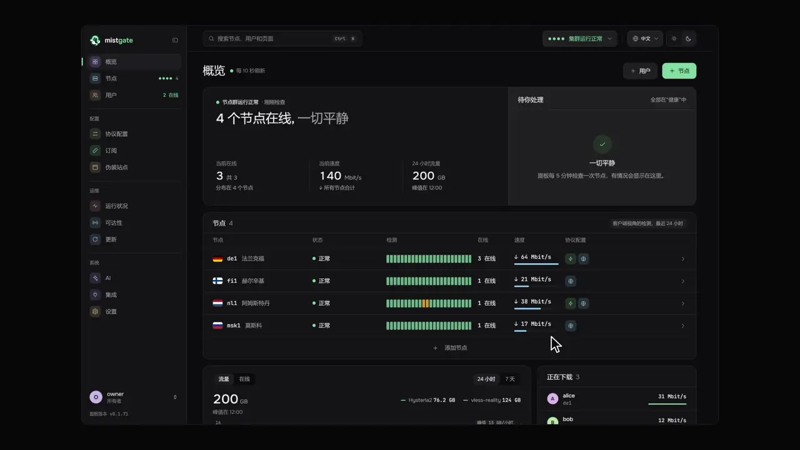

## 功能

面板装在一台服务器上，你的 VPN 服务器作为节点加进来。每个人拿到一个订阅链接，应用会自动获取他可以用的所有服务器。面板负责让节点保持正确配置，并持续检测它们。

<p align="center"></p>

这里的一切都用虚构的演示数据；动图是真实管理端的短循环。

<table>
<tr>
<td width="38%" valign="top">
<h3>在浏览器里添加服务器</h3>
<p>输入服务器 IP，选择面板如何登录（面板自己的 SSH 密钥，在服务商处添加一次即可；或 root 密码），然后看着它安装。面板会固定服务器的 SSH 主机密钥，检查主机，在已启用的 UFW 或 firewalld 中开放端口，并安装带签名的 agent。新服务器上不用开终端；也可以用一条一次性命令。</p>
<p><a href="docs/zh/getting-started/add-node.md">文档 →</a></p>
</td>
<td width="62%"><picture><source media="(prefers-color-scheme: dark)" srcset="docs/images/readme/addnode-dark-en.webp"><source media="(prefers-color-scheme: light)" srcset="docs/images/readme/addnode-light-en.webp">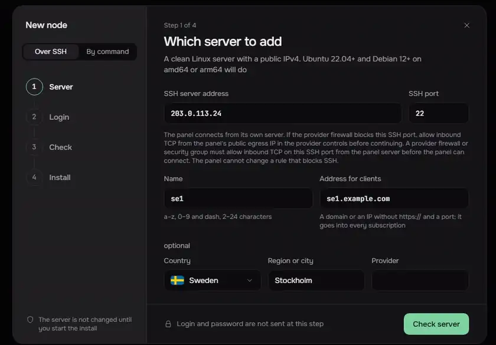</picture></td>
</tr>
<tr>
<td width="38%" valign="top">
<h3>每人一个链接，外加自己的页面</h3>
<p>每个人得到一个订阅链接、一个二维码，以及后面的一个页面：适合其平台的说明、剩余天数、流量和自己的设备。Mihomo 类应用从链接获取全部协议，Happ 获取 Hysteria2 和 VLESS，AmneziaVPN 则在页面上为每台设备取一把密钥。用户组决定每个人能用到哪些服务器。</p>
<p><a href="docs/zh/guide/user-page.md">文档 →</a></p>
</td>
<td width="62%"><picture><source media="(prefers-color-scheme: dark)" srcset="docs/images/readme/link-dark-en.webp"><source media="(prefers-color-scheme: light)" srcset="docs/images/readme/link-light-en.webp">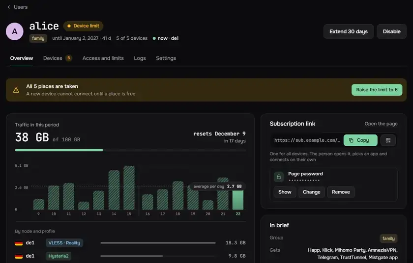</picture></td>
</tr>
<tr>
<td width="38%" valign="top">
<h3>客户端视角的检查</h3>
<p>面板每 5 分钟像一个应用那样连接每个节点上的每种协议，并显示经过每条隧道的延迟，所以服务器出问题时你会比使用者先知道。每个节点上的诊断程序做 23 项主机检查并提供十种修复，没有你的确认，一项也不会运行。</p>
<p><a href="docs/zh/operations/health.md">文档 →</a></p>
</td>
<td width="62%"><picture><source media="(prefers-color-scheme: dark)" srcset="docs/images/readme/health-dark-en.webp"><source media="(prefers-color-scheme: light)" srcset="docs/images/readme/health-light-en.webp">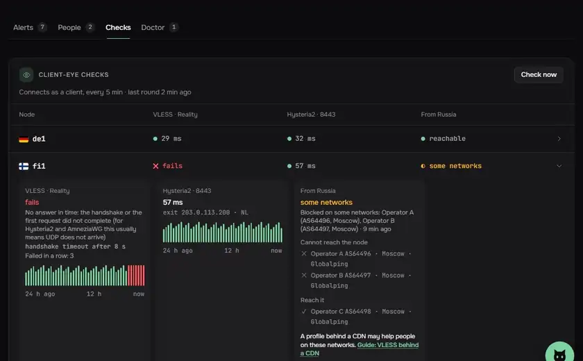</picture></td>
</tr>
<tr>
<td width="38%" valign="top">
<h3>多种协议共用一个 TCP 443</h3>
<p>许多网络只放行 TCP 443。一个节点可以在这一个端口上同时放 VLESS REALITY、基于 TLS 的 VLESS、TrustTunnel 和 MTProto：agent 根据客户端请求的域名把它们区分开。当你把第二个配置放到已被占用的端口时，面板会建议把它放在第一个旁边，并显示需要添加的 DNS 记录。</p>
<p><a href="docs/zh/guide/shared-port.md">文档 →</a></p>
</td>
<td width="62%"><picture><source media="(prefers-color-scheme: dark)" srcset="docs/images/readme/shared-dark-en.webp"><source media="(prefers-color-scheme: light)" srcset="docs/images/readme/shared-light-en.webp"></picture></td>
</tr>
<tr>
<td width="38%" valign="top">
<h3>用模板生成伪装站点</h3>
<p>陌生人打开节点时，应该看到一个普通的小网站，而不是 Mistgate 的页面。选择一个国家和十种类型之一（服务状态页、文档、博客、小商铺、作品集等），面板就会生成一个使用该国语言、有自己外观和文字的站点，每次都不一样。先预览，不满意就换一个，再保存。填入你自己的免费图片 API 密钥后，站点还能用上真实照片，由节点自己提供。</p>
<p><a href="docs/zh/guide/decoy-site.md#从模板创建站点">文档 →</a></p>
</td>
<td width="62%"><picture><source media="(prefers-color-scheme: dark)" srcset="docs/images/readme/decoys-dark-en.webp"><source media="(prefers-color-scheme: light)" srcset="docs/images/readme/decoys-light-en.webp"></picture><br><picture><source media="(prefers-color-scheme: dark)" srcset="docs/images/readme/decoys-sites-dark-en.webp"><source media="(prefers-color-scheme: light)" srcset="docs/images/readme/decoys-sites-light-en.webp"></picture></td>
</tr>
<tr>
<td width="38%" valign="top">
<h3>可滚动发布、可回滚的更新</h3>
<p>节点从不自行更新。滚动发布先更新一个金丝雀节点，给它 5 分钟通过健康检查，然后分小批继续。未通过的节点会换回原来的版本，发布随即暂停。面板只有在你确认后才更新自己，新版本撑不住时会还原旧二进制和数据。</p>
<p><a href="docs/zh/operations/updates.md">文档 →</a></p>
</td>
<td width="62%"><picture><source media="(prefers-color-scheme: dark)" srcset="docs/images/readme/updates-dark-en.webp"><source media="(prefers-color-scheme: light)" srcset="docs/images/readme/updates-light-en.webp">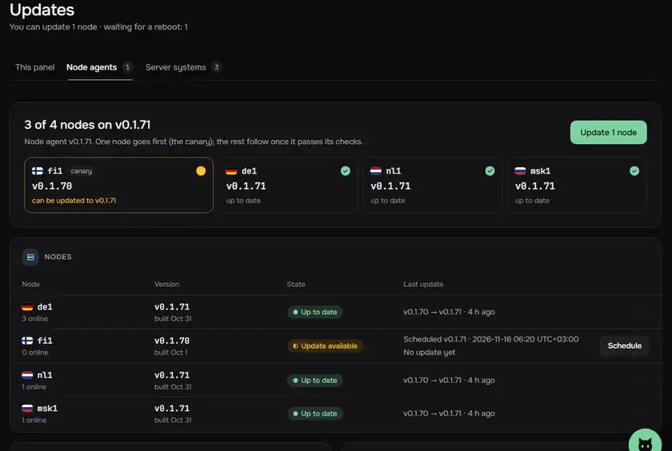</picture></td>
</tr>
<tr>
<td width="38%" valign="top">
<h3>服务器系统的更新</h3>
<p>不用逐台登录，就能看到哪些服务器在等待安全更新或重启。可以给一台服务器安装安全更新或重启，也可以勾选多台，作为一次滚动发布来运行：一次几台，每台之后做健康检查，遇到第一台失败就停下。</p>
<p><a href="docs/zh/operations/updates.md#服务器操作系统">文档 →</a></p>
</td>
<td width="62%"><picture><source media="(prefers-color-scheme: dark)" srcset="docs/images/readme/os-dark-en.webp"><source media="(prefers-color-scheme: light)" srcset="docs/images/readme/os-light-en.webp">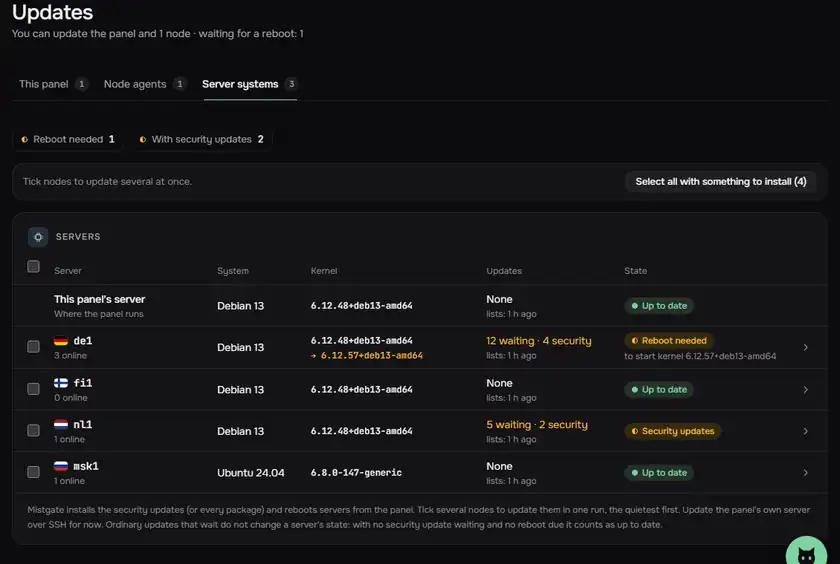</picture></td>
</tr>
<tr>
<td width="38%" valign="top">
<h3>WARP 出口，并检查它是否可用</h3>
<p>让配置的流量经 Cloudflare WARP 出去，每个节点一个账号。卡片显示隧道、流量和出口检查；面板还会通过每个节点的 WARP 抓取一份网站清单，当其中一些网站开始屏蔽它时发出告警。使用 WARP 出口的配置绝不会退回到节点自己的地址。</p>
<p><a href="docs/zh/guide/warp.md">文档 →</a></p>
</td>
<td width="62%"><picture><source media="(prefers-color-scheme: dark)" srcset="docs/images/readme/warp-dark-en.webp"><source media="(prefers-color-scheme: light)" srcset="docs/images/readme/warp-light-en.webp">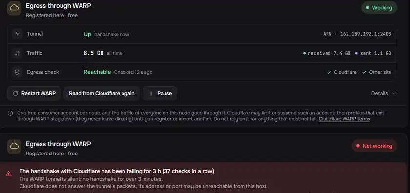</picture></td>
</tr>
<tr>
<td width="38%" valign="top">
<h3>面向应用的 DNS 预设</h3>
<p>预设规定一个人的应用向哪些 DNS 服务器查询、以什么方式（普通、DoT 或 DoH），还可以为某个国家或一组网站设置分流规则（比如俄罗斯网站直连），并在应用里屏蔽广告。可以分配给所有人、某个组或某一个人；编辑器会显示每个应用实际会得到什么。</p>
<p><a href="docs/zh/guide/dns.md">文档 →</a></p>
</td>
<td width="62%"><picture><source media="(prefers-color-scheme: dark)" srcset="docs/images/readme/dns-dark-en.webp"><source media="(prefers-color-scheme: light)" srcset="docs/images/readme/dns-light-en.webp">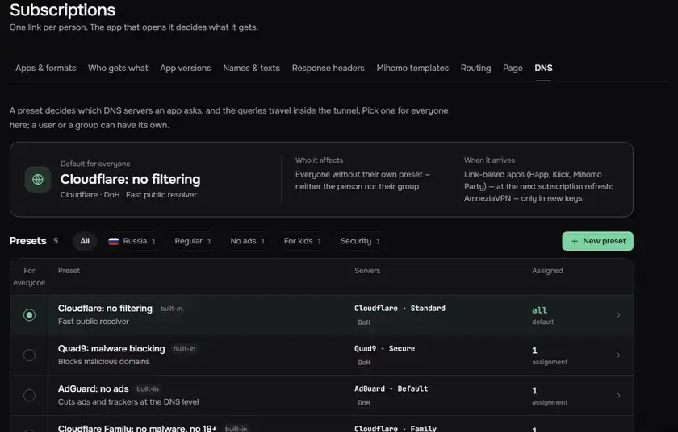</picture></td>
</tr>
<tr>
<td width="38%" valign="top">
<h3>助手和 MCP，先出方案</h3>
<p>内置助手（你用自己的密钥连接的云端模型）回答关于节点和用户的问题，并准备好更改。MCP 让外部 AI 代理也能这样：它读取整个节点群并规划更改，每个有风险的更改在应用前都要你在管理端批准。API 令牌每小时最多只能停用或改写 10 个用户，除非你解除限制。</p>
<p><a href="docs/zh/guide/assistant.md">文档 →</a></p>
</td>
<td width="62%"><picture><source media="(prefers-color-scheme: dark)" srcset="docs/images/readme/assistant-dark-en.webp"><source media="(prefers-color-scheme: light)" srcset="docs/images/readme/assistant-light-en.webp">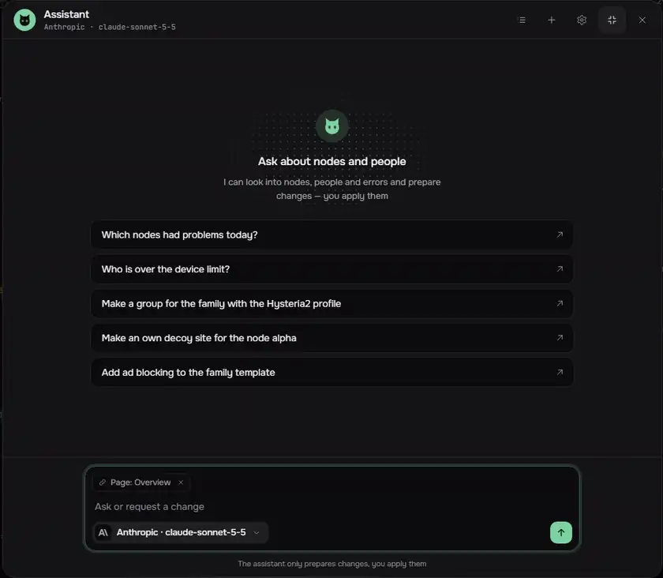</picture></td>
</tr>
<tr>
<td width="38%" valign="top">
<h3>Telegram 提醒</h3>
<p>连接你自己的机器人，当节点掉线或恢复、检查失败、备份失败或 agent 的方案在等你时，面板会给你的聊天发消息。它只发提醒：不能在聊天里批准或更改任何东西。每位管理员关联自己的聊天。</p>
<p><a href="docs/zh/operations/telegram-alerts.md">文档 →</a></p>
</td>
<td width="62%"><picture><source media="(prefers-color-scheme: dark)" srcset="docs/images/readme/telegram-dark-en.webp"><source media="(prefers-color-scheme: light)" srcset="docs/images/readme/telegram-light-en.webp">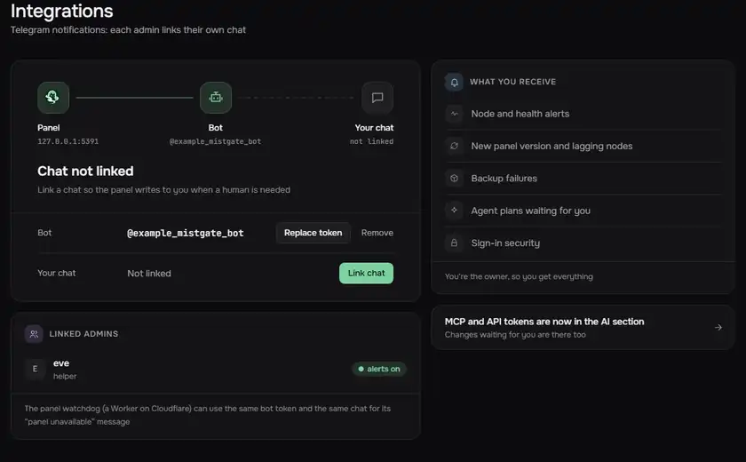</picture></td>
</tr>
<tr>
<td width="38%" valign="top">
<h3>加密备份和谨慎的恢复</h3>
<p>备份可按计划或手动上传到你自己的 Cloudflare R2 存储桶，在离开面板之前就用你离线保存的密钥加密。恢复前面板先检查备份，并把其中的内容与当前情况对照；你确认之前什么都不会改变，恢复前的数据也会保留。</p>
<p><a href="docs/zh/operations/backups.md">文档 →</a></p>
</td>
<td width="62%"><picture><source media="(prefers-color-scheme: dark)" srcset="docs/images/readme/backups-dark-en.webp"><source media="(prefers-color-scheme: light)" srcset="docs/images/readme/backups-light-en.webp">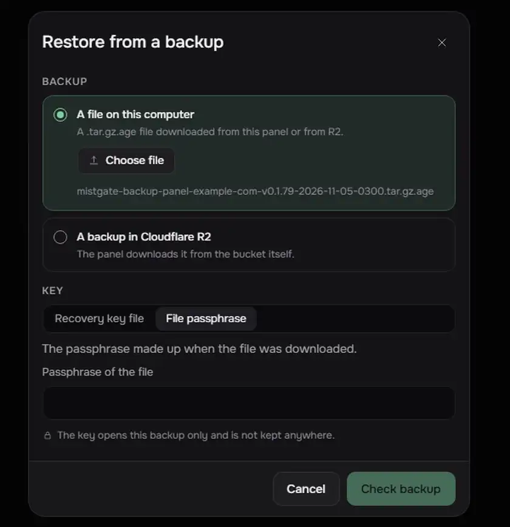</picture></td>
</tr>
</table>

另外还有：

- 某些网络无法访问某台服务器时，用户可以经由你的另一个节点连接，该节点只转发加密流量。面板在启用前检查路径，之后持续监测；节点页面的入口以图的形式列在列表旁，展示用户如何到达服务器；节点列表页还有整个集群的地图。[中转](docs/zh/guide/relays.md)
- 可选的检测：按网络查看你的服务器在某国境内能否打开——Globalping 在家庭和移动网络中通过 IPv4 和 IPv6 的探测、志愿者和 SIM 探测点、封锁名单，以及从你自己节点发起的 TSPU 探测。大多数来源只在俄罗斯可用。[可达性](docs/zh/operations/reachability.md)
- 不需要 Docker，也不需要数据库服务器。在 1 vCPU / 1 GB 的服务器上，面板空闲时占用 39–44 MiB 内存。[基准测试](docs/zh/reference/benchmarks.md)里也写了 Mistgate 较慢的地方。
- 陌生人打开面板地址只会看到伪装站点；管理后台位于私密路径或私密主机名之后。
- 谁能用哪台服务器：节点可以给所有人、选定的用户组，或暂时不给任何人，一个人也可以属于多个用户组。[用户组](docs/zh/guide/users-and-groups.md)
- Windows 桌面应用 [Mistgate](https://github.com/Mistgate/mistgate-client) 可配合这些面板，也可用于普通订阅链接。

暂时没有的：除提醒外的 Telegram 机器人；Cloudflare Workers 版本仍是[预览版](docs/zh/getting-started/install-edge.md)。部分默认值偏向俄罗斯的用户，它们都是可调的设置。

## 协议

| 协议 | 节点上的实现 | 可以设置什么 |
|:--|:--|:--|
| [Hysteria2](docs/zh/guide/hysteria2.md) | 官方 Hysteria2 内核 | UDP（QUIC）。Salamander 混淆（Gecko 为实验性）、端口跳跃、Let's Encrypt 证书或固定指纹的自签名证书。 |
| [VLESS](docs/zh/guide/vless.md) | xray-core | REALITY 搭配 XHTTP 或 TCP（RAW + Vision）；TLS 搭配 XHTTP 或 WebSocket，可以直连，也可以放在 CDN 之后。 |
| [AmneziaWG](docs/zh/guide/amneziawg.md) | 用户态的 amneziawg-go，或内核模块 | 3.1 版（默认）和 2.0 版，每台设备一个独立密钥。不提供 1.5 和 1.0。 |
| [TrustTunnel](docs/zh/guide/trusttunnel.md) | Mistgate 在节点 agent 中自带的引擎 | 实验性。普通 HTTPS 之内的 VPN（HTTP/2，可选 HTTP/3），使用真实证书；`tt://` 密钥供官方 TrustTunnel 应用使用。 |
| [MTProto](docs/zh/guide/mtproto.md) | Mistgate 自带的 MTProto 内核 | 实验性。只供 Telegram 应用使用的代理：Fake TLS，握手中使用节点自己的域名或另一个网站，每人一个密钥，其他人看到伪装站点。 |

Hysteria2 和 VLESS 可以共用一个节点，包括 TCP 443。并非每种订阅格式都能承载每种协议配置：见[各格式支持哪些协议配置](docs/zh/guide/subscriptions.md#各格式支持哪些协议配置)。

暂不支持：VMess、Trojan、Shadowsocks、TUIC 和普通 WireGuard。我们计划加入更多协议，每个新协议都通过下面的统一接口接入同一个订阅链接。

一个协议分为两半，都编译进二进制文件。面板这一半是一个 Go 接口：设置的 JSON Schema（管理后台据此生成表单）、校验、交给节点运行的服务器配置、设备凭据的签发，以及它在每种订阅格式中的那一部分。节点这一半是一个引擎：运行这份配置，无需重启即可替换凭据，并上报流量和运行状况。新协议只会下发给声明支持它的 Agent，所以旧版 Agent 照常工作。详见[协议插件契约](docs/zh/reference/architecture.md#协议插件契约)。

## 稳定性如何

还是测试版，而且很新：v0.1.0 的标签打于 2026-10-03，0.2.0 这条线重画了整个界面。1.0 之前，API、已存储的设置和节点协议仍可能变化。发布版本目前还没有经过从旧版本升级的自动化测试，这是 [1.0 的条件](docs/zh/roadmap/status.md)之一。

我自己就用它管理六台服务器，给家人和朋友用。

隧道不依赖面板：面板停机时，节点继续按最后一次应用的配置提供服务；增删用户不会重启服务器；旧版 Agent 可以配合新版面板工作。在[基准测试](docs/zh/reference/benchmarks.md)中，增删用户和重启面板都没有断开任何连接。

检查：

- 每次 push 和 pull request 都运行 CI（[ci.yml](.github/workflows/ci.yml)）：Go 测试和 vet、面板与 Agent 会话的竞态检测、`govulncheck`、管理后台的 lint 和测试、文档构建，以及在 Debian 和 Ubuntu 上测试安装脚本。
- 端到端测试（[scripts/e2e-wsl.sh](scripts/e2e-wsl.sh)）：真实的面板和节点，配合真实的 Hysteria2、AmneziaWG、Xray、mihomo 和 sing-box 客户端，还覆盖 Agent 更新、回滚和通过 SSH 安装。每次发布前在 WSL 或虚拟机里手动运行，不在 CI 中。
- GitHub Actions 把每个标签构建成草稿版本。我在存有离线发布密钥的机器上从标签重新构建，只签名逐字节一致的二进制文件；节点和面板只安装已签名的构建。[发布版本和签名](docs/zh/operations/releases.md)

<p align="center"></p>

更新（[更新](docs/zh/operations/updates.md)）：

- 节点不会自行更新。滚动更新先更新一个金丝雀节点，给它 5 分钟通过健康检查，然后每批一到两个节点继续。没有通过的节点会换回之前的构建，滚动更新随之暂停。
- 新构建 5 分钟内没有连上，或启动时反复崩溃，Agent 也会自己回滚。任何节点都可以手动回滚。
- 与面板的连接停滞的节点，可以改从 GitHub 继续下载更新。只有当那里的发布由面板自己的密钥签名且文件相同时，面板才会提供它作为第二来源；默认开启，可在设置中关闭，GitHub 能看到节点的地址。
- 面板只有在你确认后才会更新自己。它会先备份数据；新版本撑不过 45 秒，就恢复旧的二进制文件和数据。
- 即便如此，也请为 `/var/lib/mistgate` 做[加密备份](docs/zh/operations/backups.md)。

Mistgate 是借助 AI 编码智能体开发的。它们写的代码由我审阅，合并什么、发布什么由我决定；上面这些检查对它们的代码和对其他人的代码一视同仁。借助智能体完成的提交带有 `Co-Authored-By` 行，智能体在这个仓库里遵守的规则写在 [AGENTS.md](AGENTS.md) 中。

## 快速开始

你需要一台全新的 Linux 服务器（amd64 或 arm64，带 systemd），一个直接指向它的域名（这里用 `panel.example.com`），空闲的 TCP 80 和 443 端口，以及支持 `ssh-keygen -Y verify` 的 `openssh-client`，或者 OpenSSL 3.2 及以上版本。在服务器上运行：

```sh
curl -fsSL https://mistgate.app/install.sh | sudo bash -s -- --public-url https://panel.example.com
```

安装程序会验证已签名的面板清单，通过 systemd 启动 Mistgate，并打印管理后台地址和一次性初始设置链接（30 分钟内有效）。它不会改动防火墙。`--yes` 跳过所有提问，`--dry-run` 只验证发布版本；手动安装和其他选项见[安装面板](docs/zh/getting-started/install-panel.md)。

然后：

1. 打开初始设置链接并创建所有者：使用通行密钥，或使用密码加身份验证器验证码。
2. 在**节点 → 添加节点**中添加服务器，可以通过 SSH，也可以用一条一次性命令（[添加节点](docs/zh/getting-started/add-node.md)）。
3. 添加用户：[首批用户](docs/zh/getting-started/first-users.md)。

能运行 `ssh` 的 AI 智能体可以按 [AI 智能体指南](docs/zh/getting-started/ai-agents.md#使用-ai-智能体安装-mistgate)里的提示词完成这些步骤；所有者账户仍由你自己创建。

## 与其他面板的对比

| | Mistgate | 3x-ui | Remnawave | Hiddify | PasarGuard | s-ui |
|:--|:--|:--|:--|:--|:--|:--|
| 无需 Docker 即可运行 | ✅ | ✅ | ❌ | ✅ | 🟡 部分 | ✅ |
| 数据库 | SQLite | SQLite 或 PostgreSQL | PostgreSQL + Redis | MySQL + Redis | SQLite、MySQL、MariaDB 或 PostgreSQL | SQLite |
| 面板空闲时占用 RAM | 39–44 MiB¹ | 73–76 MiB¹ | 436–464 MiB¹ | 未测量 | 273–277 MiB¹ | 未测量 |
| 在面板中添加节点（SSH） | ✅ | ❌ | ❌ | ❌ | ❌ | ? |
| Hysteria2 | ✅ | ✅ | 🟡 部分 | ✅ | ✅ | ✅ |
| VLESS REALITY | ✅ | ✅ | ✅ | ✅ | ✅ | ✅ |
| AmneziaWG | ✅ 2.0 和 3.1 | ✅ 3.1 | ? | ? | ? | ? |
| TrustTunnel | ✅ 实验性 | ? | ? | ? | ? | ? |
| Telegram 代理（MTProto） | ✅ 实验性 | ✅ | ? | ✅ | ? | ? |
| WireGuard | ❌ | ✅ | 🟡 仅通过内核配置 | ✅ | ✅ | ? |
| TUIC | ❌ | ✅ | ? | ✅ | ? | ✅ |
| VMess、Trojan、Shadowsocks | ❌ | ✅ | 🟡 部分 | ✅ | ✅ | ✅ |
| Xray JSON 或 sing-box 订阅 | ✅ 两者都有 | Xray JSON | ✅ 两者都有 | ✅ 两者都有 | ✅ 两者都有 | sing-box |
| 经入口节点中转 | ✅ | 🟡 出站链 | 🟡 手动配置桥接 | ✅ 中转域名 | ? | ? |
| 伪装站点 | ✅ | 🟡 仅 Hysteria2 | ? | ✅ | ? | ? |
| 设备限制 | ✅ | ✅ | ✅ | ? | ✅ | ? |
| 多个管理员和角色 | ❌ 仅一个管理员 | ? | ❌ | ✅ | ✅ | ? |
| 健康检查和告警 | ✅ 客户端视角检测、节点诊断、从国家视角检测可达性 | ✅ 隧道监控（需手动开启） | ✅ 状态、Prometheus | 🟡 部分 | 🟡 部分 | 🟡 仅状态 |
| Telegram 机器人 | 🟡 仅告警 | ✅ | 🟡 部分 | ✅ | ✅ | 🟡 仅第三方机器人 |
| 面向 AI 智能体的内置 MCP 服务器 | ✅ | ? | ❌ | ? | ? | ? |

¹ 整个面板进程组空闲时的私有内存，0 到 200 个用户，未连接节点，在 1 vCPU / 1 GB 的测试服务器上测得（3x-ui 包含它的 Xray 内核和 fail2ban）。方法、版本和局限见[基准测试](docs/zh/reference/benchmarks.md)。「?」表示该项目自己的 README 和文档中没有说明。

在协议覆盖范围、社区规模、管理员角色和功能完整的 Telegram 机器人方面，其他面板更领先。带来源的完整对照表（核对于 2026-10-09，部分于 2026-11-24 复核）见[与其他面板的对比](docs/zh/reference/comparison.md)。

## 文档

全部内容在 [mistgate.app](https://mistgate.app/zh/docs/) 和 [`docs/`](docs/README.md) 中。可以从这里开始：

- [概览](docs/zh/getting-started/overview.md)和[要求](docs/zh/getting-started/requirements.md)
- [安装面板](docs/zh/getting-started/install-panel.md)、[通过 SSH 安装节点](docs/zh/getting-started/ssh-install.md)、[首批用户](docs/zh/getting-started/first-users.md)
- [运行状况](docs/zh/operations/health.md)、[更新](docs/zh/operations/updates.md)、[面板加密备份](docs/zh/operations/backups.md)、[故障排查](docs/zh/operations/troubleshooting.md)
- [CLI](docs/zh/reference/cli.md)、[API](docs/zh/reference/api.md)、[MCP](docs/zh/reference/mcp.md)、[架构](docs/zh/reference/architecture.md)

## 参与开发

欢迎提交缺陷报告、修复和文档改进。[CONTRIBUTING.md](CONTRIBUTING.md)（英文）介绍了构建方法、代码结构、CI 运行的检查和约定。编码智能体请先阅读 [`AGENTS.md`](AGENTS.md)；[AI 智能体指南](docs/zh/getting-started/ai-agents.md#使用编码智能体参与开发)中有一段现成的提示词，可用于参与开发。

## 安全

请私下报告漏洞，见 [SECURITY.md](SECURITY.md)。请备份面板的数据目录（`/var/lib/mistgate`）：其中保存着数据库、主密钥和节点所信任的 CA。

## 许可证

Mistgate 是自由软件，采用 [GNU Affero General Public License v3.0 only](LICENSE)。如果你为他人运行修改过的面板，其管理后台会显示一个「源代码」链接（`serve --source-url`），它应指向你的源代码。

## Star 历史

<a href="https://www.star-history.com/?repos=mistgate%2Fmistgate&type=date&legend=top-left">
 <picture>
   <source media="(prefers-color-scheme: dark)" srcset="https://api.star-history.com/chart?repos=mistgate/mistgate&type=date&theme=dark&legend=top-left" />
   <source media="(prefers-color-scheme: light)" srcset="https://api.star-history.com/chart?repos=mistgate/mistgate&type=date&legend=top-left" />
   
 </picture>
</a>
