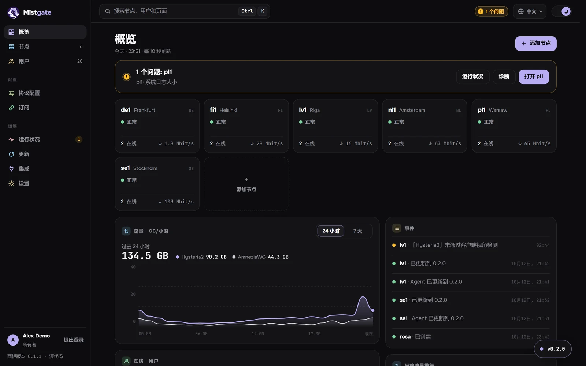
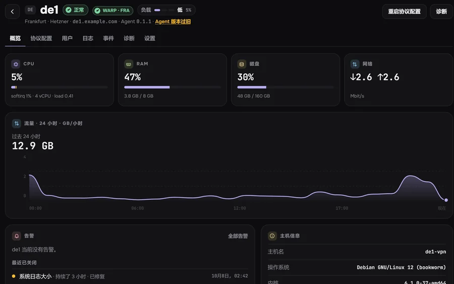
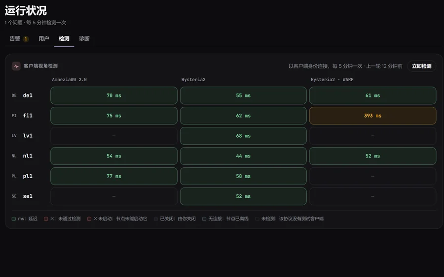
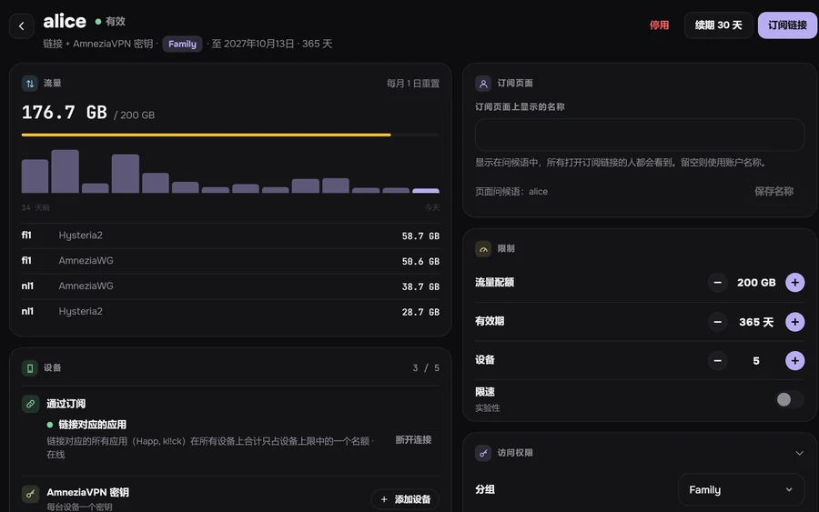
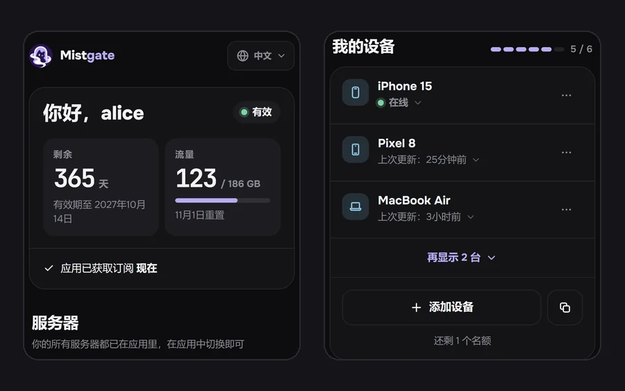

<div align="center">


<h1>Mistgate</h1>

<h3>为身边的人搭一个自己的 VPN，不必时时盯着服务器。</h3>

<p>适合家人、朋友、社群或小团队。<br>
在你自己的服务器上运行 Hysteria2、AmneziaWG 和 VLESS REALITY：在浏览器里添加服务器，给每个人一个链接，出了故障你最先知道。</p>

<p>

<a href="https://github.com/Mistgate/mistgate/releases/latest"></a>
<a href="LICENSE"></a>
<a href="https://github.com/Mistgate/mistgate/actions/workflows/ci.yml"></a>
<a href="go.mod"></a>
</p>

<p><a href="https://mistgate.app/zh/"><b>文档</b></a> · <a href="#快速开始"><b>安装</b></a> · <a href="#截图"><b>截图</b></a> · <a href="#与其他面板的对比"><b>对比</b></a> · <a href="README.md">English</a> · <a href="README.ru.md">Русский</a></p>

<p><sub><b>测试版。</b>Mistgate 已在生产环境中运行，但在 1.0 之前仍会有不完善之处，API、已存储的设置和节点协议也可能变化。<a href="https://mistgate.app/zh/roadmap/status/">状态和路线图</a></sub></p>

</div>

<picture>
  <source media="(prefers-color-scheme: dark)" srcset="docs/images/readme/overview-dark-zh.webp">
  <source media="(prefers-color-scheme: light)" srcset="docs/images/readme/overview-light-zh.webp">
  
</picture>

## 为什么用 Mistgate

Mistgate 面向为别人运行 VPN 的人：家人、朋友、社群或小团队。你安装一个面板，向其中添加服务器，再给每个人发一个链接。之后由面板负责保持服务器配置正确，并持续检测它们。

**一个链接，多种协议。**
基于 Clash/Mihomo 内核的应用（kl!ck、FlClash、Clash Verge Rev）可以从同一个链接获取 Hysteria2、VLESS 和 AmneziaWG 服务器：用户的网络封锁了其中一种协议时，另一种已经在应用里了。Happ 获取 Hysteria2 和 VLESS 服务器；AmneziaVPN 则在用户页面上为每台设备获取一个密钥。[客户端应用](https://mistgate.app/zh/guide/client-apps/)

**VLESS REALITY，藏在真实网站之后。**
VLESS 可以通过 TCP 运行（搭配 XHTTP，或搭配 RAW 和 Vision），也可以通过 TLS 运行（搭配 XHTTP 或 WebSocket），可以直连，也可以放在 CDN 之后，在限制 UDP 的网络上同样可用。非客户端访问者看到的是一个真实的网站：默认是节点自己的站点，使用它自己的 Let’s Encrypt 证书，也可以是你指定的其他站点。Hysteria2 和 VLESS 可以共用一个节点，包括 TCP 443 端口。节点页面上的**检测端口**会从另一台节点检测某个 TCP 端口能否连到 Mistgate 本身。[VLESS REALITY](https://mistgate.app/zh/guide/vless/) · [在同一节点上运行 VLESS 和 Hysteria2](https://mistgate.app/zh/guide/vless-and-hysteria2/)

**在浏览器里添加服务器。**
输入它的 IP 和 root 密码。面板会固定 SSH 主机密钥、检查服务器、在已启用的 UFW 或 firewalld 中开放端口、安装已签名的 Agent，并等待它连接。节点会自行获取 Let’s Encrypt 证书，**启用 WARP** 则让它获得一个 Cloudflare 出口。[通过 SSH 安装节点](https://mistgate.app/zh/getting-started/ssh-install/)

**你最先知道。**
面板每 5 分钟像应用那样连接一次每台服务器，并通过隧道加载一个测试页面。每个节点上的诊断会运行 17 项主机检查（磁盘、日志、DNS 解析、时钟、端口、BBR），并提供六种修复，只有你确认后才会执行。告警发送到 Telegram。[运行状况](https://mistgate.app/zh/operations/health/)

**轻量且隐蔽。**
两个静态 Go 二进制文件，一个是面板，一个是节点 Agent。使用 SQLite 和 systemd：无需 Docker，也无需数据库服务器。在一台小型测试服务器（1 vCPU / 1 GB）上，面板单独空闲时占用 16–20 MiB 私有内存（3x-ui 为 68–74，PasarGuard 为 262–265，Remnawave 为 426–454）；面板、节点和数据库一起运行在一台 2 vCPU / 2 GB 的服务器上，共占用 57 MiB（同样三者为 74、297 和 761）。在这项测试中，添加和删除用户、重启面板都没有断开任何连接，而 3x-ui 在用户变化时会重启其内核。陌生人打开面板地址只会看到一个伪装站点；管理后台位于私密路径或私密主机名之后。发布版本可复现构建，并在离线环境中签名，节点只安装已签名的构建。BT 下载拦截会在节点上拦截明文 BitTorrent；相关事件只记录匹配到的内容和目标端口，不会有任何地址离开节点。[安全](https://mistgate.app/zh/operations/security/) · [发布版本和签名](https://mistgate.app/zh/operations/releases/) · [基准测试，包括 Mistgate 较慢的地方](https://mistgate.app/zh/reference/benchmarks/)

**让 AI 智能体帮忙。**
面板内置 MCP 服务器。Claude Code、Codex 或其他智能体可以读取集群状态，并通过「计划 → 执行」来修改它。安装节点、诊断修复或更换服务器密码，都要等你在管理后台批准后才会执行。智能体永远拿不到订阅链接、设备密钥或密码。[AI 智能体指南](https://mistgate.app/zh/getting-started/ai-agents/) · [MCP](https://mistgate.app/zh/reference/mcp/)

> **即将推出，尚未包含在任何发布版本中：** 可管理集群和用户的完整 Telegram 机器人。在 Cloudflare Workers 上运行的 Cloudflare 版面板自 v0.1.36 起已包含在发布版本中，作为[预览版](https://mistgate.app/zh/getting-started/install-edge/)提供，尚未在真实的 Cloudflare 账户上运行过。

## 截图

<table>
<tr>
<td width="50%"><picture><source media="(prefers-color-scheme: dark)" srcset="docs/images/readme/node-dark-zh.webp"><source media="(prefers-color-scheme: light)" srcset="docs/images/readme/node-light-zh.webp"></picture><br><sub><b>节点。</b>状态、WARP 出口、负载和 24 小时流量。</sub></td>
<td width="50%"><picture><source media="(prefers-color-scheme: dark)" srcset="docs/images/readme/health-dark-zh.webp"><source media="(prefers-color-scheme: light)" srcset="docs/images/readme/health-light-zh.webp"></picture><br><sub><b>客户端视角检测。</b>每个节点上的每种协议，以及通过隧道的延迟。</sub></td>
</tr>
<tr>
<td width="50%"><picture><source media="(prefers-color-scheme: dark)" srcset="docs/images/readme/user-dark-zh.webp"><source media="(prefers-color-scheme: light)" srcset="docs/images/readme/user-light-zh.webp"></picture><br><sub><b>用户。</b>按设备 ID 区分的设备、计入配额的流量和各项限制。</sub></td>
<td width="50%"><picture><source media="(prefers-color-scheme: dark)" srcset="docs/images/readme/phone-dark-zh.webp"><source media="(prefers-color-scheme: light)" srcset="docs/images/readme/phone-light-zh.webp"></picture><br><sub><b>用户在浏览器中打开自己的链接。</b>剩余天数、流量和他的设备。</sub></td>
</tr>
</table>

截图中的数据均为虚构的演示数据。

## 快速开始

你需要一台全新的 Linux 服务器（amd64 或 arm64，带 systemd），一个直接指向它的域名（这里用 `panel.example.com`），空闲的 TCP 80 和 443 端口，以及支持 `ssh-keygen -Y verify` 的 `openssh-client`，或者 OpenSSL 3.2 及以上版本。在服务器上运行：

```sh
curl -fsSL https://mistgate.app/install.sh | sudo bash -s -- --public-url https://panel.example.com
```

安装程序会验证已签名的面板清单，运行 setup，并通过 systemd 启动 Mistgate。它会打印管理后台地址和一个 30 分钟后过期的一次性初始设置链接，不会修改防火墙规则。加上 `--yes` 可以非交互运行，加上 `--dry-run` 则只验证发布版本，不改动服务器。手动安装和其他选项见[安装面板](https://mistgate.app/zh/getting-started/install-panel/)。

然后：

1. 打开初始设置链接并创建所有者：使用通行密钥，或使用密码加身份验证器验证码。
2. 在**节点 → 添加节点**中添加服务器，可以通过 SSH，也可以用一条一次性命令（[添加节点](https://mistgate.app/zh/getting-started/add-node/)）。
3. 按照[首批用户](https://mistgate.app/zh/getting-started/first-users/)操作。[安装面板](https://mistgate.app/zh/getting-started/install-panel/)还介绍了手动安装、隐藏的管理后台、你自己的证书和你自己的伪装站点。

**也可以让 AI 智能体来安装。** Claude Code、Codex CLI，或任何能在你的电脑上运行 `ssh` 的智能体，都可以完成上面的步骤：从 [AI 智能体指南](https://mistgate.app/zh/getting-started/ai-agents/#使用-ai-智能体安装-mistgate)复制安装提示词。它每次改动前都会先询问，所有者账户由你自己创建。

## 与其他面板的对比

| | Mistgate | 3x-ui | Remnawave | Hiddify | PasarGuard | s-ui |
|:--|:--|:--|:--|:--|:--|:--|
| 无需 Docker 即可运行 | ✅ | ✅ | ❌ | ✅ | 部分 | ✅ |
| 数据库 | SQLite | SQLite 或 PostgreSQL | PostgreSQL + Redis | MySQL + Redis | SQLite、MySQL、MariaDB 或 PostgreSQL | SQLite |
| 面板空闲时占用 RAM | 16–20 MiB¹ | 68–74 MiB¹ | 426–454 MiB¹ | 未测量 | 262–265 MiB¹ | 未测量 |
| 一行命令安装 | ✅ | ✅ | ❌ | ✅ | ✅ | ✅ |
| 在面板中添加节点（SSH） | ✅ | ❌ | ❌ | ❌ | ❌ | ? |
| Hysteria2 | ✅ | ✅ | 部分 | ✅ | ✅ | ✅ |
| AmneziaWG | ✅ 2.0 和 3.1 | ✅ 3.1 | ? | ? | ? | ? |
| VLESS REALITY | ✅ | ✅ | ✅ | ✅ | ✅ | ? |
| VMess、Trojan、Shadowsocks | ❌ | ✅ | 部分 | ✅ | ✅ | ✅ |
| Xray JSON 或 sing-box 订阅 | ✅ 两者都有 | Xray JSON | ✅ 两者都有 | ✅ 两者都有 | sing-box | sing-box |
| 健康检查和告警 | ✅ 客户端视角检测，带修复的诊断 | ✅ 隧道监控（需手动开启） | ✅ 状态、Prometheus | 部分 | 部分 | ? |
| Telegram 机器人 | 仅告警，完整机器人即将推出 | ✅ | 部分 | ✅ | ✅ | ? |
| HWID 设备限制 | ✅ | ✅ | ✅ | ? | ✅ | ? |
| 面向 AI 智能体的内置 MCP 服务器 | ✅ | ? | ❌ | ? | ? | ? |

¹ 整个面板进程组空闲时的私有内存，0 到 200 个用户，未连接节点，在 1 vCPU / 1 GB 的测试服务器上测得（3x-ui 包含它的 Xray 内核和 fail2ban）。方法、版本和局限见[基准测试](https://mistgate.app/zh/reference/benchmarks/)。「?」表示该项目自己的 README 和文档中没有说明。

在协议覆盖范围、社区规模和功能完整的 Telegram 机器人方面，其他面板更领先。带来源的完整对照表（核对于 2026-10-09）见[与其他面板的对比](https://mistgate.app/zh/reference/comparison/)。

## 状态和路线图

Mistgate 处于测试阶段。[最新发布版本](https://github.com/Mistgate/mistgate/releases/latest)已在生产环境中运行。在 1.0 之前，API、已存储的设置和节点协议仍可能变化。适用于 amd64 和 arm64 的 Linux 二进制文件在 [GitHub Releases](https://github.com/Mistgate/mistgate/releases/latest) 上提供。

下一步：先在真实账户上运行 Cloudflare Workers 版（[预览版](https://mistgate.app/zh/getting-started/install-edge/)），并让它具备与 VPS 版相同的功能；再往后是面向集群和用户的 Telegram 机器人。部分默认值偏向俄罗斯用户（俄罗斯节点默认使用 Yandex DNS、诊断所用的检测域名、DNS 分流预设），这些都可以在设置中修改。详情和已知限制见[状态和路线图](https://mistgate.app/zh/roadmap/status/)。

## 文档

全部内容都在 [mistgate.app](https://mistgate.app/zh/)，相同的页面也在 [`docs/`](docs/README.md) 中。可以从这里开始：

- [概览](https://mistgate.app/zh/getting-started/overview/)和[要求](https://mistgate.app/zh/getting-started/requirements/)
- [安装面板](https://mistgate.app/zh/getting-started/install-panel/)、[通过 SSH 安装节点](https://mistgate.app/zh/getting-started/ssh-install/)、[首批用户](https://mistgate.app/zh/getting-started/first-users/)
- [运行状况](https://mistgate.app/zh/operations/health/)、[更新](https://mistgate.app/zh/operations/updates/)、[面板加密备份](https://mistgate.app/zh/operations/backups/)、[故障排查](https://mistgate.app/zh/operations/troubleshooting/)
- [CLI](https://mistgate.app/zh/reference/cli/)、[API](https://mistgate.app/zh/reference/api/)、[MCP](https://mistgate.app/zh/reference/mcp/)、[架构](https://mistgate.app/zh/reference/architecture/)

## 参与开发

欢迎提交缺陷报告、修复和文档改进。[CONTRIBUTING.md](CONTRIBUTING.md)（英文）介绍了构建方法、代码结构、CI 运行的检查和约定。编码智能体请先阅读 [`AGENTS.md`](AGENTS.md)；[AI 智能体指南](https://mistgate.app/zh/getting-started/ai-agents/#使用编码智能体参与开发)中有一段现成的提示词，可用于参与开发。

## 安全

请私下报告漏洞，见 [SECURITY.md](SECURITY.md)。请备份面板的数据目录（`/var/lib/mistgate`）：其中保存着数据库、主密钥和节点所信任的 CA。[加密备份](https://mistgate.app/zh/operations/backups/)到 Cloudflare R2 可以按计划自动完成这件事。

## 许可证

Mistgate 是自由软件，采用 [GNU Affero General Public License v3.0 only](LICENSE)。如果你为他人运行修改过的面板，其管理后台会显示一个「源代码」链接（`serve --source-url`），它应指向你的源代码。
