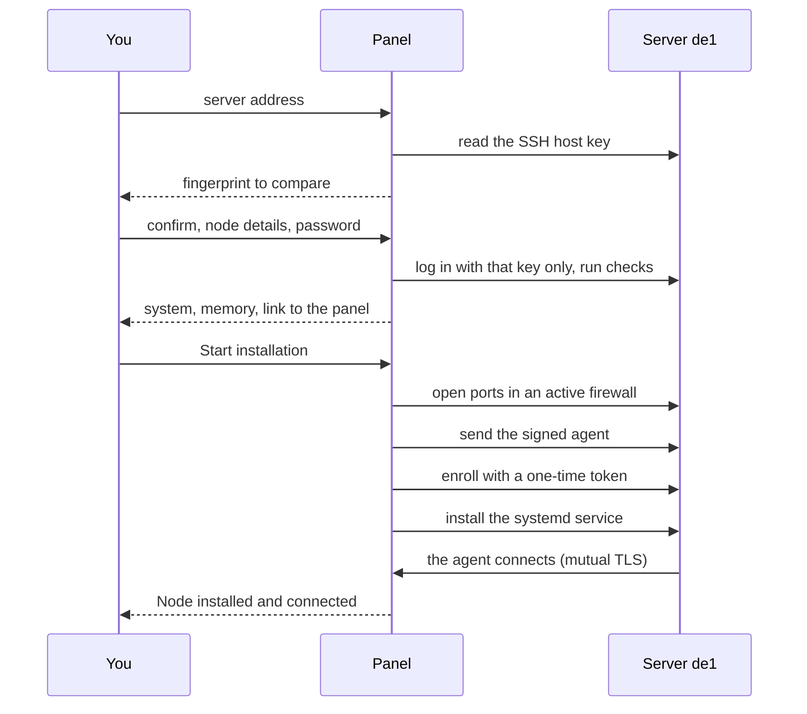

With an SSH installation the panel itself connects to a new server, checks it, installs the node agent and waits for it to connect: you do not copy anything to the server or paste a command. It is the owner's job and starts in **Nodes → Add node → Install automatically over SSH**. An AI agent can start the same installation through MCP, and you approve it in the admin: see the [AI agent guide](ai-agents.md). When the panel cannot reach the server over SSH, use the [manual install](add-node.md).

## What you need

- A server with Ubuntu 22.04 or newer or Debian 12 or newer, amd64 or arm64, systemd, at least 256 MiB of RAM and free space in `/root` for the agent (its size plus 64 MiB). See [Requirements](requirements.md).
- SSH login with a password, as `root` or as an account that runs `sudo -n` without asking for a password. Login with an SSH key is not supported. The address must be public: private, loopback and link-local addresses are refused.
- SSH open to the panel server. If a provider firewall or security group limits SSH, first allow inbound TCP on the SSH port from the panel server's public egress address. The panel can change only the firewall on the host, and only after SSH connects.
- The panel's agent address reachable from the server: the panel's public address on TCP 443, or the address given to `serve --agent-addr`. The checks test it.
- A public address the panel knows: `setup --public-url` or `serve --agent-addr`. Without one the wizard says "The panel's public address is not configured".
- A trusted, unexpired node agent bundle in the panel's data directory. A panel from the official release downloads it from GitHub Releases when it starts and every 10 minutes after that. A panel you built yourself needs a bundle you signed in `<data-dir>/dist`: see [Releases and signing](../operations/releases.md). The **Release bundle** line on the Updates page shows its state.

## The four steps

1. **Server.** Enter the **SSH server address** and the **SSH port** (usually 22) and press **Check server**. The panel reads the server's SSH host key from its own server. No login or password is sent yet.
2. **SSH key.** Compare the SHA-256 fingerprint and its key type with a trusted copy: one your provider's console shows, or the output of `ssh-keygen -lf /etc/ssh/ssh_host_ed25519_key.pub` run on the server through that console. Do not confirm a key you cannot check. Tick the confirmation, then fill in the node: **Name**, **Address** (the public domain or IP clients connect to), **Country**, **Region or city**, **Provider**, the **SSH login** (`root` by default) and the **SSH password**. **Continue** may ask you to confirm your sign-in again (see "Step-up re-authentication" in [Security](../operations/security.md)), then logs in with exactly the confirmed key and runs the checks.
3. **Check.** Review **System**, **Architecture**, **Kernel**, **Processors**, **Memory**, **Free disk**, **systemd** and **Panel connection**. Enter the password again, tick "Install the Mistgate agent and create this node" and press **Start installation**. The server is unchanged until this point.
4. **Install.** The job runs in the panel, phase by phase: connecting over SSH, checking the server, preparing the host firewall, sending the agent, registering the node, starting the agent, waiting for the node to connect. **Close; keep running in background** closes the window; the job goes on. When the agent connects, the window says "Node installed and connected" and offers **Open node**. If the job fails, the window says why and offers **Retry installation** with the password, or **Open install manager**.

The new node then has no profile yet: go on with [First users](first-users.md).

## What the panel does on the server

Everything runs over one SSH connection that accepts only the confirmed host key. For a login other than root, every command runs through `sudo -n`.

1. **Checks.** It reads the OS, architecture, kernel, CPUs, memory, free disk in `/root` and whether systemd is there, whether the server already holds a Mistgate node identity, and whether the server can open a TCP connection to the panel's agent address (a 5-second test).
2. **Host firewall.** Only a firewall that is already active is touched; an inactive one stays inactive. UFW gets the SSH port, then 80/tcp, 443/tcp and 443/udp with the comment `mistgate-node-provision-v1`, except a port you already have the same rule for. firewalld gets the SSH port, 80/tcp, 443/tcp and 443/udp in every active zone, at runtime and permanently, without a reload that would drop runtime-only rules.
3. **Agent.** It streams the agent for the server's architecture from the trusted bundle to `/root/mistgate-node`, checks its size and SHA-256, and makes it executable.
4. **Enrollment.** It runs `mistgate-node enroll` with a one-time token that is valid for an hour. The token goes in on standard input (`--token-stdin`), never on the command line. `--resume-key` keeps the pending key on disk, so an interrupted enrollment can be retried with the same key.
5. **Service.** It runs `mistgate-node install`, which writes the hardened systemd unit and starts the agent, exactly as in a manual install: see "What happens on the server" in [Add a node](add-node.md).
6. **Connection.** It waits up to 2 minutes for the agent to connect, then saves the SSH access (encrypted) and ends the job.

From then on the agent keeps UFW in line with its own profiles: after it applies an enabled UDP inbound, it adds that exact port, and an accepted Hysteria2 port-hopping range, to an active UFW as rules tagged as its own. It never changes or removes a rule for the same port that it did not add. UFW runs outside the agent's sandbox, as a transient systemd unit. firewalld is only checked: the agent names the ports missing from the default zone, and you add them. When the host firewall cannot be brought in line, the node shows one `host_firewall_sync_failed` warning event and the listener keeps running. Retiring the node removes the tagged rules, the 80/443 rules of the installation included; the SSH rule is never removed.

## Install jobs and the install manager

Every installation is a job the panel keeps. The install manager at `<admin URL>nodes/install` lists the last 100 jobs with their state (queued, installing, stopping, cancelled, node connected, failed) and the saved server access. A job's page shows its steps, refreshes every 4 seconds and never shows output from the server. Only the owner opens it.

The install manager speaks English, Russian or Simplified Chinese: the admin's language when opened from the wizard (it passes `?lang=`), otherwise the browser's first language when that is Chinese or Russian, else English.

- **Cancel.** A queued job stops at once and its temporary SSH data is deleted. A running job is asked to stop; a command that is already running on the server may have changed it, so check the server before you retry.
- **Retry.** A failed or cancelled job can run again with the SSH login and password. The checks see whether the server already holds the identity of this node and the job continues from there; a server that holds another node's identity is refused. A job whose node was retired cannot be retried: start a new installation.
- **Names.** A node name is reserved while the node is live or an installation for it is active. Retiring a node keeps its history and frees the name.
- **The password.** While a job runs, the SSH password is stored encrypted with the panel's master key and bound to that job. It is deleted when the job ends; on success it becomes the node's saved access.

## Saved SSH access

After a successful installation the panel keeps the SSH login and password, encrypted with the master key, together with the pinned host key. No API read, MCP tool or log ever returns the password.

- **See it.** The node's **Settings → SSH access** card shows the SSH server and login. **Reveal password** asks you to confirm your sign-in again and is written to the audit log.
- **Change it.** In the install manager, the server access table takes a new password of at least 12 characters. Through MCP, `node_server_password_rotate` makes the panel generate one; the agent never sees it. Either way the panel first stores the new password as pending, changes it on the server with `chpasswd`, logs in again with it, and only then replaces the saved one.
- **An interrupted change.** If the server could not confirm the new password, the next reveal or change first tries both. When the server cannot be reached to tell which one works, **Reveal password** shows "Current password (not verified)" and "New password from the interrupted change (not verified)": try the current one first. A new change waits until the server answers. If the server rejects both, reset the password through your provider's console.
- **A password the panel generated.** Only the panel knows it, and the card says so. Reveal it and keep a copy before you retire the node.
- **A retired node.** Its SSH access card stays: the panel no longer changes that server, but you can still reveal the password. **Forget saved access**, asked twice and with a fresh sign-in confirmation, deletes it for good. Only a retired node's access can be forgotten.

## On the Cloudflare edition

The edge edition (the panel on Cloudflare Workers) installs nodes over SSH too. The wizard, the steps, the install manager and the saved access are the same; the installs run in a second Worker script, `mistgate-edge-provision`, that `mistgate edge deploy` deploys with the panel (see [Install the Cloudflare edition](install-edge.md)). What differs:

- **The panel connects from Cloudflare's network**, not from a server you know and not from your computer. For the time of the install SSH on the new server must accept inbound TCP from the internet on its port, in the provider firewall or security group and in the host firewall. A rule that allows only your own IP, or one fixed panel address, makes the check time out: Cloudflare does not publish the addresses a Worker connects from. You change or reveal the saved password later over SSH too, so open it again for that.
- **The agent comes from the signed release on GitHub** that matches the panel's version, and the node enrols over the panel's public address. A panel build that is not a release has no trusted agent and the wizard says so.
- **"Refused or unreachable"** (the wizard says "The panel's network refused this address, or the server cannot be reached from it") means that Cloudflare's network did not connect the panel to that address. From a Worker a refusal by the platform and a closed port look the same, so the panel cannot say which it was. Look for: an address that belongs to Cloudflare, or a name that Cloudflare proxies (an orange cloud in the DNS list), where you need the server's own address or a DNS-only name; a private network or a server reachable only through a VPN or a bastion; a wrong port or no SSH service on it.

When the panel cannot reach the server this way, or the server takes SSH keys only, install the node with the manual command: the wizard offers **Use the manual command** next to this error, and [Add a node](add-node.md) describes it. An install that Cloudflare interrupts three times in a row stops as failed; retry it or use the manual command.

## When it fails

| The wizard says | What to do |
|:--|:--|
| The panel could not reach this SSH address and port in time | Check that SSH runs on that port, and allow inbound TCP from the panel server's egress address in the provider firewall. If the host firewall blocks SSH, open it through the provider's console. |
| The panel's network refused this address, or the server cannot be reached from it | Edge edition only: see "On the Cloudflare edition" above. Use the server's own public address, or the [manual install](add-node.md). |
| The panel got no answer from this SSH address and port in time, and the text names Cloudflare's network | Edge edition: allow inbound TCP on the SSH port from the internet for the install, not only from your own IP; or use the [manual install](add-node.md). |
| The panel could not read an SSH key from this address | Check the host, the port and the SSH service. |
| Enter a public server address that can be reached over SSH | The address is private, loopback or link-local, or does not resolve. Use the server's public address. |
| The server rejected this SSH login or password | Check both; the panel supports password login only. |
| The SSH key changed after confirmation | The server now shows another host key: find out why before you start again. |
| Use Ubuntu 22.04 or newer, or Debian 12 or newer / The server must use amd64 or arm64 | The server is not supported; use the [manual install](add-node.md) only if you know the agent works there. |
| The SSH account needs root access or passwordless sudo | Log in as root, or allow the account `sudo -n`. |
| The panel's public address is not configured, so the node cannot connect back | Set `--public-url` or `--agent-addr`. |
| The server could not open a TCP connection to the panel's agent address | Allow the agent port in the firewall or security group in front of the panel, check the DNS of the agent address and outbound TCP from the server, then try again. |
| The server has no systemd | Use Ubuntu 22.04+ or Debian 12+ with systemd. |
| The server has too little memory or CPU | The agent needs at least 256 MB of RAM. |
| The server has too little free disk space for the agent | It needs the agent's size plus 64 MB. Free some space, then retry. |
| The server already holds another or a damaged Mistgate node identity | Remove `/var/lib/mistgate-node` on the server only if that node is gone, then retry. |
| The panel has no trusted agent for this server's architecture | Check **Release bundle** on the Updates page, then retry. |
| This node name is already in use | Choose another name, or retire the old node first. |
| The panel connected, but could not prepare the active UFW/firewalld rules | Check the account's root or `sudo -n` access and the host firewall, then retry. |
| SSH stopped after changing the server | Some install commands may have run. Look at the server, then retry. |
| The agent was installed but did not connect to the panel | On the server: `journalctl -u mistgate-node -n 50 --no-pager`. Usually the node cannot reach the panel's agent address. |
| Mistgate could not install or start its systemd service | Look at the server's journal, then retry. |
| Installation stopped. Open the install manager for details | A reason the wizard has no words for; the manager shows the job's exact code. |
