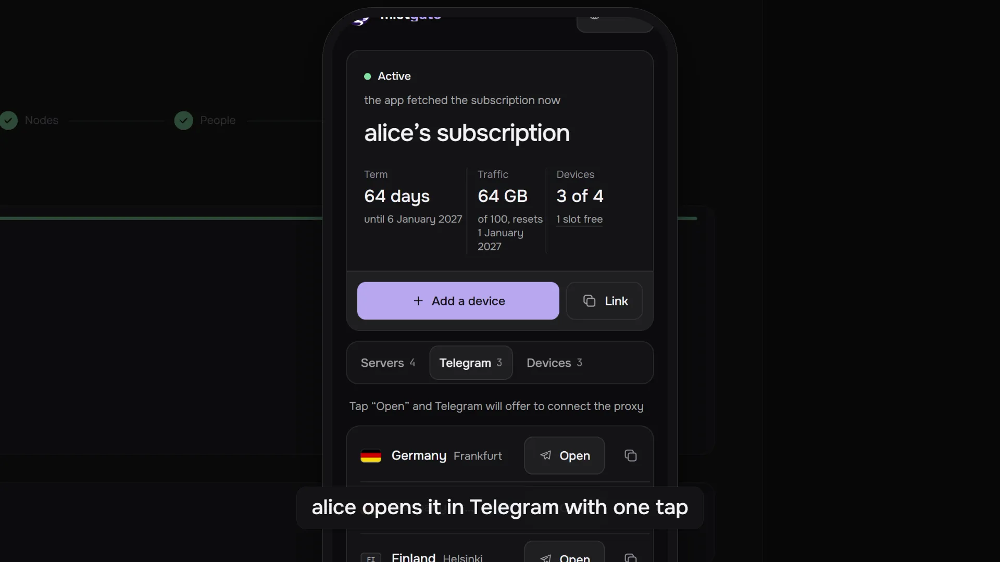

MTProto is Telegram's own proxy protocol. A Mistgate MTProto profile makes every node it runs on a proxy server for the **Telegram app and nothing else**: the person taps a link, Telegram adds the proxy to its settings, and Telegram's traffic goes through the node. It is not a VPN: other apps do not use it, and no VPN app reads it. This page lists the settings of an MTProto profile and how a person gets the link; how a profile is made and put on nodes is on [Profiles](profiles.md). A profile can also run in the **Web** mode, which gives people a different kind of link; it is described under [Web Proxy](#web-proxy).



> **Note:** MTProto is **experimental**. It is the first version of the protocol in Mistgate and has not been proven in the field yet; the panel marks it as experimental where you pick the protocol. Settings and behaviour may still change.

## When it helps, and its limits

Use it where Telegram is blocked or throttled but the rest of the internet is not, or as a lighter second way to reach Telegram next to a VPN. The proxy speaks Fake TLS: to anyone who watches the connection it starts like an ordinary TLS 1.3 handshake with a site, and the node answers everyone who is not a client with a real site (see [The name in the handshake](#the-name-in-the-handshake)).

What it cannot do:

- **It may not work in Russia.** Since spring 2026 MTProto proxies have been detected and blocked in waves there. A proxy can work for a week and then stop. If your people are in Russia, expect that and keep a VPN profile (Hysteria2, VLESS) as the main way.
- **A green check does not prove it works for your people.** The panel's checks run from the panel's server, outside any country. They show that the node does its job, not that a network inside a censoring country lets the connection through. Try the link on the networks that matter before you promise anything.
- **A careful prober can still tell the fake from a real site.** The node's answer to a Fake TLS hello is built to look like a TLS 1.3 server, but a scan that compares it with the real flight of a real site can see the difference. This is why strangers are sent to a real site, and why no setting makes the proxy invisible.
- **Telegram only.** A tap on a link changes only Telegram's proxy setting. No other app goes through it.
- **No middle proxy.** The node connects straight to Telegram's data centres. Telegram's promoted channel (the sponsor tag) is not available; see [What is not built yet](#what-is-not-built-yet).

## The name in the handshake

A Telegram proxy secret carries a domain: Telegram puts it into the TLS handshake as the server name. The node accepts only a handshake with that name and the person's key, and sends everyone else, other names, wrong keys, replayed hellos, plain HTTP, browsers and scanners, to a site. You choose the domain per profile, in the setting **Name in the TLS handshake**:

| | This node's name | Another site |
|:--|:--|:--|
| The domain | The node's own host name (or the **Domain (SNI)** set for the profile on that node) | A real site you name, for example `www.example.org` |
| What a stranger sees on the port | The node's own decoy site, the one Hysteria2 and VLESS show, with the node's certificate | The real site: the node passes the connection on to it, so the prober completes a real handshake with that site and sees its certificate |
| Let's Encrypt on the node | Keeps working, also on TCP 443: the validation is answered on this port | On TCP 443 the node's own site and that validation are not answered here, so the node's certificate renews over port 80 |
| A node with only an IP address | Not possible: there is no name to use | Works |
| Its weak side | The decoy site must look natural for the node's name | The domain does not belong to the server's IP address, which some networks notice |

How to choose:

- Start with **This node's name** on a node that has a domain. Strangers get the same decoy site as on the node's other protocols ([Your own decoy site](decoy-site.md)), and nothing else changes on the node.
- Choose **Another site** for a node known only by its IP address, or when you want strangers to meet a big, well-known site. Pick a site that is fast and not blocked where your people are, and that has nothing to do with you. **Do not use the domain of the panel**: anyone who probes the node would then see the panel's address.
- With **Another site** on TCP 443, keep port 80 of the node reachable, or its certificate cannot renew. The profile editor warns about this, and about the IP mismatch.
- A site you name must be a plain host name (`www.example.org`): no IP address, no port, no path.

## Settings

The editor shows the settings under **Basics**. Critical settings change the links people already have, so people must add the new link again; the editor asks before it saves them (see [Profiles](profiles.md)).

| Setting | Default | Critical | What it does |
|:--|:--|:--|:--|
| **Mode** | Fake TLS | yes | **Fake TLS** or **Web**. Web is the [Web Proxy](#web-proxy): the port is fixed at 443 and the name is the node's own. The rest of this page is about Fake TLS unless it says otherwise. |
| **TCP port** | 443 | yes | The TCP port the node listens on, 1 to 65535. In the Web mode it is fixed at 443. |
| **Name in the TLS handshake** | This node's name | yes | **This node's name** or **Another site**. See above. The Web mode has no such choice: the editor hides it. |
| **Site** | empty | yes | Another site only: the host name of that site. |

On a node the profile can have its own **Port**, and, with **This node's name**, its own **Domain (SNI)**, which is then the name in the handshake.

MTProto is a TCP profile. On a TCP port that another TCP profile of the node already holds, VLESS for example, it can stand beside it only when each of them has a name of its own and one of them shows the node's own site: see [One 443 for everyone](shared-port.md). The panel proposes the new name for the profile you add, so a service that already stands on the port keeps its name and its `tg://` links. Otherwise put MTProto on another port; Telegram accepts any port. The built-in site that Hysteria2 shows on TCP 443 gives way to MTProto, as it does to VLESS ([VLESS and Hysteria2 on one node](vless-and-hysteria2.md)); with **This node's name** the visitor of that port still sees the node's site.

The node's clock matters here. The handshake carries the client's time, and the node accepts it within about five minutes of its own clock. A node whose clock is off refuses every client; the doctor's **Clock** check warns about it (see [Health](../operations/health.md)).

## Add a profile

1. Open **Profiles** and press **New profile**. The first step is the choice of a protocol: pick the **MTProto** card. The second step is the form.
2. Set the **TCP port** and the **Name in the TLS handshake**; with **Another site**, type the **Site**.
3. Give the profile a name and say where it goes: put it on nodes, and add it to a group. A person gets Telegram only from a group that carries an MTProto profile on a node they may use.
4. **Create profile**.

If a node has only an IP address and the profile uses **This node's name**, the node refuses it with the reason: enter a domain for the profile on that node, or choose **Another site**. The panel on the right shows the link a person would get, with the key hidden.

A node runs MTProto with the node agent v0.1.69 or newer. The panel does not send the profile to an older agent: there the server shows as not started because the node's agent is too old, and everything else on the node keeps updating. Update the agent on the **Updates** page.

## Give Telegram to a person

Telegram is a switch on the person, next to the subscription link and AmneziaVPN keys, in the user form and on the user card. It is off by default.

- Turning it on makes the person's **Telegram key** at once: one key per person, the same on every MTProto profile and node they may use.
- The Telegram switch comes **in addition** to Happ or AmneziaVPN, not instead of them. At least one of those two stays on.
- The key is listed among the person's devices as **Telegram proxy**, but it takes no place in the device limit, so it never fails for want of room. Turning the switch off, or deleting the person, revokes it.
- A person gets links only while they are active, and the group has an MTProto profile on a node they may use. A disabled, expired or over-quota person loses the proxy with the rest of their access.
- **No link goes into a subscription.** VPN apps would show a `tg://` line as a broken server, and the Telegram app reads no subscription. The link comes only from the person's page or from the admin.

## Where the person finds the link

- **Their own page.** A block **Telegram proxy**, under the servers, when Telegram is on for them. Each link is named by the server's country and place, never by the node's name in the panel, and has **Open in Telegram** and **Copy link**. Until the proxy is ready the block says so. See [User page](user-page.md#telegram-proxy).
- **The admin.** On the person's page in **Users**, the block **Telegram proxy** lists the links with **Open in Telegram**, copy and a QR code, and the buttons **Re-issue** and **Revoke**. Send the link, or show the QR code, over any channel you trust.

A link looks like this, with the key and the name in hex:

```ini
tg://proxy?server=de1.example.com&port=443&secret=ee<key><name>
```

The link is the key: anyone who has it can use the proxy. Treat it like a password. Telegram asks the person to confirm before it uses the proxy.

## Re-issue and revoke

- **Re-issue** gives the person a new key. Every link made before stops working at once, on all nodes, and open connections on the old key are closed. The new links appear in the block; the person adds them in Telegram. Use it when a link leaked.
- **Revoke** takes the key away. The links disappear, open connections are closed, and Telegram stays switched on for the person, with no key. A new key can be made from the same block.
- Turning the Telegram switch off, or removing the **Telegram proxy** device, revokes the key too.

One key holds up to 64 connections at once. Telegram opens about 10 to 15 per account at the busiest, so a leaked key cannot carry more than a handful of people. A connection with no data for 10 minutes is closed.

## Relays and IPv6 twins

A person's Telegram links follow the same rules as other servers (see [Subscriptions](subscriptions.md#extra-servers-over-ipv6-and-through-a-relay)), with the same labels:

- if the node has an [IPv6 entry](nodes.md#ipv6-entry), there is a second link at its IPv6 address, marked **IPv6**;
- for each working [relay](relays.md) of the node there is another link through the entry node, marked **via RU** (the entry's country). The relay passes the connection on unchanged, so the key and the name in the handshake stay those of the exit.

A Web Proxy link has neither an IPv6 twin nor a relay: see [Web Proxy](#web-proxy).

## What the health check proves

The panel checks every MTProto profile as Telegram would use it, with a hidden key of its own that belongs to no person ([Health](../operations/health.md#mtproto)):

1. it opens a TCP connection to the profile's port;
2. it completes the Fake TLS handshake with the name and a key;
3. it asks Telegram's data centre 2, through the proxy, for a first message (`req_pq_multi`) and checks that a valid answer comes back.

A green cell therefore proves that the node accepts a client, can reach Telegram, and that Telegram answers through it. It does not prove that a network inside a country that blocks MTProto lets the traffic through. When it fails, the cell says at which step.

## Web Proxy

> **Warning:** The **Web** mode is **in development** and has not been tried on live Telegram apps yet: the page the app loads from the node is still a stub, and no real Telegram app has been checked against it. Do not give Web links to people yet. This section describes what the panel and the node do today.

A profile in the **Web** mode serves another kind of Telegram link, `tg://webproxy`. There is no Fake TLS handshake: the Telegram app visits a name of the node over HTTPS, as a browser visits a site, and carries its traffic over that connection. Anyone who visits the name without a key sees the node's own site.

A Web Proxy is a proxy for the **Telegram apps** (Desktop, Android and iOS), like every other proxy on this page. It is not Telegram Web in a browser: a browser tab does not use it. Support in the apps is still uneven: it is in recent versions of Telegram Desktop, and on phones it arrives as the apps get it. An app that does not know `tg://webproxy` cannot use the link.

### How it differs from Fake TLS

| | Fake TLS | Web |
|:--|:--|:--|
| Link | `tg://proxy`, the secret starts with `ee` | `tg://webproxy`, the secret starts with `dd` |
| What the connection looks like | A TLS 1.3 handshake with a site, then Telegram's own protocol | An HTTPS visit to a host name, with that name's real certificate |
| Port | Any TCP port, 443 by default | 443 only |
| The name | In the secret: the node's name or another site | The node's own name; another site is not possible |
| What a stranger sees | The node's decoy site, or the other site you named | The node's own site |
| Relays and IPv6 twin | Yes | No |
| The node's agent | v0.1.69 or newer | One that lists `mtproto-web/1` |

The person's Telegram key is the same for both: one key per person, so re-issuing or revoking it ends both kinds of link at once.

### When to choose it

The Web mode is newer than Fake TLS and unproven, so treat it as a second way beside Fake TLS, not a replacement. It suits a node where you want the proxy to look like a visit to an ordinary site under a name of its own, for people whose Telegram app supports it. Give the same people a Fake TLS profile as well: a person gets the links of every MTProto profile on the nodes they may use, and when one kind fails on their network, the other may still work.

Choose Fake TLS when you need a port other than 443, a relay or an IPv6 twin, or when your people's apps do not know `tg://webproxy` yet.

### What it needs

- **A name of its own for the profile on the node.** A host name with a dot, such as `tg.example.com`, with a DNS record that leads to the node (an `A` record with the value `192.0.2.10`), without a proxy (the grey cloud on Cloudflare). It is the node's own host name, or the **Domain (SNI)** you give the profile on that node. Prefer a name of its own: where another service already stands on TCP 443 under the node's name, a second one cannot take the same name (`sni_taken`). A node known only by an IP address needs the name in any case. The node asks Let's Encrypt for the name's certificate by itself once the name leads to it; until then clients cannot connect, and the health check says the certificate is not issued yet.
- **TCP 443 of the node, free or shared.** The Web profile takes TCP 443 for itself, or stands beside VLESS, TrustTunnel and Fake TLS MTProto on the shared port, each under its own name: see [One 443 for everyone](shared-port.md). It shows the node's own site, so the node's other services can share the port with it.
- **A node agent that lists `mtproto-web/1`.** An older agent would ignore the mode and start a Fake TLS server under the same profile, so the panel does not send it the profile (see Limits below).

### Turn it on

1. Prepare the name and add its DNS record, as above.
2. Open **Profiles**, press **New profile** and pick the **MTProto** card.
3. Set **Mode** to **Web**. The editor sets the **TCP port** to 443 and locks it, hides **Name in the TLS handshake**, and says under **Mode** that the profile needs a subdomain of its own on the node. **Mode** is a critical setting: on an existing profile, changing it changes the links people have (see [Profiles](profiles.md)).
4. Name the profile, put it on nodes and add it to a group, then **Create profile**. When TCP 443 on a node is already held by another service, the window asks for the name and shows the DNS record (**Put beside on 443**, see [One 443 for everyone](shared-port.md#in-the-admin)). Otherwise type the name into **Domain (SNI)** for that node, or leave it empty to use the node's host name.
5. Add the DNS record. Once the certificate is issued, the profile's cell in [Health](../operations/health.md) turns green.

If a profile has a port of its own on a node that is not 443, it does not start there. The editor warns about it before you save: take that port off on the profile's **Servers on nodes** tab. A node with only an IP address and no **Domain (SNI)** refuses the profile with the reason, as it does for Fake TLS.

### What the person sees

Nothing changes in how Telegram is given to a person: the same switch, the same key. The **Telegram proxy** block of their page and the same block in the admin show a Web link as a row marked **Web**; the hint on the mark says it is a Web Proxy link. It is named by the server's country and place, like the others, and has **Open in Telegram** and **Copy link** (and a QR code in the admin). A link looks like this:

```ini
tg://webproxy?server=tg.example.com&port=443&secret=dd<key>
```

Here `server` is the profile's name on the node, not the node's address, and the key is the person's Telegram key. The link is the key, as with Fake TLS.

### What a stranger sees

Anyone who does not hold a key gets the node's own site ([Your own decoy site](decoy-site.md)): on every path, also on a request that looks like the app's but carries a wrong or revoked key, and with the name's real certificate. Only the holder of a key gets the hidden page that the app uses; after the key is re-issued or revoked, the old link meets the site. This is not invisibility: the name is listed in public certificate logs like every Let's Encrypt name, and a visitor who knows it finds an ordinary site there.

### Limits

- **Telegram apps only**, and only those that support the Web Proxy. A browser tab does not use it.
- **No calls.** Calls do not work through a Web Proxy; this is a limit of the Web Proxy of the Telegram apps, not of Mistgate.
- **Port 443 only.** The profile's port cannot be changed, and a port of its own on a node is refused.
- **No relays and no IPv6 twin.** The link carries a name, not an address, so a twin at another address would be a copy of the same link. A relay is refused with the reason `webproxy`: in the admin, "Web Proxy works only straight on the node", and in MCP `relay_candidates` lists the server as unsupported.
- **A fresh node agent.** The panel sends the profile only to an agent that lists `mtproto-web/1`. On an older one the server shows as not started, with a note that the node's agent is older than this profile needs and a request to update the node on the **Updates** page; everything else on the node keeps updating.
- **The same limits per key as Fake TLS:** up to 64 connections at once.
- **Experimental**, like the whole protocol.

### How the panel checks it

The panel checks a Web profile with a client of its own, not with a Telegram app, using the profile's hidden check key:

1. connects over TCP to port 443 of the node, with the profile's name in the TLS hello, and checks the certificate of the name;
2. asks for the hidden page the way the app does, and gets it only if the node accepts the key;
3. opens a session and a stream through the node;
4. asks Telegram's data centre 2 for a first message (`req_pq_multi`) and checks that a valid answer comes back;
5. closes the session.

A green cell proves that the node, the certificate, the Web Proxy service on the node's site and Telegram's data centre work. It does not prove that a Telegram app accepts the page, or that a network inside a country that blocks MTProto lets the traffic through. When it fails, the cell says at which step. The codes, and the cell's own words for them:

| Code | The cell says | What it means for the Web Proxy |
|:--|:--|:--|
| `refused` | Connection refused: nothing listens on the port | The TCP connection to port 443 failed: the profile did not start, or a firewall is in the way |
| `timeout` | No answer in time: the handshake or the first request did not complete … | A step did not answer in time: the connection, the page, the session or Telegram's data centre |
| `tls` | Certificate or domain does not match | The secure connection to the name failed: the certificate is not issued yet (the DNS record is missing or new), it is for another name, or the connection broke before the page came |
| `auth` | The node refused the panel's check account | The node answered with its site instead of the hidden page: it does not accept the check key, for example because the profile was just changed and the node has not applied it |
| `session` | The node could not create the Web Proxy carrier session | The page came, but the node did not create the session or open the stream |
| `exit_unreachable` | The tunnel works, but the node's exit to the internet does not | The session works, but Telegram's data centre 2 did not answer with a valid `resPQ`: the node cannot reach Telegram's addresses |

## What is not built yet

- **A middle proxy and the promoted channel.** The node talks to Telegram's data centres directly. Telegram's own proxy configuration, and with it the sponsor tag that proxies can show, are not supported.
- **Speed limits per person and per device.** The limits on the user card apply to Hysteria2 and VLESS, not to the Telegram proxy.
- **People with Telegram only.** Telegram goes together with Happ or AmneziaVPN; a person cannot have the proxy and nothing else.
- **Shaping the fake answer after the real site.** The node does not yet measure the real handshake of the site and copy its shape.
- **More for the Web Proxy.** Only the HTTPS carrier is built: there is no WebSocket and no carrier per stream. Relays through an entry node are not built either (see Limits above).
