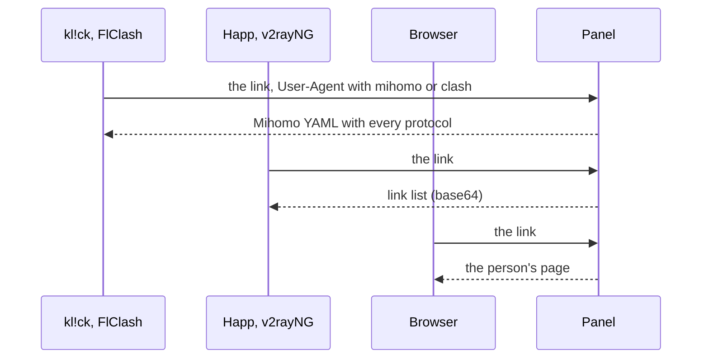

Every person has one subscription link. The same link gives a subscription app its list of servers, gives an app on the mihomo core a ready config, gives an app on the Xray or sing-box core a JSON config of its own, and gives a browser the person's own page. The **Subscriptions** section decides what each app gets and what people see. It has five tabs: **Apps & formats**, **Who gets what**, **Names & texts**, **User page** and **DNS**.

## The link

A link looks like this:

```ini
https://sub.example.com/<secret prefix>/<token>
```

- The base, up to and including the secret prefix, is set by `mistgate setup` on the panel server; **Settings** → **Domains** shows it (to the owner) as **Base of the subscription links**. Without it, no links are handed out. See [Install the panel](../getting-started/install-panel.md).
- The token is the person's own secret. **Subscription link** on the user card shows the link and its QR code; **New link** replaces it, and the old link stops working at once (the page password changes with it).
- A link nobody owns answers like any other unknown path of the site, so a link cannot be found by guessing.

## Formats

| Format | What it is | Who gets it by default |
|:--|:--|:--|
| **Link list (base64)** | One share link per server in a plain list. Happ, v2rayNG, Hiddify and most other apps read it. | Any app without a rule. |
| **Web page** | The person's page: instructions, a QR code, their traffic. See [User page](user-page.md). | Anyone who opens the link in a browser. |
| **Mihomo YAML** | A ready config for Mihomo and Clash Meta with every protocol the person has. | Apps on the mihomo core (kl!ck, Clash Meta, FlClash, Clash Verge), by the rules `mihomo` and `clash`. |
| **Xray JSON** | A JSON array with one Xray config per server, for v2rayNG, v2rayN and other apps on the Xray core. | Nobody, until you add a rule for it. |
| **sing-box JSON** | One profile for the official sing-box apps (SFA, SFI, SFM): every server in one switch, with the person's DNS. | The official sing-box apps, by the rule `sing-box`. |
| **Fake 404** | Pretends the link does not exist. Handy to shut out a scraper by its User-Agent. | Nobody, until you add a rule for it. |



The **Apps & formats** tab lists the apps the protocols work with and what each reads: Happ reads the link list (and Xray JSON, when a rule gives it), Mihomo / Clash Meta (kl!ck and the other apps on the mihomo core) reads the Mihomo YAML, sing-box reads the sing-box JSON, and AmneziaVPN does not read the subscription at all (it takes a `vpn://` key from the person's page).

### Xray JSON and sing-box JSON

Both are built from the same profiles and the same access as the link list. They differ in what a format can carry ([What works where](#what-works-where)) and in how the app is wired.

- **Xray JSON** is an array of configs, one per server; the server's name is the `remarks` of its config. Each config opens a local SOCKS proxy on `127.0.0.1:10808`, which the app's own VPN mode feeds. Other apps on the device can see that port, and some VPN checks look for it. There is no HTTP proxy, no API and no statistics port. The DNS preset is written into every config.
- **sing-box JSON** is one profile: a switch with every server (the first is the default), a TUN interface, and the DNS preset. It opens no local proxy. It needs sing-box 1.12 or newer.

The names follow the template of [Names & texts](#names-texts). Xray JSON keeps the link list's 30-character limit and, for Happ, the load; sing-box JSON keeps the full names and never adds the load.

**Planned:** subscription mirrors.

## What works where

A server that a format cannot carry is left out of that format without a word, as Gecko is already left out of the link list. The person's page is built from the link list and does not change. The **Subscription formats** line on each profile says the same ([Profiles](profiles.md#subscription-formats-of-a-profile)).

| Profile | Link list | Mihomo YAML | Xray JSON | sing-box JSON |
|:--|:--|:--|:--|:--|
| Hysteria2, Let's Encrypt (with or without Salamander) | yes | yes | yes | yes |
| Hysteria2, self-signed (pinned) | yes | yes | yes | no |
| Hysteria2 with Gecko | no | yes | no | no |
| Hysteria2 with port hopping | one port | the range | one port | the range |
| VLESS REALITY over XHTTP (the default) | yes | yes | yes | no |
| VLESS REALITY over TCP (RAW + Vision) | yes | yes | yes | yes |
| VLESS TLS over XHTTP, direct or behind a CDN | yes | yes | yes | no |
| VLESS TLS over WebSocket, direct or behind a CDN | yes | yes | yes | yes |
| AmneziaWG 2.0 and 3.1 | no | yes | no | no |
| The WARP copy of any of these | as its original | as its original | as its original | as its original |

- sing-box has no XHTTP transport and cannot check a self-signed certificate by its fingerprint. Gecko is carried by Mihomo only.
- AmneziaWG reaches an app only through Mihomo YAML or an AmneziaVPN key.
- A WARP copy is the node's exit; nothing changes on the client, so it follows the profile it copies.
- A person for whom a format has no server at all gets a placeholder entry: see [When no server fits the app](#when-no-server-fits-the-app).

## Who gets what

The **Who gets what** tab is a list of rules, top to bottom. A rule is a piece of text and a format: an app whose User-Agent contains the text (case does not matter) gets that format. The first rule that matches decides. Whatever matches nothing lands on the last line, **Everything else**: a browser gets the page, any app gets the link list.

A fresh panel has three rules: `mihomo` and `clash`, both to **Mihomo YAML**, and `sing-box` to **sing-box JSON**, as the last rule. The official sing-box apps send a User-Agent such as `SFA (sing-box 1.14.3; language en_US)`, which the last rule takes.

- A panel that was made before this rule existed gets it once, when it is updated, at the end of its list. It is not added when a rule with the text `sing-box` is already there (whatever its format) or the list is full, and it does not come back after you delete it.
- Hiddify stays on **Mihomo YAML**: its User-Agent contains `ClashMeta`, and the rule `clash` is above `sing-box`. Happ stays on the link list. Xray JSON goes out only by a rule of yours, for example **User-Agent contains** `v2rayng`, **Serve** **Xray JSON**.
- **Add rule**: **User-Agent contains** and **Serve**.
- Drag a rule, or use the arrows, to change the order. The order is saved at once.
- A removed rule can be brought back from the message for a few seconds.
- Up to 50 rules; two rules cannot have the same text.

What counts as a browser: a User-Agent that starts with `Mozilla/`, has a browser engine (`AppleWebKit`, `Gecko/`, `Firefox/`, `Trident/`) and does not name a known VPN app (Happ, v2ray, clash, mihomo, hiddify, sing-box, streisand, shadowrocket, karing, flclash, nekobox, okhttp, cfnetwork). An unusual app that looks like a browser is steered with a rule.

**Try a User-Agent**: paste what an app sends, or pick an example, and the tab shows which rule takes it ("Rule 2 matches → Mihomo YAML", "Nothing matched, and it looks like a browser → web page", "Nothing matched → link list"). The examples include `sing-box` and `v2rayNG`.

**Trying a format on one request.** `?format=xray-json` or `?format=sing-box` at the end of a subscription link picks the format for that request, whatever the rules say. It is meant for trying an app that no rule names yet. It grants nothing more than a rule does: a link nobody owns still gets the fake 404, a link whose rule is **Fake 404** stays the fake 404, and any other value is ignored. The user page never shows a link with the parameter.

## Device limit for apps on the link

An app that fetches the link sends, besides its User-Agent, a device ID in the `X-HWID` header (the standard of Happ, Remnawave and 3x-ui) and often its model and system. The panel counts devices by that ID: one app on one device is one device with its own place in the person's limit and its own keys. Apps that send no ID share one place. How devices appear and are managed: [Users and groups](users-and-groups.md#devices-and-the-device-limit). Which apps send an ID: [Client apps](client-apps.md#which-apps-send-a-device-id).

The mode is set in the card **Device limit for apps on the link**, under the rules of **Who gets what**. It has three options:

| Mode | What it does |
|:--|:--|
| **Only count** | Nobody is refused. Devices get their places and keys, the limit is counted, and the users list shows who is over it. A person can have up to twice the limit; beyond that, a new app takes the shared place instead of one of its own, so an app that sends a different ID with every request cannot fill the panel. The event "the device limit is reached" is history only. |
| **Limit** | A new device over the limit is refused. The devices a person already has stay. A link device silent for 30 days gives its place to a new one. Apps without a device ID share one place, and when the limit is full and there is no shared place yet, such an app is refused too. |
| **Strict** | As **Limit**, and an app without a device ID is refused. Switching to it removes every shared place at once. |

The default depends on the panel. A panel that already has users gets **Only count** when it is updated, so no one is cut off the day of the update. A new panel with no users gets **Limit**. The owner and helpers change the mode; the change applies at the next fetch.

- **Limit** asks for a confirmation when someone is over the limit: "Turn on the limit?" says how many people are, and that they keep their devices while a new one is refused until they free a place or you raise the limit.
- **Strict** always asks: "Switch to strict?" says how many people use apps without a device ID right now. They stop connecting, the shared places go at once, and such an app is told that it sends no device ID. Apps that send an ID are not affected.

### How to move from Only count to Limit

1. Open **Users** and press the chip **Over device limit**. These people have more devices than their limit.
2. Raise **Devices** on the card of those who need more, or ask the others to delete the devices they no longer use on their page.
3. Switch the mode to **Limit**. The confirmation shows who is still over. Move to **Strict** later, and only once you know who uses an app without a device ID.

After the switch, the alert "An app was turned away at the device limit" tells you when someone was actually refused (see [Health](../operations/health.md)).

## What the apps receive

Every answer to an app carries, besides the servers, the headers subscription apps read:

| Header | What it carries |
|:--|:--|
| `Profile-Title` | The subscription name (**Name in the app**). |
| `Subscription-Userinfo` | Uploaded and downloaded traffic of the period, the quota (0 = unlimited) and the end of the term (0 = never). |
| `Profile-Update-Interval` | How often the app refreshes the link, in hours. |
| `Profile-Web-Page-Url` | The link itself: the app's button to the person's page. |
| `Announce` | The announcement, or the reason the subscription does not work. |
| `Support-Url` | The support link. |
| `Probe-Report` | `1` while the panel takes the reports of the kl!ck server check (**Reachability → Sources**, see [kl!ck reports](../operations/reachability.md#klck-reports)). Without it kl!ck sends nothing. |
| `Routing` | The link list for Happ only: the person's DNS preset as a Happ routing profile. See [DNS](dns.md). The other formats carry their DNS inside, so they send no `Routing`. |
| `Ping-Type`, `Ping-Result`, `Subscription-Ping-Onopen-Enabled` | Happ only, and only when **Ping in Happ** is not **App default**: how Happ pings the servers, the delay in ms, and whether it pings when it opens. See [Names & texts](#names-texts). |

The Mihomo YAML, Xray JSON and sing-box JSON carry the same headers except `Routing`. The Mihomo YAML has one proxy group with every server and a `dns:` section; Xray JSON has one config per server; sing-box JSON has one switch with every server. Each takes the person's DNS preset in its own form.

## Extra servers: over IPv6 and through a relay

Next to a server of a node, an app can list up to two more, marked by a label after the name. They are the same server, with the same keys, names and certificates; only the address the app connects to differs, and an app picks one by its name like any other.

| Label | What it is | Added by |
|:--|:--|:--|
| ` · IPv6` (the same in every language) | The server at one of the node's IPv6 addresses, for people whose network blocks the node's IPv4 address. Apps without IPv6 skip it. In URIs the address is in brackets (`@[2001:db8::5]:443`); in the Mihomo, Xray JSON and sing-box formats it is bare, as those formats want it. | The node's [IPv6 entry](nodes.md#ipv6-entry) |
| ` · via RU` (ru ` · через RU`, zh ` · 经 RU`) | The server through a relay of an entry node, with the entry's country. | A [relay](relays.md) |

The order is the node's server, its IPv6 server, then the servers through its relays; a relay's server is never doubled for IPv6. Both appear for every person who may use the node (and the entry node, for a relay), at the next refresh of the app. A server behind a CDN, one with a certificate for the node's IPv4 address, and the static AmneziaWG keys get no IPv6 server. The load of an IPv6 server in Happ is the node's. Names are kept within Happ's 30 characters: the label stays, the profile name is shortened first.

## Names & texts

| Setting | What it does |
|:--|:--|
| **Name in the app** | Shown at the top of the list in Happ. Up to 100 characters. Empty means the panel's name (the brand). |
| **Announcement** | One or two lines above the servers, up to 1000 characters; the user page shows it too. The counter says how much Happ shows: 200 characters. A longer text is cut at a word with "…" for the apps. |
| **Support link** | Opens from the "Message support" button. A Telegram link (`https://t.me/…` or `tg://resolve?domain=…`) or a web link (`https://…`). |
| **Refresh every** | 1–72 hours, default 12: how often the app downloads the subscription again. |

**Server names** is a template of up to 100 characters, built from pieces:

| Piece | Becomes |
|:--|:--|
| `{flag}` | The flag emoji of the node's country. |
| `{country}` | The two-letter code of the node's country (`DE`). |
| `{node}` | The node name. |
| `{profile}` | The profile name. |

The default is `{flag} {country} · {profile}`: "🇩🇪 DE · Hysteria2". Profile names come from the panel, so protocol variants and WARP twins stay easy to tell apart. A number is added only if the full name repeats. A node without a country keeps its profile name; if the name is empty too, it falls back to the node. Happ shows a flag as the server icon only when the name starts with one.

In the link list every name is kept within 30 characters, Happ's limit for a server name (a flag counts as four): a long name first shortens the protocol at the start of the profile name (Hysteria2 to HY2, AmneziaWG to AWG, WireGuard to WG), then is cut. The Mihomo YAML keeps the full names.

In Happ, a node also ends its name with its current load: "🇩🇪 DE · Hysteria2 · 64％", its CPU use, or the higher of its receive and send rates as a share of the **Network capacity** on the node's **Server** tab when that is set and higher. Other apps and the Mihomo profile get the name without it: they remember the chosen server by its name, and a name that changes would reset the choice at every refresh.

**How it looks in the app** draws the list as Happ shows it, loads included, with the servers of the group most people are in, or with made-up servers when there is none.

**Ping in Happ** sets how Happ measures the delay to the servers. Other apps ignore it.

| Setting | What it does |
|:--|:--|
| **How to ping** | **App default** (the default) sends nothing, so Happ uses its own setting. **TCP** sends `Ping-Type: tcp` and `Ping-Result: time`: Happ opens a TCP connection to each server's port and shows the delay in ms. |
| **Ping when the app opens** | With **TCP** only: Happ checks every server each time it starts (`Subscription-Ping-Onopen-Enabled: 1`; off sends `0`). |

## When a subscription does not work

When a person is disabled, past their term or over their quota, the apps do not get an empty list. They get one entry, named after the reason, that never connects, and the announcement is replaced by the same reason, in the panel's default language:

| Reason | Text |
|:--|:--|
| Term ended | "Subscription ended on 29 September. Message us to renew" (without a date when unknown) |
| Over quota, with a reset | "Traffic used up, resets on 1 October" |
| Over quota, without a reset | "Traffic used up. Message us to raise the limit" |
| Disabled | "Access paused" |

In Russian: «Подписка закончилась 29 сентября. Напишите — продлим», «Трафик закончился, обнулится 1 октября», «Трафик закончился. Напишите — увеличим», «Доступ приостановлен».

In Chinese: 「订阅已于9月29日到期。联系我们即可续期」、「流量已用完，10月1日重置」、「流量已用完。联系我们提高额度」、「访问已暂停」.

In Xray JSON the entry is one config named after the reason; in sing-box JSON it is a switch with one entry of that name. Both never connect.

For such a person the refresh interval drops to 1 hour, so a fix (term extended, quota raised) reaches the app soon. The person's page explains the same in their language.

### When no server fits the app

Xray JSON and sing-box JSON never answer an active person with an empty document. When none of the person's servers can be carried in the format (all of them use XHTTP and the app reads sing-box, or the person has only AmneziaWG, or there is no server at all), the app gets one entry that never connects, named "Your servers do not work in this app. The subscription page shows which app does". The announcement carries the same text.

In Russian: «Ваши серверы не работают в этом приложении. Какое подойдёт — на странице подписки».

In Chinese: 「这些服务器无法在此应用中使用。适用的应用请在订阅页面查看」.

## What the app shows when a device is refused

An app whose device is refused does not get an error. The answer is a normal one (HTTP 200) with a single placeholder entry that never connects, named after the reason, as for [a subscription that does not work](#when-a-subscription-does-not-work). The announcement carries the same text, the refresh interval drops to 1 hour, and `Profile-Web-Page-Url` is the button to the person's page, where they free a place. The texts are in the panel's default language:

| Reason | Text |
|:--|:--|
| The limit is full | "Device limit: 5 of 5. Remove one you no longer use on the subscription page" |
| The owner blocked the device | "This device was turned off by the owner" |
| The app sends no device ID (**Strict**) | "This app does not report a device ID. Turn on HWID in the settings of Happ, or use kl!ck" |

In Russian: «Лимит устройств: 5 из 5. Удалите ненужное на странице подписки», «Это устройство отключено владельцем», «Приложение не сообщает ID устройства. Включите HWID в настройках Happ или возьмите kl!ck».

In Chinese: 「设备已达上限：5 / 5。请在订阅页面删除不再使用的设备」、「此设备已被所有者停用」、「此应用未提供设备 ID。请在 Happ 设置中开启 HWID，或改用 kl!ck」.

The answer also carries the headers that Remnawave and 3x-ui use, so the apps that read them behave the same:

| Header | Value |
|:--|:--|
| `X-Hwid-Active` | `true` on every refusal: the device check is on. |
| `X-Hwid-Max-Devices-Reached` | `true` when the limit is full. |
| `X-Hwid-Not-Supported` | `true` when the app sends no usable device ID. The panel also sets it on the answer to an app whose `X-HWID` value cannot be used (not 10 to 64 letters, digits, `=` and `-`). |
| `X-Hwid-Limit` | The person's device limit, as a number. v2RayTun reads it. |

A blocked device gets `X-Hwid-Active` and `X-Hwid-Limit` only: the limit is not why it is refused, and an app that reads the flags must not tell the person to free a place. Its announcement says what happened.

SFA and SFI send no device ID, so in **Strict** they get the refusal entry instead ("This app does not report a device ID…", in sing-box JSON) and cannot connect.

Apps differ in what they show of this: Happ shows the announcement and the name of the entry, kl!ck only the entry, since it does not read the announcement. See [Client apps](client-apps.md#which-apps-send-a-device-id).

## The user page

The **User page** tab holds the options of the page and the apps it recommends, with a live preview. It is described in [User page](user-page.md).

### Apps on the page

The page shows one card per app on each platform, in the order of this list. Several apps may share a platform. Each app has:

| Field | What it is |
|:--|:--|
| Platform and kind | iOS, Android, Windows, macOS or Linux; **By subscription link** or **AmneziaWG key**. |
| **App name** | Shown on the card. |
| **Download link** | An `https://` link: a store page or a file. |
| **"Add" link template** | A one-tap link that opens the app with the subscription. Placeholders: `{url}` is the subscription link, `{url_enc}` the same URL-encoded, `{name_enc}` the encoded subscription name. Empty: the page offers to copy the link. Scripting schemes (`javascript:`, `data:` and the like) are refused. |
| **Description on the card** | Plain text, up to 80 characters. Empty: the card says how the app connects. |
| **Recommended** | A badge on the card; the recommended app leads its platform. |

**Add app** takes a platform and either a **Known app** (kl!ck, Happ, AmneziaVPN, Clash Verge Rev, FlClash, Clash Meta for Android, Hiddify, v2rayNG, sing-box: it fills in the name, the kind, the download link and the "add" template of that platform) or a kind (**Takes**) for a blank card. Every field stays editable. The arrows move an app among the apps of its platform. Up to 30 apps.

A fresh panel recommends kl!ck on Windows and macOS (Happ second) and Happ on iOS and Android, and offers AmneziaVPN for keys on all five platforms (from the store on phones, from the AmneziaVPN site elsewhere). Which app suits which platform, what each one receives and how the one-tap links work: [Client apps](client-apps.md).

### Options of the page

| Option | Default | What it does |
|:--|:--|:--|
| **Show announcement** | on | The text from **Names & texts**. |
| **Support button** | on | Opens the support link. |
| **QR for a second device** | on | Handy when the link is on a phone. |
| **Password on the page** | on | Every person's page asks for a password, once per device. Apps fetch the subscription without one. |
| **Devices on the page** | on | People add, re-key and remove their own AmneziaWG devices on their page, within their device limit. |
| **DNS choice on the page** | off | People pick on their page one DNS for the apps on the link, from the presets listed under the switch (**DNS for the apps on the link**), and the DNS of the AmneziaWG keys of each server, from the presets the owner offers on each node. See [DNS](dns.md) and [User page](user-page.md). |

Rules are saved as soon as you add, move or remove one. On **Names & texts** and **User page**, changes wait for **Save** in the bar at the bottom (**Discard** drops them). Either way they apply at the next fetch, without a restart.

## Protection of the links

- **Fetches.** One link answers at most 60 times an hour; more get "too many requests". Fetches within 10 seconds of each other get the same answer.
- **Guessing.** A network (a /24 for IPv4, a /48 for IPv6) that tries 20 unknown links within a minute gets only the fake 404 for 15 minutes, even for valid links.
- **Sharing.** When one link is used from more than 8 networks in a day, the panel writes the event "a subscription link is used from 9 networks a day" and opens the alert "A subscription looks shared". It counts networks, it never stores the addresses. Issue a new link if the old one leaked.

## Who can do what

Every admin can read these settings and try a User-Agent. The owner and helpers change them. The DNS tab is described in [DNS](dns.md).
