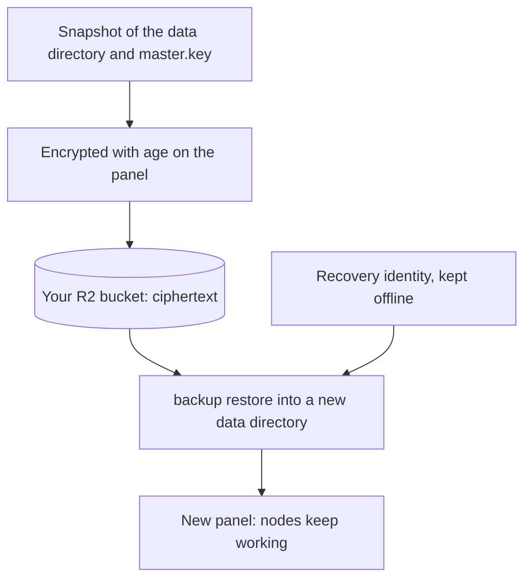

Mistgate can upload scheduled or on-demand panel backups to your Cloudflare R2 bucket. Backups are **off until the owner configures them**. Each archive is encrypted with age before it leaves the panel; Cloudflare stores ciphertext, not the database contents.

## Before enabling backups

### Create an offline recovery identity

Run this once on a trusted machine that is not the panel server:

```sh
mistgate backup keygen --identity-file ./mistgate-recovery.txt
```

The command creates a private age identity without overwriting an existing file, gives it mode 0600, and prints the matching public recipient. The identity is a post-quantum hybrid one, so its recipient starts with `age1pq1`; an X25519 recipient made with `age-keygen` (`age1…`) is accepted too. Keep the identity outside the panel and R2, with a separate offline copy. Paste only the public recipient into the panel. Without the private identity, a backup cannot be decrypted.

### Create the R2 bucket and token

Create a bucket in Cloudflare R2 and an S3 API token limited to that bucket. Mistgate needs object **read, write and delete** access: the storage test lists the backups, writes a temporary object, reads it back (a restore downloads) and deletes it, and configured retention deletes expired backups. Use a dedicated token rather than an account-wide API key.

## Configure the panel

Only the owner configures and runs backups; saving the settings, the storage test and **Create backup now** ask for a fresh sign-in confirmation. Open **Settings → Backups** and enter the **Cloudflare account ID**, **Bucket jurisdiction** (Default, EU, US or FedRAMP), **R2 bucket name**, **R2 access key ID** and **R2 secret access key**, plus the **Age recovery recipient**. The secret access key is encrypted with the panel master key and never returned by the API. A saved secret stays in place when its field is left blank; **Forget the saved secret access key** removes it.

1. Save the settings.
2. Choose **Test R2 access**. It lists the bucket, then writes a temporary object, reads it back and deletes it.
3. Set the interval from 1 to 168 hours (24 by default) and the retention in days. `0` means never prune; otherwise retention must be from 7 to 3650 days. Pruning never deletes the three newest backups, however old they are, so a retention as long as the interval still leaves more than one copy.
4. Enable automatic backups and save. The first scheduled run starts within about a minute, then follows the interval. **Create backup now** starts an owner-confirmed backup immediately. It runs in the panel, not in the browser request: the page shows it running and then says how it went, and closing the page does not stop it. A backup that takes longer than 4 hours is abandoned.

The panel takes a consistent SQLite snapshot, includes the other files of the data directory (the release bundle and the Let's Encrypt cache among them) and the effective `master.key`, creates a manifest with file hashes, encrypts the archive to the public recipient, and uploads it to R2. The page shows the last successful backup, the retention, the last error code and the recent backups in the bucket. The private recovery identity is never stored by Mistgate. Keep a copy of it even if R2 is available.

The work happens in a temporary directory inside the data directory, so that disk needs free space for one more copy of the database plus the encrypted archive; the other files are read in place. After a failed scheduled run the next attempt waits 2 minutes, then 4, 8 and so on, never longer than the interval. Saving the settings ends the wait.



## A copy on this computer

**File on this computer** in the window before a panel update (see [Updates](updates.md#update-the-panel)) and **Download to this computer** on this page save the same encrypted archive to the computer the browser runs on, named `mistgate-backup-<panel>-<version>-<UTC date>.tar.gz.age`; it does not need R2. When this page has a recovery recipient the file is encrypted to it; otherwise you make up a passphrase for that file (at least 12 characters), which is not stored anywhere: without it the file cannot be opened. Only the owner can download, with a fresh step-up; the panel keeps no copy of the archive, and the audit log records `backup.download`. Restore it as below; for a file with a passphrase use `--passphrase` (asked on the terminal) or `--passphrase-file FILE` instead of `--identity-file`.

## Restore in the panel

**Restore…** under **Restore from a backup** on this page brings the running panel back to a backup. Only the owner can, with a fresh step-up, on the VPS edition.

1. **Backup**: a file from this computer (the panel uploads it to a private folder of its data directory) or one of the R2 backups (the panel downloads it from the bucket itself; **Restore** next to a backup in the list opens the window with it).
2. **Key**: the recovery key file (the identity `mistgate backup keygen` made; it opens the R2 backups and files downloaded without a passphrase) or the file's passphrase. The key is sent once and used in memory to open this backup: it is not written to disk, to a log or to the audit log.
3. **Check backup**: the panel decrypts and verifies the archive as `backup restore` does (the manifest, the hashes, `master.key`, the database opens, its migrations are not newer than this panel) and shows the panel's name, the version that made the backup and when, and the nodes, people and profiles in it next to the numbers now. Nothing has changed yet; the check is valid for 30 minutes.
4. **Restore**, after typing the panel's name: the panel's update helper stops the panel, moves the current data directory aside to `<data-dir>.before-restore-<UTC time>`, puts the backup's data in its place and starts the panel. If the restored panel does not stay up for 45 seconds, the helper puts the previous data back and starts that.

Everything changed after the backup was made is gone, the sessions too: sign in with the password and passkeys of the backup. The section then shows the result, "Restored from a backup" or "The restore failed; the panel runs on its previous data"; the audit log has `backup.restore_started` in the old data and `backup.restored` in the restored. **Data from before a restore** lists the directories moved aside, with their size; each stays until **Delete** (the owner, with a step-up). To go back by hand, stop the service and swap the directories.

One restore runs at a time, and never during a backup, a panel update or a node rollout. A panel that cannot update itself cannot restore itself either (the same helper does both): the window says so, and the way below works.

## Restore on a new panel

The installer restores a backup on a new server in one command, before the panel's first start:

```sh
curl -fsSL https://mistgate.app/install.sh | sudo bash -s -- --restore ./backup.tar.gz.age --identity-file ./mistgate-recovery.txt
```

For a file with a passphrase give `--passphrase-file FILE` instead of `--identity-file`; the installer never takes a passphrase on the command line. It installs the binary, restores into the data directory, keeps the backup's `master.key`, panel address and certificates, skips the one-time setup link and says which domain to point at the server: once it points there, the nodes reconnect by themselves. With `--dry-run` it checks the archive and the key without installing anything.

By hand:

Download the encrypted object from R2 and copy it, the recovery identity, and the `mistgate` binary to the new panel host. Stop Mistgate if it is already running. Restore into a **new, non-existing** data directory; the command refuses to overwrite files:

```sh
mistgate backup restore \
  --identity-file ./mistgate-recovery.txt \
  --file ./backup.tar.gz.age \
  --data-dir /var/lib/mistgate-restored
```

Use a `mistgate` binary at least as new as the panel that made the backup. An archive whose database has migrations the binary does not know is refused, with the version that made it; an older archive is fine, and the panel brings its database up to date when it starts.

Run the restore as the panel service account, or set the restored directory's owner before starting the service. Point the systemd unit at `/var/lib/mistgate-restored` with `serve --data-dir`. The restored data includes the database, panel CA and master key, so enrolled nodes and encrypted panel secrets can continue working.

If systemd supplies `master.key` through `CREDENTIALS_DIRECTORY`, replace that credential with the restored `master.key` before starting Mistgate. The service must use the restored key to read the restored database.

Keep the old data directory until the restored panel starts and you verify sign-in, nodes and subscriptions. Never restore an archive over a live data directory. Losing the recovery identity makes the R2 archives unusable; losing the restored master key makes the panel's encrypted secrets unreadable.

## Failures

A backup that fails leaves its error code on the settings page. If the owner linked Telegram, the owner is also told once (however often the schedule retries) and again when the next backup works: see [Telegram alerts](telegram-alerts.md).
