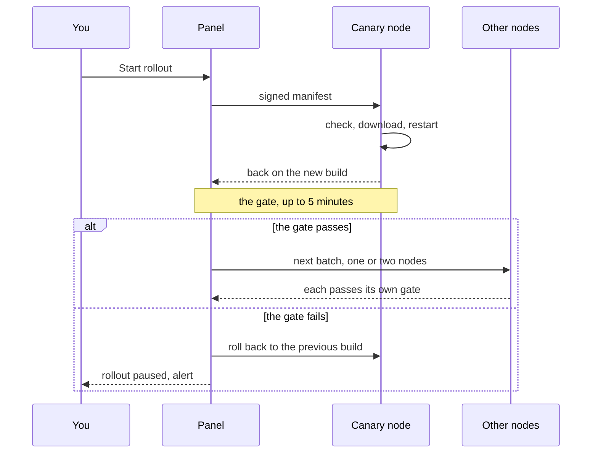

Node agents update themselves, but only to a build signed with the release key. The panel carries the signed bundle to the nodes, and every agent checks the signature against the key compiled into its own binary before it replaces itself. The panel never updates a node on its own: you press **Update N nodes** (or **Update** in a node's row) to update now, or schedule a node for a quiet hour. The panel itself can install a newer official release from the Updates page, again only when its signature verifies.

This page is for running a fleet. Making the release key, signing releases and publishing them is in [Releases and signing](releases.md).

The signed node bundle also carries an IPv4 and IPv6 range table with ASN operator names, generated from iptoasn.com (PDDL 1.0). It contains network ranges, not client addresses or records about people.

## How trust works

- There is one Ed25519 key pair, the **release key**. Its private half stays offline with whoever signs the releases; both binaries carry the public half, stamped in at build time. The official binaries carry the project's key. The panel also saves the key in `<data-dir>/release.pub` on its first start.
- Every release has two signed manifests: the node bundle (`manifest.json` with `manifest.sig`) and the panel manifest (`panel-manifest.json` with `panel-manifest.sig`). Each lists the version, the build time, an expiry date and, for every binary, its name, OS, architecture, size and SHA-256. The panel manifest is signed in its own Ed25519 context, so an agent never accepts it as its update and the panel never installs a node binary as itself.
- The agent checks, in this order: the signature against its compiled-in key, the manifest format, the expiry, that the release is newer than itself, and that the bundle has a file for its OS and architecture. It downloads from the panel first over mutual TLS (on the [Cloudflare edition](#on-the-cloudflare-edition), over its link); when the VPS panel offers GitHub to a capable agent, it can continue there after a transfer failure. The agent checks the downloaded size and SHA-256 against the signed manifest. A final digest mismatch fails visibly and is not retried from another source. Any failure leaves the installed binary untouched.
- The panel is only a courier: a compromised panel cannot make a node run code that was not signed with the release key.
- Releases are ordered by their build time (the Unix time of the source commit), not by the version string. A release with the same build time as the node is "already current"; an older one is refused as a downgrade.
- A node agent built without a release key cannot update itself; `mistgate-node version` prints the fingerprint of the key it carries. If the key compiled into the panel and `release.pub` differ, the panel logs `release key mismatch` and trusts no bundle until the new key is confirmed: see "Rotate the release key" in [Releases and signing](releases.md).

## Where the bundle comes from

The panel keeps the node bundle in `<data-dir>/dist`. (The [Cloudflare edition](#on-the-cloudflare-edition) has no such folder and uses its own release; this section and the **Release bundle** line describe a VPS panel.)

- **From GitHub.** A panel with a release key checks the newest release of `Mistgate/mistgate` on the panel's [release channel](#release-channels) when it starts and every 10 minutes after that. When the release carries a node bundle that verifies with the panel's key and is newer than the bundle the panel has, the panel downloads it, checks every file and replaces `dist` in one step. A release signed with another key is ignored and `dist` stays as it is. Downloading a bundle never updates a node by itself.
- **By hand.** A panel built with your own key gets the bundle you sign and copy into `dist`: see "Use a bundle of your own" in [Releases and signing](releases.md). The panel reads `dist` again within a minute; **Read the folder again** reads it at once.

The **Release bundle** line at the foot of the fleet card of the Updates page shows the result (the details are behind **Details**; they open by themselves when the bundle failed the check or is missing):

| Status | Meaning |
|---|---|
| Signature verified | The signature matches this panel's release key, the manifest is valid and every file is present with the right size and checksum. Only such a bundle can be rolled out and used by the [SSH installation](../getting-started/ssh-install.md). |
| Failed the check | Something is wrong; the card says what (see below). |
| Not checked | This installation has no usable release key: none in its build or `release.pub`, or the two differ. The panel cannot judge the bundle; the nodes still check it themselves. |
| No bundle | `<data-dir>/dist` has no `manifest.json`. |

| Reason | What to do |
|---|---|
| No release bundle in the panel's data directory | Wait for the GitHub download, or copy your bundle to `<data-dir>/dist`. |
| The signature file (manifest.sig) is missing | Copy `manifest.sig` too. |
| manifest.json is not a valid release manifest | Sign again; do not edit the manifest. |
| The manifest uses a newer format than this panel understands | Update the panel first. |
| The signature does not verify with this panel's release key | The bundle was signed with another key, or the panel was built with another key. |
| The manifest has expired; sign a new one | A newer signature is needed: the maintainers renew it on GitHub, or you sign again with a later `--expires`. |
| A file listed in the manifest is missing | Copy every file of the bundle. |
| A file differs from the manifest (size or checksum) | The copy is incomplete or the file was changed: copy it again. |

The panel serves the bundle's files only to agents with a valid node certificate, through the agent endpoint, with at most four live downloads at a time, in resumable chunks. A resume of the same file takes over that node's slot at once while the previous handler finishes its write. Only regular files in `dist` count (a symbolic link is not followed). Replace a hand-made bundle at once, as a whole; changing it while a rollout runs pauses the rollout.

## The Updates page

Everyone can view the page. Updating, scheduling, pausing, resuming and cancelling, rolling a node back and **Read the folder again** need the owner and a fresh step-up (see [Security](security.md)).

The page has three layers, a card for each in a row at the top: **This panel**, **Node agents** and **Server systems**. Each card says where its layer stands and carries a status, so all three are in view whichever is open; the chosen one opens below. The page opens on the panel when a panel update is out, because the panel is updated before the nodes, and otherwise on the node agents; the address remembers the layer. The Cloudflare edition has the first two.

What the layers hold (the fleet card, the rollout and the nodes are under **Node agents**; **Server systems** is described in [Server operating system](#server-operating-system)):

- **This panel**: one line with its version, build date, state and **Check GitHub**. When a signed release is out, the card stands out and carries **Update panel**. The release key fingerprint, the SHA-256 and the explanation are behind **Details**; a panel that cannot update itself opens its steps on its own.
- **The fleet card**: where the fleet stands ("2 of 4 nodes on v0.1.24"), a bar with one segment per node, the count of each state under it, and the one main button. With something to update that is **Update N nodes** (below); while a rollout runs, **Pause** / **Resume** / **Cancel rollout**. Its last line is the **Release bundle**: the bundle in `<data-dir>/dist`, the verdict of the signature check, its version and dates, **Read the folder again**, and the folded details (files, the reason for a refusal, the steps to make a bundle yourself).
- **The rollout**: a running one sits right under the fleet card, by stage (the canary, the batches) with the nodes of each; while a compatible agent downloads its file, its phase, progress, downloaded size and recent transfer speed are shown; the last finished one comes after the node list, folded to one line (**Show stages**) when it ended well.
- **Nodes**: every node with its agent version and build date, its state and its last update on one line. The owner gets one main button per row, **Update** (or **Schedule** when an update is already scheduled), and a **⋯** menu beside it with **Schedule…** and **Roll back…**. A node that belongs to the running rollout says so in its row ("Queued · batch 2", "Updating…") and has no update or schedule of its own; **Roll back…** stays where it was allowed.

| Node state | Meaning |
|---|---|
| Up to date | Its build is at least as new as the trusted bundle's (without a trusted bundle, as the panel's own build). |
| Update available | It can update itself and runs an older build. |
| Updating… | An update of this node is in progress. |
| Rolled back | Its last update ended in a rollback; it runs the previous build. |
| Update failed | Its last update failed on the node. |
| Update by hand | Its agent cannot update itself (see "Old agents" below). |
| Offline | The node is not connected; the last known build is shown. |

"No guard against repeated crashes" under a node means its service file has no crash-loop guard: only the agent's own 5-minute self-rollback protects an update there. If Health → Doctor offers **Refresh the service**, apply it there; the agent restarts and connections can drop for a few seconds. For an agent too old to offer the fix, run `mistgate-node install` with a current binary once.

### What's new

Under the fleet card and in the panel's line the page lists what the update brings, so you can tell whether to do it now or later: the notes of every stable release newer than your oldest node agent, up to the bundle on the panel (and, for the panel, every release between this one and the one it can install). The newest version is shown in full, with **Show all** when it is long; the earlier ones are folded behind "and N earlier versions". The notes appear in the language of the interface (English when the release has none in it).

The text is the description of the release on GitHub, read by the panel over HTTPS from the official repository on the same schedule as the release check. It is informational and **not signed**: only the manifests are. Nothing is decided from it except one badge. A release whose notes have a **Security** section (a heading "Security", "Безопасность" or "安全") is marked **Security fixes**, and the card then says that the update includes security fixes and is worth doing soon. Without such a section the page says nothing about urgency. Without a trusted bundle, or when the panel has not read the notes yet (on the [Cloudflare edition](../getting-started/install-edge.md) that happens when you press **Check GitHub**), the block is simply absent.

## Release channels

Every release belongs to one channel, and its tag says which: `vX.Y.Z` is **Stable**, `vX.Y.Z-testing.N` is **Testing** and `vX.Y.Z-dev.N` is **Development**. A panel follows one channel and is offered the newest release of that channel and of every more stable one: Stable sees stable releases, Testing sees testing and stable ones, Development sees all three. The panel's own update and the node bundle both follow the channel; nodes still update only when you roll the bundle out.

| Channel | For |
|:--|:--|
| **Stable** (the default) | Checked releases, for every panel. |
| **Testing** | The next release before everyone else. It can have bugs: tell us about them. |
| **Development** | Builds from the work in progress: the newest of everything, and it may break. For a test panel of your own. |

The owner changes the channel on the Updates page: the chip next to the panel's version opens **Release channel**. The change needs a fresh step-up, is written to the audit log and is used by the next check at once. Moving to an earlier channel offers its newest release at once. Moving to a more stable one never installs anything older: the panel and its nodes stay on what they run until the channel has something newer, and the panel's bar says so. **What's new** marks testing and development releases. A panel installed with `--channel testing` or `--channel dev` (see [Install the panel](../getting-started/install-panel.md)) starts on that channel. The MCP tool `updates_status` shows the channel; it cannot change it.

## Update a node

### Everything that can be updated, in one rollout

**Update N nodes** in the fleet card opens a window with every node that can be updated: each has a tick (all ticked by default) and the canary is named, the node with the fewest people online. The window says that the canary is checked for 5 minutes, that the rest go in batches (one at a time while fewer than five nodes are to be updated, else two), and that a node that fails its checks gets its previous version back and the rollout pauses. Nothing happens until you press **Start rollout**. The call is pinned to the bundle the page showed, like the update of one node, and asks for a fresh step-up. The button is absent while a rollout runs, without a trusted bundle, and for anyone but the owner; a node to be updated at a set time is scheduled one by one (below).



### Now, with the running rollout, or later

**Update** in a node's row opens a dialog with two choices:

- **Update now** starts the update of this node at once. While another update runs with the same release, the choice reads **Add to current rollout**: the node becomes the next stage and starts after the current one passes its checks. A paused rollout, or one with another release, has to be resumed, finished or cancelled first.
- **Choose a date and time** saves a schedule. The time is entered in the fixed UTC offset of **Settings → System → Update time zone**; UTC is the default (installations made before this default keep UTC+03:00, which was the default then). Changing the setting does not move existing schedules: each keeps the exact instant and offset shown when it was saved. The earliest time is a minute from now; **Cancel schedule** removes it.

Each update is pinned to a release:

- An update now is pinned to the bundle version the page showed (an MCP plan to the version of the plan): if the trusted bundle was replaced in between, the panel refuses and asks you to review the new version.
- A schedule is pinned to the signed version selected when it was saved and cannot be later than that bundle's expiry. If it cannot start at the chosen time (the node is offline, another update is running), the panel keeps trying for two hours; after that the row says the schedule was missed, and it never starts by itself, so an update meant for a quiet hour does not run whenever the node returns. Schedule it again or cancel it. If the bundle is replaced before then, the panel does not substitute the new version: review it and schedule again.

### One node's update

1. The panel sends the signed manifest. The agent checks it, downloads its file, keeps its current binary as `<binary>.prev`, puts the new one in its place and restarts itself in place (systemd sees nothing). The node is offline for a few seconds; the admin shows it as updating, not as an outage.
2. The panel gives agents with `update-timeout/1` the configured download window (30 minutes by default, changed in **Settings → System → Download timeout**); the window is captured when the command is sent, and a transfer that sends nothing for 90 seconds is resumed where it stopped, up to three times, within the window. The panel sends its bundle first and, when enabled and verified for this release, GitHub second to agents with `update-sources/1`. Changing a setting affects later steps. Older agents keep their built-in 10-minute limit. After the agent answers, the panel allows up to 3 minutes for the node to come back with the new build.
3. The **gate** runs for up to 5 minutes after the node is back. It passes when all of this holds:
   - the new build has committed: it connected and applied its configuration without a failed profile;
   - the configuration the node applied is the panel's;
   - no profile that worked before the update has failed (a profile that stays failed for 30 seconds fails the gate at once);
   - every profile the panel can check has passed a [client-eye check](health.md) since the node came back (the panel starts a round at once). The [Cloudflare edition](#on-the-cloudflare-edition) leaves this one out.
   - on a node with an enabled profile that exits through WARP, the WARP tunnel has been up since the node came back.
4. When the gate passes, the step is done. A failed gate names the condition that did not hold: the new build did not confirm the update, the node did not apply its configuration, the panel could not read the node's profiles, a profile failed, or WARP did not come up. When it fails, the panel sends the node a rollback (the previous binary comes back), the step ends as "rolled back" and the rollout pauses.

**When only the panel's own path loses packets.** Right after a reboot or an update the path from the panel to a node can lose packets while the node is fine and other nodes reach it. The client-eye checks then time out, and the gate would fail a healthy node. For agent updates and OS updates alike, the gate has a second way to pass, and only when the client-eye check is the one condition that did not hold: every failed round was a timeout (a refused connection, an authentication error and a TLS error are not) and the failures have lasted at least a minute; the node reports itself well (the job is done or the new build committed, every enabled profile is running, and the node's own resolver check passed after it came back); and a port check started after the node came back, from another node (never the panel, never the node itself), saw every UDP port delivering and every TCP and TLS port answered by this node. The step then passes with the note "The panel's own path to the node is losing packets", and the node's History has the info event `panel_path_lossy`. If the other node does not see the ports either, or no other node can look, the gate fails as before and the note says which. This is a proof of reachability, and of the TLS listeners, together with the node's own report; it is not a full client connection through the tunnel. The panel's [synthetic alerts](health.md) stay as they are and may stay red until the panel's path recovers.

### The agent's own safety net

The agent does not rely on the panel to undo a bad update:

- A new build that has not connected and applied its configuration within 5 minutes of starting puts the previous binary back and restarts (`not_committed`).
- A new build whose own build time differs from the manifest rolls back at once (`built_mismatch`).
- The service file counts the starts while an update is pending; at the third start in a row it restores the previous binary before the agent runs (`crash_loop`).
- The previous build reports the outcome when it connects again.

### Pause, resume, cancel

A running update shows its progress at the top of the page, with **Pause**, **Resume** and **Cancel rollout** for the owner.

- **Pause**: no new step starts. A step already in progress finishes and goes through its gate. Nodes already updated stay updated.
- **Resume**: the remaining waiting steps go on. Failed and rolled-back steps stay as they are; update those nodes again after fixing the cause. If the bundle on disk changed, resume is refused: cancel and start again.
- **Cancel rollout**: waiting nodes are skipped; a node being updated finishes and is checked; updated nodes stay on the new version.

A rollout also pauses by itself:

| Pause reason | What happened |
|---|---|
| a node did not take the update | It rejected the update (the reason is shown). |
| a node did not pass the check after updating | It failed the gate or did not come back; where possible it was put back on the previous version. |
| the release bundle changed | The bundle in `<data-dir>/dist` is now another release. Cancel and start again. |
| the panel restarted during a step | The panel does not know how the step ended. Check the node, then resume or cancel. |

The first, second and fourth also raise the alert "The node update stopped" until you resume, cancel or start a new update.

A finished rollout is **Done**, **Cancelled** or **Finished with problems** (at least one node failed or was rolled back). The page shows the active rollout, or the last one. Finished rollouts are kept: always the last 20, older ones for 90 days.

Common step errors:

| Error | Meaning |
|---|---|
| The node rejected the signature | The node's agent trusts another release key. |
| This node's agent was built without a release key | Update it by hand. |
| The release is older than what the node already runs | A newer signed build is needed. |
| The bundle has no file for this node's system and architecture | The bundle lacks the binary for its architecture (for example `arm64`). |
| The node could not download the file from the panel | Look at the node's link to the panel. |
| The node could not download the file from any offered source | The failed step shows `sources_failed`, for example `panel:stalled,github:http_404`; check the node's panel connection and its access to GitHub. |
| The node cannot write next to its program file | Check the disk of the node; apply **Refresh the service** in Health → Doctor when offered, or run `mistgate-node install` once with a current binary. |
| The node did not answer the update command within its download window (30 minutes by default; 10 minutes for older agents) | Look at the node and its download progress. |
| The node did not come back within 3 minutes | Look at the node and its logs. |
| The client-eye check failed after the update | See [Health](health.md); the node is back on the previous version. |

### Download sources

On a VPS panel, **Settings → System → Download sources** enables GitHub fallback by default. The panel is always first and cannot be disabled; GitHub is the only optional source currently available. The panel offers GitHub only when its own release key verifies the signed manifest for the exact release tag and that manifest lists the same files as the rollout bundle. A re-signed manifest with a later expiry is accepted when the file list is unchanged. Hand-made bundles and bundles from a panel built with another key are not offered from GitHub. The Cloudflare edition has no setting for this source.

When enabled and offered, the node can request the release binary directly from GitHub if the panel is busy, too slow, or a panel transfer fails. GitHub can see the node's public IP, release tag, binary filename, and `User-Agent: Mistgate-Update/1`, which names the software. The request carries no node ID, panel address, authorization header or panel token. The Updates page shows the current source while a compatible agent downloads; a switch between polls is expected. A failed download lists only source names and short error codes, such as `panel:stalled,github:http_404`.

### Roll back by hand

**Roll back…** in the **⋯** menu of a node's row (it still asks first, naming the version the node returns to) puts the node's previous binary (`<binary>.prev`) back and restarts the agent. It works outside a rollout too. A node that was never updated has no previous version and refuses. If the node is part of an active rollout, its step is marked "rolled back" and the rollout pauses.

The **Last update** column says who rolled a node back: "Rolled back by you", "The panel put the previous version back: …" (the gate), or "The previous version came back on a command of the panel".

## Old agents: update by hand once

A node shows **Update by hand** when its agent cannot update itself: it predates self-update, it was built without a release key, or it runs under the first version of the service file (whose program directory is read-only). **How to update** in its row gives two commands, for example:

```sh
scp /var/lib/mistgate/dist/mistgate-node-linux-amd64 root@de1.example.com:/root/mistgate-node
ssh root@de1.example.com 'chmod +x /root/mistgate-node && /root/mistgate-node install'
```

`install` copies the binary to `/usr/local/bin/mistgate-node`, writes the current hardened service file (with the crash-loop guard) and restarts the agent. After that the node updates from the Updates page. Without a bundle on the panel, take `mistgate-node` of the same release as the panel. On the Cloudflare edition the two commands are different: see below.

Older agents keep working with a newer panel: changes to the agent protocol are additive. A feature an old agent lacks is reported as "agent too old" where it is needed.

## On the Cloudflare edition

A panel on the [Cloudflare edition](../getting-started/install-edge.md) updates its nodes from this same page, and the canary, batches, gate, pause, resume, cancel, manual rollback and scheduled updates work as described above. These things differ:

- **The release is the panel's own.** The panel offers the signed node release of the version it was deployed from, checked against the key compiled into it, and never looks for a newer one. To move the nodes to a newer release, deploy it to the panel first, then press **Update** here. A panel that is not a release build, or that cannot fetch its release from GitHub, says why in the fleet card (it tries again within a minute) and starts no rollout. Deploying another version while a rollout runs pauses the rollout if nodes are still waiting ("the release bundle changed"). There is no `dist` folder, so the **Release bundle** line and **Read the folder again** are not shown.
- **The node downloads through the panel.** The update command carries a token that is good for one step. The agent asks `<link address>/update/<node id>/<file>` with that token, and the panel's Worker streams the file from the GitHub release, so the node never contacts GitHub and only has to reach the panel. An interrupted download resumes where it stopped. Before it swaps, the agent checks the size and the SHA-256 against the signed manifest. The token works for that node only, while its step waits for the answer, and only for files of the manifest the rollout started with.
- **The gate has no client-eye check.** The panel does not run [client-eye checks](health.md) on this edition yet, so the gate leaves that condition out, and the rollout window and card say so. It still requires that the new build committed, that the node applied the panel's configuration, that no profile that worked before has failed and, for a profile that exits through WARP, that WARP is up. A build that keeps its profiles running but breaks their tunnels passes this gate; the canary and the batches limit the damage.
- **Steps move on the minute.** The edition's scheduled job advances a rollout once a minute, so a decision can come up to a minute later than on a VPS panel. The waiting limits are the same.
- **The panel itself** is updated from your computer, not from this page: `mistgate edge deploy --host panel.example.com --version vX.Y.Z`, and `--rollback` returns the previous version (see [Update](../getting-started/install-edge.md#update) and [Roll back](../getting-started/install-edge.md#roll-back)). The panel's row shows this instead of **Update panel**. After the deploy, the nodes show **Update available**.

An agent of v0.1.49 or older cannot download over the link yet, so its row says **Update by hand**. **How to update** gives two commands to run on the node, once, as root; the page fills in the version, the file for the node's architecture and its SHA-256 from the signed manifest:

```sh
curl -fL -o /root/mistgate-node.new https://github.com/Mistgate/mistgate/releases/download/vX.Y.Z/mistgate-node-linux-amd64 && echo "<sha256>  /root/mistgate-node.new" | sha256sum -c -
chmod +x /root/mistgate-node.new && mv /root/mistgate-node.new /root/mistgate-node && /root/mistgate-node install
```

Run the second command when the first printed `OK`. This is the one time a node needs GitHub; if it cannot reach it, copy the file to `/root/mistgate-node.new` yourself and run the check and the second command. `install` keeps the node's identity and its link to the panel, writes the current service file and restarts the agent. After that the node updates from this page. A node that has not reported its architecture gets the amd64 file; on an ARM server take the arm64 file and its SHA-256 from the release's `manifest.json`.

## Update the panel

This section is about a VPS panel. A panel on the [Cloudflare edition](#on-the-cloudflare-edition) is updated with `mistgate edge deploy`.

The Updates page checks the newest release of `Mistgate/mistgate` on the panel's [release channel](#release-channels) at startup and every ten minutes (the same pace as the node bundle). When a newer signed release is out, the owner sees a small card with its version on every page except Updates. It can be collapsed to a pill, or closed until a newer version appears. **Check GitHub** checks at once (a check made in the last three minutes is answered from memory, which keeps the unauthenticated GitHub quota for the bundle download).

**Update panel** first opens a window: what happens (the panel restarts for about a minute; nodes and people's connections keep working; it goes back by itself if the new version does not start) and a backup. When [backups to Cloudflare R2](backups.md) are set up, the window shows the last one and offers **Back up now**; otherwise a link sets them up. **File on this computer** downloads an encrypted backup named `mistgate-backup-<panel>-<version>-<date>.tar.gz.age`: to your recovery key when there is one, else with a passphrase you make up for that file. **Update** never waits for a backup except one to R2 that is still running.

A release can be installed only when it carries `panel-manifest.json` and `panel-manifest.sig`, the signature verifies under the release key compiled into this panel (`release.pub` does not count: the panel's service user can write it), the manifest has not expired, and its build time is newer than this panel's. Releases are ordered by that build time, not by the version string: a panel built from a commit after the tag (for example `v0.1.6-3-gabc1234`) never sees `v0.1.6` as an update, so it is never offered a downgrade onto a database it already migrated. A release without such a manifest is shown as "not signed with this panel’s release key: it cannot be installed"; one whose manifest expired, as expired until it is signed again. The card shows the release's build date and the SHA-256 of the binary for this server. **Update panel** sends exactly that version and SHA-256, and the panel refuses if the latest signed release is another one by then.

Automatic installation is available to a root panel under systemd. A panel running as an unprivileged service user such as `mistgate` can use the fixed root helper below; the HTTP panel stays unprivileged. In either case, the owner must confirm with a fresh step-up, and an active node rollout must finish first. The panel writes the selected channel, confirmed version and SHA-256 to `<data-dir>/panel-update.request` and starts the helper (a transient systemd unit `mistgate-panel-update-<time>.service` for a root panel, `mistgate-panel-update.service` otherwise). The request can only narrow what the helper installs. The helper verifies the release's panel manifest itself with the key compiled into the installed binary, requires it to name exactly the confirmed version and SHA-256 and a build newer than its own, downloads the binary and checks its size, SHA-256 and ELF architecture. Only then does it stop the panel, back up its data directory, replace the binary and start the panel.

The helper's allowed release channel comes from the root-owned `/etc/mistgate/panel-update-channel` file. A fresh install creates it from the installer `--channel` (default `stable`) only if no policy file already exists. If the file is missing, the helper uses `stable`, so existing stable installations need no migration. The Updates page stores its channel choice in the panel database; step-up protects that setting but does not let the `mistgate` process write the root policy. The panel writes the selected channel, confirmed version and SHA-256 to `panel-update.request`. If the selected and allowed channels differ, the Updates page says so once, as the state of the panel card with the root command to change the allowed channel (no Update button, no repeated errors), and the helper refuses on its own with `panel_update_channel_not_allowed`. The file must be a regular file owned by root, not writable by group or others, holding one word (`stable`, `testing` or `dev`), in a directory owned by root that others cannot write; anything else, a symbolic link included, is refused with `panel_update_channel_config_invalid` and the page shows the command that replaces the file. Existing Testing or Development installations are not silently moved: their update waits until the owner runs that command, while an existing stable installation keeps updating without any action.

The new panel must stay active for 45 seconds without systemd restarting it (with `Restart=on-failure`, a crash a few seconds in shows only as a restart). Otherwise the helper stops it, puts back the previous binary and the data backup, including the original file ownership, and starts the previous panel. On success the previous binary is kept as `<binary>.prev`; the data snapshot is kept next to the data directory as `<data-dir>.panel-update-backup.tar.gz`. If the helper ends without replacing the panel (a failed check or download), the Updates page shows within seconds that the update did not finish, and a rollout or another update can start again; `journalctl -u 'mistgate-panel-update*'` says why.

The data backup is taken while the panel is stopped, before the new binary first runs. If the new panel fails its 45-second check, the database it may already have migrated forward is replaced by that backup, so the previous binary never runs on a schema it does not know; whatever the new panel wrote in those seconds is lost. To go back later by hand, stop the panel, restore the data directory from `<data-dir>.panel-update-backup.tar.gz`, put `<binary>.prev` back and start it; everything changed since the update is lost.

### Enable updates for a non-root panel service

For a systemd panel unit with `User=mistgate`, install the root-owned helper unit and its narrow PolicyKit rule. The rule allows that account to start only `mistgate-panel-update.service`; it does not grant general systemd control or a root shell. The panel unit can keep `NoNewPrivileges=yes`. The helper unit updates only the standard layout: the binary `/usr/local/bin/mistgate`, the data directory `/var/lib/mistgate` and the service `mistgate.service`. A non-root panel installed elsewhere refuses **Update panel** with an error that names these paths; update it by hand.

To allow a different channel deliberately, run the command shown by the panel as root. For example, this sets the allowed channel to Development:

```sh
sudo sh -c 'install -d -o root -g root -m 0755 /etc/mistgate && tmp=$(mktemp /etc/mistgate/.panel-update-channel.XXXXXX) && printf "%s\n" dev > "$tmp" && chmod 0644 "$tmp" && mv -f "$tmp" /etc/mistgate/panel-update-channel'
```

```sh
install -o root -g root -m 0644 deploy/systemd/mistgate-panel-update.service /etc/systemd/system/mistgate-panel-update.service
install -o root -g root -m 0644 deploy/polkit/60-mistgate-panel-update.rules /etc/polkit-1/rules.d/60-mistgate-panel-update.rules
```

Review the helper unit before loading it. Its `ExecStart` must name the installed binary, data directory and panel unit. The default panel unit is `mistgate.service`; if yours differs, set `--update-service` on the panel and `--service` in the helper unit to the same value. Set `ReadWritePaths` to the data directory's parent and the binary's directory; the helper needs the parent to atomically rename the data directory during rollback. If the service user is not `mistgate`, change `subject.user` in the PolicyKit rule to that exact account. Keep both files owned by root and not writable by the panel user.

```sh
systemctl daemon-reload
systemctl show --property=LoadState --value mistgate-panel-update.service
```

The last command should print `loaded`. The host also needs PolicyKit installed and its authorization service running for the panel user to start the helper. The helper is started on demand by the panel and should not be enabled or started manually. Check its result with `journalctl -u mistgate-panel-update.service` if the panel reports that an update could not be scheduled.

### Early builds and manual updates

Early commit builds such as `0.1.0-<commit>` predate the panel updater: they can show a release but cannot install it. Replace such a binary once with the matching asset of the current stable release from [GitHub Releases](https://github.com/Mistgate/mistgate/releases/latest), with the manual steps below. Later builds update from **Settings → System**: press **Check GitHub**, then **Update panel** when a newer release appears.

For a non-systemd installation, a panel built with your own key, or a manual fallback:

1. Use a binary with the same release key. A panel whose compiled-in key differs from `<data-dir>/release.pub` trusts no bundle until you run `mistgate release trust-key` (see [Releases and signing](releases.md)); a build without a key keeps using `release.pub` for bundles but cannot install panel releases.
2. Do not update the panel while a rollout is running: pause it or let it finish. A restart in the middle of a step pauses the rollout ("the panel restarted during a step").
3. Copy the new binary next to the installed one, then stop the panel, back up the data directory, replace the binary and start it again. Here the binary is `/usr/local/bin/mistgate` and the systemd unit is `mistgate.service`, as in [Install the panel](../getting-started/install-panel.md); use your own names:

```sh
scp mistgate-linux-amd64 panel.example.com:/usr/local/bin/mistgate.new
# on the panel server, as root
systemctl stop mistgate
tar czf /root/mistgate-backup-$(date +%F).tgz -C /var/lib mistgate
mv /usr/local/bin/mistgate.new /usr/local/bin/mistgate
chmod 0755 /usr/local/bin/mistgate
systemctl start mistgate
journalctl -u mistgate -n 50
```

4. The database is migrated when the panel starts; nothing else is needed. The log line `mistgate starting` shows the new version, and so do **This panel** on the Updates page and `mistgate version`.

What happens around the restart:

- The node agents reconnect by themselves (they retry with a growing pause of 1 to 60 seconds). Their profiles keep running while the panel is away.
- During the first 90 seconds after the start, the panel opens no "Node is unreachable" alert.
- Admin sessions survive the restart.

> **Warning:** Migrations only go forward. An older panel binary is not guaranteed to work with a database a newer one has migrated. To go back, stop the panel, restore the data directory from the backup taken before the update, put the old binary back and start it. Changes made after the backup are lost.

## Server operating system

The **Server systems** layer of the Updates page shows the operating system of every server: this panel's own server first, then each node. It answers which servers wait for a new kernel, a reboot or security updates, without a login to each of them.

| Column | What it shows |
|---|---|
| Server | The node (or **This panel's server**) and how many people are online on it. |
| System | The distribution and its version. |
| Kernel | The running kernel and, when a newer one is installed, the one a reboot would start. |
| Updates | How many packages wait and how many of them are security updates, and how old the server's package lists are. With no security update, the column says **No security updates** and, beside it in a quiet line, how many ordinary updates wait ("18 ordinary updates"). |
| State | **Security up to date** (green), **Security updates** (amber), **Reboot needed** (amber), **Update failed** (red), **Updating…**, **Offline**, **Not available** or **Not read yet**. |

The state is about security and the reboot. A server with no security update waiting and no reboot due is green, **Security up to date** (**Up to date** when nothing at all waits), even when ordinary packages (everything that is not a security update) wait: those are the note beside the count, not the state, so the page can look all good. Amber is for security updates waiting and for a reboot that is due; red is for a failure. The line above the table adds up the same: how many servers need a reboot, how many have security updates, or "Security is up to date on every server" with the number of servers that have ordinary updates waiting.

Under a row the page names what needs a hand: why a reboot is needed (a new kernel, or the packages that ask for it), packages held back, interrupted installs, automatic security updates switched off or not installed, another package manager running at the moment, and a new kernel for which the AmneziaWG module is not built yet. On a container the kernel is the provider's, and the row says so.

How it is read:

- The node agent reads it on the server itself, from the package lists already on disk and a simulated upgrade (`apt-get -s`). It does not contact the package mirrors, does not run `apt update` and changes nothing on the server. The counts are therefore as fresh as the lists: "lists: 9 days ago" means the server has not refreshed them for nine days, and a server with no lists at all asks for one `apt update` by hand.
- The agent reads in full every six hours, and sooner when something on the server changed (a package installed, the lists refreshed, a reboot); it sends the result when it connects. A connected node whose last reading is older than 18 hours shows **Not read yet**.
- It works on Debian and Ubuntu with systemd. Other systems, and nodes whose agent is older than this feature, show **Not available** with the reason.
- The panel's own server is read only when the panel runs as root; otherwise the row says to check it by hand.

The status lists up to 32 pending security package names and marks names that have remained pending for more than two days while automatic updates are enabled. After `unattended-upgrade`, the node retries security packages it still sees in its own simulation, including any required new dependencies, and reports a failed retry without failing the job. When apt holds its lock, the status names the holder process and shows when it started.

From this layer the panel can install security updates or all packages, or reboot one node; see [Update one server's system](#update-one-servers-system). A fleet OS rollout can update 1–20 nodes: its canary has the fewest people online, then the fewest inbounds; later batches contain 1–5 nodes (default 1). Ordinary package updates use mode `all`; the panel's own server remains out of scope and must be updated by hand. The Cloudflare edition does not have this layer. The MCP tool `os_updates_status` returns the same stored readings and the last OS update; it never contacts a node.

### Update one server's system

An owner can install security updates on one server, or reboot it, from the panel: on the node's **Server** tab (the **Operating system** card) or in the node's row of the **Server systems** layer. The panel asks for a fresh confirmation first, as for every change that runs as root on a node.

| Button | What it does |
|---|---|
| **Install security updates…** | Installs what the distribution calls security updates (`unattended-upgrade`). With **Reboot if needed** (recommended) it then reboots the server when a reboot is needed; with **Don't reboot** it only installs, and the server shows **Reboot needed** until you reboot it. |
| **Reboot…** | Reboots the server and installs nothing. |
| **Check for updates** | Refreshes the server's package lists (`apt-get update`) so the counts are current. Installs and reboots nothing. Once per server in 30 minutes, three servers at a time. |

The confirmation window says what will happen: how many packages wait and how many of them are security updates, whether a new kernel is waiting, whether a reboot is already needed, how many people are online on the server, and that they are disconnected while it reboots (usually about two minutes) and reconnect by themselves. It warns about what makes the server refuse: `unattended-upgrades` set to reboot by itself, an AmneziaWG module that is not built for the new kernel, half-installed packages. Old kernels stay installed.

What happens next, in the server's row:

1. The panel gives the job a new id and sends it to the node's agent, which runs it as its own system service, so an agent restart does not cut it. The row shows the phase: checking the server, waiting for another package manager (up to 15 minutes), repairing interrupted packages, checking for updates, installing updates, building the AmneziaWG module for the new kernel, checking before the reboot, rebooting.
2. After a reboot the panel waits up to 15 minutes for the server to come back on a new boot. The node checks that it started on the kernel it installed, that the AmneziaWG module is loaded where it was in use, and that its profiles are up.
3. The panel then runs the same check as after an agent update: the configuration is applied, no profile that worked before has failed, WARP is up where a profile leaves through it, and the panel's own client-eye probes pass (up to 8 minutes). While it waits, the row says what for: the names of the profiles that have not passed yet (the first five, then "and N more"), or, when it is not a profile, that the panel is applying the node's settings, that WARP is starting or that the node is finishing its own check; and how long it has waited of the most it will. The panel passes the server only once it knows how the job ended: a server it found back on a new boot but heard nothing more about waits for the job's own report. If the server drops off during this check and no reboot was involved, the update stops with "the server was lost". Then the row says **Done**, with the number of packages installed and the new kernel.

**A reboot that is too early is not offered.** The node refuses a reboot less than 10 minutes after it booted (`too_soon`), and a reboot the panel asked for more than once an hour or three times in 24 hours (`reboot_limit`). The panel knows both: the node's boot time, and the reboots of its own OS updates. In the node's data it gives the time from which a reboot is possible again, the later of the two limits, and **Reboot…** stays off until then, with "Reboot possible in 12 min" under it (minutes rounded up, refreshed with the page). Installing is not held by it; the window then preselects **Do not reboot** and says why, because a reboot that the node holds after the install stops the update. An MCP plan for a reboot before that time is refused with the same reason (`reboot_wait`).

The node decides whether a reboot is safe, and the panel has no way around its answer: there is no "reboot anyway". When the node refuses, the updates it installed stay installed (a **Reboot…** run installs nothing, and says only that the server was not rebooted), the job ends as failed with the reboot **held**, and the row says why and what to do. The same sentences stand for every refusal and failure of a job:

| Code | What it means and what to do |
|---|---|
| `busy` | Another job is running on the server: wait for it to finish. |
| `too_soon` | The server restarted less than 10 minutes ago, so it was not rebooted again. |
| `reboot_limit` | The panel already rebooted this server within the last hour or three times today, so it will not do it again yet. |
| `boot_entry_missing` | `/boot/grub/grub.cfg` has no menu entry for the newest kernel, so a reboot would not start it and the node was not rebooted: run `update-grub` on the server or reboot from your provider’s panel. |
| `boot_default_custom` | The boot menu (GRUB) is set to a chosen or saved entry, not the newest kernel, so the node was not rebooted: set GRUB_DEFAULT=0 or reboot from your provider’s panel. |
| `awg_module_missing` | The AmneziaWG module is not built for the new kernel, so the node was not rebooted: build the module first. |
| `awg_module_build_failed` | The AmneziaWG module failed to build for the new kernel; the node was not rebooted and the loaded module keeps working: fix the build first. |
| `kernel_unknown` | The kernel the server will boot could not be determined, so it was not rebooted. |
| `kernel_older` | The next boot would start an older kernel, so it was not rebooted: check the boot menu (GRUB). |
| `initramfs_missing` | The files that start the new kernel are missing, so the node was not rebooted: reinstall the kernel package. |
| `boot_full` | The /boot partition is too full for the new kernel: remove old kernels. |
| `apt_lock` | Another package manager held the lock too long: try again in a few minutes. |
| `dpkg_interrupted` | A package installation was interrupted: run sudo dpkg --configure -a on the server. |
| `dpkg_broken` | The package database is broken: run sudo dpkg --configure -a on the server. |
| `disk_full` | The disk is too full: free some space. |
| `security_source_failed` | The server could not reach its security package source: check its mirror and network. |
| `refresh_failed` | The package lists could not be refreshed: check the server’s network and mirrors. |
| `install_failed` | Installing the updates failed: see the job’s log on the server (journalctl -u mistgate-os-update). |
| `auto_reboot_conflict` | Unattended-upgrades is set to reboot by itself, which would bypass the checks: turn Automatic-Reboot off. |
| `reboot_failed` | The reboot command was refused or the server did not go down: reboot it from your provider’s panel. |
| `kernel_not_switched` | The server restarted on another kernel than the one installed: check the boot menu (GRUB). |
| `awg_module_not_loaded` | After the reboot the AmneziaWG module did not load: rebuild it or switch the backend to Auto. |
| `inbound_failed` | After the reboot some profiles did not start: see the node’s Profiles tab. |
| `unsupported_os` | This system cannot be updated from the panel: update it by hand. |
| `no_systemd` | The server has no systemd: update it by hand. |
| `bad_request` | The node did not accept the request: update the node agent. |
| `launch_failed` | The job could not be started: check the node’s disk and the agent’s log. |
| `timeout` | The job took too long and was stopped. |
| `interrupted` | The job stopped without a result: check the server. |
| `cancelled` | The job was cancelled before it changed anything. |
| `unknown` | The node reported a problem the panel does not know: see its History tab. |

**It is not available** (the buttons are grey, with the reason under them) when: the server is offline; its agent is too old to run jobs (update the agent on the Updates page); the system is not Debian 12 or 13 or Ubuntu 22.04, 24.04 or 26.04 with systemd; it is the panel's own server (rebooting it would take the panel down; update it by hand); another job is running on it (an update, the AmneziaWG module build, an agent update); nothing has been read from it yet; there are no security updates to install (use **Reboot…** or **Check for updates**); or another update is running: an OS update of another node (running, or stopped and not yet closed), an agent rollout, a panel update or a bundle install. Only one at a time, so that two reboots or two package managers never overlap. In the other direction, while an OS update is running, agent rollouts, a panel update, a bundle install and scheduled node updates wait for it; an OS update that is only stopped holds nothing but the next OS update.

When a node refuses a step for a self-closing reason (`busy`, `apt_lock`, `too_soon`, `reboot_limit`), that step waits and retries for up to two hours; then it is marked **Skipped** (`try_later`) and the run continues. A hard blocker such as a kernel that is not ready is skipped immediately with its reason. A real failure (job failure, node not returning, or a failed second gate check) pauses the whole run; no later node starts until the owner resumes or cancels it. Resume retries the failed step once, or `skip_failed` marks it skipped and continues. A running node job is never interrupted by pause or cancel. If the server does not come back within 15 minutes after reboot, open your hoster's console: if it hangs, choose the previous kernel under GRUB's *Advanced options* (old kernels are never removed by an update).

The panel keeps the run and its steps in the database, so after a panel restart it resumes from the stored step state. The node's events `os_update_started`, `os_update_done`, `os_update_failed` and `os_reboot_started` and the panel's `os_step_passed` and `os_step_failed` are on the node's **History** tab; the audit log has `os_rollout_start`, `os_rollout_pause`, `os_rollout_resume`, `os_rollout_cancel` and `os_refresh`.

### The kernel table

The node's Operating system card (Node → Server) lists the installed kernels, newest first, at most 8. One row is one kernel, with five small marks that say whether it can be started:

- **Boot**: the kernel image is in `/boot` and its initramfs is at least 1 MiB.
- **GRUB**: `/boot/grub/grub.cfg` names the kernel.
- **Headers**: `/usr/src/linux-headers-<kernel>` is there.
- **Module**: the AmneziaWG module is built for it. Grey when AmneziaWG does not use the kernel module, or when the agent cannot see the build (a plain build on Debian).
- **Packages**: the kernel's `linux-*` packages are fully configured.

The line under the title reads "Next boot: ready", or "A reboot would be refused: …" with the first reason (`initramfs_missing`, `boot_entry_missing`, `awg_module_missing`, `dpkg_interrupted`, `kernel_older` or `boot_default_custom`, the same codes as the reboot job below). In the Updates table the block appears, open, only for such a node. While a reboot would be refused, **Reboot…** is off with the same reason. The agent reads these files in its own sandbox and changes nothing; the reboot job checks again as root and decides, so the table is a preview, not a promise. An agent from before this version shows "Update the agent to see the kernel table".

The Security updates check in Health also warns when `unattended-upgrades` has `Automatic-Reboot` on while AmneziaWG runs on the kernel module: that reboot is outside the agent's guard and can land on a kernel without the module. Turn `Automatic-Reboot` off.

### Running by hand on a node

The panel starts this same job for one node (see [Update one server's system](#update-one-servers-system)). The node can also run one itself, and the owner can start it on one server over SSH (as root; Debian 12 or 13, Ubuntu 22.04, 24.04 or 26.04 with systemd):

```
mistgate-node host os-update --action upgrade --mode security --reboot if-required        # prints the plan, runs nothing
systemd-run --unit=mistgate-os-update --collect --property=KillMode=mixed --property=TimeoutStopSec=600 \
  mistgate-node host os-update --yes --action upgrade --mode security --reboot if-required
```

| Option | Values |
|---|---|
| `--action` | `refresh` (only refresh the package lists), `upgrade` (install updates; the default), `reboot` (no package change, only the reboot). |
| `--mode` | `security` (what `unattended-upgrade` installs; the default) or `all` (`apt-get upgrade --with-new-pkgs`). Only with `upgrade`. |
| `--reboot` | `never` (the default), `if-required` (only when a reboot is needed) or `always`. `refresh` takes `never`, `upgrade` takes `never` or `if-required`, `reboot` takes `if-required` or `always`. |
| `--awg-required` | Treat the AmneziaWG kernel module as needed. The command treats it as needed anyway whenever the module is loaded. |

Without `--yes` the command only prints the plan. Run it as its own unit, as in the second line, so that a dropped SSH session cannot interrupt `dpkg`. What it does, in order: checks the system and the free space; waits up to 15 minutes for another package manager; finishes interrupted package installs (`dpkg --configure -a`) if there are any; runs `apt-get update`; installs the updates; on Ubuntu builds the AmneziaWG module (DKMS) for a newly installed kernel; and, only as the last step and only when asked, reboots.

Before it reboots, the command checks and refuses, rebooting nothing and ending as failed with the reboot **held**, when:

- apt or `dpkg` is busy (`apt_lock`);
- a package install was interrupted, half installed or half configured (`dpkg_interrupted`, the packages are named);
- the kernel the next boot starts cannot be told (`kernel_unknown`) or is older than the running one (`kernel_older`);
- the AmneziaWG module is loaded (or `--awg-required` is given) and is not built for every kernel the boot menu can end up on: the newest installed one and each lower one that is not older than the running kernel (`awg_module_missing`);
- the image or initramfs of one of those kernels is missing or cut short (`initramfs_missing`), or, when the kernel changes, `/boot` has under 50 MB free (`boot_full`);
- GRUB may not start its first entry: there is no `/boot/grub/grub.cfg`, `GRUB_DEFAULT` is set to anything but `0` in `/etc/default/grub` or `/etc/default/grub.d/*.cfg`, `grub-editenv list` shows a `saved_entry` or a `next_entry`, or `grub-editenv` cannot be read (`boot_default_custom`);
- `/boot/grub/grub.cfg` exists but does not name `vmlinuz-<kernel>` for the newest installed kernel (`boot_entry_missing`);
- the host booted less than 10 minutes ago (`too_soon`): a node is not rebooted in a loop;
- for a job sent by the panel (an id that starts with `osj_`): the node was rebooted by such a job less than an hour ago or three times in the last 24 hours, or the reboot history, kept next to `os-update.json`, is unreadable or ahead of the clock (`reboot_limit`). Commands started by hand are not limited.

When the checks pass, the command takes the dpkg lock and keeps it until the reboot, so that no other package manager starts in between.

`--reboot always` skips only the question "is a reboot needed", never these checks. The command never removes the AmneziaWG packages and installs no package for the module, not even the kernel headers. When the module's own DKMS build fails, the command stops with `awg_module_build_failed`, naming the kernel and the `linux-headers-<kernel>` package whose configuration runs the build: nothing is removed, nothing more is installed, the reboot (if one was asked for) is held, and the module that is loaded keeps serving until the next boot. Fix the build (its `make.log` is under `/var/lib/dkms/amneziawg`) before any reboot. A DKMS build that fails for another reason, for instance because the headers of the new kernel are not installed, only leaves the module missing for that kernel and holds the reboot (`awg_module_missing`). Other refusals: `unsupported_os` (any system outside the list above), `no_systemd`, `disk_full`, `security_source_failed` (the security package source could not be refreshed; other sources that fail are only listed), `install_failed` (names the package), `auto_reboot_conflict` (`unattended-upgrades` is set to reboot by itself, which would bypass these checks: turn `Automatic-Reboot` off or use `--mode all`), `busy` (another OS job, an agent update or the module build is running).

The state is kept in `os-update.json` in the agent's state directory (default `/var/lib/mistgate-node`), so it survives an agent restart and the reboot itself. After the reboot the agent finds the file and checks that the host came back on the expected kernel, that the AmneziaWG module is loaded again where it was in use, and that the node's inbounds are up; the result is one event on the node's History tab (`os_update_done`, or `os_update_failed` with a code). The output of `apt` stays in the journal of the unit (`journalctl -u mistgate-os-update`), cut and without addresses. To cancel before the install starts, run `systemctl stop mistgate-os-update`: with `KillMode=mixed` the signal reaches the command only, and an `apt` that has already started is let finish (up to `TimeoutStopSec`). The same job id, sent again to the agent, is answered with the result of that job and starts nothing; after a refusal or a failure the panel sends its next attempt under a new job id.

What it does not do: it does not edit package sources, does not run `dist-upgrade` or `autoremove` (old kernels stay installed), does not upgrade the release, does not change the node's AmneziaWG backend setting and does not touch the agent's own binary. A node whose agent is older than this release has no such command.

## Updates through the API and MCP

Every API token profile can read the Updates page (`GetUpdates`). Risky actions are refused over the plain API; an MCP agent with the admin profile can only plan them, and the owner approves each plan in the admin. An MCP `rollout_start` updates 1–20 selected nodes in staged canary order. OS rollout plans (`os_rollout_start`) pin the node ids, mode, reboot policy and batch size, and show the canary/order plus per-node package, kernel, reboot, online-user and blocker facts. Pause, resume and cancel are available as owner-approved plans; refreshing package lists (`RefreshOsUpdates`) remains the owner's action in the admin. See [API](../reference/api.md) and [MCP](../reference/mcp.md).
