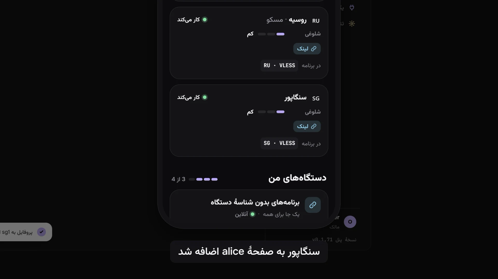

Mistgate پنلی خودمیزبان برای مجموعهٔ کوچکی از سرورهای VPN است که روی سرورهای خودتان اجرا می‌کنید. این صفحه توضیح می‌دهد چه کارهایی می‌کند، چه کارهایی نمی‌کند، و مفهوم‌هایی که بقیهٔ مستندات روی آن‌ها بنا شده‌اند چه هستند.

## Mistgate چیست

- **دو برنامه، بدون Docker.** `mistgate` پنل است. `mistgate-node` ایجنتی است که روی هر سرور VPN اجرا می‌شود. هر دو فایل اجرایی تکی Go برای Linux هستند (amd64 و arm64).
- **یک پنل مدیریت برای همهٔ نودها.** پنل افراد، تنظیم‌های پروتکل‌ها و سرورها را در یک پایگاه دادهٔ SQLite نگه می‌دارد و در یک پنل مدیریت وب به زبان‌های انگلیسی، روسی، چینی ساده، فارسی و ترکی نشان می‌دهد.
- **ایجنت‌ها روی سرورها کار را انجام می‌دهند.** ایجنت پروتکل‌ها را اجرا می‌کند و میزبان را در وضعیتی که پنل می‌خواهد نگه می‌دارد. خودش به پنل وصل می‌شود، پس پنل به هیچ پورت مدیریتی روی سرورهای شما نیاز ندارد. پنل فقط برای نصب یک نود (از پنل مدیریت، یا برای ایجنت هوش مصنوعی با تأیید شما) از راه SSH وارد سرور می‌شود و، تا وقتی این دسترسی SSH ذخیره مانده، به درخواست شما رمز عبور سرور را عوض یا بررسی می‌کند.
- **پروتکل‌ها.** Hysteria2 (هستهٔ رسمی که داخل ایجنت است)، VLESS REALITY روی XHTTP یا TCP (xray-core که داخل ایجنت است) و AmneziaWG نسخه‌های 2.0 و 3.1 (به‌طور پیش‌فرض در فضای کاربر، و برحسب درخواست ماژول کرنل برای هر نود). Cloudflare WARP می‌تواند خروجی هر سه باشد.
- **یک لینک برای هر نفر.** برنامهٔ اشتراکی که لینک را باز می‌کند فهرست سرورها را با قالبی می‌گیرد که می‌خواند (فهرستی از لینک‌های `hysteria2://` و `vless://` یا یک پروفایل Mihomo YAML، که با قاعده‌های User-Agent انتخاب می‌شود). مرورگر صفحهٔ شخصی همان فرد را با راهنما می‌گیرد. کاربران AmneziaVPN برای هر دستگاه یک کلید می‌گیرند.
- **به‌طور پیش‌فرض پنهان.** غریبه‌ای که نشانی پنل را باز کند یک سایت پوششی می‌بیند. پنل مدیریت پشت یک مسیر مخفی، یک نام میزبان مخفی یا یک listener جداگانه است، و لینک اشتراکِ ناشناخته هم همان سایت پوششی را می‌گیرد.
- **سلامت و به‌روزرسانی.** پنل هر سرور را همان‌طور که یک کلاینت واقعی می‌بیند بررسی می‌کند، هر نود یک عیب‌یاب با بررسی‌های میزبان و چند راه‌حل امن دارد، و هشدارها مشکل را به زبان ساده می‌گویند. ایجنت نودها و پنل فقط به ریلیزهایی به‌روز می‌شوند که با کلید ریلیزِ داخل پنل امضا شده باشند: کلید پروژه برای ریلیزهای رسمی GitHub، و کلید خودتان برای بیلدهای خودتان.
- **نسخهٔ پشتیبان.** نسخهٔ پشتیبان رمزگذاری‌شدهٔ پنل در سطل Cloudflare R2 شما، زمان‌بندی‌شده یا هر وقت بخواهید.
- **خودکارسازی.** اسکریپت‌ها با توکن‌های API محدودشده از همان API نوع Connect استفاده می‌کنند که پنل مدیریت استفاده می‌کند؛ ایجنت‌های هوش مصنوعی از سرور MCP داخلی استفاده می‌کنند و تغییرهای پرخطر منتظر تأیید مالک می‌مانند.

## چه چیزی نیست

- **سرویس VPN نیست.** سرورها و نام‌های دامنه را شما می‌آورید و همه‌چیز را خودتان اداره می‌کنید. Mistgate سرور اجاره نمی‌دهد و دسترسی نمی‌فروشد.
- **سیستم صورتحساب نیست.** پرداخت، تعرفه یا فاکتوری در کار نیست. سهمیهٔ ترافیک، مهلت و سقف دستگاه محدودیت‌هایی هستند که خودتان تعیین می‌کنید.
- **برنامهٔ کلاینت نیست.** افراد با برنامه‌های موجود وصل می‌شوند: یک برنامهٔ اشتراکی مثل Happ، یا برنامه‌ای روی هستهٔ mihomo مثل kl!ck (پیشنهادی روی Windows و macOS)، Clash Verge یا FlClash، و AmneziaVPN برای کلیدهای AmneziaWG.
- **تمام‌شده نیست.** این یک نسخهٔ اولیه است: API، تنظیم‌های ذخیره‌شده و پروتکل نود ممکن است تا نسخهٔ 1.0 هنوز تغییر کنند. مدل داده برای حدود 5000 کاربر و 50 نود اندازه‌گیری شده است.
- **نصب‌کنندهٔ یک‌کلیکی نیست.** پنل را دستی نصب می‌کنید، از فایل‌های اجرایی Linux یک ریلیز GitHub یا ساخته‌شده از روی سورس. نود را از پنل مدیریت اضافه می‌کنید، یا خودکار از راه SSH یا با یک دستور نصب یک‌بارمصرف که روی سرور اجرا می‌کنید. نصب‌کنندهٔ تک‌خطی برای پنل **برنامه‌ریزی‌شده** است.

## برای چه کسی است

Mistgate برای یک نفر یا یک گروه کوچک است که چند سرور VPN را برای خودش، خانواده، دوستان یا یک انجمن کوچک اداره می‌کند. باید با Linux، SSH، systemd و رکوردهای DNS راحت باشید. بعضی پیش‌فرض‌ها برای کاربران داخل روسیه و چین انتخاب شده‌اند (DNS یاندکس برای نودهای روسیه، AliDNS و DNSPod برای نودهای چین، دامنه‌های کنترلی کشوری عیب‌یاب، پیش‌تنظیم‌های split-DNS)؛ همهٔ آن‌ها تنظیم‌پذیرند.

## مفهوم‌ها

| مفهوم | چیست |
|:--|:--|
| پنل | فرایند `mistgate serve`، یکی برای هر نصب. پایگاه داده، کلید اصلی که رازهای ذخیره‌شده را رمزگذاری می‌کند، و مرجع صدور گواهی (CA) خودِ پنل را نگه می‌دارد. سایت پوششی، اشتراک‌ها و صفحه‌های کاربر را روی نشانی عمومی‌اش، پنل مدیریت را روی یک نشانی مخفی، و نقطهٔ اتصال ایجنت‌های نود را ارائه می‌کند. |
| نود | سروری Linux که ترافیک VPN را حمل می‌کند. یک نام دارد (`de1`)، نشانی‌ای که کلاینت‌ها به آن وصل می‌شوند (دامنه یا IP)، و به‌دلخواه یک کشور. |
| ایجنت | سرویس `mistgate-node` روی یک نود. گواهی کلاینتی از CA پنل دارد، یک اتصال با پنل نگه می‌دارد، آنچه پنل روی این نود می‌خواهد را اعمال می‌کند و ترافیک، نشست‌ها، سلامت و رویدادها را گزارش می‌دهد. |
| پروفایل | تنظیم قابل‌استفادهٔ دوبارهٔ یک پروتکل: یک پروتکل به‌علاوهٔ تنظیم‌هایش (پورت، گواهی، مبهم‌سازی و غیره). تا وقتی پروفایل را روی نودی نگذارید هیچ کاری نمی‌کند. |
| سرور روی نود | پروفایلی که روی یک نود گذاشته شده. همان چیزی است که واقعاً روی نود گوش می‌دهد و فرد در برنامه‌اش به‌صورت یک سرور می‌بیند. پورت و دامنه (SNI) آن می‌تواند برای هر نود فرق کند. API به آن inbound می‌گوید. |
| گروه | مجموعه‌ای از پروفایل‌ها. هر کاربر در یک گروه است و پروفایل‌های همان گروه را می‌گیرد. پنل تازه با یک گروه خالی به نام «همه» شروع می‌شود. |
| کاربر | فردی که دسترسی دارد: یک گروه، برنامه‌هایی که استفاده می‌کند (لینک اشتراک، AmneziaVPN یا هر دو)، نودهایی که می‌گیرد (همه یا چند تا)، سهمیهٔ ترافیک، مهلت و سقف دستگاه. وضعیت: فعال، غیرفعال، منقضی یا سهمیه تمام. |
| دستگاه | دستگاهی از یک کاربر که اعتبارنامه دارد. برای برنامه‌های اشتراکی، دستگاه وقتی برنامه لینک را می‌گیرد خودش پیدا می‌شود، یکی برای هر شناسهٔ دستگاه، و کلیدهای خودش را دارد؛ برنامه‌هایی که شناسهٔ دستگاه نمی‌فرستند یک جا را با هم شریک‌اند. برای AmneziaWG دستگاه یک کلید است که به یک پروفایل بسته شده. سقف دستگاه، دستگاه‌ها را می‌شمارد. |
| لینک اشتراک | یک نشانی مخفی برای هر کاربر. برنامه‌ای که آن را بگیرد سرورهای کاربر را می‌گیرد؛ مرورگر صفحهٔ کاربر را می‌گیرد. لینک جدید لینک قبلی را فوراً جایگزین می‌کند. |
| صفحهٔ کاربر | آنچه لینک در مرورگر نشان می‌دهد: راهنمای پلتفرم همان فرد، یک کد QR، ترافیک و مهلت، و، اگر اجازه بدهید، کلیدهای AmneziaWG که فرد برای دستگاه‌های خودش می‌سازد. می‌تواند رمز عبور صفحه بخواهد. |

ارتباطشان با هم:

- یک **کاربر** وقتی یک **سرور روی نود** را می‌گیرد که پروفایل در **گروه** کاربر باشد، نود جزو نودهای کاربر باشد، سرور روشن باشد، کاربر فعال باشد، و یکی از برنامه‌های کاربر بتواند آن پروتکل را به کار ببرد (Hysteria2 و VLESS برای برنامه‌های اشتراکی؛ AmneziaWG برای AmneziaVPN، و برای برنامه‌های روی هستهٔ mihomo وقتی AmneziaVPN برای کاربر روشن است).
- هر تغییر در هر یک از این‌ها بی‌درنگ به نودهای مربوط فرستاده می‌شود. هیچ‌کس لازم نیست چیزی را دوباره راه‌اندازی کند.

## برنامهٔ هر فرد چطور به نود می‌رسد

برنامه فقط برای گرفتن لینک با پنل حرف می‌زند. ترافیک VPN مستقیم از برنامه به نود و از آنجا به اینترنت می‌رود؛ هرگز از پنل نمی‌گذرد.

## بعدش

- [پیش‌نیازها](requirements.md): پنل و نودها چه چیزی لازم دارند.
- [نصب پنل](install-panel.md)، سپس [افزودن نود](add-node.md) (یا [نصب نود از راه SSH](ssh-install.md)) و [اولین کاربران](first-users.md).
- [معماری](../reference/architecture.md): اجزا چطور با هم حرف می‌زنند، با جزئیات بیشتر.
