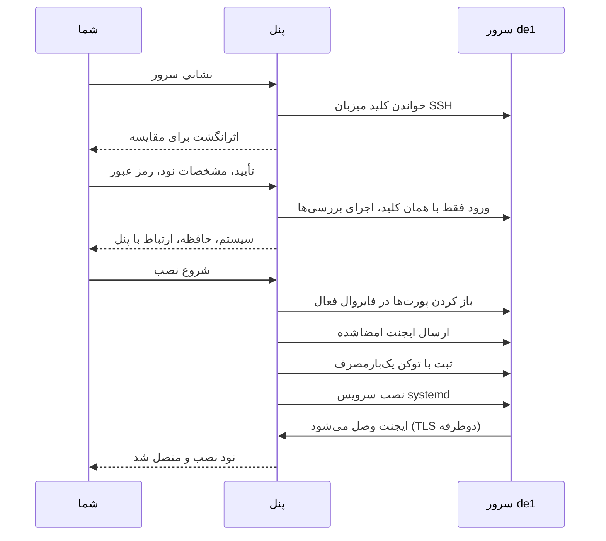

در نصب SSH، خودِ پنل به سرور تازه وصل می‌شود، آن را بررسی می‌کند، ایجنت نود را نصب می‌کند و منتظر می‌ماند وصل شود: لازم نیست چیزی را روی سرور کپی کنید یا فرمانی بچسبانید. این کار مالک است و از **نودها ← افزودن نود ← نصب خودکار از راه SSH** شروع می‌شود. ایجنت هوش مصنوعی هم می‌تواند همین نصب را از راه MCP شروع کند و شما در پنل مدیریت تأییدش می‌کنید: [راهنمای ایجنت هوش مصنوعی](ai-agents.md) را ببینید. وقتی پنل نمی‌تواند از راه SSH به سرور برسد، از [نصب دستی](add-node.md) استفاده کنید.

## چه چیزی لازم دارید

- سروری با Ubuntu نسخهٔ 22.04 یا جدیدتر یا Debian نسخهٔ 12 یا جدیدتر، amd64 یا arm64، systemd، دست‌کم 256 MiB رم و فضای آزاد در `/root` برای ایجنت (اندازهٔ آن به‌علاوهٔ 64 MiB). [پیش‌نیازها](requirements.md) را ببینید.
- ورود SSH با رمز عبور، به‌عنوان `root` یا حسابی که `sudo -n` را بدون پرسیدن رمز عبور اجرا می‌کند. ورود با کلید SSH پشتیبانی نمی‌شود. نشانی باید عمومی باشد: نشانی‌های خصوصی، loopback و link-local رد می‌شوند.
- SSH باز به روی سرور پنل. اگر فایروال سرویس‌دهنده یا security group جلوی SSH را می‌گیرد، اول TCP ورودی روی پورت SSH را از نشانی خروجی عمومی سرور پنل مجاز کنید. پنل فقط فایروال خودِ میزبان را می‌تواند تغییر دهد، آن‌هم فقط پس از وصل شدن SSH.
- نشانی ایجنتِ پنل که از سرور در دسترس باشد: نشانی عمومی پنل روی TCP 443، یا نشانی‌ای که به `serve --agent-addr` داده شده. بررسی‌ها آن را امتحان می‌کنند.
- یک نشانی عمومی که پنل بشناسد: `setup --public-url` یا `serve --agent-addr`. بدون آن جادوگر می‌گوید «The panel's public address is not configured».
- یک بستهٔ ایجنت نود مورد اعتماد و منقضی‌نشده در پوشهٔ دادهٔ پنل. پنلی از ریلیز رسمی آن را هنگام شروع و پس از آن هر 10 دقیقه از GitHub Releases دانلود می‌کند. پنلی که خودتان ساخته‌اید بستهٔ امضاشدهٔ خودتان را در `<data-dir>/dist` لازم دارد: [نسخه‌ها و امضا](../operations/releases.md) را ببینید. خط **بستهٔ ریلیز** در صفحهٔ به‌روزرسانی‌ها وضعیتش را نشان می‌دهد.

## چهار مرحله

1. **سرور.** **آدرس سرور SSH** و **پورت SSH** (معمولاً 22) را وارد کنید و **بررسی سرور** را بزنید. پنل کلید میزبان SSH سرور را از سرور خودش می‌خواند. هنوز هیچ نام کاربری یا رمز عبوری فرستاده نمی‌شود.
2. **کلید SSH.** اثرانگشت SHA-256 و نوع کلید را با یک نسخهٔ قابل‌اعتماد مقایسه کنید: نسخه‌ای که کنسول سرویس‌دهنده‌تان نشان می‌دهد، یا خروجی `ssh-keygen -lf /etc/ssh/ssh_host_ed25519_key.pub` که از راه همان کنسول روی سرور اجرا شده. کلیدی را که نمی‌توانید بررسی کنید تأیید نکنید. تیک تأیید را بزنید، سپس نود را پر کنید: **نام**، **آدرس** (دامنه یا IP عمومی که کلاینت‌ها به آن وصل می‌شوند)، **کشور**، **منطقه یا شهر**، **سرویس‌دهنده**، **نام کاربری SSH** (به‌طور پیش‌فرض `root`) و **رمز عبور SSH**. **ادامه** ممکن است از شما بخواهد ورودتان را دوباره تأیید کنید (به «تأیید دوبارهٔ ورود» (step-up) در [امنیت](../operations/security.md) نگاه کنید)، سپس دقیقاً با همان کلید تأییدشده وارد می‌شود و بررسی‌ها را اجرا می‌کند.
3. **بررسی.** **سیستم**، **معماری**، **هسته**، **پردازنده‌ها**، **حافظه**، **فضای آزاد دیسک**، **systemd** و **ارتباط با پنل** را مرور کنید. رمز عبور را دوباره وارد کنید، «ایجنت Mistgate نصب شود و این نود ساخته شود» را تیک بزنید و **شروع نصب** را بزنید. تا اینجا سرور دست‌نخورده است.
4. **نصب.** کار در پنل، فاز به فاز اجرا می‌شود: اتصال از راه SSH، بررسی سرور، آماده‌سازی فایروال سرور، ارسال ایجنت، ثبت نود، راه‌اندازی ایجنت، انتظار برای اتصال نود. **بستن؛ نصب در پس‌زمینه ادامه دارد** پنجره را می‌بندد؛ کار ادامه پیدا می‌کند. وقتی ایجنت وصل شود، پنجره «نود نصب و متصل شد» را می‌گوید و **باز کردن نود** را پیشنهاد می‌کند. اگر کار شکست بخورد، پنجره دلیلش را می‌گوید و **تلاش دوباره برای نصب** (با رمز عبور) یا **باز کردن مدیر نصب** را پیشنهاد می‌کند.

نود تازه هنوز پروفایلی ندارد: با [اولین کاربران](first-users.md) ادامه دهید.

## پنل روی سرور چه می‌کند

همه‌چیز روی یک اتصال SSH اجرا می‌شود که فقط کلید میزبان تأییدشده را می‌پذیرد. برای ورودی غیر از root، هر فرمان از راه `sudo -n` اجرا می‌شود.

1. **بررسی‌ها.** سیستم‌عامل، معماری، کرنل، CPUها، حافظه، فضای آزاد دیسک در `/root` و وجود systemd را می‌خواند، اینکه سرور از قبل هویت یک نود Mistgate را دارد یا نه، و اینکه سرور می‌تواند به نشانی ایجنتِ پنل یک اتصال TCP باز کند یا نه (آزمایش 5 ثانیه‌ای).
2. **فایروال میزبان.** فقط به فایروالی دست می‌زند که از قبل فعال است؛ فایروال غیرفعال غیرفعال می‌ماند. UFW پورت SSH، سپس 80/tcp، 443/tcp و 443/udp را با کامنت `mistgate-node-provision-v1` می‌گیرد، مگر پورتی که از قبل همان قانون را برایش دارید. firewalld پورت SSH، 80/tcp، 443/tcp و 443/udp را در هر zone فعال می‌گیرد، هم در runtime و هم دائمی، بدون reloadای که قانون‌های فقط-runtime را از دست بدهد.
3. **ایجنت.** ایجنتِ معماری سرور را از بستهٔ مورد اعتماد به `/root/mistgate-node` استریم می‌کند، اندازه و SHA-256 آن را می‌سنجد و اجرایی‌اش می‌کند.
4. **ثبت.** `mistgate-node enroll` را با توکنی یک‌بارمصرف اجرا می‌کند که یک ساعت اعتبار دارد. توکن روی ورودی استاندارد می‌رود (`--token-stdin`)، هرگز روی خط فرمان. `--resume-key` کلید در انتظار را روی دیسک نگه می‌دارد تا ثبت نیمه‌کاره با همان کلید دوباره امتحان شود.
5. **سرویس.** `mistgate-node install` را اجرا می‌کند که unit سخت‌شدهٔ systemd را می‌نویسد و ایجنت را راه می‌اندازد، دقیقاً مثل نصب دستی: «روی سرور چه می‌شود» در [افزودن نود](add-node.md) را ببینید.
6. **اتصال.** تا 2 دقیقه منتظر می‌ماند ایجنت وصل شود، سپس دسترسی SSH را (رمزگذاری‌شده) ذخیره می‌کند و کار را تمام می‌کند.

از آن به بعد ایجنت UFW را با پروفایل‌های خودش هم‌سو نگه می‌دارد: پس از اعمال یک ورودی UDPِ فعال، همان پورت دقیق و یک بازهٔ پرش پورت پذیرفته‌شدهٔ Hysteria2 را به‌صورت قانون‌هایی با برچسب خودش به UFWِ فعال اضافه می‌کند. هرگز قانونی را که خودش برای همان پورت نیفزوده تغییر یا حذف نمی‌کند. UFW بیرون از sandbox ایجنت، به‌صورت unit موقت systemd اجرا می‌شود. firewalld فقط بررسی می‌شود: ایجنت پورت‌هایی را که در zone پیش‌فرض نیستند نام می‌برد و شما اضافه‌شان می‌کنید. وقتی فایروال میزبان نتواند هم‌سو شود، نود یک رویداد هشدار `host_firewall_sync_failed` نشان می‌دهد و listener به کارش ادامه می‌دهد. از رده خارج کردن نود قانون‌های برچسب‌دار را برمی‌دارد، از جمله قانون‌های 80/443 نصب؛ قانون SSH هرگز برداشته نمی‌شود.

## کارهای نصب و مدیر نصب

هر نصب کاری است که پنل نگه می‌دارد. مدیر نصب در `<admin URL>nodes/install` آخرین 100 کار را با وضعیتشان (در صف، در حال نصب، در حال توقف، لغو شد، نود متصل شد، ناموفق) و دسترسی‌های ذخیره‌شدهٔ سرور فهرست می‌کند. صفحهٔ هر کار مرحله‌هایش را نشان می‌دهد، هر 4 ثانیه تازه می‌شود و هرگز خروجی سرور را نشان نمی‌دهد. فقط مالک آن را باز می‌کند.

مدیر نصب انگلیسی، روسی یا چینی ساده صحبت می‌کند: زبان پنل مدیریت وقتی از جادوگر باز می‌شود (`?lang=` را می‌فرستد؛ مدیری با زبان فارسی یا ترکی انگلیسی می‌گیرد)، وگرنه اولین زبان مرورگر اگر چینی یا روسی باشد، و در غیر این صورت انگلیسی.

- **لغو.** کار در صف فوراً متوقف می‌شود و دادهٔ موقت SSH آن پاک می‌شود. به کار در حال اجرا گفته می‌شود متوقف شود؛ فرمانی که از قبل روی سرور در حال اجراست ممکن است سرور را تغییر داده باشد، پس پیش از امتحان دوباره سرور را بررسی کنید.
- **تلاش دوباره.** کار ناموفق یا لغوشده را می‌توان با نام کاربری و رمز عبور SSH دوباره اجرا کرد. بررسی‌ها می‌بینند سرور از قبل هویت این نود را دارد یا نه و کار از همان‌جا ادامه می‌یابد؛ سروری که هویت نود دیگری را دارد رد می‌شود. کاری که نودش از رده خارج شده را نمی‌توان دوباره امتحان کرد: نصب تازه‌ای شروع کنید.
- **نام‌ها.** نام نود تا وقتی نود زنده است یا نصبی برایش فعال است رزرو می‌ماند. از رده خارج کردن نود تاریخچه‌اش را نگه می‌دارد و نام را آزاد می‌کند.
- **رمز عبور.** تا وقتی کاری اجرا می‌شود، رمز عبور SSH با کلید اصلی پنل رمزگذاری و به همان کار بسته می‌شود. وقتی کار تمام شود پاک می‌شود؛ در صورت موفقیت به دسترسی ذخیره‌شدهٔ نود تبدیل می‌شود.

## دسترسی SSH ذخیره‌شده

پس از نصب موفق، پنل نام کاربری و رمز عبور SSH را، رمزگذاری‌شده با کلید اصلی، همراه کلید میزبان pin‌شده نگه می‌دارد. هیچ خواندن API، ابزار MCP یا لاگی رمز عبور را برنمی‌گرداند.

- **دیدنش.** کارت **سرور ← دسترسی SSH** نود، سرور SSH، نام کاربری و کلید میزبان pin‌شده را نشان می‌دهد. **نمایش رمز عبور** از شما می‌خواهد ورودتان را دوباره تأیید کنید و در لاگ ممیزی نوشته می‌شود.
- **تغییرش.** در همین کارت، **تغییر رمز عبور** دو راه دارد: **ساختن خودکار** (پنل یک رمز 26 نویسه‌ای می‌سازد) یا **رمز خودم** (دست‌کم 12 نویسه)، و از شما می‌خواهد ورودتان را دوباره تأیید کنید. تغییر ممکن است تا یک دقیقه طول بکشد و کارت پیشرفتش را نشان می‌دهد؛ صفحه را نبندید. بعد کارت رمز تازه را با دکمهٔ کپی تا 60 ثانیه یا تا وقتی از زبانه بیرون بروید نشان می‌دهد: همان موقع ذخیره‌اش کنید. جدول دسترسی سرور در مدیر نصب هم رمز تایپ‌شده می‌گیرد، و از راه MCP، `node_server_password_rotate` پنل را وامی‌دارد خودش یکی بسازد؛ ایجنت هرگز آن را نمی‌بیند. در هر حالت پنل اول رمز تازه را به‌عنوان در انتظار ذخیره می‌کند، با `chpasswd` روی سرور عوضش می‌کند، با آن دوباره وارد می‌شود، و تازه آن‌وقت رمز ذخیره‌شده را جایگزین می‌کند: پس از آن کارت **تأییدشده** را نشان می‌دهد. نود از رده خارج‌شده **تغییر رمز عبور** ندارد.
- **تغییر نیمه‌کاره.** اگر سرور نتوانست رمز تازه را تأیید کند، کارت **تغییر تأیید نشد** را نشان می‌دهد و نمایش یا تغییر بعدی اول هر دو را امتحان می‌کند. وقتی نتوان به سرور رسید تا بفهمیم کدام کار می‌کند، **نمایش رمز عبور** «رمز عبور فعلی (تأییدنشده)» و «رمز عبور جدید از تغییر نیمه‌کاره (تأییدنشده)» را نشان می‌دهد: اول فعلی را امتحان کنید. تغییر تازه تا پاسخ سرور صبر می‌کند. اگر سرور هر دو را رد کند، رمز را از راه کنسول سرویس‌دهنده‌تان بازنشانی کنید.
- **رمزی که پنل ساخته.** فقط پنل آن را می‌داند، و کارت این را می‌گوید. پیش از از رده خارج کردن نود، نشانش دهید و یک نسخه نگه دارید.
- **نودِ از رده خارج.** کارت دسترسی SSH آن می‌ماند: پنل دیگر آن سرور را تغییر نمی‌دهد، اما هنوز می‌توانید رمز عبور را نشان دهید. **فراموش کردن دسترسی ذخیره‌شده**، که دو بار پرسیده می‌شود و تأیید تازهٔ ورود می‌خواهد، آن را برای همیشه پاک می‌کند. فقط دسترسی نودِ از رده خارج را می‌توان فراموش کرد.

## در نسخهٔ Cloudflare

نسخهٔ edge (پنل روی Cloudflare Workers) هم نودها را از راه SSH نصب می‌کند. جادوگر، مرحله‌ها، مدیر نصب و دسترسی ذخیره‌شده یکی هستند؛ نصب‌ها در یک اسکریپت Worker دوم به نام `mistgate-edge-provision` اجرا می‌شوند که `mistgate edge deploy` همراه پنل مستقر می‌کند ([نصب نسخهٔ Cloudflare](install-edge.md) را ببینید). تفاوت‌ها:

- **پنل از شبکهٔ Cloudflare وصل می‌شود**، نه از سروری که بشناسید و نه از کامپیوتر شما. در مدت نصب، SSH روی سرور تازه باید TCP ورودی را از اینترنت روی پورتش بپذیرد، هم در فایروال یا security group سرویس‌دهنده و هم در فایروال میزبان. قاعده‌ای که فقط IP خودتان یا یک نشانی ثابت پنل را مجاز کند باعث timeout در بررسی می‌شود: Cloudflare نشانی‌هایی را که Worker از آن‌ها وصل می‌شود منتشر نمی‌کند. رمز ذخیره‌شده را هم بعداً از راه SSH عوض یا نمایش می‌دهید، پس برای آن دوباره بازش کنید.
- **ایجنت از ریلیز امضاشدهٔ روی GitHub می‌آید** که با نسخهٔ پنل بخواند، و نود روی نشانی عمومی پنل ثبت می‌شود. بیلدی از پنل که ریلیز نیست ایجنت مورد اعتماد ندارد و جادوگر این را می‌گوید.
- **«Refused or unreachable»** (جادوگر می‌گوید «شبکهٔ پنل این آدرس را نپذیرفت، یا سرور از آن شبکه در دسترس نیست») یعنی شبکهٔ Cloudflare پنل را به آن نشانی وصل نکرد. از Worker، رد شدن به‌دست پلتفرم و پورت بسته یک شکل‌اند، پس پنل نمی‌تواند بگوید کدام بوده. این‌ها را بررسی کنید: نشانی‌ای که متعلق به Cloudflare است، یا نامی که Cloudflare پراکسی‌اش می‌کند (ابر نارنجی در فهرست DNS) که به‌جایش نشانی خود سرور یا نامی فقط-DNS لازم دارید؛ شبکهٔ خصوصی یا سروری که فقط از راه VPN یا bastion در دسترس است؛ پورت اشتباه یا نبودن سرویس SSH روی آن.

وقتی پنل نمی‌تواند از این راه به سرور برسد، یا سرور فقط کلید SSH می‌پذیرد، نود را با فرمان دستی نصب کنید: جادوگر کنار این خطا **استفاده از دستور دستی** را پیشنهاد می‌دهد و [افزودن نود](add-node.md) آن را توضیح می‌دهد. نصبی که Cloudflare سه بار پشت‌سرهم قطعش کند با وضعیت ناموفق متوقف می‌شود؛ دوباره امتحانش کنید یا از فرمان دستی استفاده کنید.

## وقتی شکست می‌خورد

| جادوگر می‌گوید | چه کنید |
|:--|:--|
| پنل به‌موقع به این آدرس و پورت SSH نرسید | بررسی کنید SSH روی آن پورت اجرا می‌شود، و در فایروال سرویس‌دهنده TCP ورودی را از نشانی خروجی سرور پنل مجاز کنید. اگر فایروال میزبان SSH را می‌بندد، از کنسول سرویس‌دهنده بازش کنید. |
| شبکهٔ پنل این آدرس را نپذیرفت، یا سرور از آن شبکه در دسترس نیست | فقط نسخهٔ edge: «در نسخهٔ Cloudflare» در بالا را ببینید. نشانی عمومی خود سرور را به کار ببرید، یا [نصب دستی](add-node.md). |
| پنل به‌موقع از این آدرس و پورت SSH پاسخی نگرفت، و متن از شبکهٔ Cloudflare نام می‌برد | نسخهٔ edge: برای مدت نصب TCP ورودی روی پورت SSH را از اینترنت مجاز کنید، نه فقط از IP خودتان؛ یا از [نصب دستی](add-node.md) استفاده کنید. |
| پنل نتوانست از این آدرس کلید SSH بگیرد | میزبان، پورت و سرویس SSH را بررسی کنید. |
| یک آدرس عمومی برای سرور وارد کن که از راه SSH در دسترس باشد | آدرس خصوصی، loopback یا link-local است، یا resolve نمی‌شود. نشانی عمومی سرور را به کار ببرید. |
| سرور نام کاربری یا رمز عبور SSH را نپذیرفت | هر دو را بررسی کنید؛ پنل فقط ورود با رمز عبور را پشتیبانی می‌کند. |
| کلید SSH بعد از تأیید تغییر کرد | سرور اکنون کلید میزبان دیگری نشان می‌دهد: پیش از شروع دوباره بفهمید چرا. |
| Ubuntu نسخهٔ 22.04 یا جدیدتر، یا Debian نسخهٔ 12 یا جدیدتر لازم است / سرور باید amd64 یا arm64 باشد | سرور پشتیبانی نمی‌شود؛ فقط اگر می‌دانید ایجنت آنجا کار می‌کند از [نصب دستی](add-node.md) استفاده کنید. |
| حساب SSH باید دسترسی root یا sudo بدون رمز داشته باشد | با root وارد شوید، یا به حساب اجازهٔ `sudo -n` بدهید. |
| آدرس عمومی پنل تنظیم نشده است، برای همین نود نمی‌تواند دوباره به آن وصل شود | `--public-url` یا `--agent-addr` را تنظیم کنید. |
| سرور نتوانست به نشانی ایجنتِ پنل اتصال TCP باز کند | پورت ایجنت را در فایروال یا security group جلوی پنل مجاز کنید، DNS نشانی ایجنت و TCP خروجی سرور را بررسی کنید، دوباره امتحان کنید. |
| سرور systemd ندارد | Ubuntu 22.04+ یا Debian 12+ با systemd به کار ببرید. |
| حافظه یا پردازندهٔ سرور کم است | ایجنت دست‌کم 256 MB رم می‌خواهد. |
| فضای آزاد دیسک سرور برای ایجنت کم است | اندازهٔ ایجنت به‌علاوهٔ 64 MB لازم است. کمی فضا آزاد کنید و دوباره امتحان کنید. |
| سرور از قبل هویت نود دیگری یا هویتی آسیب‌دیده از Mistgate دارد | `/var/lib/mistgate-node` را روی سرور فقط اگر آن نود دیگر وجود ندارد حذف کنید، سپس دوباره امتحان کنید. |
| پنل برای معماری این سرور ایجنت معتبری ندارد | **بستهٔ ریلیز** در صفحهٔ به‌روزرسانی‌ها را بررسی کنید، سپس دوباره امتحان کنید. |
| این نام نود از قبل استفاده شده است | نام دیگری انتخاب کنید، یا اول نود قدیمی را از رده خارج کنید. |
| پنل وصل شد، اما نتوانست قانون‌های فعال UFW/firewalld را آماده کند | دسترسی root یا `sudo -n` حساب و فایروال میزبان را بررسی کنید، سپس دوباره امتحان کنید. |
| SSH بعد از ایجاد تغییرهایی روی سرور قطع شد | ممکن است بخشی از فرمان‌های نصب اجرا شده باشد. سرور را ببینید، سپس دوباره امتحان کنید. |
| ایجنت نصب شد اما به پنل وصل نشد | روی سرور: `journalctl -u mistgate-node -n 50 --no-pager`. معمولاً نود نمی‌تواند به نشانی ایجنتِ پنل برسد. |
| Mistgate نتوانست سرویس systemd خودش را نصب یا راه‌اندازی کند | ژورنال سرور را ببینید، سپس دوباره امتحان کنید. |
| نصب متوقف شد. برای جزئیات مدیر نصب را باز کن | دلیلی که جادوگر برایش واژه ندارد؛ مدیر کد دقیق کار را نشان می‌دهد. |
