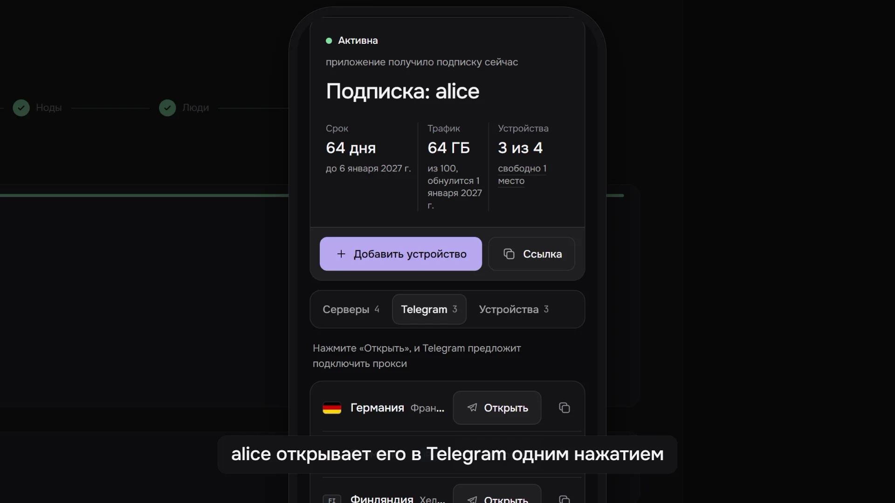

MTProto — собственный протокол прокси Telegram. Профиль MTProto в Mistgate превращает каждую ноду, на которой он работает, в прокси-сервер **только для приложения Telegram**: человек нажимает на ссылку, Telegram добавляет прокси в свои настройки, и трафик Telegram идёт через ноду. Это не VPN: другие приложения им не пользуются, и ни одно VPN-приложение его не читает. На этой странице — настройки профиля MTProto и то, как человек получает ссылку; как профиль создаётся и ставится на ноды, описано в разделе [Профили](profiles.md). Профиль может работать и в режиме **Web**: он выдаёт людям ссылку другого вида; об этом — в разделе [Web Proxy](#web-proxy).



> **Важно:** MTProto — **экспериментальный** протокол. Это первая версия протокола в Mistgate, на практике она ещё не проверена; панель помечает его как экспериментальный там, где вы выбираете протокол. Настройки и поведение ещё могут измениться.

## Когда это помогает и где пределы

Он нужен там, где Telegram заблокирован или замедлен, а остальной интернет нет, или как более лёгкий второй путь к Telegram рядом с VPN. Прокси говорит на Fake TLS: для всякого, кто наблюдает за соединением, оно начинается как обычное рукопожатие TLS 1.3 с сайтом, а всем, кто не клиент, нода отвечает настоящим сайтом (см. [Имя в рукопожатии](#имя-в-рукопожатии)).

Чего он не умеет:

- **В России он может не работать.** С весны 2026 года MTProto-прокси там обнаруживают и блокируют волнами. Прокси может проработать неделю и перестать. Если ваши люди в России, рассчитывайте на это и держите профиль VPN (Hysteria2, VLESS) как основной способ.
- **Зелёная проверка не доказывает, что у ваших людей он работает.** Проверки панели идут с сервера панели, из-за пределов любой страны. Они показывают, что нода делает своё дело, но не что сеть внутри страны с цензурой пропустит соединение. Прежде чем что-то обещать, попробуйте ссылку в тех сетях, которые важны.
- **Дотошный проверяющий всё же отличит подделку от настоящего сайта.** Ответ ноды на приветствие Fake TLS собран так, чтобы выглядеть как сервер TLS 1.3, но сканирование, которое сравнивает его с настоящим обменом настоящего сайта, увидит разницу. Поэтому посторонних отправляют на настоящий сайт, и поэтому никакая настройка не делает прокси невидимым.
- **Только Telegram.** Нажатие на ссылку меняет только настройку прокси в Telegram. Никакое другое приложение через него не идёт.
- **Нет промежуточного прокси.** Нода подключается прямо к дата-центрам Telegram. Продвигаемый канал Telegram (спонсорская метка) недоступен; см. [Что ещё не сделано](#что-ещё-не-сделано).

## Имя в рукопожатии

В секрете прокси Telegram записан домен: Telegram кладёт его в рукопожатие TLS как имя сервера. Нода принимает только рукопожатие с этим именем и ключом человека, а всех остальных — другие имена, неверные ключи, повторённые приветствия, обычный HTTP, браузеры и сканеры — отправляет на сайт. Домен выбирается для каждого профиля в настройке **Имя в TLS-рукопожатии**:

| | Имя этой ноды | Другой сайт |
|:--|:--|:--|
| Домен | Собственное имя хоста ноды (или **Домен (SNI)**, заданный для профиля на этой ноде) | Настоящий сайт, который вы называете, например `www.example.org` |
| Что посторонний видит на порту | Собственный сайт-ширма ноды, тот же, что показывают Hysteria2 и VLESS, с сертификатом ноды | Настоящий сайт: нода передаёт соединение ему, поэтому проверяющий проходит настоящее рукопожатие с этим сайтом и видит его сертификат |
| Let's Encrypt на ноде | Продолжает работать, в том числе на TCP 443: проверка отвечает на этом порту | На TCP 443 собственный сайт ноды и эта проверка здесь не отвечают, поэтому сертификат ноды продлевается через порт 80 |
| Нода только с IP-адресом | Нельзя: нет имени, которое можно взять | Работает |
| Слабое место | Сайт-ширма должен выглядеть естественно для имени ноды | Домен не принадлежит IP-адресу сервера, и некоторые сети это замечают |

Как выбирать:

- Начните с **Имя этой ноды** на ноде, у которой есть домен. Посторонние получают ту же ширму, что и на других протоколах ноды ([Свой сайт-ширма](decoy-site.md)), и больше на ноде ничего не меняется.
- Выбирайте **Другой сайт** для ноды, известной только по IP-адресу, или когда хотите, чтобы посторонние встречали большой, известный сайт. Берите сайт, который быстро открывается, не заблокирован там, где ваши люди, и не имеет к вам отношения. **Не берите домен панели**: любой, кто проверит ноду, увидит адрес панели.
- С **Другой сайт** на TCP 443 держите порт 80 ноды доступным, иначе её сертификат не продлится. Редактор профиля предупреждает об этом и о несовпадении с IP-адресом.
- Сайт, который вы называете, должен быть обычным именем хоста (`www.example.org`): без IP-адреса, порта и пути.

## Настройки

Редактор показывает настройки в группе **Основное**. Критичные настройки меняют ссылки, которые у людей уже есть, поэтому людям придётся добавить новую ссылку заново; перед их сохранением редактор переспрашивает (см. [Профили](profiles.md)).

| Настройка | По умолчанию | Критичная | Что делает |
|:--|:--|:--|:--|
| **Режим** | Fake TLS | да | **Fake TLS** или **Web**. Web — это [Web Proxy](#web-proxy): порт закреплён на 443, а имя — собственное имя ноды. Остальная часть страницы — про Fake TLS, если не сказано иное. |
| **TCP-порт** | 443 | да | TCP-порт, на котором слушает нода, от 1 до 65535. В режиме Web закреплён на 443. |
| **Имя в TLS-рукопожатии** | Имя этой ноды | да | **Имя этой ноды** или **Другой сайт**. См. выше. В режиме Web такого выбора нет: редактор его скрывает. |
| **Сайт** | пусто | да | Только для другого сайта: имя хоста этого сайта. |

На ноде у профиля может быть свой **Порт** и, при **Имя этой ноды**, свой **Домен (SNI)**, который тогда и становится именем в рукопожатии.

MTProto — TCP-профиль. На TCP-порту, который уже держит другой TCP-профиль ноды, например VLESS, он может встать рядом, только если у каждого из них своё имя и один из них показывает сайт ноды: см. [Один 443 для всех](shared-port.md). Панель предлагает новое имя для добавляемого профиля, поэтому сервис, который уже стоит на порту, сохраняет имя и свои ссылки `tg://`. Иначе поставь MTProto на другой порт; Telegram принимает любой порт. Встроенный сайт, который Hysteria2 показывает на TCP 443, уступает порт MTProto, как уступает и VLESS ([VLESS и Hysteria2 на одной ноде](vless-and-hysteria2.md)); при **Имя этой ноды** посетитель этого порта всё равно видит сайт ноды.

Здесь важны часы ноды. Рукопожатие несёт время клиента, и нода принимает его в пределах примерно пяти минут от своих часов. Нода с неверными часами отказывает всем клиентам; проверка **Часы** в докторе предупреждает об этом (см. [Здоровье](../operations/health.md)).

## Добавление профиля

1. Откройте **Профили** и нажмите **Новый профиль**. Первый шаг — выбор протокола: выберите карточку **MTProto**. Второй шаг — форма.
2. Задайте **TCP-порт** и **Имя в TLS-рукопожатии**; с **Другой сайт** впишите **Сайт**.
3. Назовите профиль и скажите, куда он идёт: поставьте его на ноды и добавьте в группу. Telegram человек получает только из группы, в которой есть профиль MTProto на разрешённой ему ноде.
4. **Создать профиль**.

Если у ноды только IP-адрес, а профиль использует **Имя этой ноды**, нода откажет и назовёт причину: впишите для профиля на этой ноде домен или выберите **Другой сайт**. Панель справа показывает ссылку, которую получил бы человек, со скрытым ключом.

MTProto работает на ноде с агентом v0.1.69 или новее. Старому агенту панель профиль не отправляет: там сервер показан незапущенным, потому что агент ноды устарел, а всё остальное на ноде продолжает обновляться. Обновите агента на странице **Обновления**.

## Как дать Telegram человеку

Telegram — переключатель у человека, рядом со ссылкой подписки и ключами AmneziaVPN, в форме пользователя и в его карточке. По умолчанию он выключен.

- Включение сразу создаёт **ключ Telegram** человека: один ключ на человека, одинаковый для всех профилей MTProto и всех нод, которые ему разрешены.
- Переключатель Telegram идёт **в дополнение** к Happ или AmneziaVPN, а не вместо них. Хотя бы один из этих двух остаётся включённым.
- Ключ показан среди устройств человека как **Telegram-прокси**, но не занимает места в лимите устройств, поэтому ему никогда не отказывают из-за нехватки места. Выключение переключателя или удаление человека отзывает его.
- Ссылки человек получает, только пока он активен и у группы есть профиль MTProto на разрешённой ему ноде. Отключённый, просроченный или превысивший квоту человек теряет прокси вместе с остальным доступом.
- **Ни одна ссылка не попадает в подписку.** VPN-приложения показали бы строку `tg://` как нерабочий сервер, а приложение Telegram подписки не читает. Ссылка берётся только со страницы человека или из админки.

## Где человек находит ссылку

- **Его страница.** Блок **Telegram-прокси** под серверами, когда Telegram для него включён. Каждая ссылка названа по стране и месту сервера, а не по имени ноды в панели, и у неё есть **Открыть в Telegram** и **Скопировать ссылку**. Пока прокси не готов, блок об этом говорит. См. [Страницу пользователя](user-page.md#telegram-прокси).
- **Админка.** На странице человека в разделе **Пользователи** блок **Telegram-прокси** перечисляет ссылки с **Открыть в Telegram**, копированием и QR-кодом, а также кнопки **Выпустить заново** и **Отозвать**. Отправьте ссылку или покажите QR-код по любому надёжному каналу.

Ссылка выглядит так, где ключ и имя записаны в шестнадцатеричном виде:

```ini
tg://proxy?server=de1.example.com&port=443&secret=ee<key><name>
```

Ссылка и есть ключ: кто её получил, тот может пользоваться прокси. Обращайтесь с ней как с паролем. Перед тем как использовать прокси, Telegram просит человека подтвердить.

## Перевыпуск и отзыв

- **Выпустить заново** даёт человеку новый ключ. Все ссылки, сделанные раньше, сразу перестают работать на всех нодах, а открытые соединения на старом ключе закрываются. Новые ссылки появляются в блоке; человек добавляет их в Telegram. Пользуйтесь, когда ссылка утекла.
- **Отозвать** забирает ключ. Ссылки пропадают, открытые соединения закрываются, а Telegram у человека остаётся включённым, но без ключа. Новый ключ можно создать из того же блока.
- Выключение переключателя Telegram или удаление устройства **Telegram-прокси** тоже отзывает ключ.

Один ключ держит до 64 соединений одновременно. Telegram в самый напряжённый момент открывает около 10–15 на аккаунт, поэтому утёкший ключ не обслужит больше горстки людей. Соединение, по которому 10 минут не было данных, закрывается.

## Ретрансляции и IPv6-двойники

Ссылки Telegram у человека подчиняются тем же правилам, что и другие серверы (см. [Подписки](subscriptions.md#дополнительные-серверы-по-ipv6-и-через-ретрансляцию)), и подписи у них те же:

- если у ноды есть [вход по IPv6](nodes.md#вход-по-ipv6), появляется вторая ссылка на её IPv6-адрес с пометкой **IPv6**;
- для каждой работающей [ретрансляции](relays.md) ноды появляется ещё одна ссылка через ноду входа с пометкой **через RU** (страна входа). Ретрансляция передаёт соединение без изменений, поэтому ключ и имя в рукопожатии остаются как у выхода.

У ссылки Web Proxy нет ни IPv6-двойника, ни ретрансляции: см. [Web Proxy](#web-proxy).

## Что доказывает проверка здоровья

Панель проверяет каждый профиль MTProto так, как им пользовался бы Telegram, со своим скрытым ключом, который не принадлежит ни одному человеку ([Здоровье](../operations/health.md#mtproto)):

1. открывает TCP-соединение с портом профиля;
2. проходит рукопожатие Fake TLS с этим именем и ключом;
3. через прокси просит у дата-центра Telegram 2 первое сообщение (`req_pq_multi`) и проверяет, что приходит корректный ответ.

Зелёная ячейка, таким образом, доказывает, что нода принимает клиента, достаёт до Telegram и что Telegram отвечает через неё. Она не доказывает, что сеть внутри страны, которая блокирует MTProto, пропустит трафик. Если проверка не прошла, ячейка говорит, на каком шаге.

## Web Proxy

> **Внимание:** режим **Web** **в разработке** и на живых приложениях Telegram пока не проверялся: страница, которую приложение загружает с ноды, пока заглушка, и ни одно настоящее приложение Telegram с ней не сверяли. Не раздавайте людям ссылки Web. В этом разделе описано то, что панель и нода делают сегодня.

Профиль в режиме **Web** выдаёт ссылку Telegram другого вида — `tg://webproxy`. Рукопожатия Fake TLS здесь нет: приложение Telegram заходит на имя ноды по HTTPS, как браузер заходит на сайт, и несёт свой трафик по этому соединению. Всякий, кто зайдёт на это имя без ключа, увидит собственный сайт ноды.

Web Proxy — прокси для **приложений Telegram** (Desktop, Android и iOS), как и все остальные прокси на этой странице. Это не Telegram Web в браузере: вкладка браузера им не пользуется. Поддержка в приложениях пока неровная: она есть в свежих версиях Telegram Desktop, а на телефонах появляется по мере того, как её получают приложения. Приложение, которое не знает `tg://webproxy`, этой ссылкой воспользоваться не может.

### Чем он отличается от Fake TLS

| | Fake TLS | Web |
|:--|:--|:--|
| Ссылка | `tg://proxy`, секрет начинается с `ee` | `tg://webproxy`, секрет начинается с `dd` |
| Как выглядит соединение | Рукопожатие TLS 1.3 с сайтом, затем собственный протокол Telegram | Заход по HTTPS на имя хоста с настоящим сертификатом этого имени |
| Порт | Любой TCP-порт, по умолчанию 443 | Только 443 |
| Имя | В секрете: имя ноды или другой сайт | Собственное имя ноды; другой сайт нельзя |
| Что видит посторонний | Сайт-ширму ноды или названный вами другой сайт | Собственный сайт ноды |
| Ретрансляции и IPv6-двойник | Есть | Нет |
| Агент ноды | v0.1.69 или новее | Тот, что объявляет `mtproto-web/1` |

Ключ Telegram у человека для обоих видов один: один ключ на человека, поэтому перевыпуск или отзыв закрывает сразу оба вида ссылок.

### Когда его выбирать

Режим Web новее Fake TLS и не проверен, поэтому считайте его вторым способом рядом с Fake TLS, а не заменой. Он подходит там, где вы хотите, чтобы прокси выглядел как заход на обычный сайт под собственным именем, для людей, у которых приложение Telegram его поддерживает. Дайте тем же людям и профиль Fake TLS: человек получает ссылки каждого профиля MTProto на разрешённых ему нодах, и если один вид не проходит в его сети, другой может сработать.

Выбирайте Fake TLS, когда нужен порт не 443, ретрансляция или IPv6-двойник, или когда приложения ваших людей ещё не знают `tg://webproxy`.

### Что для него нужно

- **Собственное имя профиля на ноде.** Имя хоста с точкой, например `tg.example.com`, и DNS-запись, ведущая на ноду (запись `A` со значением `192.0.2.10`), без прокси (серое облако в Cloudflare). Это либо собственное имя хоста ноды, либо **Домен (SNI)**, который вы задаёте профилю на этой ноде. Лучше взять отдельное имя: если на TCP 443 уже стоит другой сервис под именем ноды, второй не может занять то же имя (`sni_taken`). Ноде, известной только по IP-адресу, имя нужно в любом случае. Сертификат на это имя нода запрашивает у Let's Encrypt сама, как только имя ведёт на неё; пока его нет, клиенты не подключатся, а проверка здоровья скажет, что сертификат ещё не выпущен.
- **TCP 443 на ноде: свободный или общий.** Профиль Web занимает TCP 443 сам или встаёт рядом с VLESS, TrustTunnel и MTProto Fake TLS на общем порту, каждый под своим именем: см. [Один 443 для всех](shared-port.md). Он показывает собственный сайт ноды, поэтому остальные сервисы ноды могут делить с ним порт.
- **Агент ноды, объявляющий `mtproto-web/1`.** Старый агент проигнорировал бы режим и поднял бы под тем же профилем сервер Fake TLS, поэтому панель такой профиль ему не отправляет (см. «Ограничения» ниже).

### Как включить

1. Подготовьте имя и добавьте его DNS-запись, как описано выше.
2. Откройте **Профили**, нажмите **Новый профиль** и выберите карточку **MTProto**.
3. Переключите **Режим** на **Web**. Редактор поставит **TCP-порт** 443 и закрепит его, скроет **Имя в TLS-рукопожатии** и напишет под **Режим**, что профилю нужен собственный поддомен на ноде. **Режим** — критичная настройка: у существующего профиля её смена меняет ссылки, которые уже есть у людей (см. [Профили](profiles.md)).
4. Назовите профиль, поставьте его на ноды и добавьте в группу, затем нажмите **Создать профиль**. Если TCP 443 на ноде уже занят другим сервисом, окно спросит имя и покажет DNS-запись (**Поставить рядом на 443**, см. [Один 443 для всех](shared-port.md#в-админке)). Иначе впишите имя в **Домен (SNI)** для этой ноды или оставьте поле пустым, чтобы взять имя хоста ноды.
5. Добавьте DNS-запись. Когда сертификат будет выпущен, ячейка профиля в [Здоровье](../operations/health.md) станет зелёной.

Если у профиля на ноде свой порт, не равный 443, там он не запустится. Редактор предупреждает об этом до сохранения: снимите этот порт на вкладке профиля **Серверы на нодах**. Нода только с IP-адресом и без заданного **Домена (SNI)** откажет профилю с указанием причины, как и для Fake TLS.

### Что видит человек

В том, как человеку выдают Telegram, ничего не меняется: тот же переключатель, тот же ключ. В блоке **Telegram-прокси** на его странице и в таком же блоке в админке ссылка Web показана строкой с меткой **Web**; подсказка на метке говорит, что это ссылка Web Proxy. Она названа по стране и месту сервера, как и остальные, и у неё есть **Открыть в Telegram** и **Скопировать ссылку** (а в админке ещё и QR-код). Ссылка выглядит так:

```ini
tg://webproxy?server=tg.example.com&port=443&secret=dd<key>
```

Здесь `server` — имя профиля на ноде, а не адрес ноды, а ключ — ключ Telegram у человека. Ссылка и есть ключ, как и у Fake TLS.

### Что видит посторонний

Всякий, у кого нет ключа, получает собственный сайт ноды ([Свой сайт-ширма](decoy-site.md)): по любому пути, в том числе на запрос, похожий на запрос приложения, но с неверным или отозванным ключом, и с настоящим сертификатом этого имени. Скрытую страницу, которую использует приложение, получает только владелец ключа; после перевыпуска или отзыва ключа старая ссылка встречает сайт. Это не невидимость: имя, как и любое имя Let's Encrypt, попадает в публичные журналы сертификатов, а тот, кто его знает, найдёт там обычный сайт.

### Ограничения

- **Только приложения Telegram**, и только те, что поддерживают Web Proxy. Вкладка браузера им не пользуется.
- **Звонков нет.** Звонки через Web Proxy не работают; это ограничение Web Proxy в приложениях Telegram, а не Mistgate.
- **Только порт 443.** Порт профиля изменить нельзя, а собственный порт на ноде отвергается.
- **Нет ретрансляций и IPv6-двойника.** Ссылка несёт имя, а не адрес, поэтому двойник на другом адресе был бы копией той же ссылки. Ретрансляцию отклоняют с причиной `webproxy`: в админке «Web Proxy работает только напрямую на ноду», а в MCP `relay_candidates` показывает этот сервер как неподдерживаемый.
- **Свежий агент ноды.** Панель отправляет профиль только агенту, который объявляет `mtproto-web/1`. У более старого сервер показан незапущенным, с пометкой, что агент ноды старше, чем нужно этому профилю, и просьбой обновить ноду на странице **Обновления**; всё остальное на ноде продолжает обновляться.
- **Те же ограничения на ключ, что у Fake TLS:** до 64 соединений одновременно.
- **Экспериментально**, как и весь протокол.

### Как панель его проверяет

Профиль Web панель проверяет собственным клиентом, а не приложением Telegram, со своим скрытым проверочным ключом профиля:

1. подключается по TCP к порту 443 ноды, ставит имя профиля в TLS-приветствие и проверяет сертификат этого имени;
2. просит скрытую страницу так, как это делает приложение; получит её, только если нода принимает ключ;
3. открывает сессию и поток через ноду;
4. просит у дата-центра Telegram 2 первое сообщение (`req_pq_multi`) и проверяет, что приходит корректный ответ;
5. закрывает сессию.

Зелёная ячейка доказывает, что работают нода, сертификат, служба Web Proxy на сайте ноды и дата-центр Telegram. Она не доказывает, что приложение Telegram примет страницу и что сеть внутри страны, которая блокирует MTProto, пропустит трафик. Если проверка не прошла, ячейка говорит, на каком шаге. Коды и слова самой ячейки о них:

| Код | Что пишет ячейка | Что это значит для Web Proxy |
|:--|:--|:--|
| `refused` | Соединение отклонено: на порту никто не слушает | TCP-соединение с портом 443 не удалось: профиль не запустился или мешает файрвол |
| `timeout` | Нет ответа вовремя: рукопожатие или первый запрос не завершились … | Какой-то шаг не ответил вовремя: соединение, страница, сессия или дата-центр Telegram |
| `tls` | Сертификат или домен не совпадает | Защищённое соединение с именем не удалось: сертификат ещё не выпущен (DNS-запись не добавлена или совсем новая), он выписан на другое имя или соединение оборвалось до страницы |
| `auth` | Нода отклонила проверочную учётку панели | Нода ответила своим сайтом вместо скрытой страницы: она не принимает проверочный ключ, например потому, что профиль только что изменили, а нода ещё не применила изменения |
| `session` | Нода не смогла создать сессию Web Proxy | Страница пришла, но нода не создала сессию или не открыла поток |
| `exit_unreachable` | Туннель работает, а выход ноды в интернет нет | Сессия работает, но дата-центр Telegram 2 не ответил корректным `resPQ`: нода не достаёт до адресов Telegram |

## Что ещё не сделано

- **Промежуточный прокси и продвигаемый канал.** Нода говорит с дата-центрами Telegram напрямую. Собственная конфигурация прокси Telegram, а с ней и спонсорская метка, которую могут показывать прокси, не поддерживаются.
- **Ограничения скорости на человека и на устройство.** Лимиты в карточке пользователя действуют на Hysteria2 и VLESS, но не на Telegram-прокси.
- **Люди только с Telegram.** Telegram идёт вместе с Happ или AmneziaVPN; у человека не может быть прокси и больше ничего.
- **Подгонка поддельного ответа под настоящий сайт.** Нода пока не замеряет настоящее рукопожатие сайта и не копирует его форму.
- **Остальное для Web Proxy.** Есть только перенос по HTTPS: WebSocket и переноса по потоку нет. Ретрансляции через ноду входа тоже не сделаны (см. «Ограничения» выше).
