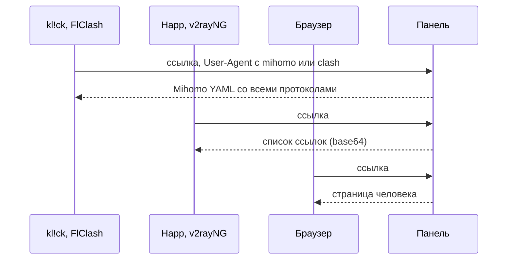

У каждого человека одна ссылка на подписку. Одна и та же ссылка даёт приложению по ссылке список серверов, приложению на ядре mihomo — готовый конфиг, приложению на ядре Xray или sing-box — собственный JSON-конфиг, а браузеру — личную страницу человека. Раздел **Подписки** решает, что получает каждое приложение и что видят люди. В нём пять вкладок: **Приложения и форматы**, **Кому что отдавать**, **Названия и тексты**, **Страница пользователя** и **DNS**.

## Ссылка

Ссылка выглядит так:

```ini
https://sub.example.com/<секретный префикс>/<токен>
```

- Основу ссылки вместе с секретным префиксом задаёт `mistgate setup` на сервере панели; **Настройки** → **Домены** показывает её владельцу как **Основа ссылок подписки**. Без неё ссылки не выдаются. См. [Установка панели](../getting-started/install-panel.md).
- Токен — личный секрет человека. **Ссылка подписки** в карточке пользователя показывает ссылку и её QR-код; **Новая ссылка** заменяет её, и старая сразу перестаёт работать (вместе с ней меняется пароль страницы).
- Ссылка, которой нет, отвечает как любой другой неизвестный адрес сайта, поэтому подобрать ссылку перебором нельзя.

## Форматы

| Формат | Что это | Кому отдаётся по умолчанию |
|:--|:--|:--|
| **Список ссылок (base64)** | Список ссылок, по одной на сервер. Его читают Happ, v2rayNG, Hiddify и большинство других приложений. | Любому приложению, для которого нет правила. |
| **Веб-страница** | Страница человека: инструкция, QR-код, его трафик. См. [Страница пользователя](user-page.md). | Всем, кто открыл ссылку в браузере. |
| **Mihomo YAML** | Готовый конфиг для Mihomo и Clash Meta со всеми протоколами человека. | Приложениям на ядре mihomo (kl!ck, Clash Meta, FlClash, Clash Verge) — по правилам `mihomo` и `clash`. |
| **Xray JSON** | JSON-массив: по одному конфигу Xray на сервер, для v2rayNG, v2rayN и других приложений на ядре Xray. | Никому, пока вы не добавите правило. |
| **sing-box JSON** | Один профиль для официальных приложений sing-box (SFA, SFI, SFM): все серверы в одном переключателе, с DNS человека. | Официальным приложениям sing-box — по правилу `sing-box`. |
| **Заглушка 404** | Делает вид, что такой ссылки нет. Удобно, чтобы закрыть ссылку от сканера по его User-Agent. | Никому, пока вы не добавите правило. |



Вкладка **Приложения и форматы** перечисляет приложения, с которыми работают протоколы, и что каждое читает: Happ — список ссылок (и Xray JSON, если его отдаёт правило), Mihomo / Clash Meta (kl!ck и другие приложения на ядре mihomo) — Mihomo YAML, sing-box — sing-box JSON, а AmneziaVPN подписку не читает вовсе (оно берёт ключ `vpn://` со страницы человека).

### Xray JSON и sing-box JSON

Оба формата собираются из тех же профилей и с тем же доступом, что и список ссылок. Они отличаются тем, что формат может нести ([Что где работает](#что-где-работает)), и тем, как устроено приложение.

- **Xray JSON** — массив конфигов, по одному на сервер; название сервера — это `remarks` его конфига. Каждый конфиг открывает локальный SOCKS-прокси на `127.0.0.1:10808`, в который направляет трафик собственный VPN-режим приложения. Этот порт видят другие приложения на устройстве, и некоторые проверки VPN его ищут. HTTP-прокси, API и порта статистики нет. DNS-пресет записан в каждый конфиг.
- **sing-box JSON** — один профиль: переключатель со всеми серверами (по умолчанию выбран первый), интерфейс TUN и DNS-пресет. Локального прокси он не открывает. Нужен sing-box 1.12 или новее.

Названия строятся по шаблону из [Названий и текстов](#названия-и-тексты). В Xray JSON действует то же ограничение в 30 символов, что и в списке ссылок, а Happ получает ещё и загрузку; в sing-box JSON названия полные и загрузки в них нет.

**Планируется:** зеркала подписки.

## Что где работает

Сервер, который формат нести не может, молча отсутствует в этом формате — как Gecko уже отсутствует в списке ссылок. Страница человека строится по списку ссылок и не меняется. То же самое говорит строка **Форматы подписки** на каждом профиле ([Профили](profiles.md#форматы-подписки-профиля)).

| Профиль | Список ссылок | Mihomo YAML | Xray JSON | sing-box JSON |
|:--|:--|:--|:--|:--|
| Hysteria2, Let's Encrypt (с Salamander или без) | да | да | да | да |
| Hysteria2, самоподписанный (с пином) | да | да | да | нет |
| Hysteria2 с Gecko | нет | да | нет | нет |
| Hysteria2 с прыжками по портам | один порт | диапазон | один порт | диапазон |
| VLESS REALITY через XHTTP (по умолчанию) | да | да | да | нет |
| VLESS REALITY через TCP (RAW + Vision) | да | да | да | да |
| VLESS TLS через XHTTP, напрямую или за CDN | да | да | да | нет |
| VLESS TLS через WebSocket, напрямую или за CDN | да | да | да | да |
| AmneziaWG 2.0 и 3.1 | нет | да | нет | нет |
| Копия любого из них с WARP | как у оригинала | как у оригинала | как у оригинала | как у оригинала |

- В sing-box нет транспорта XHTTP, и он не умеет проверять самоподписанный сертификат по отпечатку. Gecko несёт только Mihomo.
- AmneziaWG доходит до приложения только через Mihomo YAML или ключ AmneziaVPN.
- Копия с WARP — это выход ноды, на клиенте ничего не меняется, поэтому она ведёт себя как профиль, с которого сделана.
- Человек, у которого в формате нет ни одного сервера, получает запись-заглушку: см. [Когда ни один сервер не подходит приложению](#когда-ни-один-сервер-не-подходит-приложению).

## Кому что отдавать

Вкладка **Кому что отдавать** — список правил сверху вниз. Правило — это кусок текста и формат: приложение, чей User-Agent содержит этот текст (регистр не важен), получает этот формат. Решает первое подошедшее правило. Всё, что не подошло ни под одно, попадает в последнюю строку **Всё остальное**: браузеру — страница, приложению — список ссылок.

В свежей панели три правила: `mihomo` и `clash`, оба — **Mihomo YAML**, и последнее, `sing-box` — **sing-box JSON**. Официальные приложения sing-box шлют User-Agent вроде `SFA (sing-box 1.14.3; language en_US)`, и его берёт последнее правило.

- Панель, созданная до появления этого правила, получает его один раз, при обновлении, в конце списка. Его не добавляют, если правило с текстом `sing-box` уже есть (в любом формате) или список заполнен, и оно не возвращается после удаления.
- Hiddify остаётся на **Mihomo YAML**: его User-Agent содержит `ClashMeta`, а правило `clash` стоит выше `sing-box`. Happ остаётся на списке ссылок. Xray JSON отдаётся только по вашему правилу, например **User-Agent содержит** `v2rayng`, **Отдавать** **Xray JSON**.
- **Добавить правило**: **User-Agent содержит** и **Отдавать**.
- Порядок меняется перетаскиванием или стрелками и сохраняется сразу.
- Удалённое правило можно несколько секунд вернуть из сообщения.
- До 50 правил; двух правил с одинаковым текстом быть не может.

Что считается браузером: User-Agent, который начинается с `Mozilla/`, содержит движок браузера (`AppleWebKit`, `Gecko/`, `Firefox/`, `Trident/`) и не называет известное VPN-приложение (Happ, v2ray, clash, mihomo, hiddify, sing-box, streisand, shadowrocket, karing, flclash, nekobox, okhttp, cfnetwork). Необычное приложение, похожее на браузер, направляют правилом.

**Проверка User-Agent**: вставьте то, что присылает приложение, или выберите пример, и вкладка покажет, какое правило сработает («Подходит правило 2 → Mihomo YAML», «Ничего не подошло, похоже на браузер → веб-страница», «Ничего не подошло → список ссылок»). Среди примеров есть `sing-box` и `v2rayNG`.

**Попробовать формат на одном запросе.** `?format=xray-json` или `?format=sing-box` в конце ссылки подписки выбирает формат для этого запроса, что бы ни говорили правила. Он нужен, чтобы проверить приложение, для которого правила ещё нет. Больше, чем правило, он не даёт: ссылка, которой нет, по-прежнему получает заглушку 404, ссылка, чьё правило — **Заглушка 404**, остаётся заглушкой, а любое другое значение игнорируется. Страница пользователя ссылку с этим параметром не показывает.

## Лимит устройств для приложений по ссылке

Приложение, забирая ссылку, шлёт кроме User-Agent ещё ID устройства в заголовке `X-HWID` (стандарт Happ, Remnawave и 3x-ui) и обычно модель и систему. Панель считает устройства по этому ID: одно приложение на одном устройстве — одно устройство со своим местом в лимите человека и своими ключами. Приложения без ID делят одно место. Как устройства появляются и как ими управлять: [Пользователи и группы](users-and-groups.md#устройства-и-лимит-устройств). Какие приложения шлют ID: [Клиентские приложения](client-apps.md#какие-приложения-сообщают-id-устройства).

Режим задаётся в карточке **Лимит устройств для приложений по ссылке** под правилами вкладки **Кому что отдавать**. Вариантов три:

| Режим | Что делает |
|:--|:--|
| **Только считать** | Никому не отказывает. Устройства получают места и ключи, лимит считается, а список пользователей показывает, кто сверх него. У человека может быть до двойного лимита; дальше новое приложение садится на общее место, а не получает своё, чтобы приложение, которое шлёт другой ID при каждом запросе, не заполнило панель. Событие «достигнут лимит устройств» — только история. |
| **Ограничивать** | Новому устройству сверх лимита отказывают. Устройства, которые у человека уже есть, остаются. Устройство по ссылке, молчавшее 30 дней, отдаёт место новому. Приложения без ID устройства делят одно место, и когда лимит заполнен, а общего места ещё нет, такому приложению тоже отказывают. |
| **Строго** | Как **Ограничивать**, и приложению без ID устройства отказывают. При переключении на него все общие места удаляются сразу. |

Значение по умолчанию зависит от панели. Панель, в которой уже есть пользователи, при обновлении получает **Только считать**, чтобы никого не отключить в день обновления. Новая панель без пользователей получает **Ограничивать**. Режим меняют владелец и помощники; изменение действует со следующего обновления подписки.

- **Ограничивать** просит подтверждение, если кто-то сверх лимита: «Включить ограничение?» говорит, сколько таких людей и что их устройства остаются, а новое не подключится, пока они не освободят место или вы не поднимете лимит.
- **Строго** просит подтверждение всегда: «Включить строгий режим?» говорит, сколько людей сейчас пользуются приложениями без ID устройства. Они перестанут подключаться, общие места удалятся сразу, а такое приложение получит сообщение, что оно не сообщает ID устройства. Приложений, которые ID сообщают, это не касается.

### Как перейти с «Только считать» на «Ограничивать»

1. Откройте **Пользователи** и нажмите фильтр **Сверх лимита устройств**. У этих людей устройств больше, чем лимит.
2. Поднимите **Устройства** в карточке тех, кому нужно больше, а остальных попросите удалить ненужные устройства на своей странице.
3. Переключите режим на **Ограничивать**. Подтверждение покажет, кто всё ещё сверх лимита. На **Строго** переходите позже и только когда знаете, кто пользуется приложением без ID устройства.

После переключения алерт «Приложению отказали: лимит устройств» сообщит, когда кому-то действительно отказали (см. [Здоровье](../operations/health.md)).

## Что получают приложения

Каждый ответ приложению, кроме серверов, несёт заголовки, которые читают приложения подписки:

| Заголовок | Что в нём |
|:--|:--|
| `Profile-Title` | Название подписки (**Название в приложении**). |
| `Subscription-Userinfo` | Отданный и полученный трафик периода, квота (0 — без лимита) и конец срока (0 — бессрочно). |
| `Profile-Update-Interval` | Как часто приложение обновляет ссылку, в часах. |
| `Profile-Web-Page-Url` | Сама ссылка: кнопка приложения, ведущая на страницу человека. |
| `Announce` | Объявление или причина, по которой подписка не работает. |
| `Support-Url` | Ссылка на поддержку. |
| `Routing` | Только для Happ и только со списком ссылок: DNS-пресет человека в виде профиля маршрутизации Happ. См. [DNS](dns.md). Остальные форматы несут DNS внутри себя, поэтому `Routing` с ними не отправляется. |
| `Ping-Type`, `Ping-Result`, `Subscription-Ping-Onopen-Enabled` | Только для Happ и только если **Пинг в Happ** не **Как в приложении**: как Happ пингует серверы, задержка в мс и пинговать ли при открытии. См. [«Названия и тексты»](#названия-и-тексты). |

Mihomo YAML, Xray JSON и sing-box JSON несут те же заголовки, кроме `Routing`. В Mihomo YAML одна группа прокси со всеми серверами и раздел `dns:`; в Xray JSON по конфигу на сервер; в sing-box JSON один переключатель со всеми серверами. DNS-пресет человека каждый формат берёт в своём виде.

## Названия и тексты

| Настройка | Что делает |
|:--|:--|
| **Название в приложении** | Показывается вверху списка в Happ. До 100 символов. Пусто — название панели (бренд). |
| **Объявление** | Одна-две строки над списком серверов, до 1000 символов; показывается и на странице пользователя. Счётчик говорит, сколько видно в Happ: 200 символов. Более длинный текст для приложений обрезается по слову с «…». |
| **Ссылка на поддержку** | Открывается по кнопке «Написать в поддержку». Ссылка на Telegram (`https://t.me/…` или `tg://resolve?domain=…`) или на сайт (`https://…`). |
| **Обновлять каждые** | 1–72 часа, по умолчанию 12: как часто приложение заново скачивает подписку. |

**Названия серверов** — шаблон до 100 символов, собранный из частей:

| Часть | Что подставляется |
|:--|:--|
| `{flag}` | Флаг-эмодзи страны ноды. |
| `{country}` | Двухбуквенный код страны ноды (`DE`). |
| `{node}` | Имя ноды. |
| `{profile}` | Имя профиля. |

По умолчанию — `{flag} {country} · {profile}`: «🇩🇪 DE · Hysteria2». Имена профилей заданы в панели, поэтому варианты протокола и двойники с WARP легко различить. Номер добавится, только если совпадёт всё название. Если страна не указана, останется имя профиля; если пусто и оно, подставится имя ноды. Happ рисует флаг иконкой сервера, только если название начинается с него.

В списке ссылок каждое название укладывается в 30 символов — столько Happ показывает в названии сервера (флаг считается за четыре): у длинного названия сначала сокращается протокол в начале имени профиля (Hysteria2 — до HY2, AmneziaWG — до AWG, WireGuard — до WG), потом оно обрезается. В Mihomo YAML названия полные.

В Happ у ноды в конце названия стоит ещё и её текущая загрузка: «🇩🇪 DE · Hysteria2 · 64％» — загрузка процессора или, если указана **Пропускная способность канала** в **Настройках** ноды и так выходит больше, большая из скоростей приёма и отдачи как доля этой пропускной способности. Другие приложения и профиль Mihomo получают название без неё: они запоминают выбранный сервер по названию, и меняющееся название сбрасывало бы выбор при каждом обновлении.

**Так это выглядит в приложении** рисует список так, как его покажет Happ, вместе с загрузкой, с серверами группы, в которой больше всего людей, а если такой нет — с выдуманными серверами.

**Пинг в Happ** задаёт, как Happ измеряет задержку до серверов. Другие приложения эту настройку не читают.

| Настройка | Что делает |
|:--|:--|
| **Как пинговать** | **Как в приложении** (по умолчанию) ничего не отправляет, и Happ берёт свою настройку. **TCP** отправляет `Ping-Type: tcp` и `Ping-Result: time`: Happ открывает TCP-подключение к порту каждого сервера и показывает задержку в мс. |
| **Пинговать при открытии** | Только с **TCP**: Happ проверяет все серверы при каждом запуске (`Subscription-Ping-Onopen-Enabled: 1`; выключенный отправляет `0`). |

## Когда подписка не работает

Когда человек отключён, срок закончился или квота исчерпана, приложения получают не пустой список. Они получают одну запись, названную по причине, которая никуда не подключается, а объявление заменяется той же причиной на языке панели по умолчанию:

| Причина | Текст |
|:--|:--|
| Срок закончился | «Подписка закончилась 29 сентября. Напишите — продлим» (без даты, если она неизвестна) |
| Квота исчерпана, есть сброс | «Трафик закончился, обнулится 1 октября» |
| Квота исчерпана, сброса нет | «Трафик закончился. Напишите — увеличим» |
| Отключён | «Доступ приостановлен» |

По-английски: "Subscription ended on 29 September. Message us to renew", "Traffic used up, resets on 1 October", "Traffic used up. Message us to raise the limit", "Access paused".

По-китайски: 「订阅已于9月29日到期。联系我们即可续期」、「流量已用完，10月1日重置」、「流量已用完。联系我们提高额度」、「访问已暂停」.

В Xray JSON запись — один конфиг, названный по причине; в sing-box JSON — переключатель с одной записью с таким названием. Ни к чему из этого подключиться нельзя.

Для такого человека интервал обновления падает до 1 часа, чтобы исправление (продлённый срок, увеличенная квота) быстро дошло до приложения. Страница человека объясняет то же на его языке.

### Когда ни один сервер не подходит приложению

Xray JSON и sing-box JSON никогда не отвечают активному человеку пустым документом. Если ни один из серверов человека нельзя нести в этом формате (все они на XHTTP, а приложение читает sing-box, или у человека только AmneziaWG, или серверов нет вовсе), приложение получает одну запись, к которой нельзя подключиться, с названием «Ваши серверы не работают в этом приложении. Какое подойдёт — на странице подписки». То же самое стоит в объявлении.

По-английски: "Your servers do not work in this app. The subscription page shows which app does".

По-китайски: 「这些服务器无法在此应用中使用。适用的应用请在订阅页面查看」.

## Что показывает приложение при отказе устройству

Приложение, чьему устройству отказали, не получает ошибку. Ответ обычный (HTTP 200) с одной записью-заглушкой, которая никуда не подключается, названной по причине, как при [неработающей подписке](#когда-подписка-не-работает). Объявление несёт тот же текст, интервал обновления падает до 1 часа, а `Profile-Web-Page-Url` — кнопка на страницу человека, где он освобождает место. Тексты — на языке панели по умолчанию:

| Причина | Текст |
|:--|:--|
| Лимит заполнен | «Лимит устройств: 5 из 5. Удалите ненужное на странице подписки» |
| Владелец заблокировал устройство | «Это устройство отключено владельцем» |
| Приложение не сообщает ID устройства (**Строго**) | «Приложение не сообщает ID устройства. Включите HWID в настройках Happ или возьмите kl!ck» |

По-английски: "Device limit: 5 of 5. Remove one you no longer use on the subscription page", "This device was turned off by the owner", "This app does not report a device ID. Turn on HWID in the settings of Happ, or use kl!ck".

По-китайски: 「设备已达上限：5 / 5。请在订阅页面删除不再使用的设备」、「此设备已被所有者停用」、「此应用未提供设备 ID。请在 Happ 设置中开启 HWID，或改用 kl!ck」.

В ответе также стоят заголовки, которыми пользуются Remnawave и 3x-ui, так что приложения, читающие их, ведут себя так же:

| Заголовок | Значение |
|:--|:--|
| `X-Hwid-Active` | `true` при любом отказе: проверка устройств включена. |
| `X-Hwid-Max-Devices-Reached` | `true`, когда лимит заполнен. |
| `X-Hwid-Not-Supported` | `true`, когда приложение не шлёт пригодный ID устройства. Панель ставит его и в ответ приложению, чьё значение `X-HWID` использовать нельзя (не от 10 до 64 латинских букв, цифр, `=` и `-`). |
| `X-Hwid-Limit` | Лимит устройств человека числом. Его читает v2RayTun. |

Заблокированное устройство получает только `X-Hwid-Active` и `X-Hwid-Limit`: отказ не из-за лимита, и приложение, читающее флаги, не должно говорить человеку освободить место. Что случилось, сказано в объявлении.

SFA и SFI не шлют ID устройства, поэтому в режиме **Строго** они получают вместо этого запись об отказе («Приложение не сообщает ID устройства…», в sing-box JSON) и подключиться не могут.

Приложения показывают это по-разному: Happ показывает объявление и название записи, kl!ck — только запись, потому что объявление он не читает. См. [Клиентские приложения](client-apps.md#какие-приложения-сообщают-id-устройства).

## Страница пользователя

На вкладке **Страница пользователя** — параметры страницы и приложения, которые она рекомендует, с живым предпросмотром. Сама страница описана в разделе [Страница пользователя](user-page.md).

### Приложения на странице

Страница показывает по карточке на каждое приложение для каждой платформы, в порядке этого списка. На одной платформе может быть несколько приложений. У каждого:

| Поле | Что это |
|:--|:--|
| Платформа и вид | iOS, Android, Windows, macOS или Linux; **По ссылке подписки** или **Ключ AmneziaWG**. |
| **Название приложения** | Показывается на карточке. |
| **Ссылка на скачивание** | Ссылка `https://`: страница в магазине или файл. |
| **Шаблон ссылки «добавить»** | Ссылка в одно касание, которая открывает приложение с подпиской. Подстановки: `{url}` — ссылка подписки, `{url_enc}` — она же в URL-кодировке, `{name_enc}` — закодированное название подписки. Пусто — страница предложит скопировать ссылку. Схемы со скриптами (`javascript:`, `data:` и подобные) не принимаются. |
| **Описание на карточке** | Обычный текст до 80 символов. Пусто — на карточке будет сказано, как приложение подключается. |
| **Рекомендуем** | Значок на карточке; рекомендованное приложение идёт первым на своей платформе. |

**Добавить приложение** спрашивает платформу и либо **Известное приложение** (kl!ck, Happ, AmneziaVPN, Clash Verge Rev, FlClash, Clash Meta for Android, Hiddify, v2rayNG, sing-box: оно подставит название, вид, ссылку на скачивание и шаблон «добавить» для этой платформы), либо вид (**Принимает**) для пустой карточки. Любое поле можно поправить. Стрелки двигают приложение среди приложений его платформы. До 30 приложений.

Свежая панель рекомендует kl!ck на Windows и macOS (Happ вторым) и Happ на iOS и Android, а для ключей предлагает AmneziaVPN на всех пяти платформах (на телефонах — из магазина, на остальных — с сайта AmneziaVPN). Какое приложение для какой платформы, что получает каждое и как работают ссылки в одно касание: [Приложения-клиенты](client-apps.md).

### Параметры страницы

| Параметр | По умолчанию | Что делает |
|:--|:--|:--|
| **Показывать объявление** | включено | Текст из **Названия и тексты**. |
| **Кнопка поддержки** | включено | Ведёт по ссылке на поддержку. |
| **QR для второго устройства** | включено | Удобно, если подписка на телефоне. |
| **Пароль на странице** | включено | Страница каждого человека спрашивает пароль — один раз на устройстве. Приложения берут подписку без пароля. |
| **Устройства на странице** | включено | Люди сами добавляют, перевыпускают ключ и удаляют свои устройства AmneziaWG на своей странице, в пределах лимита устройств. |
| **Выбор DNS на странице** | выключено | Люди выбирают на своей странице один DNS для приложений по ссылке — из пресетов, перечисленных под переключателем (**DNS для приложений по ссылке**), и DNS ключей AmneziaWG каждого сервера — из пресетов, которые владелец предлагает на каждой ноде. См. [DNS](dns.md) и [Страница пользователя](user-page.md). |

Правила сохраняются сразу, как только правило добавлено, перемещено или удалено. На вкладках **Названия и тексты** и **Страница пользователя** изменения ждут кнопки **Сохранить** на полосе внизу (**Сбросить** их отменяет). В любом случае они действуют со следующего запроса, без перезапуска.

## Защита ссылок

- **Запросы.** Одна ссылка отвечает не больше 60 раз в час; дальше — «слишком много запросов». Запросы чаще чем раз в 10 секунд получают тот же ответ.
- **Перебор.** Сеть (/24 для IPv4, /48 для IPv6), которая за минуту попробовала 20 несуществующих ссылок, на 15 минут получает только заглушку 404 — даже на настоящие ссылки.
- **Передача ссылки.** Если одной ссылкой за сутки пользуются из больше чем 8 сетей, панель пишет событие «ссылкой подписки пользуются из 9 сетей за сутки» и открывает алерт «Подписка похожа на общую». Она считает сети, но никогда не хранит адреса. Если ссылка утекла, выдайте новую.

## Кто что может

Читать эти настройки и проверять User-Agent может любой админ. Менять их могут владелец и помощники. Вкладка DNS описана в разделе [DNS](dns.md).
