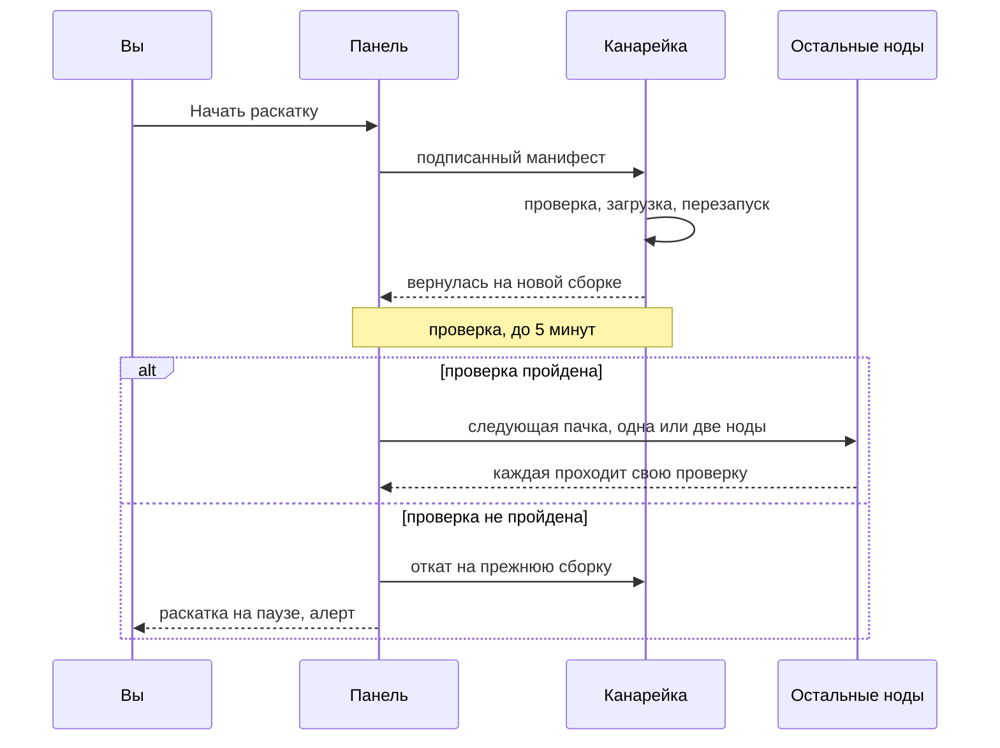

Агенты нод обновляют себя сами, но только до сборки, подписанной ключом релиза. Панель доставляет подписанный пакет на ноды, а каждый агент перед заменой себя проверяет подпись ключом, вшитым в его собственный бинарник. Сама панель ноду никогда не обновляет: вы нажимаете **Обновить N нод** (или **Обновить** в строке ноды), чтобы обновить сейчас, или назначаете обновление ноды на тихий час. Панель умеет и сама установить более новый официальный релиз со страницы «Обновления» — тоже только если подпись сходится.

Эта страница — для работы с флотом. Как сделать ключ релиза, подписать и опубликовать релиз, описано в разделе [Релизы и подпись](releases.md).

## Как устроено доверие

- Есть одна пара ключей Ed25519 — **ключ релиза**. Закрытая половина хранится офлайн у того, кто подписывает релизы; открытая вшивается в оба бинарника при сборке. В официальных бинарниках — ключ проекта. При первом запуске панель также сохраняет ключ в `<data-dir>/release.pub`.
- В каждом релизе два подписанных манифеста: пакет нод (`manifest.json` с `manifest.sig`) и манифест панели (`panel-manifest.json` с `panel-manifest.sig`). В каждом — версия, время сборки, срок действия и для каждого бинарника имя, ОС, архитектура, размер и SHA-256. Манифест панели подписывается в отдельном контексте Ed25519, поэтому агент никогда не примет его за своё обновление, а панель не установит бинарник ноды вместо себя.
- Агент проверяет по порядку: подпись — вшитым ключом, формат манифеста, срок действия, что релиз новее его самого и что в пакете есть файл под его ОС и архитектуру. Затем скачивает файл с панели по своему соединению с взаимным TLS (в [Cloudflare-версии](#в-cloudflare-версии) — по своему каналу к панели) и сверяет размер и SHA-256. При любой ошибке установленный бинарник не трогается.
- Панель — только курьер: взломанная панель не заставит ноду запустить код, который не подписан ключом релиза.
- Релизы упорядочены по времени сборки (Unix-время коммита исходников), а не по строке версии. Релиз с тем же временем сборки, что у ноды, считается «уже актуальным»; более старый отклоняется как откат версии.
- Агент ноды, собранный без ключа релиза, не обновляется сам; `mistgate-node version` печатает отпечаток вшитого ключа. Если ключ, вшитый в панель, и `release.pub` различаются, панель пишет в журнал `release key mismatch` и не доверяет ни одному пакету, пока новый ключ не подтверждён: см. «Смена ключа релиза» в разделе [Релизы и подпись](releases.md).

## Откуда берётся пакет

Пакет нод панель хранит в `<data-dir>/dist`. (В [Cloudflare-версии](#в-cloudflare-версии) такой папки нет, там свой релиз; этот раздел и строка **Пакет релиза** описывают панель на VPS.)

- **С GitHub.** Панель с ключом релиза проверяет последний стабильный релиз `Mistgate/mistgate` при запуске и потом каждые 10 минут. Если в релизе есть пакет нод, подпись которого сходится с ключом панели и который новее пакета панели, она скачивает его, проверяет каждый файл и одним шагом заменяет `dist`. Релиз, подписанный другим ключом, игнорируется, и `dist` остаётся как был. Скачивание пакета само по себе не обновляет ни одну ноду.
- **Вручную.** Панель, собранная со своим ключом, получает пакет, который вы подписываете и копируете в `dist`: см. «Свой пакет» в разделе [Релизы и подпись](releases.md). Панель перечитывает `dist` в течение минуты; **Перечитать папку** читает её сразу.

Строка **Пакет релиза** внизу верхней карточки страницы «Обновления» показывает результат (подробности — под кнопкой **Подробности**; они раскрываются сами, если пакет не прошёл проверку или его нет):

| Статус | Значение |
|---|---|
| Подпись проверена | Подпись сходится с ключом релиза этой панели, манифест в порядке, все файлы на месте с нужным размером и контрольной суммой. Раскатывать и использовать для [установки по SSH](../getting-started/ssh-install.md) можно только такой пакет. |
| Не прошёл проверку | Что-то не так; карточка пишет что (см. ниже). |
| Не проверен | У установки нет пригодного ключа релиза: его нет ни в сборке, ни в `release.pub`, или они различаются. Панель не может оценить пакет; ноды всё равно проверяют его сами. |
| Нет пакета | В `<data-dir>/dist` нет `manifest.json`. |

| Причина | Что делать |
|---|---|
| В каталоге данных панели нет пакета релиза | Дождитесь скачивания с GitHub или скопируйте свой пакет в `<data-dir>/dist`. |
| Нет файла подписи (manifest.sig) | Скопируйте и `manifest.sig`. |
| manifest.json — не манифест релиза | Подпишите заново; не правьте манифест. |
| Манифест в более новом формате, чем понимает эта панель | Сначала обновите панель. |
| Подпись не сходится с ключом релиза этой панели | Пакет подписан другим ключом или панель собрана с другим ключом. |
| Срок манифеста истёк: подпиши новый | Нужна новая подпись: мейнтейнеры продлевают её на GitHub, а свой пакет вы подписываете заново с более поздним `--expires`. |
| Файла из манифеста нет | Скопируйте все файлы пакета. |
| Файл не совпадает с манифестом (размер или контрольная сумма) | Копия неполная или файл изменён: скопируйте его снова. |

Файлы пакета панель отдаёт только агентам с действующим сертификатом ноды, через точку подключения агентов, не больше четырёх загрузок одновременно, кусками, с докачкой. Учитываются только обычные файлы в `dist` (символьные ссылки не открываются). Пакет, сделанный вручную, меняйте целиком и за один раз; замена пакета во время раскатки ставит раскатку на паузу.

## Страница «Обновления»

Смотреть страницу могут все. Обновление, расписание, пауза, продолжение и отмена, откат ноды и **Перечитать папку** доступны только владельцу и требуют свежего повторного подтверждения входа (см. [«Безопасность»](security.md)).

Сверху вниз, по важности:

- **Верхняя карточка**: где стоит флот («2 из 4 нод на v0.1.24»), полоса из отрезков по одному на ноду, под ней счётчики по состояниям, и одна главная кнопка. Когда есть что обновлять, это **Обновить N нод** (см. ниже); пока идёт раскатка — **Пауза** / **Продолжить** / **Отменить раскатку**. В её нижней строке **Пакет релиза**: пакет в `<data-dir>/dist`, вердикт проверки подписи, версия и сроки, **Перечитать папку** и свёрнутые подробности (файлы, причина отказа, шаги для самостоятельной сборки пакета).
- **Раскатка**: идущая раскатка стоит сразу под верхней карточкой, по этапам (канарейка, пачки) с нодами в каждом; последняя законченная — после списка нод, свёрнутой в одну строку (**Показать этапы**), если она закончилась хорошо.
- **Эта панель**: одна строка с версией, датой сборки, состоянием и кнопкой **Проверить GitHub**. Когда вышел подписанный релиз, карточка выделяется и в ней появляется **Обновить панель**. Отпечаток ключа релиза, SHA-256 и пояснение скрыты под **Подробности**; панель, которая не умеет обновлять себя, раскрывает шаги сама.
- **Ноды**: каждая нода с версией агента и датой сборки, состоянием и последним обновлением в одну строку. Владельцу в строке доступна одна основная кнопка: **Обновить** (или **Расписание**, если обновление уже назначено); рядом меню **⋯** с **Запланировать…** и **Откатить…**. Нода, входящая в идущую раскатку, говорит об этом в строке («В очереди · пачка 2», «Обновляется…») и не имеет своего обновления и расписания; **Откатить…** остаётся там, где был разрешён.

| Состояние ноды | Значение |
|---|---|
| Актуальна | Её сборка не старее сборки проверенного пакета (без проверенного пакета — сборки самой панели). |
| Есть обновление | Она умеет обновляться сама и работает на более старой сборке. |
| Обновляется… | Идёт обновление этой ноды. |
| Откатилась | Последнее обновление закончилось откатом; работает прежняя сборка. |
| Обновление не удалось | Последнее обновление не удалось на ноде. |
| Обновить вручную | Её агент не умеет обновляться сам (см. «Старые агенты» ниже). |
| Не в сети | Нода не на связи; показана последняя известная сборка. |

«Нет защиты от повторных падений» под нодой значит, что в её служебном файле нет защиты от цикла падений: обновление там страхует только самооткат агента через 5 минут. Если вы видите исправление **Обновить службу** в разделе «Здоровье» → «Доктор», примените его там; агент перезапустится, подключения могут прерваться на несколько секунд. Если агент слишком старый и не предлагает исправление, вы можете один раз выполнить `mistgate-node install` с текущим бинарником.

### Что нового

Под верхней карточкой и в строке панели страница показывает, что принесёт обновление, чтобы ты мог решить, обновляться сейчас или позже: описания всех стабильных релизов, которые новее самого старого агента среди нод, вплоть до пакета на панели (для панели — всех релизов между этим и тем, который она может установить). Новейшая версия показана целиком, а если она длинная, есть **Показать всё**; более ранние свёрнуты под «и ещё N более ранних версий». Описания выводятся на языке интерфейса (по-английски, если у релиза нет описания на нём).

Это текст описания релиза на GitHub: панель читает его по HTTPS из официального репозитория с той же периодичностью, что и проверку релиза. Он справочный и **не подписан**: подписаны только манифесты. Ничего, кроме одной отметки, по нему не решается. Релиз, в описании которого есть раздел **Безопасность** (заголовок «Security», «Безопасность» или «安全»), помечается **Исправления безопасности**, и карточка прямо говорит, что в обновлении есть исправления безопасности и лучше обновиться скорее. Без такого раздела о срочности страница молчит. Без доверенного пакета или если панель ещё не прочитала описания (в [Cloudflare-версии](../getting-started/install-edge.md) это происходит, когда нажимаешь **Проверить GitHub**), блока просто нет.

## Обновление ноды

### Всё, что можно обновить, одной раскаткой

**Обновить N нод** в верхней карточке открывает окно со всеми нодами, которые можно обновить: у каждой галочка (по умолчанию стоят все), канарейка названа — это нода, где меньше всего людей онлайн. Окно напоминает, что канарейку проверяют 5 минут, остальные идут пачками (по одной, пока к обновлению меньше пяти нод, иначе по две), а нода при отказе проверки получает прежнюю версию и раскатка встаёт на паузу. Пока вы не нажали **Начать раскатку**, ничего не происходит. Запрос закреплён за пакетом, который показывала страница, как и обновление одной ноды, и требует повторного подтверждения входа. Кнопки нет, пока идёт раскатка, пока нет проверенного пакета и для всех, кроме владельца; ноды, чьё обновление нужно назначить на время, обновляются по одной (см. ниже).



### Сейчас, вместе с идущей раскаткой или позже

**Обновить** в строке ноды открывает окно с двумя вариантами:

- **Обновить сейчас** сразу запускает обновление этой ноды. Пока идёт другое обновление с тем же релизом, вариант называется **В текущую раскатку**: нода становится следующим этапом и начнёт обновляться, когда текущий пройдёт проверку. Раскатку на паузе или с другим релизом сначала нужно продолжить, дождаться её конца или отменить.
- **Выбрать дату и время** сохраняет расписание. Время вводится с фиксированным смещением UTC из **Настройки → Система → Часовой пояс обновлений**; по умолчанию это UTC (установки, сделанные раньше, сохраняют UTC+03:00 — тогдашнее значение по умолчанию). При смене настройки уже сохранённые расписания не сдвигаются: каждое хранит точный момент и смещение, показанные при сохранении. Самое раннее время — через минуту от текущего; **Отменить расписание** удаляет его.

Каждое обновление закреплено за релизом:

- Обновление «сейчас» закреплено за версией пакета, которую показывала страница (план MCP — за версией плана): если проверенный пакет за это время заменился, панель откажет и попросит посмотреть новую версию.
- Расписание закреплено за подписанной версией, выбранной при сохранении, и не может быть позже срока действия этого пакета. Если в выбранное время обновление начать нельзя (нода отключена, идёт другое обновление), панель пытается ещё два часа; после этого строка покажет, что расписание пропущено, и само оно уже не начнётся — обновление, рассчитанное на тихий час, не запустится, когда нода вернётся. Запланируйте заново или отмените. Если пакет к этому моменту заменился, панель не подменит версию: проверьте новую и запланируйте заново.

### Обновление одной ноды

1. Панель отправляет подписанный манифест. Агент проверяет его, скачивает свой файл, сохраняет текущий бинарник как `<бинарник>.prev`, ставит новый на его место и перезапускает себя на месте (systemd ничего не замечает). Нода пропадает на несколько секунд; админка показывает это как обновление, а не как сбой.
2. Панель ждёт ответа агента до 10 минут (вместе со скачиванием), затем до 3 минут — возвращения ноды с новой сборкой.
3. **Проверка после обновления** идёт до 5 минут после возвращения ноды. Она пройдена, когда выполнено всё сразу:
   - новая сборка закрепилась: подключилась и применила конфигурацию без упавшего профиля;
   - нода применила ту же конфигурацию, что у панели;
   - не упал ни один профиль, который работал до обновления (профиль, который не работает 30 секунд, сразу проваливает проверку);
   - каждый профиль, который панель умеет проверять, прошёл [проверку глазами клиента](health.md) после возвращения ноды (панель сразу запускает круг). [Cloudflare-версия](#в-cloudflare-версии) это условие пропускает.
   - на ноде с включённым профилем, который выходит через WARP, туннель WARP поднят с момента возвращения ноды.
4. Если проверка пройдена, шаг завершён. Проваленная проверка называет невыполненное условие: новая сборка не подтвердила обновление, нода не применила конфигурацию, панель не смогла прочитать профили ноды, упал профиль или не поднялся WARP. Если нет, панель отправляет ноде откат (возвращается прежний бинарник), шаг заканчивается как «откачена», раскатка встаёт на паузу.

### Собственная страховка агента

Агент не полагается на панель, чтобы отменить плохое обновление:

- Новая сборка, которая за 5 минут после запуска не подключилась и не применила конфигурацию, возвращает прежний бинарник и перезапускается (`not_committed`).
- Новая сборка, у которой собственное время сборки отличается от манифеста, откатывается сразу (`built_mismatch`).
- Служебный файл считает запуски, пока обновление не закреплено; на третьем запуске подряд он возвращает прежний бинарник ещё до старта агента (`crash_loop`).
- Прежняя сборка сообщает итог, когда снова подключается.

### Пауза, продолжение, отмена

Идущее обновление показывает ход в верхней части страницы, а владельцу — кнопки **Пауза**, **Продолжить** и **Отменить раскатку**.

- **Пауза**: новые шаги не начинаются. Шаг, который уже идёт, доходит до конца и проходит свою проверку. Уже обновлённые ноды остаются обновлёнными.
- **Продолжить**: оставшиеся ждущие шаги идут дальше. Неудачные и откаченные шаги остаются как есть; обновите эти ноды снова, когда устраните причину. Если пакет на диске сменился, продолжить нельзя: отмените раскатку и начните заново.
- **Отменить раскатку**: ждущие ноды пропускаются; нода, которую обновляют сейчас, заканчивает и проходит проверку; обновлённые ноды остаются на новой версии.

Раскатка встаёт на паузу и сама:

| Причина паузы | Что случилось |
|---|---|
| нода не приняла обновление | Она отклонила обновление (причина показана). |
| нода не прошла проверку после обновления | Она провалила проверку или не вернулась; где получилось, ей вернули прежнюю версию. |
| пакет релиза сменился | В `<data-dir>/dist` теперь другой релиз. Отмените раскатку и начните заново. |
| панель перезапустилась во время шага | Панель не знает, чем закончился шаг. Проверьте ноду, затем продолжите или отмените. |

Первая, вторая и четвёртая причины ещё и открывают алерт «Обновление ноды остановилось» — до тех пор, пока раскатку не продолжат, не отменят или не запустят новое обновление.

Законченная раскатка получает статус **Готово**, **Отменена** или **Закончилась с проблемами** (хотя бы одна нода не обновилась или откатилась). Страница показывает идущую раскатку или последнюю. Законченные раскатки хранятся: последние 20 — всегда, более старые — 90 дней.

Частые ошибки шагов:

| Ошибка | Значение |
|---|---|
| Нода отвергла подпись | Агент ноды доверяет другому ключу релиза. |
| Агент этой ноды собран без ключа релиза | Обновите его вручную. |
| Релиз старее того, что уже работает на ноде | Нужна более новая подписанная сборка. |
| В пакете нет файла для системы и архитектуры этой ноды | В пакете нет бинарника под её архитектуру (например, `arm64`). |
| Нода не смогла скачать файл с панели | Проверьте связь ноды с панелью. |
| Нода не может писать рядом со своей программой | Проверьте диск ноды; примените **Обновить службу** в разделе «Здоровье» → «Доктор», если исправление доступно, или вы можете один раз выполнить `mistgate-node install` с текущим бинарником. |
| Нода не ответила на команду обновления за 10 минут | Посмотрите на ноду. |
| Нода не вернулась за 3 минуты | Посмотрите на ноду и её логи. |
| Проверка глазами клиента после обновления не прошла | См. [«Здоровье»](health.md); нода уже на прежней версии. |

### Откат вручную

**Откатить…** в меню **⋯** строки ноды (и, как раньше, с подтверждением, в котором названа версия, к которой нода вернётся) возвращает прежний бинарник ноды (`<бинарник>.prev`) и перезапускает агента. Работает и вне раскатки. У ноды, которую ни разу не обновляли, прежней версии нет, и она откажет. Если нода участвует в идущей раскатке, её шаг помечается как «откачена», и раскатка встаёт на паузу.

Столбец **Последнее обновление** показывает, кто откатил ноду: «Откачено тобой», «Панель вернула прошлую версию: …» (проверка после обновления) или «Прошлую версию вернули командой панели».

## Старые агенты: один раз вручную

Нода показывает **Обновить вручную**, когда её агент не умеет обновляться сам: он появился раньше самообновления, собран без ключа релиза или работает под первой версией служебного файла (где каталог программы только для чтения). **Как обновить** в её строке даёт две команды, например:

```sh
scp /var/lib/mistgate/dist/mistgate-node-linux-amd64 root@de1.example.com:/root/mistgate-node
ssh root@de1.example.com 'chmod +x /root/mistgate-node && /root/mistgate-node install'
```

`install` копирует бинарник в `/usr/local/bin/mistgate-node`, пишет актуальный защищённый служебный файл (с защитой от цикла падений) и перезапускает агента. После этого нода обновляется со страницы «Обновления». Если пакета на панели нет, возьмите `mistgate-node` из того же релиза, что и панель. В Cloudflare-версии две команды другие: см. ниже.

Старые агенты продолжают работать с более новой панелью: изменения протокола агента только добавляют новое. Если старому агенту чего-то не хватает, там, где это нужно, админка пишет «агент слишком старый».

## В Cloudflare-версии

Панель в [Cloudflare-версии](../getting-started/install-edge.md) обновляет ноды с этой же страницы, и канарейка, пачки, проверка после обновления, пауза, продолжение, отмена, ручной откат и обновления по расписанию работают так, как описано выше. Отличается вот что:

- **Релиз — собственный релиз панели.** Панель предлагает подписанный релиз нод той версии, из которой развёрнута, сверяет его вшитым ключом и более новый не ищет. Чтобы перевести ноды на новый релиз, сначала разверни его на панели, потом нажми здесь **Обновить**. Если панель собрана не из релиза или не смогла получить свой релиз с GitHub, верхняя карточка говорит почему (панель повторяет попытку в течение минуты), а раскатку не начать. Если развернуть другую версию во время раскатки и в ней ещё есть ждущие ноды, раскатка встанет на паузу («пакет релиза сменился»). Папки `dist` нет, поэтому строки **Пакет релиза** и кнопки **Перечитать папку** не видно.
- **Нода скачивает через панель.** Команда обновления несёт токен, который годится на один шаг. Агент запрашивает `<адрес канала>/update/<id ноды>/<файл>` с этим токеном, а Worker панели отдаёт файл потоком из релиза на GitHub: нода с GitHub не соединяется, ей достаточно дотянуться до панели. Оборванная загрузка продолжается с того места, где остановилась. Перед заменой агент сверяет размер и SHA-256 с подписанным манифестом. Токен годится только для этой ноды, пока её шаг ждёт ответа, и только для файлов того манифеста, с которым началась раскатка.
- **В проверке после обновления нет проверки глазами клиента.** Панель пока не запускает в этой версии [проверки глазами клиента](health.md), поэтому проверка после обновления это условие пропускает, а окно и карточка раскатки об этом говорят. Остальное она требует: новая сборка закрепилась, нода применила конфигурацию панели, ни один профиль, работавший раньше, не упал, а у профиля с выходом через WARP поднят WARP. Сборка, у которой профили остаются запущенными, но туннели ломаются, такую проверку пройдёт; ущерб ограничивают канарейка и пачки.
- **Шаги идут по минутам.** Плановая задача версии двигает раскатку раз в минуту, поэтому решение может прийти на минуту позже, чем на панели с VPS. Пределы ожидания те же.
- **Саму панель** обновляют со своего компьютера, а не с этой страницы: `mistgate edge deploy --host panel.example.com --version vX.Y.Z`, а `--rollback` возвращает прежнюю версию (см. [Обновление](../getting-started/install-edge.md#обновление) и [Откат](../getting-started/install-edge.md#откат)). Строка панели показывает это вместо **Обновить панель**. После деплоя у нод появляется **Есть обновление**.

Агент v0.1.49 и старше пока не умеет скачивать по каналу, поэтому в его строке написано **Обновить вручную**. **Как обновить** даёт две команды, которые нужно один раз выполнить на ноде от root; страница сама подставляет версию, файл под архитектуру ноды и его SHA-256 из подписанного манифеста:

```sh
curl -fL -o /root/mistgate-node.new https://github.com/Mistgate/mistgate/releases/download/vX.Y.Z/mistgate-node-linux-amd64 && echo "<sha256>  /root/mistgate-node.new" | sha256sum -c -
chmod +x /root/mistgate-node.new && mv /root/mistgate-node.new /root/mistgate-node && /root/mistgate-node install
```

Вторую команду запускай, когда первая напечатала `OK`. Это единственный раз, когда ноде нужен GitHub; если он недоступен, положи файл в `/root/mistgate-node.new` сам, выполни проверку и вторую команду. `install` сохраняет личность ноды и её канал к панели, пишет актуальный служебный файл и перезапускает агента. После этого нода обновляется с этой страницы. Если нода не сообщила архитектуру, подставляется файл для amd64; на ARM-сервере возьми файл arm64 и его SHA-256 из `manifest.json` релиза.

## Обновление панели

Этот раздел — про панель на VPS. Панель в [Cloudflare-версии](#в-cloudflare-версии) обновляется командой `mistgate edge deploy`.

Страница «Обновления» проверяет последний стабильный релиз `Mistgate/mistgate` при запуске и каждые десять минут (в том же темпе, что и пакет для нод). Когда выходит новая подписанная версия, владелец видит на каждой странице, кроме «Обновлений», небольшую карточку с номером версии. Её можно свернуть в плашку или закрыть до следующей версии. **Проверить GitHub** проверяет сразу (на проверку, сделанную за последние три минуты, панель отвечает из памяти и бережёт анонимную квоту GitHub для скачивания пакета).

Установить можно только релиз, в котором есть `panel-manifest.json` и `panel-manifest.sig`, подпись проходит проверку ключом релиза, вшитым в эту панель (`release.pub` не считается: его может изменить пользователь службы панели), срок манифеста не истёк, а время сборки новее, чем у этой панели. Релизы упорядочены по этому времени сборки, а не по строке версии: панель, собранная из коммита после тега (например, `v0.1.6-3-gabc1234`), никогда не увидит `v0.1.6` как обновление, и ей не предложат откат на базу, которую она уже обновила. Релиз без такого манифеста показывается как «не подписана ключом релиза этой панели: установить её нельзя»; релиз с истёкшим манифестом — как истёкший, пока его не подпишут заново. Карточка показывает дату сборки релиза и SHA-256 бинарника для этого сервера. **Обновить панель** отправляет именно эти версию и SHA-256, и панель откажет, если к тому времени последним подписанным релизом стал другой.

Автоматическая установка доступна панели от root под systemd. Панель с непривилегированным пользователем службы, например `mistgate`, может использовать отдельный фиксированный root-helper ниже; HTTP-панель при этом остаётся непривилегированной. В обоих случаях владелец подтверждает действие свежим повторным подтверждением входа, а идущая раскатка нод должна закончиться. Панель записывает подтверждённые версию и SHA-256 в `<data-dir>/panel-update.request` и запускает helper (временный unit systemd `mistgate-panel-update-<время>.service` для панели от root, иначе `mistgate-panel-update.service`). Этот запрос может только сузить то, что helper установит. Helper сам проверяет манифест панели в релизе ключом, вшитым в установленный бинарник, требует, чтобы он называл ровно подтверждённые версию и SHA-256 и сборку новее его собственной, скачивает бинарник и сверяет размер, SHA-256 и архитектуру ELF. Только после этого он останавливает панель, сохраняет каталог данных, заменяет бинарник и запускает службу.

Новая панель должна проработать 45 секунд без перезапусков со стороны systemd (при `Restart=on-failure` падение через несколько секунд после старта видно только как перезапуск). Иначе helper останавливает её, возвращает прежний бинарник и копию данных с исходными владельцами файлов и запускает прежнюю панель. После успеха предыдущий бинарник хранится как `<бинарник>.prev`, а копия данных — рядом с каталогом данных: `<data-dir>.panel-update-backup.tar.gz`. Если helper завершился, не заменив панель (не прошла проверка или скачивание), страница «Обновления» в течение нескольких секунд покажет, что обновление не завершилось, и раскатку или новое обновление снова можно запускать; причину покажет `journalctl -u 'mistgate-panel-update*'`.

Копия данных делается, пока панель остановлена, до первого запуска нового бинарника. Если новая панель не прошла 45-секундную проверку, базу, которую она, возможно, уже мигрировала вперёд, заменяет эта копия, поэтому прежний бинарник никогда не работает со схемой, которой не знает; всё, что новая панель успела записать за эти секунды, теряется. Чтобы вернуться позже вручную, остановите панель, восстановите каталог данных из `<data-dir>.panel-update-backup.tar.gz`, верните `<бинарник>.prev` и запустите; всё, что изменилось после обновления, будет потеряно.

### Включить обновления для непривилегированной службы панели

Для systemd-службы панели с `User=mistgate` установите root-owned unit helper и узкое правило PolicyKit. Правило разрешает этой учётной записи запускать только `mistgate-panel-update.service`; оно не даёт общего доступа к systemd и не открывает root shell. В unit панели можно оставить `NoNewPrivileges=yes`. Unit helper обновляет только стандартную раскладку: бинарь `/usr/local/bin/mistgate`, каталог данных `/var/lib/mistgate` и служба `mistgate.service`. Панель без root, установленная иначе, откажет в **Обновить панель** с ошибкой, где названы эти пути; обновляйте её вручную.

```sh
install -o root -g root -m 0644 deploy/systemd/mistgate-panel-update.service /etc/systemd/system/mistgate-panel-update.service
install -o root -g root -m 0644 deploy/polkit/60-mistgate-panel-update.rules /etc/polkit-1/rules.d/60-mistgate-panel-update.rules
```

Проверьте unit helper перед загрузкой. В `ExecStart` должны быть указаны установленный бинарник, каталог данных и unit панели. По умолчанию используется `mistgate.service`; если имя отличается, укажите одинаковое значение в `--update-service` панели и `--service` helper. В `ReadWritePaths` укажите родительский каталог данных и каталог бинарника: для отката helper должен атомарно переименовать каталог данных. Если служба работает от другого пользователя, замените `subject.user` в правиле PolicyKit на точное имя этой учётной записи. Оба файла должны принадлежать root и быть недоступны для записи пользователю панели.

```sh
systemctl daemon-reload
systemctl show --property=LoadState --value mistgate-panel-update.service
```

Последняя команда должна вывести `loaded`. На сервере также должен быть установлен PolicyKit и работать его служба авторизации, чтобы пользователь панели мог запустить helper. Helper запускается по запросу панели; включать или запускать его вручную не нужно. Если панель сообщает, что не удалось запланировать обновление, проверьте журнал командой `journalctl -u mistgate-panel-update.service`.

### Ранние сборки и ручное обновление

Ранние сборки с хешем коммита, например `0.1.0-<commit>`, появились до самообновления панели: они показывают релиз, но не могут его установить. Один раз замените такой бинарник на подходящий файл текущего стабильного релиза из [GitHub Releases](https://github.com/Mistgate/mistgate/releases/latest), следуя ручным шагам ниже. Более новые сборки обновляются в разделе **Настройки → Система**: нажмите **Проверить GitHub**, затем **Обновить панель**, когда появится новая версия.

Для установки без systemd, панели, собранной со своим ключом, или ручного обновления:

1. Берите бинарник с тем же ключом релиза. Панель, чей вшитый ключ отличается от `<data-dir>/release.pub`, не доверяет ни одному пакету, пока вы не выполните `mistgate release trust-key` (см. [Релизы и подпись](releases.md)); сборка без ключа продолжает проверять пакеты ключом из `release.pub`, но не может устанавливать релизы панели.
2. Не обновляйте панель во время раскатки: поставьте её на паузу или дождитесь конца. Перезапуск посреди шага ставит раскатку на паузу («панель перезапустилась во время шага»).
3. Скопируйте новый бинарник рядом с установленным, затем остановите панель, сделайте копию каталога данных, замените бинарник и запустите панель снова. Здесь бинарник — `/usr/local/bin/mistgate`, а unit systemd — `mistgate.service`, как в [«Установке панели»](../getting-started/install-panel.md); подставьте свои имена:

```sh
scp mistgate-linux-amd64 panel.example.com:/usr/local/bin/mistgate.new
# на сервере панели, от root
systemctl stop mistgate
tar czf /root/mistgate-backup-$(date +%F).tgz -C /var/lib mistgate
mv /usr/local/bin/mistgate.new /usr/local/bin/mistgate
chmod 0755 /usr/local/bin/mistgate
systemctl start mistgate
journalctl -u mistgate -n 50
```

4. База данных мигрирует при запуске панели, больше ничего не нужно. Новую версию покажут строка журнала `mistgate starting`, карточка **Эта панель** на странице «Обновления» и `mistgate version`.

Что происходит вокруг перезапуска:

- Агенты нод переподключаются сами (повторяют попытки с растущей паузой от 1 до 60 секунд). Пока панели нет, их профили продолжают работать.
- Первые 90 секунд после запуска панель не открывает алерт «Нода недоступна».
- Сессии админки переживают перезапуск.

> **Внимание:** миграции идут только вперёд. Старый бинарник панели не обязан работать с базой, которую уже обновил новый. Чтобы вернуться, остановите панель, восстановите каталог данных из копии, сделанной перед обновлением, верните старый бинарник и запустите. Всё, что изменилось после копии, будет потеряно.

## Обновления через API и MCP

Любой профиль API-токена может читать страницу обновлений (`GetUpdates`). Запуск, пауза, продолжение и отмена раскатки, расписание и откат ноды через обычный API запрещены; MCP-агент с профилем admin может их только запланировать, а каждый план одобряет владелец в админке. MCP-инструмент `rollout_start` обновляет ровно одну ноду и закреплён за версией из плана. См. [API](../reference/api.md) и [MCP](../reference/mcp.md).
