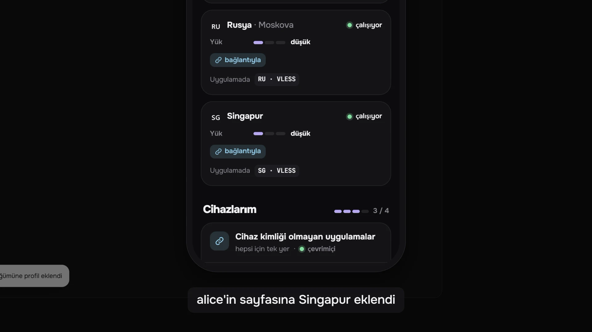

Mistgate, kendi sunucularınızda yönettiğiniz küçük bir VPN filosu için kendi sunucunuzda çalışan bir paneldir. Bu sayfa, panelin ne yaptığını, ne yapmadığını ve belgelerin geri kalanının dayandığı kavramları anlatır.

## Mistgate nedir

- **İki program, Docker yok.** `mistgate` paneldir. `mistgate-node`, her VPN sunucusunda çalışan ajandır. İkisi de Linux (amd64 ve arm64) için tek parça Go ikili dosyalarıdır.
- **Tüm filo için tek yönetim paneli.** Panel kişileri, protokol ayarlarını ve sunucuları tek bir SQLite veritabanında tutar ve bunları İngilizce, Rusça, Basitleştirilmiş Çince, Farsça ve Türkçe sunulan bir web yönetim panelinde gösterir.
- **İşi sunucularda ajanlar yapar.** Ajan protokolleri çalıştırır ve sunucuyu panelin istediği durumda tutar. Panele kendisi bağlanır; bu yüzden panelin sunucularınızda bir yönetim portuna ihtiyacı yoktur. Panel bir sunucuya SSH ile yalnızca düğüm kurmak için (yönetim panelinden ya da sizin onayınızla bir yapay zekâ ajanı için) ve SSH erişimi kayıtlı kaldığı sürece, isteğiniz üzerine sunucunun parolasını değiştirmek ya da kontrol etmek için girer.
- **Protokoller.** Hysteria2 (resmî çekirdek, ajanın içinde), XHTTP veya TCP üzerinden VLESS REALITY (xray-core, ajanın içinde) ve AmneziaWG 2.0 ile 3.1 (varsayılan olarak kullanıcı alanında, istenirse düğüm başına çekirdek modülüyle). Cloudflare WARP üçünün de çıkışı olabilir.
- **Kişi başına tek bağlantı.** Bağlantıyı açan bir abonelik uygulaması, sunucu listesini okuyabildiği bir biçimde alır (`hysteria2://` ve `vless://` bağlantılarından oluşan bir liste ya da User-Agent kurallarıyla seçilen bir Mihomo YAML profili). Tarayıcı ise kişinin talimatlı kendi sayfasını alır. AmneziaVPN kullanıcıları cihaz başına bir anahtar alır.
- **Varsayılan olarak gizli.** Panelin adresini açan bir yabancı kamuflaj sitesi görür. Yönetim paneli gizli bir yolun, gizli bir ana bilgisayar adının ya da ayrı bir dinleyicinin arkasındadır; bilinmeyen bir abonelik bağlantısı da aynı kamuflaj sitesini alır.
- **Sağlık ve güncellemeler.** Panel her sunucuyu gerçek bir istemci gibi kontrol eder, her düğüm sunucu kontrollerinden oluşan ve birkaç güvenli düzeltme sunan bir Teşhis çalıştırır, uyarılar neyin yanlış olduğunu açık sözlerle söyler. Düğüm ajanları ve panel yalnızca panelin içine gömülü sürüm anahtarıyla imzalanmış sürümlere güncellenir: resmî GitHub sürümleri için projenin anahtarı, kendi derlemeleriniz için sizin anahtarınız.
- **Yedekler.** Panelin şifreli yedekleri, zamanlanmış ya da isteğe bağlı olarak Cloudflare R2 kovanıza gider.
- **Otomasyon.** Betikler yönetim paneliyle aynı Connect API'sini kapsamlı API token'larıyla kullanır; yapay zekâ ajanları yerleşik MCP sunucusunu kullanır ve riskli değişiklikler sahibin onayını bekler.

## Ne olmadığı

- **Bir VPN hizmeti değil.** Sunucuları ve alan adlarını siz getirir, her şeyi siz işletirsiniz. Mistgate sunucu kiralamaz ve erişim satmaz.
- **Bir faturalama sistemi değil.** Ödeme, tarife ya da fatura yoktur. Trafik kotaları, süreler ve cihaz sınırları kendi koyduğunuz sınırlardır.
- **Bir istemci uygulaması değil.** İnsanlar mevcut uygulamalarla bağlanır: Happ gibi bir abonelik uygulaması, ya da mihomo çekirdeğini kullanan kl!ck (Windows ve macOS'ta önerilir), Clash Verge veya FlClash gibi bir uygulama; AmneziaWG anahtarları için AmneziaVPN. Kendi uygulamamız **Planlanıyor**.
- **Bitmiş bir ürün değil.** Bu erken bir sürüm: API, saklanan ayarlar ve düğüm protokolü 1.0'dan önce hâlâ değişebilir. Veri modeli yaklaşık 5000 kullanıcı ve 50 düğüme göre boyutlandırılmıştır.
- **Tek tıkla kurulan bir yükleyici değil.** Paneli kendi sunucunuza [tek bir komutla](install-panel.md) kurarsınız ya da elle: bir GitHub sürümünün Linux ikili dosyalarından ya da kaynaktan derlenmiş olarak; sunucuyu ve alan adını siz getirirsiniz, sahip hesabını tarayıcıda oluşturursunuz. Düğüm yönetim panelinden eklenir, ya SSH ile otomatik olarak ya da sunucuda çalıştıracağınız tek kullanımlık bir kurulum komutuyla.

## Kimin için

Mistgate, kendisi, ailesi, arkadaşları ya da küçük bir topluluk için birkaç VPN sunucusu işleten bir kişi ya da küçük bir ekip içindir. Linux, SSH, systemd ve DNS kayıtlarıyla rahat olmalısınız. Bazı varsayılanlar Rusya ve Çin'deki kullanıcılar düşünülerek seçilmiştir (Rusya'daki düğümler için Yandex DNS, Çin'deki düğümler için AliDNS ve DNSPod, Teşhis'in ülkeye özel kontrol alan adları, split DNS hazır ayarları); hepsi birer ayardır.

## Kavramlar

| Kavram | Nedir |
|:--|:--|
| Panel | `mistgate serve` süreci; her kurulumda bir tane. Veritabanını, saklanan sırları şifreleyen ana anahtarı ve panelin kendi sertifika otoritesini (CA) tutar. Kamuflaj sitesini, abonelikleri ve kullanıcı sayfalarını herkese açık adresinde, yönetim panelini gizli bir adreste, ayrıca düğüm ajanlarının bağlandığı uç noktayı sunar. |
| Düğüm | VPN trafiğini taşıyan bir Linux sunucusu. Bir adı (`de1`), istemcilerin bağlandığı bir adresi (bir alan adı ya da IP) ve isteğe bağlı olarak bir ülkesi vardır. |
| Ajan | Bir düğümdeki `mistgate-node` hizmeti. Panel CA'sından bir istemci sertifikası taşır, panele tek bir bağlantı açık tutar, panelin bu düğümde istediği her şeyi uygular ve trafiği, oturumları, sağlığı ve olayları bildirir. |
| Profil | Yeniden kullanılabilir bir protokol ayarı: bir protokol ve ayarları (port, sertifika, gizleme ve benzeri). Bir düğüme koyana kadar hiçbir şey yapmaz. |
| Düğümdeki sunucu | Bir düğüme konmuş profil. Düğümde gerçekten dinleyen şey budur ve kişi uygulamasında onu tek bir sunucu olarak görür. Portu ve Alan adı (SNI) düğümden düğüme farklı olabilir. API buna inbound der. |
| Grup | Bir profil kümesi. Her kullanıcı bir gruptadır ve o grubun profillerini alır. Yeni bir panel, “Herkes” adlı boş bir grupla başlar. |
| Kullanıcı | Erişimi olan bir kişi: bir grup, kullandığı uygulamalar (abonelik bağlantısı, AmneziaVPN ya da ikisi), aldığı düğümler (hepsi ya da bazıları), bir trafik kotası, bir süre ve bir cihaz sınırı. Durum: Etkin, Devre dışı, Süresi doldu ya da Kota doldu. |
| Cihaz | Kimlik bilgileri taşıyan bir kullanıcı cihazı. Abonelik uygulamalarında cihaz, bir uygulama bağlantıyı çektiğinde kendiliğinden belirir: cihaz kimliği başına bir tane, kendi anahtarlarıyla; cihaz kimliği göndermeyen uygulamalar tek bir yeri paylaşır. AmneziaWG'de cihaz, tek bir profile bağlı tek bir anahtardır. Cihaz sınırı cihazları sayar. |
| Abonelik bağlantısı | Kullanıcı başına gizli bir URL. Onu çeken bir uygulama kullanıcının sunucularını alır; tarayıcı kullanıcı sayfasını alır. Yeni bir bağlantı eskisinin yerini hemen alır. |
| Kullanıcı sayfası | Bağlantının tarayıcıda gösterdiği şey: kişinin platformu için talimatlar, bir QR kodu, trafik ve süre; izin verirseniz kişinin kendi cihazları için oluşturduğu AmneziaWG anahtarları. Bir sayfa parolası isteyebilir. |

Birbirleriyle ilişkileri:

- Bir **kullanıcı**, profil kullanıcının **grubunda** yer alıyorsa, düğüm kullanıcının düğümlerinden biriyse, sunucu etkinse, kullanıcı Etkinse ve kullanıcının uygulamalarından biri protokolü kullanabiliyorsa bir **düğümdeki sunucuyu** alır (abonelik uygulamaları için Hysteria2 ve VLESS; AmneziaVPN için AmneziaWG, ve kullanıcının AmneziaVPN'i açıksa mihomo çekirdekli uygulamalar için de AmneziaWG).
- Bunların herhangi birindeki her değişiklik etkilenen düğümlere hemen iletilir. Hiç kimsenin bir şeyi yeniden başlatması gerekmez.

## Bir kişinin uygulaması düğüme nasıl ulaşır

Uygulama panelle yalnızca bağlantıyı çekmek için konuşur. VPN trafiği doğrudan uygulamadan düğüme ve oradan internete gider; asla panelden geçmez.

## Sırada

- [Gereksinimler](requirements.md): panelin ve düğümlerin neye ihtiyaç duyduğu.
- [Paneli kurma](install-panel.md), ardından [Düğüm ekleme](add-node.md) (ya da [SSH ile düğüm kurma](ssh-install.md)) ve [İlk kullanıcılar](first-users.md).
- [Mimari](../reference/architecture.md): parçaların birbirleriyle nasıl konuştuğu, daha ayrıntılı olarak.
