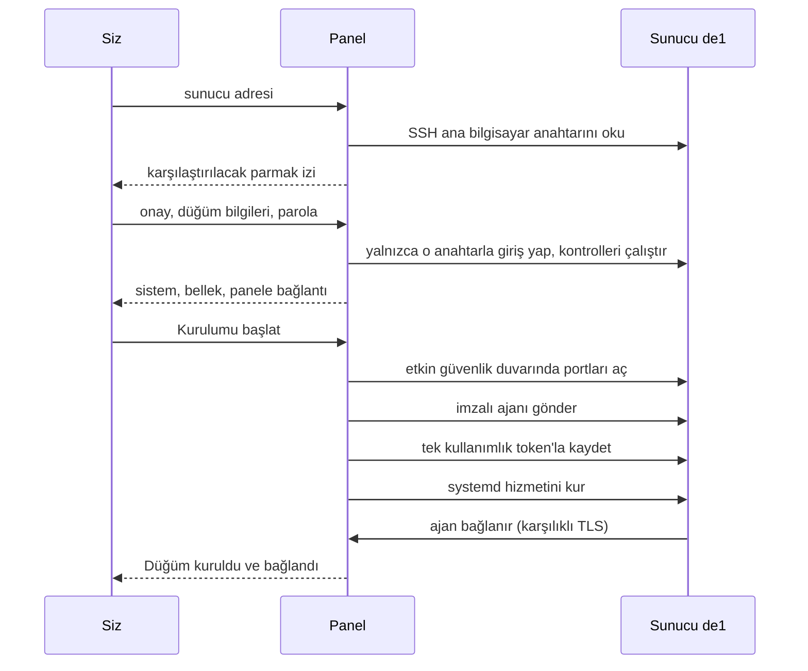

SSH kurulumunda panelin kendisi yeni sunucuya bağlanır, onu kontrol eder, düğüm ajanını kurar ve bağlanmasını bekler: sunucuya hiçbir şey kopyalamaz ve hiçbir komut yapıştırmazsınız. Bu sahibin işidir ve **Düğümler → Düğüm ekle → SSH ile otomatik kur** yolundan başlar. Bir yapay zekâ ajanı aynı kurulumu MCP üzerinden başlatabilir ve siz onu yönetim panelinde onaylarsınız: bkz. [Yapay zekâ ajanı kılavuzu](ai-agents.md). Panel sunucuya SSH ile ulaşamıyorsa [elle kurulumu](add-node.md) kullanın.

## Nelere ihtiyacınız var

- Ubuntu 22.04 ya da daha yenisi veya Debian 12 ya da daha yenisi, amd64 ya da arm64, systemd, en az 256 MiB RAM ve `/root` içinde ajan için boş yer (boyutu artı 64 MiB) olan bir sunucu. Bkz. [Gereksinimler](requirements.md).
- Parolayla SSH girişi; `root` olarak ya da parola sormadan `sudo -n` çalıştıran bir hesap olarak. SSH anahtarıyla giriş desteklenmez. Adres herkese açık olmalıdır: özel, loopback ve link-local adresler reddedilir.
- Panel sunucusuna açık SSH. Bir sağlayıcı güvenlik duvarı ya da güvenlik grubu SSH'ı sınırlıyorsa, önce SSH portuna gelen TCP'ye panel sunucusunun herkese açık çıkış adresinden izin verin. Panel yalnızca ana bilgisayardaki güvenlik duvarını ve yalnızca SSH bağlandıktan sonra değiştirebilir.
- Panelin ajan adresine sunucudan ulaşılabilmelidir: panelin TCP 443 üzerindeki herkese açık adresi ya da `serve --agent-addr` ile verilen adres. Kontroller bunu dener.
- Panelin bildiği herkese açık bir adres: `setup --public-url` ya da `serve --agent-addr`. O olmadan sihirbaz “Panelin herkese açık adresi ayarlanmamış” der.
- Panelin veri dizininde güvenilir, süresi dolmamış bir düğüm ajanı paketi. Resmî sürümden bir panel onu başlarken ve ondan sonra her 10 dakikada bir GitHub Releases'tan indirir. Kendi derlediğiniz bir panelin `<data-dir>/dist` içinde sizin imzaladığınız bir pakete ihtiyacı vardır: bkz. [Sürümler ve imzalama](../operations/releases.md). Güncellemeler sayfasındaki **Sürüm paketi** satırı durumunu gösterir.

## Dört adım

1. **Sunucu.** **SSH sunucu adresi** ve **SSH portunu** (genellikle 22) girin ve **Sunucuyu kontrol et** düğmesine basın. Panel sunucunun SSH ana bilgisayar anahtarını kendi sunucusundan okur. Henüz hiçbir kullanıcı adı ya da parola gönderilmez.
2. **SSH anahtarı.** SHA-256 parmak izini ve anahtar türünü güvenilir bir kopyayla karşılaştırın: sağlayıcınızın konsolunun gösterdiği ya da o konsol üzerinden sunucuda çalıştırılan `ssh-keygen -lf /etc/ssh/ssh_host_ed25519_key.pub` çıktısı. Kontrol edemediğiniz bir anahtarı onaylamayın. Onay kutusunu işaretleyin, sonra düğümü doldurun: **Ad**, **Adres** (istemcilerin bağlandığı herkese açık alan adı ya da IP), **Ülke**, **Bölge veya şehir**, **Sağlayıcı**, **SSH kullanıcı adı** (varsayılan `root`) ve **SSH parolası**. **Devam** sizden oturum açışınızı yeniden doğrulamanızı isteyebilir ([Güvenlik](../operations/security.md) sayfasındaki “Yeniden doğrulama (step-up)” bölümüne bakın), sonra yalnızca onaylanan anahtarla giriş yapar ve kontrolleri çalıştırır.
3. **Kontrol.** **Sistem**, **Mimari**, **Çekirdek**, **İşlemciler**, **Bellek**, **Boş disk alanı**, **systemd** ve **Panel bağlantısı** satırlarına göz atın. Parolayı yeniden girin, “Mistgate ajanı kurulur ve bu düğüm oluşturulur” kutusunu işaretleyin ve **Kurulumu başlat** düğmesine basın. Bu noktaya kadar sunucu değişmemiştir.
4. **Kurulum.** İş panelde aşama aşama çalışır: SSH ile bağlanma, sunucuyu kontrol etme, ana bilgisayarın güvenlik duvarını hazırlama, ajanı gönderme, düğümü kaydetme, ajanı başlatma, düğümün bağlanmasını bekleme. **Kapat; arka planda sürsün** pencereyi kapatır; iş sürer. Ajan bağlandığında pencere “Düğüm kuruldu ve bağlandı” der ve **Düğümü aç** sunar. İş başarısız olursa pencere nedenini söyler ve parolayla **Kurulumu yeniden dene** ya da **Kurulum yöneticisini aç** sunar.

Yeni düğümde henüz profil yoktur: [İlk kullanıcılar](first-users.md) sayfasıyla devam edin.

## Panel sunucuda neler yapar

Her şey yalnızca onaylanan ana bilgisayar anahtarını kabul eden tek bir SSH bağlantısı üzerinden çalışır. Root dışındaki bir kullanıcı adında her komut `sudo -n` ile çalıştırılır.

1. **Kontroller.** İşletim sistemini, mimariyi, çekirdeği, işlemcileri, belleği, `/root` içindeki boş diski ve systemd'nin olup olmadığını, sunucuda zaten bir Mistgate düğüm kimliği bulunup bulunmadığını ve sunucunun panelin ajan adresine bir TCP bağlantısı açıp açamadığını (5 saniyelik bir test) okur.
2. **Ana bilgisayar güvenlik duvarı.** Yalnızca zaten etkin olan bir güvenlik duvarına dokunulur; etkin olmayan etkin olmayan kalır. UFW'ye SSH portu, sonra `mistgate-node-provision-v1` yorumuyla 80/tcp, 443/tcp ve 443/udp eklenir; aynı kuralı zaten bulunan bir port hariç. firewalld'ye SSH portu, 80/tcp, 443/tcp ve 443/udp her etkin bölgede, hem çalışma anında hem kalıcı olarak eklenir; yalnızca çalışma anında olan kuralları düşürecek bir yeniden yükleme yapılmaz.
3. **Ajan.** Sunucunun mimarisine uygun ajanı güvenilir paketten `/root/mistgate-node` konumuna akıtır, boyutunu ve SHA-256 değerini kontrol eder ve çalıştırılabilir yapar.
4. **Kayıt.** Bir saat geçerli, tek kullanımlık bir token'la `mistgate-node enroll` çalıştırır. Token komut satırında değil, standart girdide (`--token-stdin`) verilir. `--resume-key` bekleyen anahtarı diskte tutar; bu yüzden yarıda kalan bir kayıt aynı anahtarla yeniden denenebilir.
5. **Hizmet.** Sertleştirilmiş systemd birimini yazan ve ajanı başlatan `mistgate-node install` komutunu çalıştırır; elle kurulumdakiyle tamamen aynıdır: bkz. [Düğüm ekleme](add-node.md) sayfasındaki “Sunucuda neler olur”.
6. **Bağlantı.** Ajanın bağlanması için en çok 2 dakika bekler, sonra SSH erişimini (şifreli olarak) kaydeder ve işi bitirir.

Bundan sonra ajan UFW'yi kendi profilleriyle uyumlu tutar: etkin bir UDP inbound'unu uyguladıktan sonra o tam portu ve kabul edilmiş bir Hysteria2 port atlama aralığını etkin bir UFW'ye kendi etiketli kuralları olarak ekler. Aynı port için eklemediği bir kuralı asla değiştirmez ya da kaldırmaz. UFW ajanın sanal alanı dışında, geçici bir systemd birimi olarak çalışır. firewalld yalnızca kontrol edilir: ajan varsayılan bölgede eksik portları söyler ve onları siz eklersiniz. Ana bilgisayar güvenlik duvarı uyumlu hale getirilemezse düğüm tek bir `host_firewall_sync_failed` uyarı olayı gösterir ve dinleyici çalışmaya devam eder. Düğümü kullanımdan kaldırmak etiketli kuralları, kurulumun 80/443 kuralları dahil, kaldırır; SSH kuralı asla kaldırılmaz.

## Kurulum işleri ve kurulum yöneticisi

Her kurulum, panelin sakladığı bir iştir. `<admin URL>nodes/install` adresindeki kurulum yöneticisi son 100 işi durumlarıyla (sırada, kuruluyor, durduruluyor, iptal edildi, düğüm bağlandı, başarısız) ve kayıtlı sunucu erişimini listeler. Bir işin sayfası adımlarını gösterir, her 4 saniyede bir yenilenir ve sunucudan gelen çıktıyı asla göstermez. Yalnızca sahip onu açar.

Kurulum yöneticisi İngilizce, Rusça ya da Basitleştirilmiş Çince konuşur: sihirbazdan açıldığında yönetim panelinin dili (`?lang=` geçirir; Farsça ya da Türkçe bir yönetici İngilizce alır), aksi halde tarayıcının ilk dili Çince ya da Rusçaysa o, yoksa İngilizce.

- **İptal.** Sıradaki bir iş hemen durur ve geçici SSH verileri silinir. Çalışan bir işten durması istenir; sunucuda zaten çalışan bir komut onu değiştirmiş olabilir, bu yüzden yeniden denemeden önce sunucuyu kontrol edin.
- **Yeniden deneme.** Başarısız ya da iptal edilmiş bir iş, SSH kullanıcı adı ve parolayla yeniden çalışabilir. Kontroller sunucuda bu düğümün kimliğinin zaten bulunup bulunmadığına bakar ve iş oradan devam eder; başka bir düğümün kimliğini taşıyan sunucu reddedilir. Düğümü kullanımdan kaldırılmış bir iş yeniden denenemez: yeni bir kurulum başlatın.
- **Adlar.** Düğüm canlı olduğu ya da onun için bir kurulum etkin olduğu sürece düğüm adı ayrılmış kalır. Bir düğümü kullanımdan kaldırmak geçmişini korur ve adı serbest bırakır.
- **Parola.** Bir iş çalışırken SSH parolası panelin ana anahtarıyla şifrelenerek saklanır ve o işe bağlanır. İş bittiğinde silinir; başarıda düğümün kayıtlı erişimi olur.

## Kayıtlı SSH erişimi

Başarılı bir kurulumdan sonra panel SSH kullanıcı adını ve parolayı, sabitlenmiş ana bilgisayar anahtarıyla birlikte, ana anahtarla şifreleyerek saklar. Hiçbir API okuması, MCP aracı ya da günlük parolayı asla döndürmez.

- **Görmek.** Düğümün **Sunucu → SSH erişimi** kartı SSH sunucusunu, kullanıcı adını ve sabitlenmiş ana bilgisayar anahtarını gösterir. **Parolayı göster** oturum açışınızı yeniden doğrulamanızı ister ve denetim günlüğüne yazılır.
- **Değiştirmek.** Aynı kartta **Parolayı değiştir**, **Oluştur** (panel 26 karakterlik bir parola üretir) ya da **Kendim yazayım** (en az 12 karakter) seçeneklerini sunar ve oturum açışınızı yeniden doğrulamanızı ister. Değişiklik bir dakikayı bulabilir, kart bu sırada ilerlemeyi gösterir; sayfayı kapatmayın. Ardından kart yeni parolayı kopyalama düğmesiyle 60 saniye boyunca ya da sekmeden ayrılana kadar gösterir: hemen kaydedin. Kurulum yöneticisindeki sunucu erişim tablosu da yazılan bir parolayı alır; MCP üzerinden `node_server_password_rotate`, panelin bir tane üretmesini sağlar ve ajan onu asla görmez. Her durumda panel yeni parolayı önce bekleyen olarak saklar, sunucuda `chpasswd` ile değiştirir, onunla yeniden giriş yapar ve ancak ondan sonra kayıtlı olanın yerine koyar: bundan sonra kart **Doğrulandı** gösterir. Kullanımdan kaldırılmış bir düğümde **Parolayı değiştir** yoktur.
- **Yarıda kalan bir değişiklik.** Sunucu yeni parolayı doğrulayamadıysa kart **Değişiklik doğrulanmadı** gösterir ve sonraki gösterme ya da değiştirme önce ikisini de dener. Hangisinin çalıştığını söylemek için sunucuya ulaşılamıyorsa **Parolayı göster** “Mevcut parola (doğrulanmadı)” ve “Yarıda kalan değişiklikteki yeni parola (doğrulanmadı)” gösterir: önce mevcut olanı deneyin. Yeni bir değişiklik sunucu yanıt verene kadar bekler. Sunucu ikisini de reddederse parolayı sağlayıcınızın konsolundan sıfırlayın.
- **Panelin ürettiği bir parola.** Yalnızca panel bilir ve kart bunu söyler. Düğümü kullanımdan kaldırmadan önce onu gösterin ve bir kopyasını saklayın.
- **Kullanımdan kaldırılmış bir düğüm.** SSH erişim kartı kalır: panel artık o sunucuyu değiştirmez, ama parolayı yine gösterebilirsiniz. İki kez sorulan ve yeni bir oturum doğrulamasıyla yapılan **Kayıtlı erişimi unut** onu kalıcı olarak siler. Yalnızca kullanımdan kaldırılmış bir düğümün erişimi unutulabilir.

## Cloudflare sürümünde

Uç sürüm (Cloudflare Workers üzerindeki panel) de düğümleri SSH ile kurar. Sihirbaz, adımlar, kurulum yöneticisi ve kayıtlı erişim aynıdır; kurulumlar, `mistgate edge deploy` komutunun panelle birlikte yayımladığı ikinci bir Worker betiğinde, `mistgate-edge-provision` içinde çalışır ([Cloudflare sürümünü kurma](install-edge.md) sayfasına bakın). Farklı olanlar:

- **Panel Cloudflare'in ağından bağlanır**, bildiğiniz bir sunucudan ya da bilgisayarınızdan değil. Kurulum süresince yeni sunucuda SSH, portunda internetten gelen TCP'yi kabul etmelidir; hem sağlayıcının güvenlik duvarında ya da güvenlik grubunda hem de ana bilgisayar güvenlik duvarında. Yalnızca kendi IP'nize ya da sabit bir panel adresine izin veren bir kural kontrolün zaman aşımına uğramasına yol açar: Cloudflare bir Worker'ın hangi adreslerden bağlandığını yayımlamaz. Kayıtlı parolayı sonra değiştirmeniz veya göstermeniz de SSH üzerinden olur; bunun için de yeniden açın.
- **Ajan GitHub'daki imzalı sürümden gelir**; panelin sürümüyle eşleşen sürüm. Düğüm panelin herkese açık adresi üzerinden kayıt olur. Sürüm olmayan bir panel derlemesinin güvenilir ajanı yoktur ve sihirbaz bunu söyler.
- **“Reddedildi ya da ulaşılamıyor”** (sihirbaz “Panelin ağı bu adresle bağlantıyı reddetti ya da sunucuya oradan ulaşılamıyor” der), Cloudflare ağının paneli o adrese bağlamadığı anlamına gelir. Bir Worker'dan platformun reddi ile kapalı bir port aynı görünür; bu yüzden panel hangisi olduğunu söyleyemez. Şunlara bakın: Cloudflare'e ait bir adres ya da Cloudflare'in proxy'sinin arkasındaki bir ad (DNS listesinde turuncu bulut), ki orada sunucunun kendi adresine ya da yalnızca DNS olan bir ada ihtiyacınız vardır; özel bir ağ ya da yalnızca bir VPN veya bastion üzerinden ulaşılan bir sunucu; yanlış bir port ya da üzerinde SSH hizmetinin olmaması.

Panel sunucuya bu yolla ulaşamadığında ya da sunucu yalnızca SSH anahtarı kabul ettiğinde düğümü elle kurulum komutuyla kurun: sihirbaz bu hatanın yanında **Komutla elle kur** seçeneğini sunar ve [Düğüm ekleme](add-node.md) sayfası onu anlatır. Cloudflare'in art arda üç kez yarıda kestiği bir kurulum başarısız olarak durur; yeniden deneyin ya da elle komutu kullanın.

## Başarısız olduğunda

| Sihirbaz şunu der | Ne yapmalı |
|:--|:--|
| Panel bu SSH adresine ve portuna zamanında ulaşamadı | SSH'ın o portta çalıştığını kontrol edin ve sağlayıcının güvenlik duvarında panel sunucusunun çıkış adresinden gelen TCP'ye izin verin. Ana bilgisayarın güvenlik duvarı SSH'ı engelliyorsa sağlayıcının konsolundan açın. |
| Panelin ağı bu adresle bağlantıyı reddetti ya da sunucuya oradan ulaşılamıyor | Yalnızca uç sürüm: yukarıdaki “Cloudflare sürümünde” bölümüne bakın. Sunucunun kendi herkese açık adresini ya da [elle kurulumu](add-node.md) kullanın. |
| Panel bu SSH adresinden ve portundan zamanında yanıt alamadı ve metin Cloudflare'in ağını anıyor | Uç sürüm: kurulum süresince SSH portuna internetten gelen TCP'ye izin verin, yalnızca kendi IP'nize değil; ya da [elle kurulumu](add-node.md) kullanın. |
| Panel bu adresten bir SSH anahtarı okuyamadı | Ana bilgisayarı, portu ve SSH hizmetini kontrol edin. |
| SSH ile ulaşılabilen, herkese açık bir sunucu adresi gir | Adres özel, loopback ya da link-local, ya da çözümlenmiyor. Sunucunun herkese açık adresini kullanın. |
| Sunucu bu SSH kullanıcı adını ya da parolayı reddetti | İkisini de kontrol edin; panel yalnızca parolayla girişi destekler. |
| SSH host anahtarı onaydan sonra değişti | Sunucu şimdi başka bir ana bilgisayar anahtarı gösteriyor: yeniden başlamadan önce nedenini öğrenin. |
| Ubuntu 22.04 ve üstünü ya da Debian 12 ve üstünü kullan / Sunucu amd64 ya da arm64 olmalı | Sunucu desteklenmiyor; yalnızca ajanın orada çalıştığını biliyorsanız [elle kurulumu](add-node.md) kullanın. |
| SSH hesabının root erişimi ya da parolasız sudo yetkisi olmalı | root olarak girin ya da hesaba `sudo -n` izni verin. |
| Panelin herkese açık adresi ayarlanmamış, bu yüzden düğüm geri bağlanamaz | `--public-url` ya da `--agent-addr` ayarlayın. |
| Sunucu panelin ajan adresine TCP bağlantısı açamadı | Panelin önündeki güvenlik duvarında ya da güvenlik grubunda ajan portuna izin verin, ajan adresinin DNS'ini ve sunucudan çıkan TCP'yi kontrol edin, sonra yeniden deneyin. |
| Sunucuda systemd yok | systemd'li Ubuntu 22.04+ ya da Debian 12+ kullanın. |
| Sunucunun belleği ya da işlemcisi yetersiz | Ajan en az 256 MB RAM ister. |
| Sunucuda ajan için yeterli boş disk alanı yok | Ajanın boyutu artı 64 MB gerekir. Biraz yer açın, sonra yeniden deneyin. |
| Sunucuda zaten başka bir ya da bozuk bir Mistgate düğüm kimliği var | `/var/lib/mistgate-node` dizinini sunucudan yalnızca o düğüm artık yoksa silin, sonra yeniden deneyin. |
| Panelin bu sunucunun mimarisi için güvenilir bir ajanı yok | Güncellemeler sayfasında **Sürüm paketi** bölümüne bakın, sonra yeniden deneyin. |
| Bu düğüm adı zaten kullanımda | Başka bir ad seçin ya da önce eski düğümü kullanımdan kaldırın. |
| Panel bağlandı ama sunucudaki etkin UFW/firewalld kurallarını hazırlayamadı | Hesabın root ya da `sudo -n` erişimini ve ana bilgisayar güvenlik duvarını kontrol edin, sonra yeniden deneyin. |
| SSH, sunucuda değişiklik yapıldıktan sonra kesildi | Bazı kurulum komutları çalışmış olabilir. Sunucuya bakın, sonra yeniden deneyin. |
| Ajan kuruldu ama panele bağlanmadı | Sunucuda: `journalctl -u mistgate-node -n 50 --no-pager`. Genellikle düğüm panelin ajan adresine ulaşamıyordur. |
| Mistgate systemd hizmetini kuramadı ya da başlatamadı | Sunucunun günlüğüne bakın, sonra yeniden deneyin. |
| Kurulum durdu. Ayrıntılar için kurulum yöneticisini aç | Sihirbazın sözcük bulamadığı bir neden; yönetici işin tam kodunu gösterir. |
