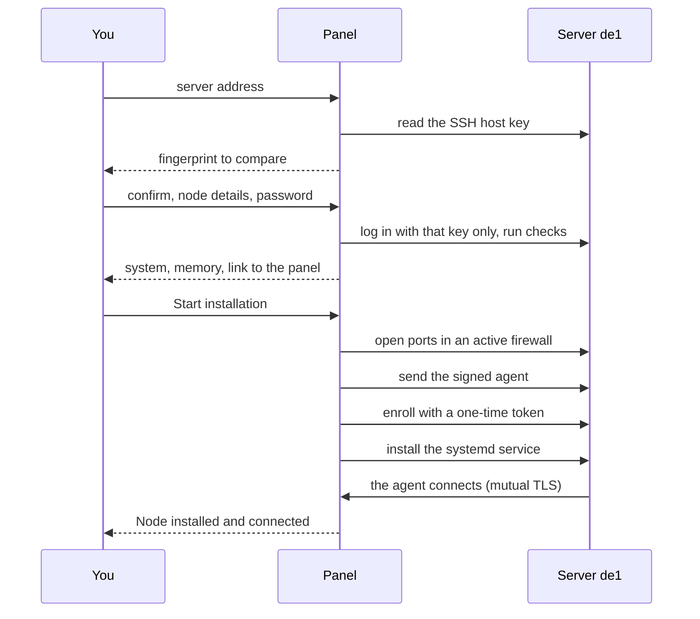

通过 SSH 安装时，面板会自行连接新服务器、检查服务器、安装节点 Agent 并等待其连接：你无需向服务器复制文件或粘贴命令。只有所有者可以发起此操作，入口为**节点 → 添加节点 → 通过 SSH 自动安装**。AI 智能体也可以通过 MCP 发起相同的安装，并由你在管理后台审批：见 [AI 智能体指南](ai-agents.md)。面板无法通过 SSH 访问服务器时，使用[手动安装](add-node.md)。

## 所需条件

- 一台运行 Ubuntu 22.04 或更高版本、Debian 12 或更高版本的服务器，架构为 amd64 或 arm64，使用 systemd，至少有 256 MiB 内存，并且 `/root` 中有足够空间存放 Agent（Agent 大小加 64 MiB）。见[要求](requirements.md)。
- 使用密码登录 SSH，账户为 `root` 或者可以不输入密码运行 `sudo -n` 的用户。不支持使用 SSH 密钥登录。地址必须是公网地址：会拒绝私有、loopback 和链路本地地址。
- 面板服务器可以通过 SSH 访问。若服务商防火墙或安全组限制 SSH，先允许从面板服务器的公网出口地址连接 SSH 端口上的入站 TCP。面板只能在 SSH 成功连接后更改主机防火墙。
- 服务器能访问面板的 Agent 地址：面板的公网地址上的 TCP 443，或传给 `serve --agent-addr` 的地址。检查过程会测试连接。
- 面板知道一个公网地址：使用 `setup --public-url` 或 `serve --agent-addr` 设置。未设置时，向导会显示「尚未配置面板的公网地址」。
- 面板数据目录中有可信且未过期的节点 Agent 包。官方发布版面板启动时会从 GitHub Releases 下载，并每 10 分钟检查一次。自行构建的面板需要在 `<data-dir>/dist` 中提供自己签名的包：见[发布与签名](../operations/releases.md)。更新页中的**发布包**一行会显示其状态。

## 四个步骤

1. **服务器。** 输入**SSH 服务器地址**和**SSH 端口**（通常为 22），然后按**检查服务器**。面板会从自己的服务器读取目标 SSH 主机密钥。此时尚未发送用户名或密码。
2. **SSH 密钥。** 将 SHA-256 指纹和密钥类型与可信副本进行比较：可以查看服务商控制台上的信息，或通过控制台在服务器上运行 `ssh-keygen -lf /etc/ssh/ssh_host_ed25519_key.pub` 并比较其输出。无法核对的密钥不要确认。勾选确认框，然后填写节点信息：**名称**、**地址**（客户端连接的公网域名或 IP）、**国家/地区**、**地区或城市**、**服务商**、**SSH 用户名**（默认为 `root`）和**SSH 密码**。按**继续**后，系统可能会要求你再次确认登录身份（见[安全](../operations/security.md)中的「再次验证」），然后会使用你确认的密钥登录并运行检查。
3. **检查。** 检查**系统**、**架构**、**内核**、**处理器**、**内存**、**可用磁盘空间**、**systemd**和**面板连接**。重新输入密码，勾选「安装 Mistgate Agent 并创建此节点」，然后按**开始安装**。到这一步之前，服务器不会发生更改。
4. **安装。** 任务会在面板中按阶段运行：通过 SSH 连接、检查服务器、准备主机防火墙、发送 Agent、注册节点、启动 Agent、等待节点连接。按**关闭，在后台继续运行**会关闭窗口，但任务仍会继续。Agent 连接后，窗口会显示「节点已安装并连接」，并提供**打开节点**。任务失败时，窗口会说明原因，并提供**重试安装**（需再次输入密码）或**打开安装管理器**。

新节点尚无协议配置：继续阅读[首批用户](first-users.md)。

## 面板会在服务器上执行什么

所有操作都通过一个 SSH 连接执行，该连接只接受你已确认的主机密钥。使用非 root 用户登录时，每条命令都会通过 `sudo -n` 运行。

1. **检查。** 读取操作系统、架构、内核、CPU、内存、`/root` 中的可用磁盘空间，并检查 systemd 是否存在、服务器是否已有 Mistgate 节点身份，以及服务器是否能通过 TCP 连接到面板的 Agent 地址（测试时间为 5 秒）。
2. **主机防火墙。** 只会更改已启用的防火墙；未启用的防火墙会保持关闭。UFW 会添加 SSH 端口、80/tcp、443/tcp 和 443/udp，并使用注释 `mistgate-node-provision-v1`；如果相同规则已存在，则跳过对应端口。firewalld 会在所有活动区域中添加 SSH 端口、80/tcp、443/tcp 和 443/udp，同时应用于运行时和永久配置；不会通过重新加载防火墙来删除仅存在于运行时的规则。
3. **Agent。** 根据服务器架构，从可信包流式传输 Agent 到 `/root/mistgate-node`，检查文件大小和 SHA-256 值，并将其设为可执行文件。
4. **注册。** 使用有效期为一小时的一次性令牌运行 `mistgate-node enroll`。令牌通过标准输入传递（`--token-stdin`），绝不会出现在命令行中。`--resume-key` 会将待处理的密钥保留在磁盘上，便于在中断后使用同一密钥重试注册。
5. **服务。** 运行 `mistgate-node install`，写入强化过的 systemd 服务单元并启动 Agent，具体与手动安装相同：见[添加节点](add-node.md)中的「服务器上会发生什么」。
6. **连接。** 最多等待两分钟，直到 Agent 连接，然后加密保存 SSH 凭据并结束任务。

此后，Agent 会根据自己的协议配置维护 UFW 规则：应用已启用的入站协议后，会为准确的端口和已接受的 Hysteria2 端口跳跃范围，在已启用的 UFW 中添加带有自身标记的规则。它不会更改或删除由其他程序为相同端口添加的规则。UFW 在 Agent 沙箱外以临时 systemd 单元运行。Agent 只会检查 firewalld，并列出默认区域中缺少的端口，由你自行添加。如果无法同步主机防火墙，节点会显示一条 `host_firewall_sync_failed` 警告事件，但监听器会继续运行。退役节点时会移除带标记的规则，包括安装时添加的 80/443 规则；SSH 规则不会移除。

## 安装任务和安装管理器

每次安装都是一个由面板保存的任务。`<admin URL>nodes/install` 中的安装管理器列出最近 100 个任务及其状态（排队中、安装中、正在停止、已取消、节点已连接、失败），并显示已保存的服务器凭据。任务页面显示各个步骤，每 4 秒刷新一次，且不会显示服务器输出。只有所有者可以打开此页面。

安装管理器使用英文或俄文：从向导打开时使用管理后台的语言；否则使用浏览器语言。

- **取消。** 排队中的任务会立即停止，并删除其临时 SSH 数据。正在运行的任务会收到停止请求；服务器上正在运行的命令可能已更改服务器，因此重试前先检查服务器。
- **重试。** 失败或已取消的任务可以使用 SSH 用户名和密码重新运行。检查过程会确认服务器上是否已有此节点的身份信息，并从相应位置继续；如果服务器上有其他节点的身份信息，则会拒绝操作。节点已退役的任务不能重试，需发起新的安装。
- **名称。** 节点处于活动状态或安装任务正在运行时，其名称会被占用。节点退役后会保留历史记录并释放名称。
- **密码。** 任务运行期间，SSH 密码会使用面板的主密钥加密，并绑定到该任务。任务结束时会删除密码；安装成功后，密码会成为节点的已保存凭据。

## 已保存的 SSH 凭据

安装成功后，面板会使用主密钥加密保存 SSH 用户名和密码，并一同保存已固定的主机密钥。任何 API 读取、MCP 工具或日志都不会返回密码。

- **查看。** 节点的**设置 → SSH 凭据**卡片会显示 SSH 服务器和用户名。选择**显示密码**时，系统会要求你再次确认登录身份，并将该操作写入审计日志。
- **更改。** 在安装管理器中，服务器凭据表允许设置至少 12 个字符的新密码。使用 MCP 时，`node_server_password_rotate` 会让面板生成新密码；Agent 不会看到密码。无论使用哪种方式，面板都会先将新密码设为待确认状态，通过 `chpasswd` 在服务器上修改密码，再次登录验证，之后才替换已保存的密码。
- **更改中断。** 如果服务器无法确认新密码，下次查看或更改时会先尝试新旧两个密码。若无法连接服务器来确定哪个密码有效，选择**显示密码**时会显示「当前密码（未经验证）」和「中断的更改中的新密码（未经验证）」：先尝试当前密码。服务器有响应前，不能进行下一次密码更改。如果服务器拒绝这两个密码，通过服务商控制台重置密码。
- **由面板生成的密码。** 只有面板知道该密码，凭据卡片也会注明这一点。退役节点前，先显示密码并保存副本。
- **已退役节点。** 节点的 SSH 凭据卡片会继续保留：面板不再更改该服务器，但你仍可查看密码。需进行两次确认并重新验证登录身份后，才能通过**清除已保存的凭据**永久删除凭据。只有已退役节点的凭据可以清除。

## Cloudflare 版

Cloudflare 版（运行在 Cloudflare Workers 上的面板）也支持通过 SSH 安装节点。向导、步骤、安装管理器和已保存的凭据均相同；安装任务会在第二个 Worker 脚本 `mistgate-edge-provision` 中运行。`mistgate edge deploy` 会将其与面板一起部署（见[安装 Cloudflare 版](install-edge.md)）。差异如下：

- **面板从 Cloudflare 网络连接**，而非从你知道地址的服务器或你的计算机连接。安装期间，服务商防火墙或安全组及主机防火墙都必须允许来自互联网的 SSH 端口入站 TCP。只允许你自己的 IP 或某个固定面板地址的规则会导致检查超时：Cloudflare 不会公布 Worker 发起连接时使用的地址。以后更改或查看已保存密码时也要通过 SSH 连接，因此需要再次开放端口。
- **Agent 来自 GitHub 上与面板版本相同的已签名发布版本**；节点通过面板公网地址完成注册。非发布构建的面板没有可信 Agent，向导会提示这一点。
- **「已拒绝或无法访问」**（向导显示「面板网络拒绝了此地址，或无法从该网络访问服务器」）表示 Cloudflare 网络无法从面板连接到该地址。Worker 收到平台拒绝和端口关闭时的结果相同，因此面板无法区分原因。检查：属于 Cloudflare 的地址或由 Cloudflare 代理的名称（DNS 列表中显示橙色云朵），这种情况下应改用服务器自身地址或仅使用 DNS 的名称；私有网络，或只能通过 VPN、跳板机访问的服务器；端口错误，或没有 SSH 服务监听该端口。

面板无法通过这种方式访问服务器，或服务器只接受 SSH 密钥时，使用手动安装命令：向导会在此错误旁提供**使用手动命令**，[添加节点](add-node.md)也有说明。Cloudflare 连续三次中断安装时，任务会以失败状态停止；重试或使用手动安装命令。

## 失败时

| 向导提示 | 处理方法 |
|:--|:--|
| 面板未能及时连接此 SSH 地址和端口 | 检查 SSH 是否在该端口运行，并在服务商防火墙中允许来自面板服务器公网出口地址的入站 TCP。如果主机防火墙阻止了 SSH，通过服务商控制台开放端口。 |
| 面板网络拒绝了此地址，或无法从该网络访问服务器 | 仅适用于 Cloudflare 版：见上文「Cloudflare 版」。使用服务器自己的公网地址，或使用[手动安装](add-node.md)。 |
| 面板未能及时收到此 SSH 地址和端口的响应，且提示中提到 Cloudflare 网络 | Cloudflare 版：安装期间允许来自互联网的 SSH 端口入站 TCP，而不只是你自己的 IP；或者使用[手动安装](add-node.md)。 |
| 面板无法从此地址读取 SSH 密钥 | 检查主机、端口和 SSH 服务。 |
| 请填写可通过 SSH 访问的公网服务器地址 | 地址是私有、loopback 或链路本地地址，或者无法解析。使用服务器的公网地址。 |
| 服务器拒绝了此 SSH 用户名或密码 | 检查用户名和密码；面板只支持密码登录。 |
| 确认后 SSH 密钥发生了变化 | 服务器现在提供另一个主机密钥：先找出原因，再重新开始。 |
| 请使用 Ubuntu 22.04 或更高版本，或 Debian 12 或更高版本 / 服务器必须使用 amd64 或 arm64 | 服务器不受支持；只有在确认 Agent 能在该服务器上运行时，才使用[手动安装](add-node.md)。 |
| SSH 账户需要 root 权限或免密 sudo | 使用 root 登录，或允许此账户运行 `sudo -n`。 |
| 尚未配置面板的公网地址，因此节点无法回连 | 设置 `--public-url` 或 `--agent-addr`。 |
| 服务器无法通过 TCP 连接面板的 Agent 地址 | 在面板前方的防火墙或安全组中允许 Agent 端口；检查 Agent 地址的 DNS 记录及服务器出站 TCP，然后重试。 |
| 服务器没有 systemd | 使用安装了 systemd 的 Ubuntu 22.04+ 或 Debian 12+。 |
| 服务器内存或 CPU 不足 | Agent 至少需要 256 MB RAM。 |
| 服务器可用磁盘空间不足，无法安装 Agent | 至少需要 Agent 大小加 64 MB。释放空间后重试。 |
| 服务器上已有其他 Mistgate 节点的身份信息，或身份信息已损坏 | 只有在对应节点已不再运行时，才移除服务器上的 `/var/lib/mistgate-node`，然后重试。 |
| 面板没有适用于此服务器架构的可信 Agent | 在更新页检查**发布包**，然后重试。 |
| 此节点名称已被占用 | 选择其他名称，或先退役旧节点。 |
| 面板已连接，但无法准备活动的 UFW/firewalld 规则 | 检查账户是否有 root 或 `sudo -n` 权限，以及主机防火墙状态，然后重试。 |
| 更改服务器后 SSH 中断 | 部分安装命令可能已经运行。先检查服务器，然后重试。 |
| Agent 已安装，但未连接面板 | 在服务器上运行 `journalctl -u mistgate-node -n 50 --no-pager`。通常是节点无法访问面板的 Agent 地址。 |
| Mistgate 无法安装或启动 systemd 服务 | 查看服务器日志，然后重试。 |
| 安装已停止。请打开安装管理器查看详情 | 向导无法说明具体原因；安装管理器会显示任务的确切代码。 |
