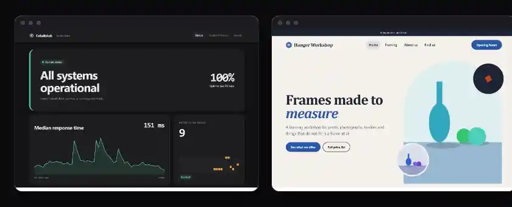

面板的公网地址会向非管理员、非订阅用户和非节点 Agent 显示伪装站点。本页介绍如何用自有的小型站点替换内置页面，让该地址看起来像普通的小型网站。相关标志和服务规则见[安装面板](../getting-started/install-panel.md#5-伪装站点)；[安全](../operations/security.md#伪装站点和隐藏的管理后台)说明伪装站点如何隐藏管理后台。

## 为什么使用自有站点

不设置 `--decoy-dir` 时，面板会显示内置的「即将推出」页面。每次安装都附带相同的页面，因此任何见过它的人都能认出来，探测器也能判断该地址属于 Mistgate 面板。使用自有站点，并为它编写独有内容和设计，就能让该地址看起来像普通的小型网站，不会引人注意。

## 节点：三种选项

每个节点都会向非客户端访问者提供伪装站点：Hysteria2 伪装（HTTP/3 和 TCP 站点）、处于 `self` 模式的 VLESS REALITY 站点，以及使用节点自身名称的 [MTProto](mtproto.md) 协议配置的端口上陌生访问者遇到的站点。（指定其他站点的 MTProto 协议配置会显示那个真实站点，而不是你的站点。）你可以在节点的**服务器**标签页中逐个选择站点，也可以在节点页面上一次为多个节点设置（选择节点，再设置伪装站点）：

- **内置**使用固定的 Mistgate 页面。每次安装都附带相同的页面，因此很容易被认出。升级前已有的节点会继续使用此页面，直到你更改设置。
- **面板站点**会将面板的 `--decoy-dir` 站点包复制到节点。适用于一个主域名和多个子域名的情况：这些子域名本来就能关联起来（证书透明度日志会列出它们），让同一家公司的站点出现在不同地区的主机上也很自然。面板检测到可用的伪装目录时，新节点默认使用此选项。
- **自有站点**是你为某个节点上传的站点包。适用于使用不同域名或裸 IP 的节点，这些节点之间不应被关联起来。为每个节点选用不同的主题和外观，不要重复其他节点已有站点的主题或设计。

### 站点包可以包含什么

上传的自有站点包和复制到节点的面板 `--decoy-dir` 目录遵循相同规则：

- **大小**：所有文件总计最多 **2 MiB**。此上限同时适用于**自有站点**和面板的 `--decoy-dir`。自有站点上传的压缩包也不得超过 2 MiB。超过 2 MiB 的伪装目录仍可供面板自身使用，但不会提供给节点：节点的**服务器**标签页会说明面板站点过大，节点会继续提供原有内容。文件数最多为 4096。
- **上传格式**：ZIP、TAR 或 TAR.GZ。按通常方式压缩文件夹：如果单层外层文件夹中包含 `index.html`，系统会移除该文件夹。
- **`index.html`** 必须位于站点根目录。所有未知地址都会使用 `404.html`；如果没有 `robots.txt`，系统会提供内置文件。
- **仅限静态文件**。符号链接、设备和其他非普通文件都会被拒绝；包含 `..` 的路径、绝对路径以及含反斜杠或冒号的名称也会被拒绝。点文件和 macOS 的 `__MACOSX` 项目会被忽略，面板也会隐藏这些项目。系统会忽略可执行位：文件只会作为数据提供。

如果站点包被拒绝，面板会说明原因（没有 `index.html`、文件过大、路径不安全或压缩包中含有链接）。

### 节点如何获取站点

面板按 SHA-256 保存每个站点包，并且只会向节点发送该节点自己的站点包；如果节点已有此站点包，则不会重复发送。节点会再次检查站点包，将其保存到磁盘并切换站点，无需重启监听器，因此现有连接以及 Hysteria2 和 VLESS 端口都不会中断。节点重启后会立即提供已保存的站点，无需等它重新连接面板。节点**服务器**标签页的**伪装站点**卡片会将已配置的模式与节点报告的模式和哈希值并列显示，并说明两者不一致的原因：节点离线、设置正在下发、先前的下发失败（面板会在几分钟后重试），或面板站点不可用。更改 `--decoy-dir` 后，大约一分钟内会同步到已连接的节点。

Agent 版本过旧（此功能推出之前的版本）的节点会继续使用内置页面，面板会显示「Agent 过旧」：更新节点后再选择站点。Edge 版不会保存自有站点包，因此无法使用自有站点。每项更改都会记录到审计日志。

通过 [MCP](../reference/mcp.md) 连接的 AI 智能体可以使用 `node_decoy_plan` 和 `node_decoy_apply` 为节点设置站点；每次更改都需要所有者批准。自有站点有两种提交方式，且只能给其中一种：

- **`bundle_base64`**：ZIP 或 TAR 压缩包，如上所述。
- **`files`**：文本文件列表 `{path, content}`；小图片或图标用 `{path, content_base64}`。适用于不会打包的智能体，例如没有文件工具的模型。面板自己把列表打成同样的规范压缩包（路径排序，时间和权限固定），因此同一组文件总是得到同一个 SHA-256，已经有该站点的节点不会再收到一遍。压缩包随后经过与上传完全相同的检查；之前只多做几项：最多 64 个文件、路径不超过 200 字节、不能有仅大小写不同的两个路径（`Index.html` 与 `index.html`）、根目录必须有 `index.html`、总计不超过 2 MiB。

计划会列出每个文件及其大小、总大小和站点包的 SHA-256；不会显示内容，内容也不会进入审计日志或保存的聊天记录。[AI 智能体](../getting-started/ai-agents.md)页面上的提示词要求智能体不要重复其他节点已有站点的主题或外观。

内置[助手](assistant.md)可以自己做站点：在聊天里让它做即可（「给节点 alpha 做一个伪装站点」）。它会写几个小页面和一个样式表，并显示带文件列表的**建议的更改**卡片；你像批准其他更改一样批准它。模型的回答长度有上限，所以这样做出的站点很小，总计约 20 KB，足够下面所说的三到五个页面。

## 从模板创建站点



最快获得自有站点的方式：由面板用内置模板自动生成。在「伪装站点」页面点击 **+ 站点**，选择 **从模板创建**，再从十种类型中选一种：服务状态页、文件传输页、登录页、个人博客、作品集、小型商户网站、项目文档、个人名片、俱乐部或社团、开源项目主页。

面板会显示生成站点的首页。点击 **换一个** 会生成同类型的另一个站点；在你点击 **创建站点** 之前，库中不会保存任何内容。创建出的站点与上传的压缩包没有区别：立即可用，有多个页面和自己的 `404.html`，可以打开、重命名、下载，并放到节点或面板上。卡片上写着「模板 · 类型」，备注包含类型名称和国家。

**国家。** 在窗口顶部选择站点所属的国家。站点使用该国的语言，并采用该国的城市和街道、地址与邮编格式、日期和货币（美元、英镑、欧元、法郎、卢布、兹罗提、克朗、里拉、坚戈）以及常见姓名。因此德国的节点应显示德语站点，英国的节点应显示英国站点：请把站点放到所属国家的节点上。窗口默认选中的是显示内置页面或面板共用页面的节点中数量最多的国家（没有这类节点时选列表中的第一个）；所选国家的语言没有文本的类型不会出现在列表中。目前已有（十种类型齐全）：美国、英国、爱尔兰、德国、奥地利、瑞士、荷兰、法国、瑞典、芬兰、爱沙尼亚、拉脱维亚、立陶宛、波兰、土耳其、俄罗斯和哈萨克斯坦。这样生成的站点，卡片上写着「模板 · 类型」，备注是「模板 · 类型 · 国家」。更多语言和国家会随版本以数据文件的形式加入，并自动出现在列表中。

**电话号码。** 只有在为虚构号码划出专用号段的地方，站点才会显示电话，而且只限有号段的城市：美国和法国的每个城市（美国是 `(212) 555-01XX` 一类的号码），英国 24 个城市中的 14 个（Ofcom 为影视作品保留的号段：伦敦 020 7946 0XXX，曼彻斯特 0161 496 0XXX 等），德国的五个大城市（柏林、汉堡、慕尼黑、科隆、法兰克福）以及瑞典的四个城市（斯德哥尔摩、哥德堡、马尔默、基律纳）。号码与站点地址中的城市一致，不会拨到真实电话。其他情况（德国、英国和瑞典的其他城市，奥地利、瑞士、爱尔兰、俄罗斯、哈萨克斯坦、荷兰、波兰、土耳其、芬兰、波罗的海国家）站点没有电话，而是显示「给我们留言」表单。它和登录表单一样什么都不发送：稍作停顿后提示消息未发出，请稍后再试。这些站点上也没有邮箱地址。

每种类型都有自己的外观：自己的页头、页脚、网格和组件，而不是同一个框架换了文字。每种类型都有三种首屏样式、三套字体和六到七套配色（个人博客、小型商户、文件传输页和作品集是浅色，个人名片、俱乐部、登录页和开源项目页是深色，文档站和状态页跟随访问者的浅色或深色设置）。每个站点还会在该类型的风格范围内抽取字号、圆角和间距，所以同一类型的两个站点不只是名称和文字不同。每个站点都有内页、在窄屏上折叠成按钮的菜单（不需要脚本），以及与站点风格一致的 `404.html`；文档站、状态页和开源项目页的 404 页面有各自独立的设计。各类型的页面如下（不含 `404.html`；范围是一个站点实际生成的数量）：

| 类型 | 页面 |
|:--|:--|
| **状态页** | 首页（含 4 到 6 个组件的状态）、历史、关于，以及 8 到 12 起故障各一页 |
| **文件传输** | 首页、使用方式、限制与常见问题、隐私、条款 |
| **登录页** | 首页（含登录表单）、帮助、隐私、条款 |
| **个人博客** | 首页、关于、归档、条款，以及 8 到 12 篇文章，每篇一页 |
| **作品集** | 首页、作品、关于、联系，以及 7 到 9 件作品各一页 |
| **小型商户** | 首页、服务（以当地货币标价）、关于、联系 |
| **文档站** | 首页、安装、使用、配置、示例、故障排查、常见问题、条款 |
| **个人名片** | 首页、关于、项目、近况 |
| **俱乐部** | 首页、活动安排、入会、动态 |
| **开源项目** | 首页、更新日志、安装、路线图，以及 6 到 8 个版本各一页 |

不含照片的站点小于 600 KB。

**照片。** 某些类型的站点（小型商户、博客、俱乐部、摄影师作品集、个人名片上的头像，以及登录页和文件传输页的封面图）可以用真实照片代替绘制的图片。为此面板需要你自己的免费 API 密钥，来自 **Pixabay** 或 **Pexels** 两个服务之一；窗口的「照片」一行有在两者之间切换的开关。Pixabay 更省事：它立即提供密钥。在 pixabay.com 登录后打开[其 API 页面](https://pixabay.com/api/docs/)，密钥就显示在那里。Pexels 目前不发放新密钥；已有的 Pexels 密钥仍照常可用。选好服务，点击 **填写密钥**（设置密钥后按钮变为 **更换密钥**），粘贴密钥，窗口会显示「含照片」。只有一个密钥时，面板使用该服务；两个都有时，使用开关所选的那个（在你选择之前，是最后添加密钥的服务）。面板在生成站点时下载照片，缩小后存放在站点自己的文件里，所以访问者的浏览器不会从外部加载任何内容，站点上也不会出现任何署名：两个服务都要求的带链接的「照片：Pixabay」（或 Pexels）一行放在窗口里，也就是搜索进行的地方。搜索的是物品和场所，而不是人物。照片从不放大：Pixabay 提供的图片最宽 1280 px，页面上它的图片太小的位置会保留绘制的图片。当所选服务无响应、不接受密钥或限额用完（Pixabay：每分钟 100 次请求，Pexels：每小时 200 次）时，面板不会转而使用另一个：站点用绘制的图片生成，窗口会说明原因和服务名称。面板把搜索结果保存在内存中（Pixabay 的条款要求 24 小时，Pexels 保存一小时），所以站点的另一个版本往往不需要再搜索；一个站点最多需要三次搜索和八个文件。点击 **创建站点** 之前看到的就是保存的内容，预览后 15 分钟内有效。密钥以加密方式保存，不会再次显示，也不会写入日志；点击 **移除** 即忘记密钥。文档、状态页和开源项目页不会使用照片。

需要知道的：

- **每个节点都应有自己的站点。** 每次生成都是全新的：同一类型的两个站点，名称、外观、文字、文件名和 404 页面都不同。因此请为每个节点分别点击 **从模板创建**，不要把同一个站点放到多个节点上：两个一模一样的站点会像同一个内置页面那样把节点联系起来。若仍把一个站点放到不同域名的节点上，面板会给出警告。
- **表单不会发送任何内容。** 登录表单总是回应「用户名或密码错误」，文件传输页在选择文件后总是拒绝，「给我们留言」表单则提示消息未发出；输入的内容和选中的文件只留在访问者的浏览器里，不会发往任何地方：任何表单都没有提交地址，页面上的小脚本也不发出任何请求。库中的检查「含有脚本或表单」只查找页面里的 `<script>` 或 `<form>` 标签和 `.js` 文件，不看它们做什么，所以这些站点都会触发：登录页和文件传输页总是触发，小型商户、作品集和俱乐部则在站点没有电话号码、显示「给我们留言」表单时触发。对模板站点来说这是设计如此，不是故障。
- **模板会随版本增加。** 更新面板后，新类型会出现在列表中；已创建的站点不会改变。

## 合适的伪装站点应该是什么样

- **少量静态页面**，大约 3 到 5 页，主题可信、平淡且符合域名：例如本地小商家或兴趣项目。包括主页、「关于」页面、服务或价格页面，以及含地址和营业时间的联系页面。
- **为此站点专门撰写的文本**。不要复制模板或其他地方的文本：搜索引擎可以找到重复内容，站点就会显得不寻常。不要使用「lorem ipsum」或「正在建设中」。
- **内容全部本地化且体积小**。不要使用外部脚本、字体、CDN、分析工具、地图、嵌入内容或社交按钮。整个站点应远小于 2 MiB；少量页面和一个样式表通常只占几十 KB。
- **不需要后端**。不要添加商店、登录或要发送内容的表单：提交到不存在的服务器的表单会暴露站点，页面中的 `<script>` 或 `<form>`（以及任何 `.js` 文件）会让库中的检查「含有脚本或表单」给出警告；这只是警告，站点仍可保存。需要联系时提供电子邮件地址。[模板](#从模板创建站点)生成的站点是例外：它们的表单和脚本不会发送任何内容。
- **轻量图片**。使用少量本地 SVG 图或经过优化的文件，每个文件最多几十 KB。
- **符合站点风格的 `404.html`**。面板会用它响应所有未知路径，因此访问者输入错误地址时，看到的应当像小型网站正常显示的错误页。也可以按同样方式添加 `429.html`。
- **仅在需要时添加 `robots.txt`**。如果没有该文件，面板会提供内置文件，阻止已知的 AI 爬虫访问。
- **不要出现暴露用途的词语**。任何页面都不能提及 VPN、代理、隧道、Mistgate 或面板。
- **语言应符合域名所在国家。**`.de` 域名应使用德语，`.fr` 域名应使用法语。
- **联系信息要可信但虚构**。使用虚构的商家、街道和姓名。不要使用真实人物信息或真实电话号码：最好不填写电话，或者使用专为虚构用途保留的号码。

复制免费模板，或让站点看起来与其他安装的站点相同，都会违背此做法的目的。最简单的方式是让 AI 智能体创建独特站点，如下所示。

## 安装站点

面板只读取目录。将站点放在 `/home` 和 `/root` 之外的目录中（[安装面板](../getting-started/install-panel.md#7-使用-systemd-运行)中的 systemd 单元会对服务隐藏这些目录），例如 `/srv/mistgate-decoy`：

```sh
mkdir -p /srv/mistgate-decoy
cp -r ./my-site/. /srv/mistgate-decoy/
find /srv/mistgate-decoy -type d -exec chmod 0755 {} +
find /srv/mistgate-decoy -type f -exec chmod 0644 {} +
```

只要面板运行用户可以读取这些文件即可；使用文档中的单元时，该用户是 root。然后：

1. 将 `--decoy-dir /srv/mistgate-decoy` 添加到 `/etc/systemd/system/mistgate.service` 中的 `ExecStart`（或设置 `MISTGATE_DECOY_DIR`；参见[配置](../reference/configuration.md)）。
2. 重新加载并重启：`systemctl daemon-reload && systemctl restart mistgate`。
3. 在自己的电脑上检查结果。主页和随机路径应显示站点内容，管理后台也应仍可正常打开：

   ```sh
   curl -si https://panel.example.com/ | head -n 20
   curl -si https://panel.example.com/no-such-page-7f3a | head -n 20
   curl -si https://panel.example.com/<secret>/ | head -n 5
   ```

   第一条命令应返回 `200` 和你的主页；第二条应返回 `404` 和你的 `404.html`；第三条应返回 `200` 和管理后台页面（替换为你自己的管理后台地址；如果使用隐藏主机名或独立监听端口，按平常方式打开）。也在浏览器中打开主页：页面、样式表和图片都应正常加载。

要更新站点，替换文件即可。面板会在每次请求时读取目录，因此更改会立即生效，无需重启；只有新增或更改 `--decoy-dir` 标志时才需要重启。

## 让 AI 智能体创建站点

能够编写文件的智能体可以在几分钟内创建完整站点。下面的提示词会让它随机选择主题和适合域名的商家名称，从头撰写所有文本，并生成普通 HTML 和一个样式表。复制代码块，填写「填写」部分中的三行，然后发送给 AI 智能体（Claude Code、Codex CLI，或任何能编写文件的智能体）。

- `DOMAIN`：面板的域名。
- `LANGUAGE`：站点文本所用的语言。
- `DIR`：一个新建或空目录。如果智能体在你的电脑上运行，填写本地目录并自行复制到服务器（`scp -r`）；如果智能体通过 SSH 在服务器上运行，使用 `/srv/mistgate-decoy`。

```text
You are building a small static web site for a small business or a hobby project. It will be
the public face of a web server, so it must look like an ordinary, quiet, believable site.
Make it from scratch; it must not look like any template or like any other site.

== Fill in ==
DOMAIN:    example.com          # 站点的域名；商家名称应与之相符
LANGUAGE:  English              # 所有文本所用的语言（应符合 DOMAIN 所在国家）
DIR:       /srv/mistgate-decoy  # 用于存放文件的新建或空目录

== Subject ==
Choose the subject yourself, at random. It is a small local business or a hobby project that
fits DOMAIN. First write down 30 different ideas, then pick one by a random number (for
example "shuf -i 1-30 -n 1" if you have a shell); do not simply take the first idea. The
examples below only show the range: piano tuner, bakery in a small town, translation bureau,
bicycle repair, beekeeper, tailor, bookbinder, aquarium shop, chess club, ceramics studio,
maths tutoring, tea shop, locksmith, photo studio, guitar lessons. Invent your own instead of
taking one of them as it is. Choose a business name that is consistent with DOMAIN (derived
from it, or a name that plausibly belongs to it), and a made-up town or district in the
country that DOMAIN belongs to.

== Content ==
1. Write every text yourself, from scratch, in LANGUAGE: natural, specific and varied. No
   lorem ipsum, no placeholders, no "coming soon" or "under construction", no text copied from
   anywhere. Give the business a small character: a short history, a few services or products
   with invented prices, opening hours, a few honest details.
2. Pages: 3 to 5 (for example home, about, services or prices, contact, and perhaps a short
   news or FAQ page), plus 404.html in the same style, with a short friendly message and a
   link home.
3. Contact details are fictional: an invented street and number, an invented person's name
   (not a known one), an email at DOMAIN such as info@DOMAIN. No real person's data, no real
   company, no tax or registration numbers. A phone number only if it is from a range reserved
   for fiction (for example US 555-0100 to 555-0199, UK 020 7946 0xxx); otherwise leave it out.
4. Never mention VPN, proxy, tunnels, servers, hosting, a panel or Mistgate, and say nothing
   technical about the site itself.

== Technical rules ==
1. Plain HTML5 and ONE style sheet, /style.css. No JavaScript. No forms, logins or anything
   that needs a backend.
2. No external resources at all: no CDNs, web fonts (use a system font stack), analytics,
   maps, embeds, iframes, social buttons, remote images, or links to other sites. Every URL
   in the files is local.
3. Layout: each page in its own folder with an index.html (/index.html, /about/index.html,
   /contact/index.html, ...), and 404.html in the root. Write every link and the style sheet
   path as an absolute path from the root (/style.css, /about/), because 404.html is shown at
   any address.
4. Images: few, and drawn by you as small local SVG files (or none). No stock photos. Each
   file under 50 KB. A small /favicon.svg is welcome.
5. Every page has lang, charset, viewport, <title> and a meta description that fit the page.
   Use proper headings and alt text.
6. Total size of all files under 500 KB.
7. Do not copy a well-known template or framework look. Choose your own layout (header and
   navigation style, grid, spacing), your own colour palette and your own mix of system fonts,
   so that the site is visibly different from the usual ones. It must work on a phone.
8. Do not create robots.txt or anything whose name starts with a dot.

== Safety ==
1. Write files only inside DIR, and create only DIR and its sub-folders. If DIR already
   exists and is not empty, stop and ask me.
2. Touch nothing else: no other directories, services or configuration, packages or network
   requests, no commands except those that write and check these files.

== When done ==
1. Check your work: every page links to existing local files only, there is no "http://" or
   "https://" in any file except the SVG namespace, and none of the words listed under
   Content, rule 4 appears.
2. Print the list of files with their sizes and the total size (for example
   "find DIR -type f -exec ls -l {} +" and "du -sb DIR"), then one line with the subject and
   the business name you chose. Nothing else.
```

完成后，[安装](#安装站点)该目录。如果 AI 智能体为你安装面板，[AI 智能体指南](../getting-started/ai-agents.md)已将此步骤列为可选项。
