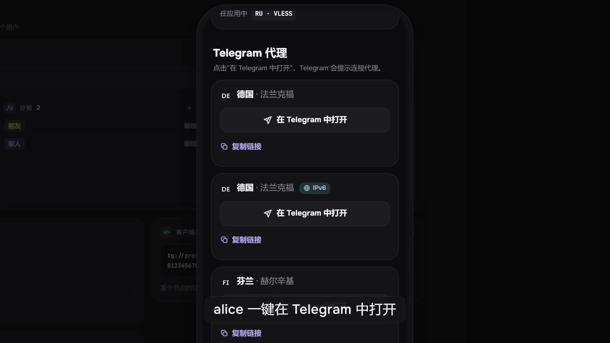

MTProto 是 Telegram 自己的代理协议。Mistgate 的 MTProto 协议配置会让它所在的每个节点成为**只服务于 Telegram 应用**的代理服务器：用户点一下链接，Telegram 就会把这个代理加入自己的设置，此后 Telegram 的流量经由节点转发。它不是 VPN：其他应用不会使用它，任何 VPN 应用也读不了它。本页列出 MTProto 协议配置的设置，以及用户如何拿到链接；协议配置如何创建并部署到节点，请参阅[协议配置](profiles.md)。



> **注意：** MTProto 是**实验性**功能。这是 Mistgate 中该协议的第一个版本，尚未在实际环境中得到验证；面板在选择协议的位置会注明它是实验性的。设置和行为之后仍可能变化。

## 何时有用，以及它的局限

在 Telegram 被封锁或限速、其他网络访问却正常的地方可以使用它；也可以把它当作 VPN 之外一条更轻量的、访问 Telegram 的备用途径。该代理使用 Fake TLS：对观察连接的人来说，它的开头与访问某个网站的普通 TLS 1.3 握手无异，而节点会把所有不是客户端的访问者交给一个真实站点（参见[握手中的名称](#握手中的名称)）。

它做不到的事：

- **在俄罗斯可能无法使用**。自 2026 年春季起，俄罗斯一直在成批地检测并封锁 MTProto 代理。一个代理可能用一周就失效。如果你的用户在俄罗斯，请预料到这一点，并把 VPN 协议配置（Hysteria2、VLESS）作为主要手段。
- **绿色检测结果不代表对你的用户有效**。面板的检测从面板所在的服务器发起，位于任何国家之外。它们只能说明节点工作正常，不能说明处于封锁国家内的网络会放行这个连接。在做出任何承诺之前，请在相关网络上试一下这个链接。
- **细心的探测者仍能分辨出它与真实站点的差别**。节点对 Fake TLS hello 的应答被设计成看起来像 TLS 1.3 服务器，但如果扫描时把它与真实站点的真实应答做对比，就能看出差异。这就是陌生访问者会被转到真实站点的原因，也是没有任何设置能让代理完全不可见的原因。
- **仅限 Telegram**。点击链接只会更改 Telegram 的代理设置，其他应用都不经过它。
- **没有中间代理**。节点直接连接 Telegram 的数据中心。Telegram 的推广频道（赞助标签）不可用；参见[尚未实现的功能](#尚未实现的功能)。

## 握手中的名称

Telegram 代理的密钥里带有一个域名：Telegram 会把它作为服务器名称放进 TLS 握手。节点只接受使用该名称和该用户密钥的握手，其余所有访问（其他名称、错误的密钥、被重放的 hello、普通 HTTP、浏览器和扫描器）都转到一个站点。域名按协议配置选择，在设置**TLS 握手中的名称**里设定：

| | 本节点的名称 | 其他站点 |
|:--|:--|:--|
| 域名 | 节点自己的主机名（或在该节点上为此协议配置设置的**域名（SNI）**） | 你指定的真实站点，例如 `www.example.org` |
| 陌生访问者在该端口上看到什么 | 节点自己的伪装站点，即 Hysteria2 和 VLESS 所展示的那个站点，并带有节点的证书 | 真实站点：节点把连接转交给它，因此探测者会与该站点完成一次真实的握手，并看到它的证书 |
| 节点上的 Let’s Encrypt | 继续可用，TCP 443 上也一样：验证请求在此端口上应答 | 在 TCP 443 上，节点自己的站点和该验证不在此处应答，因此节点证书通过 80 端口续期 |
| 只有 IP 地址的节点 | 不可行：没有可用的名称 | 可用 |
| 弱点 | 伪装站点必须与节点的名称相配，看起来自然 | 该域名不属于服务器的 IP 地址，部分网络会注意到这一点 |

如何选择：

- 在有域名的节点上，先选**本节点的名称**。陌生访问者看到的，与该节点其他协议上的伪装站点相同（[自有伪装站点](decoy-site.md)），节点上的其他一切都不变。
- 对只有 IP 地址的节点，或者你希望陌生访问者遇到一个知名大站时，选择**其他站点**。请选一个访问速度快、在你的用户所在地没有被封锁、并且与你毫无关系的站点。**不要使用面板的域名**：否则任何探测节点的人都会看到面板的地址。
- 在 TCP 443 上选择**其他站点**时，请保持节点的 80 端口可访问，否则其证书无法续期。协议配置编辑器会就此以及 IP 不匹配给出警告。
- 你指定的站点必须是普通主机名（`www.example.org`）：不能是 IP 地址，不能带端口或路径。

## 设置

编辑器将设置放在**基础**下。关键设置会改变用户已有的链接，因此用户必须重新添加新链接；编辑器保存前会先询问（请参阅[协议配置](profiles.md)）。

| 设置 | 默认值 | 是否关键 | 作用 |
|:--|:--|:--|:--|
| **TCP 端口** | 443 | 是 | 节点监听的 TCP 端口，范围为 1 至 65535。 |
| **TLS 握手中的名称** | 本节点的名称 | 是 | **本节点的名称**或**其他站点**。见上文。 |
| **站点** | 留空 | 是 | 仅适用于其他站点：该站点的主机名。 |

在节点上，协议配置可以有自己的**端口**；选择**本节点的名称**时，还可以有自己的**域名（SNI）**，它就是握手中的名称。

MTProto 是 TCP 协议配置。它不能与同一节点上的另一个 TCP 协议配置共用端口，例如 VLESS；如果节点上的 VLESS 已使用 443，请把 MTProto 放到另一个端口。Telegram 接受任何端口。Hysteria2 在 TCP 443 上显示的内置站点会让位于 MTProto，就像让位于 VLESS 一样（[在同一节点上运行 VLESS 和 Hysteria2](vless-and-hysteria2.md)）；选择**本节点的名称**时，访问该端口的人看到的仍是节点的站点。

节点的时钟在这里很重要。握手里带着客户端的时间，节点接受与自己时钟相差约五分钟以内的时间。时钟不准的节点会拒绝所有客户端；节点诊断的**时钟**检查会就此发出警告（参见[运行状况](../operations/health.md)）。

## 添加协议配置

1. 打开**协议配置**，点击**新建协议配置**。第一步是选择协议：选择 **MTProto** 卡片。第二步是表单。
2. 设置 **TCP 端口**和**TLS 握手中的名称**；选择**其他站点**时，填写**站点**。
3. 给协议配置起个名称，并说明它部署到哪里：部署到节点，并添加到分组。用户只有通过分组才能获得 Telegram，且该分组需要在用户可使用的节点上带有 MTProto 协议配置。
4. **创建协议配置**。

如果节点只有 IP 地址，而协议配置使用**本节点的名称**，节点会拒绝并给出原因：请为该节点上的协议配置输入域名，或选择**其他站点**。右侧的面板显示用户将获得的链接，密钥已隐藏。

节点 Agent 为 v0.1.69 或更新版本时，节点才能运行 MTProto。面板不会把该协议配置下发给较旧的 Agent：该服务器显示为未启动，原因是节点 Agent 过旧，节点上的其他内容照常更新。请在**更新**页面更新 Agent。

## 为用户开通 Telegram

Telegram 是用户上的一个开关，位于订阅链接和 AmneziaVPN 密钥旁边，在用户表单和用户卡片中都有。默认关闭。

- 开启后会立即生成用户的 **Telegram 密钥**：每人一个密钥，在其可使用的每个 MTProto 协议配置和节点上都相同。
- Telegram 开关是对 Happ 或 AmneziaVPN 的**补充**，而不是替代。这两者中至少要保持开启一个。
- 该密钥在用户的设备列表中显示为 **Telegram 代理**，但不占用设备上限的名额，因此不会因为名额不足而失败。关闭开关或删除用户都会吊销它。
- 只有用户处于有效状态，且其分组在用户可使用的节点上有 MTProto 协议配置时，用户才会获得链接。已停用、已过期或超出配额的用户，会连同其他访问权限一起失去代理。
- **链接不会写入任何订阅**。VPN 应用会把 `tg://` 行显示成一台损坏的服务器，而 Telegram 应用不读取任何订阅。链接只来自用户的页面或管理后台。

## 用户在哪里找到链接

- **用户自己的页面**。Telegram 对其开启时，服务器下方会有一个 **Telegram 代理**区块。每条链接以服务器所在的国家和位置命名，绝不使用面板中的节点名称，并带有**在 Telegram 中打开**和**复制链接**。代理就绪之前，区块会如实说明。参见[用户页面](user-page.md#telegram-代理)。
- **管理后台**。在**用户**中该用户的页面里，**Telegram 代理**区块列出这些链接，附带**在 Telegram 中打开**、复制和二维码，以及**重新签发**和**吊销**按钮。请通过任何你信任的渠道发送链接，或展示二维码。

链接形如下例，其中的密钥和名称为十六进制：

```ini
tg://proxy?server=de1.example.com&port=443&secret=ee<key><name>
```

链接就是密钥：任何持有它的人都可以使用该代理。请像对待密码一样对待它。Telegram 会在使用代理之前请用户确认。

## 重新签发与吊销

- **重新签发**会给用户一个新密钥。此前生成的所有链接会在所有节点上立即失效，使用旧密钥的已打开连接会被关闭。新链接会出现在区块中；用户需要在 Telegram 中添加它们。链接泄露时使用。
- **吊销**会收回密钥。链接消失，已打开的连接被关闭，该用户的 Telegram 开关仍保持开启，但没有密钥。可以在同一区块中重新生成密钥。
- 关闭 Telegram 开关，或移除 **Telegram 代理**设备，同样会吊销密钥。

一个密钥最多同时承载 64 个连接。Telegram 在最繁忙时每个账号大约打开 10 至 15 个连接，所以泄露的密钥最多只够少数几个人使用。10 分钟内没有数据的连接会被关闭。

## 中转与 IPv6 副本

用户的 Telegram 链接遵循与其他服务器相同的规则（参见[订阅](subscriptions.md#额外服务器经-ipv6-与经中转)），标签也相同：

- 如果节点有 [IPv6 入口](nodes.md#ipv6-入口)，就会多一条位于其 IPv6 地址上的链接，标记为 **IPv6**；
- 节点每有一条正常工作的[中转](relays.md)，就会多一条经入口节点的链接，标记为 **经 RU**（入口所在的国家）。中转原样转发连接，因此密钥和握手中的名称仍是出口的。

## 运行状况检测能证明什么

面板会以 Telegram 实际使用的方式检测每个 MTProto 协议配置，使用的是面板自己的、不属于任何用户的隐藏密钥（[运行状况](../operations/health.md#mtproto)）：

1. 通过 TCP 连接协议配置的端口；
2. 使用名称和密钥完成 Fake TLS 握手；
3. 经由代理向 Telegram 数据中心 2 发送第一条消息（`req_pq_multi`），并检查是否返回有效的应答。

因此，绿色单元格证明：节点接受客户端、能连到 Telegram，并且 Telegram 经由它做出应答。它不能证明封锁 MTProto 的国家境内的网络会放行流量。检测失败时，单元格会说明失败发生在哪一步。

## 尚未实现的功能

- **中间代理和推广频道**。节点直接与 Telegram 的数据中心通信。不支持 Telegram 自己的代理配置，因此也不支持代理可以显示的赞助标签。
- **按用户和按设备限速**。用户卡片上的限速适用于 Hysteria2 和 VLESS，不适用于 Telegram 代理。
- **只有 Telegram 的用户**。Telegram 须与 Happ 或 AmneziaVPN 一起使用；用户不能只有代理而没有其他方式。
- **按真实站点调整伪造应答的形态**。节点目前不会测量站点的真实握手并复制其形态。
