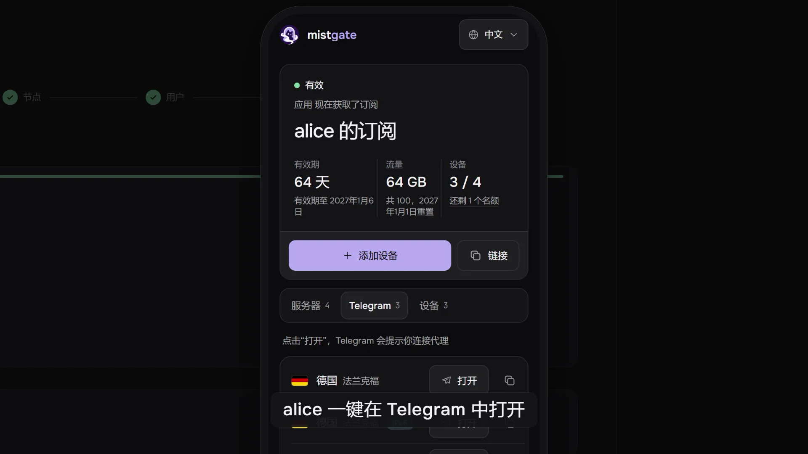

MTProto 是 Telegram 自己的代理协议。Mistgate 的 MTProto 协议配置会让它所在的每个节点成为**只服务于 Telegram 应用**的代理服务器：用户点一下链接，Telegram 就会把这个代理加入自己的设置，此后 Telegram 的流量经由节点转发。它不是 VPN：其他应用不会使用它，任何 VPN 应用也读不了它。本页列出 MTProto 协议配置的设置，以及用户如何拿到链接；协议配置如何创建并部署到节点，请参阅[协议配置](profiles.md)。协议配置也可以运行在 **Web** 模式下，它给用户的是另一种链接，详见 [Web Proxy](#web-proxy)。



> **注意：** MTProto 是**实验性**功能。这是 Mistgate 中该协议的第一个版本，尚未在实际环境中得到验证；面板在选择协议的位置会注明它是实验性的。设置和行为之后仍可能变化。

## 何时有用，以及它的局限

在 Telegram 被封锁或限速、其他网络访问却正常的地方可以使用它；也可以把它当作 VPN 之外一条更轻量的、访问 Telegram 的备用途径。该代理使用 Fake TLS：对观察连接的人来说，它的开头与访问某个网站的普通 TLS 1.3 握手无异，而节点会把所有不是客户端的访问者交给一个真实站点（参见[握手中的名称](#握手中的名称)）。

它做不到的事：

- **在俄罗斯可能无法使用**。自 2026 年春季起，俄罗斯一直在成批地检测并封锁 MTProto 代理。一个代理可能用一周就失效。如果你的用户在俄罗斯，请预料到这一点，并把 VPN 协议配置（Hysteria2、VLESS）作为主要手段。
- **绿色检测结果不代表对你的用户有效**。面板的检测从面板所在的服务器发起，位于任何国家之外。它们只能说明节点工作正常，不能说明处于封锁国家内的网络会放行这个连接。在做出任何承诺之前，请在相关网络上试一下这个链接。
- **细心的探测者仍能分辨出它与真实站点的差别**。节点对 Fake TLS hello 的应答被设计成看起来像 TLS 1.3 服务器，但如果扫描时把它与真实站点的真实应答做对比，就能看出差异。这就是陌生访问者会被转到真实站点的原因，也是没有任何设置能让代理完全不可见的原因。
- **仅限 Telegram**。点击链接只会更改 Telegram 的代理设置，其他应用都不经过它。
- **没有中间代理**。节点直接连接 Telegram 的数据中心。Telegram 的推广频道（赞助标签）不可用；参见[尚未实现的功能](#尚未实现的功能)。

## 握手中的名称

Telegram 代理的密钥里带有一个域名：Telegram 会把它作为服务器名称放进 TLS 握手。节点只接受使用该名称和该用户密钥的握手，其余所有访问（其他名称、错误的密钥、被重放的 hello、普通 HTTP、浏览器和扫描器）都转到一个站点。域名按协议配置选择，在设置**TLS 握手中的名称**里设定：

| | 本节点的名称 | 其他站点 |
|:--|:--|:--|
| 域名 | 节点自己的主机名（或在该节点上为此协议配置设置的**域名（SNI）**） | 你指定的真实站点，例如 `www.example.org` |
| 陌生访问者在该端口上看到什么 | 节点自己的伪装站点，即 Hysteria2 和 VLESS 所展示的那个站点，并带有节点的证书 | 真实站点：节点把连接转交给它，因此探测者会与该站点完成一次真实的握手，并看到它的证书 |
| 节点上的 Let’s Encrypt | 继续可用，TCP 443 上也一样：验证请求在此端口上应答 | 在 TCP 443 上，节点自己的站点和该验证不在此处应答，因此节点证书通过 80 端口续期 |
| 只有 IP 地址的节点 | 不可行：没有可用的名称 | 可用 |
| 弱点 | 伪装站点必须与节点的名称相配，看起来自然 | 该域名不属于服务器的 IP 地址，部分网络会注意到这一点 |

如何选择：

- 在有域名的节点上，先选**本节点的名称**。陌生访问者看到的，与该节点其他协议上的伪装站点相同（[自有伪装站点](decoy-site.md)），节点上的其他一切都不变。
- 对只有 IP 地址的节点，或者你希望陌生访问者遇到一个知名大站时，选择**其他站点**。请选一个访问速度快、在你的用户所在地没有被封锁、并且与你毫无关系的站点。**不要使用面板的域名**：否则任何探测节点的人都会看到面板的地址。
- 在 TCP 443 上选择**其他站点**时，请保持节点的 80 端口可访问，否则其证书无法续期。协议配置编辑器会就此以及 IP 不匹配给出警告。
- 你指定的站点必须是普通主机名（`www.example.org`）：不能是 IP 地址，不能带端口或路径。

## 设置

编辑器将设置放在**基础**下。关键设置会改变用户已有的链接，因此用户必须重新添加新链接；编辑器保存前会先询问（请参阅[协议配置](profiles.md)）。

| 设置 | 默认值 | 是否关键 | 作用 |
|:--|:--|:--|:--|
| **模式** | Fake TLS | 是 | **Fake TLS** 或 **Web**。Web 即 [Web Proxy](#web-proxy)：端口固定为 443，名称是节点自己的名称。除非另有说明，本页其余部分讲的都是 Fake TLS。 |
| **TCP 端口** | 443 | 是 | 节点监听的 TCP 端口，范围为 1 至 65535。Web 模式下固定为 443。 |
| **TLS 握手中的名称** | 本节点的名称 | 是 | **本节点的名称**或**其他站点**。见上文。Web 模式没有这个选择：编辑器会把它隐藏。 |
| **站点** | 留空 | 是 | 仅适用于其他站点：该站点的主机名。 |

在节点上，协议配置可以有自己的**端口**；选择**本节点的名称**时，还可以有自己的**域名（SNI）**，它就是握手中的名称。

MTProto 是 TCP 协议配置。在节点上另一个 TCP 协议配置（例如 VLESS）已占用的 TCP 端口上，只有当两者各自有自己的名称、且其中一个展示节点自己的站点时，它才能并排放在旁边：见[一个 443，多个服务共用](shared-port.md)。面板会为你新添加的协议配置建议新名称，所以已在端口上的服务保留它的名称和 `tg://` 链接。否则请把 MTProto 放到另一个端口；Telegram 接受任何端口。Hysteria2 在 TCP 443 上显示的内置站点会让位于 MTProto，就像让位于 VLESS 一样（[在同一节点上运行 VLESS 和 Hysteria2](vless-and-hysteria2.md)）；选择**本节点的名称**时，访问该端口的人看到的仍是节点的站点。

节点的时钟在这里很重要。握手里带着客户端的时间，节点接受与自己时钟相差约五分钟以内的时间。时钟不准的节点会拒绝所有客户端；节点诊断的**时钟**检查会就此发出警告（参见[运行状况](../operations/health.md)）。

## 添加协议配置

1. 打开**协议配置**，点击**新建协议配置**。第一步是选择协议：选择 **MTProto** 卡片。第二步是表单。
2. 设置 **TCP 端口**和**TLS 握手中的名称**；选择**其他站点**时，填写**站点**。
3. 给协议配置起个名称，并说明它部署到哪里：部署到节点，并添加到分组。用户只有通过分组才能获得 Telegram，且该分组需要在用户可使用的节点上带有 MTProto 协议配置。
4. **创建协议配置**。

如果节点只有 IP 地址，而协议配置使用**本节点的名称**，节点会拒绝并给出原因：请为该节点上的协议配置输入域名，或选择**其他站点**。右侧的面板显示用户将获得的链接，密钥已隐藏。

节点 Agent 为 v0.1.69 或更新版本时，节点才能运行 MTProto。面板不会把该协议配置下发给较旧的 Agent：该服务器显示为未启动，原因是节点 Agent 过旧，节点上的其他内容照常更新。请在**更新**页面更新 Agent。

## 为用户开通 Telegram

Telegram 是用户上的一个开关，位于订阅链接和 AmneziaVPN 密钥旁边，在用户表单和用户卡片中都有。默认关闭。

- 开启后会立即生成用户的 **Telegram 密钥**：每人一个密钥，在其可使用的每个 MTProto 协议配置和节点上都相同。
- Telegram 开关是对 Happ 或 AmneziaVPN 的**补充**，而不是替代。这两者中至少要保持开启一个。
- 该密钥在用户的设备列表中显示为 **Telegram 代理**，但不占用设备上限的名额，因此不会因为名额不足而失败。关闭开关或删除用户都会吊销它。
- 只有用户处于有效状态，且其分组在用户可使用的节点上有 MTProto 协议配置时，用户才会获得链接。已停用、已过期或超出配额的用户，会连同其他访问权限一起失去代理。
- **链接不会写入任何订阅**。VPN 应用会把 `tg://` 行显示成一台损坏的服务器，而 Telegram 应用不读取任何订阅。链接只来自用户的页面或管理后台。

## 用户在哪里找到链接

- **用户自己的页面**。Telegram 对其开启时，服务器下方会有一个 **Telegram 代理**区块。每条链接以服务器所在的国家和位置命名，绝不使用面板中的节点名称，并带有**在 Telegram 中打开**和**复制链接**。代理就绪之前，区块会如实说明。参见[用户页面](user-page.md#telegram-代理)。
- **管理后台**。在**用户**中该用户的页面里，**Telegram 代理**区块列出这些链接，附带**在 Telegram 中打开**、复制和二维码，以及**重新签发**和**吊销**按钮。请通过任何你信任的渠道发送链接，或展示二维码。

链接形如下例，其中的密钥和名称为十六进制：

```ini
tg://proxy?server=de1.example.com&port=443&secret=ee<key><name>
```

链接就是密钥：任何持有它的人都可以使用该代理。请像对待密码一样对待它。Telegram 会在使用代理之前请用户确认。

## 重新签发与吊销

- **重新签发**会给用户一个新密钥。此前生成的所有链接会在所有节点上立即失效，使用旧密钥的已打开连接会被关闭。新链接会出现在区块中；用户需要在 Telegram 中添加它们。链接泄露时使用。
- **吊销**会收回密钥。链接消失，已打开的连接被关闭，该用户的 Telegram 开关仍保持开启，但没有密钥。可以在同一区块中重新生成密钥。
- 关闭 Telegram 开关，或移除 **Telegram 代理**设备，同样会吊销密钥。

一个密钥最多同时承载 64 个连接。Telegram 在最繁忙时每个账号大约打开 10 至 15 个连接，所以泄露的密钥最多只够少数几个人使用。10 分钟内没有数据的连接会被关闭。

## 中转与 IPv6 副本

用户的 Telegram 链接遵循与其他服务器相同的规则（参见[订阅](subscriptions.md#额外服务器经-ipv6-与经中转)），标签也相同：

- 如果节点有 [IPv6 入口](nodes.md#ipv6-入口)，就会多一条位于其 IPv6 地址上的链接，标记为 **IPv6**；
- 节点每有一条正常工作的[中转](relays.md)，就会多一条经入口节点的链接，标记为 **经 RU**（入口所在的国家）。中转原样转发连接，因此密钥和握手中的名称仍是出口的。

Web Proxy 链接既没有 IPv6 副本，也不能中转：参见 [Web Proxy](#web-proxy)。

## 运行状况检测能证明什么

面板会以 Telegram 实际使用的方式检测每个 MTProto 协议配置，使用的是面板自己的、不属于任何用户的隐藏密钥（[运行状况](../operations/health.md#mtproto)）：

1. 通过 TCP 连接协议配置的端口；
2. 使用名称和密钥完成 Fake TLS 握手；
3. 经由代理向 Telegram 数据中心 2 发送第一条消息（`req_pq_multi`），并检查是否返回有效的应答。

因此，绿色单元格证明：节点接受客户端、能连到 Telegram，并且 Telegram 经由它做出应答。它不能证明封锁 MTProto 的国家境内的网络会放行流量。检测失败时，单元格会说明失败发生在哪一步。

## Web Proxy

> **警告：** **Web** 模式**正在开发中**，尚未在真实的 Telegram 应用上试过：应用从节点加载的页面目前还只是占位，也没有拿真实的 Telegram 应用对照检验过。请先不要把 Web 链接发给用户。本节描述的是面板和节点目前的行为。

处于 **Web** 模式的协议配置会给出另一种 Telegram 链接，即 `tg://webproxy`。这里没有 Fake TLS 握手：Telegram 应用像浏览器访问网站那样，通过 HTTPS 访问节点上的一个名称，并在这条连接上承载自己的流量。没有密钥而访问该名称的人，看到的是节点自己的站点。

Web Proxy 与本页其他代理一样，是给 **Telegram 应用**（Desktop、Android 和 iOS）用的代理。它不是浏览器里的 Telegram Web：浏览器标签页不会使用它。各应用的支持目前还不均衡：较新版本的 Telegram Desktop 已经支持，手机端则要等各应用陆续加入。不认识 `tg://webproxy` 的应用无法使用这种链接。

### 它与 Fake TLS 有何不同

| | Fake TLS | Web |
|:--|:--|:--|
| 链接 | `tg://proxy`，密钥以 `ee` 开头 | `tg://webproxy`，密钥以 `dd` 开头 |
| 连接看起来像什么 | 与某个站点的 TLS 1.3 握手，之后是 Telegram 自己的协议 | 通过 HTTPS 访问某个主机名，并使用该名称的真实证书 |
| 端口 | 任意 TCP 端口，默认 443 | 只能是 443 |
| 名称 | 在密钥中：节点的名称或其他站点 | 节点自己的名称；不能用其他站点 |
| 陌生访问者看到什么 | 节点的伪装站点，或你指定的其他站点 | 节点自己的站点 |
| 中转与 IPv6 副本 | 有 | 没有 |
| 节点 Agent | v0.1.69 或更新版本 | 声明了 `mtproto-web/1` 的 Agent |

用户的 Telegram 密钥对两种链接是同一个：每人一个密钥，因此重新签发或吊销它会让两种链接同时失效。

### 何时选择它

Web 模式比 Fake TLS 更新，也未经验证，所以请把它当作 Fake TLS 之外的第二条途径，而不是替代。它适合这样的节点：你希望代理看起来像是在以自己的名称访问一个普通站点，而用户的 Telegram 应用又支持它。请同时给这些人一个 Fake TLS 协议配置：用户会拿到其可使用节点上每个 MTProto 协议配置的链接，当某一种在其网络中不通时，另一种也许仍然可用。

如果你需要 443 以外的端口、中转或 IPv6 副本，或者用户的应用还不认识 `tg://webproxy`，请选择 Fake TLS。

### 它需要什么

- **协议配置在节点上的专用名称。** 带点的主机名，例如 `tg.example.com`，并配有指向节点的 DNS 记录（值为 `192.0.2.10` 的 `A` 记录），且不经过代理（Cloudflare 上的灰色云朵）。它可以是节点自己的主机名，也可以是你在该节点上为协议配置设置的**域名（SNI）**。最好用专用名称：如果 TCP 443 上已有另一个服务使用节点的名称，第二个服务就不能使用同一名称（`sni_taken`）。只有 IP 地址的节点无论如何都需要这个名称。名称指向节点之后，节点会自行向 Let’s Encrypt 申请该名称的证书；在此之前客户端无法连接，运行状况检测会说明证书尚未签发。
- **节点的 TCP 443：空闲或共用。** Web 协议配置可以独占 TCP 443，也可以与 VLESS、TrustTunnel 和 Fake TLS 的 MTProto 在共用端口上并排运行，各用各的名称：参见[一个 443，多个服务共用](shared-port.md)。它展示节点自己的站点，因此节点上的其他服务可以与它共用端口。
- **声明了 `mtproto-web/1` 的节点 Agent。** 较旧的 Agent 会忽略该模式，并在同一协议配置下启动 Fake TLS 服务器，所以面板不会把这种协议配置发给它（见下文“限制”）。

### 如何开启

1. 准备好名称，并添加它的 DNS 记录，如上所述。
2. 打开**协议配置**，点击**新建协议配置**，选择 **MTProto** 卡片。
3. 把**模式**设为 **Web**。编辑器会把 **TCP 端口**设为 443 并锁定，隐藏 **TLS 握手中的名称**，并在**模式**下提示协议配置需要在节点上使用专用子域名。**模式**是关键设置：对已有的协议配置修改它，会改变用户手里已有的链接（参见[协议配置](profiles.md)）。
4. 给协议配置起名，部署到节点并添加到分组，然后点击**创建协议配置**。如果节点的 TCP 443 已被其他服务占用，窗口会询问名称并显示 DNS 记录（**并排放在 443**，参见[一个 443，多个服务共用](shared-port.md#在管理后台)）。否则，请在该节点的 **域名（SNI）** 里填入名称，或留空以使用节点的主机名。
5. 添加 DNS 记录。证书签发后，协议配置在[运行状况](../operations/health.md)中的单元格会变绿。

如果协议配置在某个节点上有自己的端口且不是 443，它就不会在那里启动。保存之前编辑器会就此给出警告：请在协议配置的**节点上的服务器**标签页中取消该端口。只有 IP 地址、又没有设置 **域名（SNI）** 的节点会拒绝该协议配置并给出原因，这与 Fake TLS 一样。

### 用户会看到什么

为用户开通 Telegram 的方式没有变化：同一个开关，同一个密钥。用户页面上的 **Telegram 代理**区块，以及管理后台里的同名区块，会把 Web 链接显示为带 **Web** 标记的一行；标记上的提示说明这是 Web Proxy 链接。它与其他链接一样按服务器所在的国家和位置命名，并带有**在 Telegram 中打开**和**复制链接**（管理后台里还有二维码）。链接形如：

```ini
tg://webproxy?server=tg.example.com&port=443&secret=dd<key>
```

其中 `server` 是协议配置在节点上的名称，而不是节点的地址；密钥就是用户的 Telegram 密钥。与 Fake TLS 一样，链接就是密钥。

### 陌生访问者会看到什么

没有密钥的人得到的是节点自己的站点（[自有伪装站点](decoy-site.md)）：任何路径都一样，包括看起来像应用请求、但带着错误或已吊销密钥的请求，并且使用该名称的真实证书。只有持有密钥的人才能拿到应用所用的隐藏页面；密钥重新签发或吊销后，旧链接遇到的就是那个站点。这不等于不可见：与所有 Let’s Encrypt 名称一样，该名称会出现在公开的证书日志里，知道它的访问者会在那里看到一个普通站点。

### 限制

- **只限 Telegram 应用**，而且只限支持 Web Proxy 的那些。浏览器标签页不会使用它。
- **没有通话。** 通话无法经由 Web Proxy 进行；这是 Telegram 应用里 Web Proxy 本身的限制，不是 Mistgate 的。
- **只能是 443 端口。** 协议配置的端口不能更改，在节点上设置自己的端口也会被拒绝。
- **没有中转，也没有 IPv6 副本。** 链接携带的是名称而不是地址，所以另一个地址上的副本只会是同一条链接的复制品。中转会以原因 `webproxy` 被拒绝：管理后台会显示“Web Proxy 只能直接连到节点”，MCP 的 `relay_candidates` 会把该服务器列为不支持。
- **较新的节点 Agent。** 面板只把协议配置发给声明了 `mtproto-web/1` 的 Agent。较旧的 Agent 上，服务器显示为未启动，并提示节点的 Agent 低于此协议配置的要求、请在**更新**页面更新节点；节点上的其他内容照常更新。
- **每个密钥的限制与 Fake TLS 相同：** 同时最多 64 个连接。
- **实验性**，与整个协议一样。

### 面板如何检测它

面板用自己的客户端而不是 Telegram 应用来检测 Web 协议配置，使用的是协议配置的隐藏检测密钥：

1. 通过 TCP 连接节点的 443 端口，在 TLS hello 中放入协议配置的名称，并检查该名称的证书；
2. 像应用那样请求隐藏页面，只有节点接受密钥时才拿得到；
3. 经由节点打开一个会话和一条流；
4. 向 Telegram 数据中心 2 发送第一条消息（`req_pq_multi`），并检查是否返回有效的应答；
5. 关闭会话。

绿色单元格证明：节点、证书、节点站点上的 Web Proxy 服务以及 Telegram 数据中心都工作正常。它不能证明 Telegram 应用会接受该页面，也不能证明封锁 MTProto 的国家境内的网络会放行流量。检测失败时，单元格会说明失败发生在哪一步。以下是各代码，以及单元格自己对它们的说法：

| 代码 | 单元格显示 | 对 Web Proxy 意味着什么 |
|:--|:--|:--|
| `refused` | 连接被拒绝：端口上没有程序在监听 | 到 443 端口的 TCP 连接失败：协议配置没有启动，或被防火墙挡住 |
| `timeout` | 未在规定时间内应答：握手或首个请求没有完成 … | 某一步没有及时应答：连接、页面、会话或 Telegram 数据中心 |
| `tls` | 证书或域名不匹配 | 与该名称的安全连接失败：证书尚未签发（DNS 记录缺失或刚添加）、证书属于另一个名称，或连接在页面返回之前就断了 |
| `auth` | 节点拒绝了面板的检测账户 | 节点用自己的站点而不是隐藏页面作答：它不接受检测密钥，例如因为协议配置刚被修改而节点还没有应用 |
| `session` | 节点无法创建 Web Proxy 传输会话 | 页面拿到了，但节点没有创建会话或打开流 |
| `exit_unreachable` | 隧道正常，但节点通往互联网的出口不通 | 会话正常，但 Telegram 数据中心 2 没有返回有效的 `resPQ`：节点够不到 Telegram 的地址 |

## 尚未实现的功能

- **中间代理和推广频道**。节点直接与 Telegram 的数据中心通信。不支持 Telegram 自己的代理配置，因此也不支持代理可以显示的赞助标签。
- **按用户和按设备限速**。用户卡片上的限速适用于 Hysteria2 和 VLESS，不适用于 Telegram 代理。
- **只有 Telegram 的用户**。Telegram 须与 Happ 或 AmneziaVPN 一起使用；用户不能只有代理而没有其他方式。
- **按真实站点调整伪造应答的形态**。节点目前不会测量站点的真实握手并复制其形态。
- **Web Proxy 的其余部分**。目前只做了 HTTPS 承载：没有 WebSocket，也没有按流承载。经入口节点的中转同样没有做（见上文“限制”）。
