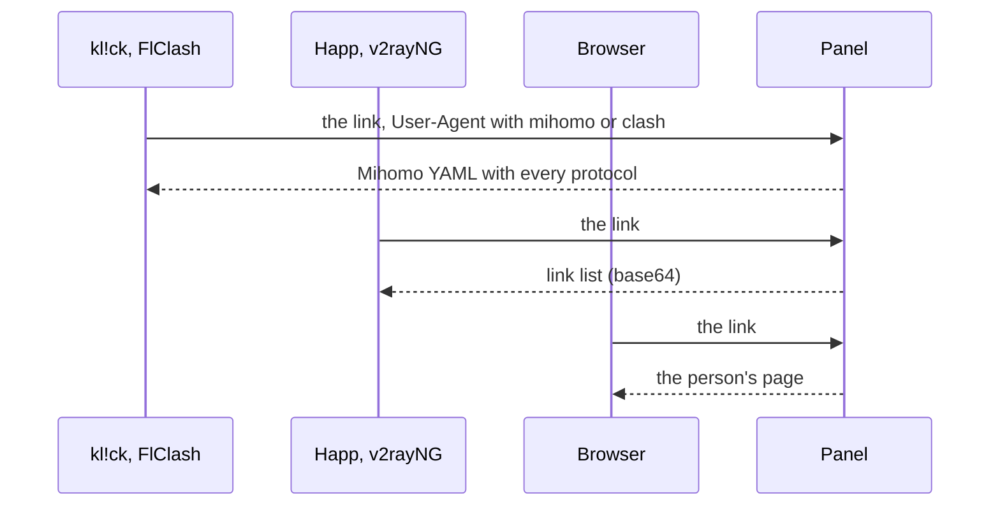

每位用户都有一个订阅链接。同一个链接会向订阅类应用提供服务器列表，向基于 mihomo 内核的应用提供完整配置，也会在浏览器中打开该用户自己的页面。**订阅**部分决定每个应用会获取什么，以及用户会看到什么。此部分有五个标签页：**应用与格式**、**下发规则**、**名称与文本**、**用户页面** 和 **DNS**。

## 链接

链接格式如下：

```ini
https://sub.example.com/<secret prefix>/<token>
```

- 面板服务器上的 `mistgate setup` 用于设置链接基础地址，包含保密前缀；**设置** → **域名**会向所有者显示**订阅链接基础地址**。未设置此地址时，系统不会发放链接。参见[安装面板](../getting-started/install-panel.md)。
- 令牌只属于该用户，必须保密。用户卡片上的**订阅链接**会显示链接和二维码；**生成新链接**会替换旧链接，旧链接会立即失效（页面密码也会随之更改）。
- 无人拥有的链接会像站点上的其他未知路径一样响应，因此无法通过猜测找到链接。

## 格式

| 格式 | 内容 | 默认适用对象 |
|:--|:--|:--|
| **链接列表（base64）** | 每台服务器对应一个分享链接，按纯文本列表排列。Happ、v2rayNG、Hiddify 和大多数其他应用都支持。 | 没有匹配规则的应用。 |
| **网页** | 用户页面：包含说明、二维码和用户流量。参见[用户页面](user-page.md)。 | 在浏览器中打开链接的所有人。 |
| **Mihomo YAML** | 适用于 Mihomo 和 Clash Meta 的完整配置，包含用户拥有的所有协议。 | 按 `mihomo` 和 `clash` 规则匹配的基于 mihomo 内核的应用（kl!ck、Clash Meta、FlClash、Clash Verge）。 |
| **伪装 404** | 模拟链接不存在。适合按 User-Agent 屏蔽爬虫。 | 尚未设置匹配规则时，无人使用。 |



**应用与格式**标签页会列出各协议支持的应用及其读取格式：Happ 读取链接列表，Mihomo / Clash Meta（kl!ck 和其他基于 mihomo 内核的应用）读取 Mihomo YAML，AmneziaVPN 则不读取订阅（它从用户页面获取 `vpn://` 密钥）。

**计划中**：更多格式（Xray JSON、sing-box）和订阅镜像。

## 下发规则

**下发规则**标签页会按从上到下的顺序列出规则。每条规则包含一段文本和一种格式：User-Agent 中包含此文本（不区分大小写）的应用会获取对应格式。按顺序使用第一个匹配规则。没有匹配项时，使用最后一行**其他所有情况**：浏览器会获取网页，其他应用会获取链接列表。

新面板默认有两条规则：`mihomo` 和 `clash`，两者都使用 **Mihomo YAML**。

- **添加规则**：设置 **User-Agent 包含**和**提供**。
- 拖动规则或使用箭头调整顺序。更改会立即保存。
- 删除规则后，几秒内可以通过提示消息将其恢复。
- 最多 50 条规则；两条规则不能使用相同文本。

浏览器的判定方法：User-Agent 以 `Mozilla/` 开头，包含浏览器引擎（`AppleWebKit`、`Gecko/`、`Firefox/`、`Trident/`），且未标明已知 VPN 应用（Happ、v2ray、clash、mihomo、hiddify、sing-box、streisand、shadowrocket、karing、flclash、nekobox、okhttp、cfnetwork）。如果某个不常见的应用看起来像浏览器，可以为它添加规则。

**测试 User-Agent**：粘贴应用发送的内容，或选择示例；标签页会显示匹配的规则（「规则 2 匹配 → Mihomo YAML」、「没有匹配的规则，且看起来是浏览器 → 网页」、「没有匹配的规则 → 链接列表」）。

## 应用会收到什么

每次向应用提供订阅时，除服务器信息外，还会附带订阅类应用会读取的响应头：

| 响应头 | 内容 |
|:--|:--|
| `Profile-Title` | 订阅名称（**应用内显示名称**）。 |
| `Subscription-Userinfo` | 当前周期的上传和下载流量、配额（0 表示不限）以及有效期结束时间（0 表示永不过期）。 |
| `Profile-Update-Interval` | 应用重新获取链接的间隔，单位为小时。 |
| `Profile-Web-Page-Url` | 链接本身，即应用中指向用户页面的按钮。 |
| `Announce` | 公告，或订阅无法使用的原因。 |
| `Support-Url` | 支持链接。 |
| `Routing` | 仅供 Happ 使用：用户的 DNS 预设，以 Happ 路由配置形式提供。参见[DNS](dns.md)。 |

Mihomo YAML 会包含相同的响应头、包含所有服务器的一个代理组，以及根据用户 DNS 预设生成的 `dns:` 部分。

## 名称与文本

| 设置 | 作用 |
|:--|:--|
| **应用内显示名称** | 显示在 Happ 列表顶部，最多 100 个字符。留空时使用面板名称（品牌名）。 |
| **公告** | 显示在服务器列表上方的一到两行文字，最多 1000 个字符；用户页面也会显示此内容。计数器会显示 Happ 展示的字符数：200 个字符。超长文本会在词语边界处截断，并在应用中显示「…」。 |
| **联系链接** | 从「联系我们」按钮打开。可填写 Telegram 链接（`https://t.me/…` 或 `tg://resolve?domain=…`）或网页链接（`https://…`）。 |
| **更新间隔** | 1–72 小时，默认 12 小时：应用重新下载订阅的间隔。 |

**服务器显示名称**是一个最多 100 个字符的模板，由多个部分组成：

| 模板部分 | 生成内容 |
|:--|:--|
| `{flag}` | 节点所在国家的旗帜表情符号。 |
| `{country}` | 节点所在国家的两位字母代码（`DE`）。 |
| `{node}` | 节点名称。 |
| `{profile}` | 协议配置名称。 |

默认模板为 `{flag} {country} · {profile}`，例如：「🇩🇪 DE · Hysteria2」。协议配置名称来自面板，因此可以轻松区分协议变体和 WARP 副本。只有完整名称重复时才会添加编号。没有国家代码的节点只显示协议配置名称；如果名称也为空，则使用节点名称。只有名称以旗帜表情符号开头时，Happ 才会将旗帜用作服务器图标。

链接列表中的名称最多为 30 个字符，这是 Happ 对服务器名称的长度限制（一面旗帜按四个字符计算）：名称过长时，会先缩短协议配置名称开头的协议名（Hysteria2 缩写为 HY2、AmneziaWG 缩写为 AWG、WireGuard 缩写为 WG），然后截断名称。Mihomo YAML 会保留完整名称。

在 Happ 中，服务器名称末尾还会附带当前负载（例如「🇩🇪 DE · Hysteria2 · 64%」）：取 CPU 使用率；如果节点**设置**中填写了**网络带宽**且链路占用率更高，则取接收和发送中较高一方占带宽的比例。其他应用和 Mihomo 配置中的名称不带负载信息：它们会按名称记住用户选择的服务器，名称变化会导致每次更新订阅时都重置选择。

**在应用中的效果**会按 Happ 的显示方式展示服务器列表及其负载，也会使用成员人数最多的分组中的服务器；如果没有分组服务器，则显示虚构服务器。

## 订阅无法使用时

用户已停用、有效期已结束或超出配额时，应用不会收到空列表。它们会收到一条永远无法连接的记录，名称和公告都会替换为面板默认语言中的对应原因：

| 原因 | 文本 |
|:--|:--|
| 有效期已结束 | 「订阅已于9月29日到期。联系我们即可续期」（日期未知时：「订阅已到期。联系我们即可续期」） |
| 超出配额，且有重置时间 | 「流量已用完，10月1日重置」 |
| 超出配额，且没有重置时间 | 「流量已用完。联系我们提高额度」 |
| 已停用 | 「访问已暂停」 |

英语界面对应：「Subscription ended on 29 September. Message us to renew」、「Traffic used up, resets on 1 October」、「Traffic used up. Message us to raise the limit」、「Access paused」。俄语界面对应：「Подписка закончилась 29 сентября. Напишите — продлим」、「Трафик закончился, обнулится 1 октября」、「Трафик закончился. Напишите — увеличим」、「Доступ приостановлен」。

此类用户的更新间隔会缩短到 1 小时，因此问题修复后（延长有效期、提高配额）很快就会同步到应用。用户页面也会以用户使用的语言说明相同情况。

## 用户页面

**用户页面**标签页包含页面选项和推荐应用，并提供实时预览。详情参见[用户页面](user-page.md)。

### 用户页面中的应用

页面会按列表顺序为每个平台上的每个应用显示一张卡片。一个平台可以有多个应用。每个应用包含：

| 字段 | 内容 |
|:--|:--|
| 平台和类型 | iOS、Android、Windows、macOS 或 Linux；**订阅链接** 或 **AmneziaWG 密钥**。 |
| **应用名称** | 显示在卡片上。 |
| **下载链接** | `https://` 链接：应用商店页面或文件。 |
| **「添加」链接模板** | 一键打开应用并添加订阅的链接。占位符：`{url}` 表示订阅链接，`{url_enc}` 是 URL 编码后的链接，`{name_enc}` 是编码后的订阅名称。留空时，页面会提供复制链接的选项。会拒绝脚本类 URL scheme（`javascript:`、`data:` 等）。 |
| **卡片上的说明** | 纯文本，最多 80 个字符。留空时，卡片会说明应用的连接方式。 |
| **推荐** | 卡片上的标记；推荐应用会排在该平台应用的前面。 |

**添加应用**时需要选择平台，然后选择**已知应用**（kl!ck、Happ、AmneziaVPN、Clash Verge Rev、FlClash、Clash Meta for Android、Hiddify、v2rayNG；系统会填入该平台应用的名称、类型、下载链接和添加链接模板），或者选择一种**接入方式**来创建空白卡片。所有字段都可以编辑。箭头可调整同一平台下应用的顺序。最多可添加 30 个应用。

新面板会在 Windows 和 macOS 上推荐 kl!ck（Happ 排在第二位），在 iOS 和 Android 上推荐 Happ，并在所有五个平台上提供 AmneziaVPN 密钥（手机端提供应用商店链接，其他平台提供 AmneziaVPN 网站链接）。有关各平台适用的应用、应用会获取的内容和一键链接工作方式，参见[客户端应用](client-apps.md)。

### 页面选项

| 选项 | 默认值 | 作用 |
|:--|:--|:--|
| **显示公告** | 开启 | 显示**名称与文本**中的内容。 |
| **联系按钮** | 开启 | 打开支持链接。 |
| **用于第二台设备的二维码** | 开启 | 当用户在手机上打开链接时很方便。 |
| **页面密码** | 开启 | 每位用户的页面都会要求输入密码，每台设备只需输入一次。应用获取订阅时无需密码。 |
| **页面上的设备** | 开启 | 用户可以在自己的页面上添加、重新获取密钥和移除 AmneziaWG 设备，但不能超过设备上限。 |
| **页面上的 DNS 选择** | 关闭 | 用户可以在自己的页面上按服务器选择 DNS，选项来自所有者为每个节点提供的预设。只有 AmneziaWG 密钥支持按服务器选择。参见[DNS](dns.md) 和 [用户页面](user-page.md)。 |

添加、移动或删除规则后会立即保存。**名称与文本**和**用户页面**中的更改需点击底部栏中的**保存**才会生效（点击**放弃更改**会丢弃这些更改）。无论哪种情况，更改都会在下次获取订阅时生效，无需重启。

## 链接保护

- **获取次数**。每个链接每小时最多响应 60 次；超过后会返回「请求过多」。间隔不到 10 秒的请求会获得相同响应。
- **猜测链接**。一分钟内尝试猜测 20 个未知链接的网络（IPv4 为 /24，IPv6 为 /48）会在 15 分钟内只能收到伪装 404，即使使用有效链接也一样。
- **分享链接**。一天内同一个链接被 8 个以上网络使用时，面板会记录事件「一个订阅链接每天在 9 个网络中使用」，并发出「疑似共享订阅」告警。面板只统计网络数，不保存地址。旧链接泄露时，生成新链接。

## 谁可以执行哪些操作

所有管理员都可以查看这些设置并测试 User-Agent。所有者和协作者可以更改设置。DNS 标签页详见[DNS](dns.md)。
