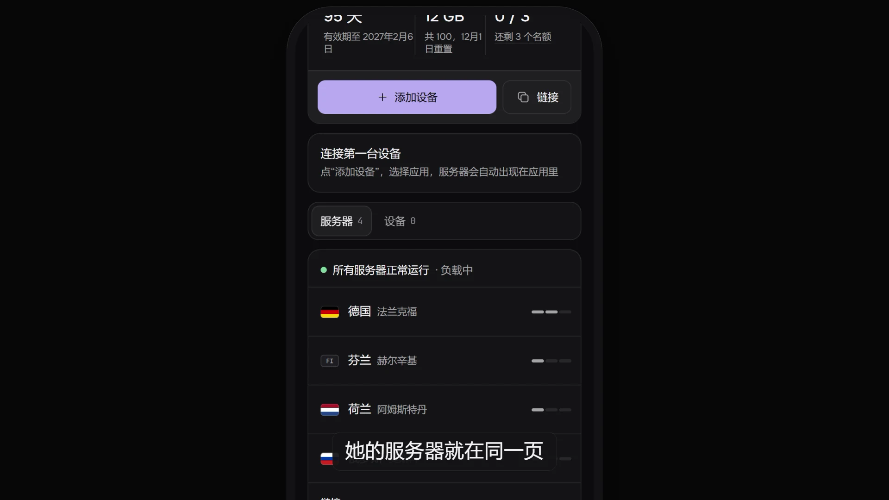
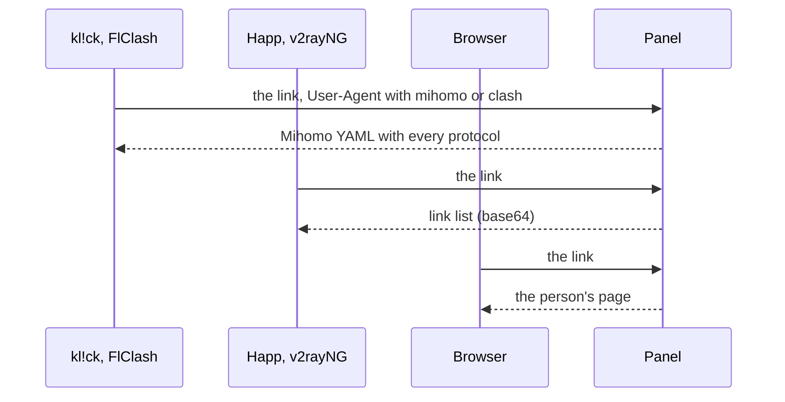

每位用户都有一个订阅链接。同一个链接会向订阅类应用提供服务器列表，向基于 mihomo 内核的应用提供完整配置，向基于 Xray 或 sing-box 内核的应用提供它们各自的 JSON 配置，也会在浏览器中打开该用户自己的页面。**订阅**部分决定每个应用会获取什么，以及用户会看到什么。此部分有八个标签页：**应用与格式**、**下发规则**、**应用版本**、**名称与文本**、**响应头**、**Mihomo 模板**、**用户页面** 和 **DNS**。



## 链接

链接格式如下：

```ini
https://sub.example.com/<secret prefix>/<token>
```

- 面板服务器上的 `mistgate setup` 用于设置链接基础地址，包含保密前缀；**设置** → **域名**会向所有者显示**订阅链接基础地址**。未设置此地址时，系统不会发放链接。参见[安装面板](../getting-started/install-panel.md)。
- 令牌只属于该用户，必须保密。用户卡片上的**订阅链接**会显示链接和二维码；**生成新链接**会替换旧链接，旧链接会立即失效（页面密码也会随之更改）。
- 无人拥有的链接会像站点上的其他未知路径一样响应，因此无法通过猜测找到链接。

## 格式

| 格式 | 内容 | 默认适用对象 |
|:--|:--|:--|
| **链接列表（base64）** | 每台服务器对应一个分享链接，按纯文本列表排列。Happ、v2rayNG、Hiddify 和大多数其他应用都支持。 | 没有匹配规则的应用。 |
| **网页** | 用户页面：包含说明、二维码和用户流量。参见[用户页面](user-page.md)。 | 在浏览器中打开链接的所有人。 |
| **Mihomo YAML** | 适用于 Mihomo 和 Clash Meta 的完整配置，包含用户拥有的所有协议。 | 按 `mihomo` 和 `clash` 规则匹配的基于 mihomo 内核的应用（kl!ck、Clash Meta、FlClash、Clash Verge）。 |
| **Xray JSON** | JSON 数组，每台服务器对应一份 Xray 配置，适用于 v2rayNG、v2rayN 等基于 Xray 内核的应用。 | 无，需先为它添加规则。 |
| **sing-box JSON** | 适用于官方 sing-box 应用（SFA、SFI、SFM）的单个配置：所有服务器在同一个选择器中，并带有用户的 DNS。 | 官方 sing-box 应用，按规则 `sing-box`。 |
| **伪装 404** | 模拟链接不存在。适合按 User-Agent 屏蔽爬虫。 | 尚未设置匹配规则时，无人使用。 |



**应用与格式**标签页会列出各协议支持的应用及其读取格式：Happ 读取链接列表（有规则指定时也读取 Xray JSON），Mihomo / Clash Meta（kl!ck 和其他基于 mihomo 内核的应用）读取 Mihomo YAML，sing-box 读取 sing-box JSON，AmneziaVPN 则不读取订阅（它从用户页面获取 `vpn://` 密钥）。

### Xray JSON 与 sing-box JSON

两者都由与链接列表相同的协议配置和相同的访问权限生成。区别在于各格式能包含哪些内容（参见[各格式支持哪些协议配置](#各格式支持哪些协议配置)），以及应用的工作方式。

- **Xray JSON** 是一个配置数组，每台服务器一份；服务器名称就是该配置的 `remarks`。开启自动选择时，最前面是包含所有服务器的 `Auto` 配置。每份配置都会在 `127.0.0.1:10808` 上开启本地 SOCKS 代理，由应用自己的 VPN 模式把流量送入其中。设备上的其他应用能看到这个端口，部分 VPN 检测会查找它。没有 HTTP 代理、API 和统计端口。DNS 预设会写入每份配置。
- **sing-box JSON** 是一个配置：包含所有服务器的选择器、TUN 接口和 DNS 预设。启用自动选择时，`Auto` 会检测服务器；关闭时默认选择第一台。它不会开启本地代理。需要 sing-box 1.12 或更高版本。

名称遵循[名称与文本](#名称与文本)中的模板。Xray JSON 沿用链接列表的 30 个字符限制，Happ 还会收到负载信息；sing-box JSON 保留完整名称，不附带负载。

### 自动选择服务器

启用**自动选择服务器**（位于**下发规则**规则列表下方的卡片，默认开启）后，Mihomo/Clash YAML 和 sing-box JSON 会带有 `Auto` 分组，Xray JSON 则把 `Auto` 配置放在最前，每五分钟通过 `https://www.gstatic.com/generate_204` 检测每台服务器。检测请求经由正在检测的服务器发出，因此家中网络屏蔽该网址不会影响检测结果。新安装会默认使用 `Auto`；用户在应用中手动选择的服务器仍会保持生效。只有一台服务器时不会生成 `Auto`。此设置不影响 AmneziaVPN，也不影响使用链接列表的 Happ（链接列表没有分组）。

Xray JSON 中的 `Auto` 配置包含所有服务器，并通过由 Xray observatory 提供数据的 `leastPing` 负载均衡器转发流量：每个新连接走上次检测中响应最快的服务器，首次检测完成前走第一台服务器。与 Mihomo 的 `url-test` 不同，它没有容差，因此两台服务器响应速度相近时，检测之后新连接可能在它们之间切换。

**计划中**：订阅镜像。

## 各格式支持哪些协议配置

格式无法包含的服务器会直接从该格式中省略，就像链接列表现在省略 Gecko 一样。用户页面根据链接列表生成，不受影响。每个协议配置上的**订阅格式**一行说明的是同样的内容（参见[协议配置](profiles.md#协议配置的订阅格式)）。

| 协议配置 | 链接列表 | Mihomo YAML | Xray JSON | sing-box JSON |
|:--|:--|:--|:--|:--|
| Hysteria2，Let's Encrypt（有或没有 Salamander） | 是 | 是 | 是 | 是 |
| Hysteria2，自签名（固定指纹） | 是 | 是 | 是 | 否 |
| 使用 Gecko 的 Hysteria2 | 否 | 是 | 否 | 否 |
| 使用端口跳跃的 Hysteria2 | 单端口 | 整个范围 | 单端口 | 整个范围 |
| VLESS REALITY，XHTTP（默认） | 是 | 是 | 是 | 否 |
| VLESS REALITY，TCP（RAW + Vision） | 是 | 是 | 是 | 是 |
| VLESS TLS，XHTTP，直连或经 CDN | 是 | 是 | 是 | 否 |
| VLESS TLS，WebSocket，直连或经 CDN | 是 | 是 | 是 | 是 |
| AmneziaWG 2.0 和 3.1 | 否 | 是 | 否 | 否 |
| 以上任一项的 WARP 副本 | 同原协议配置 | 同原协议配置 | 同原协议配置 | 同原协议配置 |

- sing-box 没有 XHTTP 传输，也无法按指纹校验自签名证书。Gecko 仅 Mihomo 支持。
- AmneziaWG 只能通过 Mihomo YAML 或 AmneziaVPN 密钥送达应用。前者可以关闭：参见[订阅类应用中的 AmneziaWG](#订阅类应用中的-amneziawg)。
- MTProto 不在任何格式中。`tg://proxy` 行在每个 VPN 应用里都会被当成一台损坏的服务器，所以 Telegram 链接只来自用户的页面和管理后台（[MTProto](mtproto.md)）。
- TrustTunnel 不在任何格式中：官方应用从用户的页面获取 `tt://` 链接（[TrustTunnel](trusttunnel.md)）。
- WARP 副本是节点的出口，客户端上没有任何变化，因此它与所复制的协议配置表现一致。
- 如果某个格式中一台服务器也没有，用户会收到一条占位记录：参见[没有适用于此应用的服务器时](#没有适用于此应用的服务器时)。

## 下发规则

**下发规则**标签页会按从上到下的顺序列出规则。每条规则包含一段文本和一种格式：User-Agent 中包含此文本（不区分大小写）的应用会获取对应格式。按顺序使用第一个匹配规则。没有匹配项时，使用最后一行**其他所有情况**：浏览器会获取网页，其他应用会获取链接列表。

新面板默认有三条规则：`mihomo` 和 `clash`，两者都使用 **Mihomo YAML**；最后一条 `sing-box` 使用 **sing-box JSON**。官方 sing-box 应用发送的 User-Agent 形如 `SFA (sing-box 1.14.3; language en_US)`，由最后一条规则匹配。

- 在这条规则出现之前创建的面板，会在更新时获得它一次，放在列表末尾。如果已有文本为 `sing-box` 的规则（无论格式），或列表已满，则不会添加；删除后它也不会再回来。
- Hiddify 仍使用 **Mihomo YAML**：它的 User-Agent 包含 `ClashMeta`，而规则 `clash` 排在 `sing-box` 之前。Happ 仍使用链接列表。Xray JSON 只会按你自己添加的规则提供，例如 **User-Agent 包含** `v2rayng`，**提供** **Xray JSON**。
- **添加规则**：设置 **User-Agent 包含**和**提供**。
- 拖动规则或使用箭头调整顺序。更改会立即保存。
- 删除规则后，几秒内可以通过提示消息将其恢复。
- 最多 50 条规则；两条规则不能使用相同文本。

浏览器的判定方法：User-Agent 以 `Mozilla/` 开头，包含浏览器引擎（`AppleWebKit`、`Gecko/`、`Firefox/`、`Trident/`），且未标明已知 VPN 应用（Happ、v2ray、clash、mihomo、hiddify、sing-box、streisand、shadowrocket、karing、flclash、nekobox、okhttp、cfnetwork）。如果某个不常见的应用看起来像浏览器，可以为它添加规则。

**测试 User-Agent**：粘贴应用发送的内容，或选择示例；标签页会显示匹配的规则（「规则 2 匹配 → Mihomo YAML」、「没有匹配的规则，且看起来是浏览器 → 网页」、「没有匹配的规则 → 链接列表」）。示例中包含 `sing-box` 和 `v2rayNG`。

**在单次请求中试用某个格式。** 在订阅链接末尾加上 `?format=xray-json` 或 `?format=sing-box`，即可为这一次请求指定格式，不受规则影响。它用于试用尚无对应规则的应用。它给出的权限不超过规则：无人拥有的链接仍然得到伪装 404，规则为**伪装 404** 的链接仍然是伪装 404，其他取值会被忽略。用户页面从不显示带此参数的链接。

## 订阅类应用中的 AmneziaWG

kl!ck 和其他 Mihomo 应用会在配置中与其他服务器一起获得 AmneziaWG 服务器。Happ 以及其他读取链接列表的应用永远不会获得：它们的格式无法承载 AmneziaWG。**订阅类应用中的 AmneziaWG** 开关位于 **下发规则** 规则下方的卡片中，用于从订阅类应用中移除 AmneziaWG。它默认开启，面板更新后也保持开启。

如果用户本来就在 AmneziaVPN 中使用 AmneziaWG（它在 Mihomo 应用中往往效果更差），可以关闭它。关闭后：

- 每个 Mihomo 应用在下次刷新时获得不含 AmneziaWG 服务器的订阅；
- 在这次刷新时，该应用的 AmneziaWG 密钥会被删除，其在 AmneziaWG 网络中的地址随之释放。确认框 **从订阅类应用中移除 AmneziaWG？** 会显示应用目前持有多少密钥；如果一个也没有，开关会立即关闭；
- AmneziaVPN 密钥、用户页面和其他格式不变。Mistgate 应用（尚未公开发布）在这里不算订阅类应用：它自行获得 AmneziaWG，无论此开关如何设置都会保留（它自己的开关是用户卡片中的 **Mistgate 应用**一行），它的密钥也不计入确认窗口的数量；
- 只有 AmneziaWG 服务器的用户会在 Mihomo 应用中收到占位记录：参见[没有适用于此应用的服务器时](#没有适用于此应用的服务器时)。

经[中转](relays.md#amneziawg-经中转)时，Mihomo 应用会得到 AmneziaWG 服务器的副本（` · 经 RU`），带有自己的密钥；Mistgate 应用在下次同步时得到。链接列表中仍然没有 AmneziaWG。

重新开启后，应用会在下次刷新时获得新的密钥。开关关闭期间，**应用与格式** 中 Mihomo 卡片上的 AmneziaWG 会被划掉，并附有指向该开关的链接。

## 订阅类应用的设备上限

应用获取链接时，除 User-Agent 外，还会在 `X-HWID` 标头中发送设备 ID（Happ、Remnawave 和 3x-ui 的通用标准），通常还会发送设备型号和系统。面板按这个 ID 给设备计数：一台设备上的一个应用就是一台设备，在用户的上限中有自己的名额和自己的密钥。不发送 ID 的应用共用一个名额。设备如何出现、如何管理：[用户和分组](users-and-groups.md#设备和设备上限)。哪些应用会发送 ID：[客户端应用](client-apps.md#哪些应用会发送设备-id)。

模式在**下发规则**标签页规则列表下方的**订阅类应用的设备上限**卡片中设置，共有三个选项：

| 模式 | 作用 |
|:--|:--|
| **仅计数** | 不拒绝任何人。设备获得名额和密钥，系统统计设备上限，用户列表会显示谁超出了上限。一个用户最多可以有两倍于上限的设备；超过后，新的应用会使用共用名额，而不是获得自己的名额，这样每次请求都换一个 ID 的应用就无法占满面板。事件「已达到设备上限」只是历史记录。 |
| **限制** | 超出上限的新设备会被拒绝。闲置设备仍保留密钥和凭据，但不占用名额。不提供设备 ID 的应用共用一个名额；上限已满且还没有共用名额时，这类应用同样会被拒绝。 |
| **严格** | 与**限制**相同，并且不提供设备 ID 的应用会被拒绝。切换到这个模式时，所有共用名额会立即移除。 |

默认情况下，设备在 30 天内没有节点观察到的连接或该设备发起的订阅获取后会变为闲置。可将**设备闲置期限**设为 7–365 天，或设为 0 关闭此规则。设备从未连接时，从创建时间开始计算。闲置设备的密钥和凭据会保留；设备返回后会重新占用名额，在**限制**或**严格**模式下只有在名额已满时才会被拒绝。此规则适用于订阅链接设备、Mistgate 应用设备和 AmneziaWG 密钥设备。

默认值取决于面板。已经有用户的面板在更新后使用**仅计数**，这样更新当天不会有人被断开。没有用户的新面板使用**限制**。所有者和协作者可以更改模式；更改会在下次获取订阅时生效。

- 有人超出上限时，切换到**限制**需要确认：「开启限制？」会写明有多少人超出上限，以及他们现有的设备保持不变，在他们腾出名额或你调高上限之前，新设备会被拒绝。
- 切换到**严格**始终需要确认：「切换到严格模式？」会写明目前有多少人在使用不提供设备 ID 的应用。这些应用将无法连接，共用名额会立即移除，这类应用会收到「应用未提供设备 ID」的提示。提供 ID 的应用不受影响。

### 如何从「仅计数」切换到「限制」

1. 打开**用户**，点击**超出设备上限**标签。这些用户的设备数超过了上限。
2. 为需要更多设备的用户调高其卡片上的**设备**，或请其他用户在自己的页面删除不再使用的设备。
3. 把模式切换为**限制**。确认框会显示谁仍然超出上限。之后再考虑切换到**严格**，并且要先弄清谁在使用不提供设备 ID 的应用。

切换之后，告警「有应用因设备数上限被拒绝」会告诉你什么时候真的有人被拒绝（参见[健康检查](../operations/health.md)）。

## 应用版本

REALITY 握手可以携带后量子密钥份额（X25519MLKEM768）。较新的 Xray 服务器可以强制要求它：不发送该份额的应用会被当作陌生人，转到伪装站点。**应用版本** 标签页会针对每台获得 VLESS REALITY 服务器的设备，显示其应用是否已知会发送该份额。这是给所有者的信息，目前不影响任何事情：不会拒绝任何设备，不会向任何人显示提示，各应用获得的服务器也保持不变。可在你将某个配置限制为仅后量子握手之前参考。

列表中的设备需满足：通过订阅链接接入、持有 VLESS 密钥，所属用户状态正常，且其分组包含 VLESS REALITY 配置，并在活跃节点上有可用入站。每台设备只有一个状态，按该用户可用的各 REALITY 配置的 fingerprint 判断（取最差的一个）：

| 状态 | 含义 |
|:--|:--|
| **正常** | 已知该应用及版本会发送该份额。 |
| **低于最低版本** | 应用已知，但版本低于已知可用的最低版本；该行会写明所需版本。 |
| **不支持** | 该应用没有任何版本能做到（sing-box 及基于它的应用），或配置的 fingerprint（`ios`、`edge`、`random`）在任何应用里都会生成传统握手。更新应用没有帮助；该行会说明是哪一种。 |
| **未知** | 表中无法判断：表里没有该应用、该平台没有已知可用的版本，或应用没有上报版本。「未知」绝不会被当作「已过时」。 |

顶部的卡片按状态统计设备与人数，同时也是筛选器；默认选中 **需要关注**，即除「正常」以外的全部。表格显示用户（链接到其卡片）、设备、应用及其上报的版本、状态、节点所见（见下文）、缺少什么，最近活动显示在用户名下方。在地址后加上 `?tab=clients&user=<用户 id>` 可只看某个用户的设备。

### 节点所见

**状态** 列是面板根据最低版本表对应用所*知道*的情况。**实际情况** 列是节点所*看到*的：最近 7 天内，每个安装了新版 Agent 的节点按设备统计经由 VLESS REALITY 到达的握手，面板再把它们加起来。设备的每次握手都带有后量子密钥交换，则为 **新式**；一次都没有，则为 **旧式**（严格配置会拒绝这样的设备）；有的有、有的没有，则为 **混合**（应用在切换 fingerprint，或同一密钥上有两个应用）；没有统计到任何可读的握手，则为 **无数据**。徽章下方的小数字是计数（新式、旧式以及无法读取的），徽章的提示用文字说明同样的内容。

两列放在一起才最有用。两者不一致时，徽章旁会出现 **≠** 标记：表中为「正常」但节点看到的是旧式握手（表对该应用有误，请在最低版本表中修正该行），或表中显示有问题但节点只看到新式握手（无需担心）。卡片下方的 **新式**、**旧式**、**混合** 和 **无数据** 标签按节点所见统计设备并充当筛选器；在这里选中的类别会包含任何状态的设备，所以表中为「正常」却发送旧式握手的设备会出现在 **旧式** 列表中。这个列表是严格模式会整体拒绝的设备；混合的设备只会被部分拒绝。

只有其节点的 Agent 足够新（列出 `vless-hello-kex/1`）时，设备才有数据。只要还有带 REALITY 服务器的节点版本较旧，页面就会用一行说明有多少节点尚未统计；请更新这些节点的 Agent，在此之前经由它们连接的设备显示为 **无数据**。

### 最低版本表

列表下方的 **最低版本** 是状态背后的表格：按应用和平台列出，使用 Chrome 类 fingerprint 以及 Firefox 或 Safari 类 fingerprint 时发送该份额的最低版本，或「不可用」。版本留空表示「未知」。内置值随面板一起提供，并随面板版本更新；它们取自各应用以及其内置的 Xray、Mihomo 内核的发布说明：

| 应用 | chrome fingerprint | firefox / safari fingerprint |
|:--|:--|:--|
| Happ，Android | 3.1.1 | 3.20.0 |
| Happ，Windows、macOS、Linux | 0.3.6 | 2.10.0 |
| Happ，iOS | 未知 | 4.8.0 |
| v2rayNG | 1.10.3 | 2.0.16 |
| v2rayN | 7.12.6 | 7.20.0 |
| Mihomo 内核（版本取自 User-Agent） | 1.19.9 | 从不（Firefox_120 / Safari_16_0 不带该份额） |
| kl!ck（按其自身版本；内部是 Mihomo） | 0.4.0 | 从不（Firefox_120 / Safari_16_0 不带该份额） |
| sing-box（SFA、SFI、SFM）、Karing、NekoBox | 不可用 | 不可用 |
| Hiddify、Streisand、FoXray、v2RayTun、INCY、OneXray、Shadowrocket、FlClash、Clash Verge、Mihomo Party、Clash Meta for Android | 未知 | 未知 |

Mihomo 内核只在 chrome fingerprint 下发送该份额：`support-x25519mlkem768` 开关只对它生效，而 firefox 和 safari 在 Mihomo 中由不带该份额的指纹构建，所有版本皆然。因此在 firefox 或 safari 配置下，Mihomo 与 kl!ck 会因 fingerprint 显示为不支持。Mihomo 与 kl!ck 只有在配置要求时才会发送该份额（`support-x25519mlkem768`），而面板目前的 Mihomo 配置并不要求；对它们而言，表格说明的是内核能做什么，而不是现在做了什么。设备按其最近一次上报的应用字符串判断，因此链接的共用位置显示的是最后一次访问的那个应用。

所有者可以修改任意值、添加应用（名称为该应用在 User-Agent 中 `/` 之前写的内容，小写），并把某一行恢复为内置值。保存需要 step-up，并以 `client_compat.update` 写入审计日志。只保存与内置表的差异，所以你没动过的行会跟随面板的版本更新。协作者和只读管理员只能看到表格，没有输入框。

通过 MCP，可用只读工具 [`outdated_devices`](../reference/mcp.md) 读取该列表；表本身只能由所有者在面板中修改。

## 应用会收到什么

每次向应用提供订阅时，除服务器信息外，还会附带订阅类应用会读取的响应头：

| 响应头 | 内容 |
|:--|:--|
| `Profile-Title` | 订阅名称（**应用内显示名称**）。 |
| `Subscription-Userinfo` | 当前周期的上传和下载流量、配额（0 表示不限）以及有效期结束时间（0 表示永不过期）。 |
| `Profile-Update-Interval` | 应用重新获取链接的间隔，单位为小时。 |
| `Profile-Web-Page-Url` | 链接本身，即应用中指向用户页面的按钮。 |
| `Announce` | 公告，或订阅无法使用的原因。 |
| `Support-Url` | 支持链接。 |
| `Probe-Report` | 面板接收 kl!ck 服务器检查报告时为 `1`（**可达性 → 来源**，参见 [kl!ck 报告](../operations/reachability.md#klck-报告)）。没有它，kl!ck 不会发送任何内容。 |
| `Routing` | 仅供 Happ 和 INCY 使用，且仅随链接列表发送：该用户所在分组的[自有路由配置](#happ-和-incy-的路由)，并填入该用户 DNS 预设的 DNS；没有自有配置时，则是该用户的 DNS 预设生成的路由配置（Happ 用 `happ://`，INCY 用 `incy://`）。链接超过 3000 字节的配置改为作为服务器之后的一行正文发送。参见[DNS](dns.md)。其他格式自带 DNS，因此不发送 `Routing`。 |
| `Ping-Type`、`Ping-Result`、`Subscription-Ping-Onopen-Enabled` | 仅供 Happ 使用，且仅在**Happ 延迟测试**不是**应用默认**时发送：Happ 测试服务器延迟的方式、以 ms 显示延迟，以及打开应用时是否测试。参见[名称与文本](#名称与文本)。 |

你自己的响应头附在这些之后：见[响应头](#响应头)；该标签页的“应用会得到什么”预览也会显示 `routing` 标头。Mihomo YAML、Xray JSON 和 sing-box JSON 包含相同的响应头，但没有 `Routing`。Mihomo YAML 有包含所有服务器的一个代理组和 `dns:` 部分；Xray JSON 每台服务器一份配置；sing-box JSON 是包含所有服务器的一个选择器。各格式都以自己的形式带上用户的 DNS 预设。

## 额外服务器：经 IPv6 与经中转

在节点的某个服务器旁，应用最多还会列出两个服务器，名称后带一个标签。它们是同一个服务器，密钥、名称和证书都相同；只有应用连接的地址不同，应用像选其他服务器一样按名称选择。

| 标签 | 含义 | 由谁添加 |
|:--|:--|:--|
| ` · IPv6`（各语言相同） | 位于节点某个 IPv6 地址上的服务器，供网络封锁了节点 IPv4 地址的用户使用。不支持 IPv6 的应用会跳过它。在 URI 中，地址放在方括号里（`@[2001:db8::5]:443`）；在 Mihomo、Xray JSON 和 sing-box 格式中则不带方括号，这些格式要求如此。 | 节点的 [IPv6 入口](nodes.md#ipv6-入口) |
| ` · via RU`（俄语为 ` · через RU`，中文为 ` · 经 RU`） | 经入口节点的中转访问的服务器，带入口的国家。 | [中转](relays.md) |

顺序是节点的服务器、它的 IPv6 服务器，然后是经它的中转的服务器；中转的服务器不会为 IPv6 再复制一份。两者都会在应用下次刷新时出现在每个有权使用该节点的用户（中转则是入口节点）那里。位于 CDN 之后的服务器、证书签发给节点 IPv4 地址的服务器以及静态 AmneziaWG 密钥，不会有 IPv6 服务器。IPv6 服务器在 Happ 中显示的负载就是节点的负载。名称保持在 Happ 的 30 个字符以内：标签保留，先缩短协议配置名称。[MTProto](mtproto.md#中转与-ipv6-副本) 协议配置的链接也有同样的副本，出现在用户的 Telegram 区块而不是订阅中。

所有者在节点**入口**选项卡中移出订阅的服务器本身不会下发，但它的 IPv6 服务器和经中转的服务器保留（参见[节点](nodes.md#直连)）。

## 名称与文本

| 设置 | 作用 |
|:--|:--|
| **应用内显示名称** | 显示在 Happ 列表顶部，最多 100 个字符。留空时使用面板名称（品牌名）。 |
| **公告** | 显示在服务器列表上方的一到两行文字，最多 1000 个字符；用户页面也会显示此内容。计数器会显示 Happ 展示的字符数：200 个字符。超长文本会在词语边界处截断，并在应用中显示「…」。 |
| **联系链接** | 从「联系我们」按钮打开。可填写 Telegram 链接（`https://t.me/…` 或 `tg://resolve?domain=…`）或网页链接（`https://…`）。 |
| **更新间隔** | 1–72 小时，默认 12 小时：应用重新下载订阅的间隔。 |

**服务器显示名称**是一个最多 100 个字符的模板，由多个部分组成：

| 模板部分 | 生成内容 |
|:--|:--|
| `{flag}` | 节点所在国家的旗帜表情符号。 |
| `{country}` | 节点所在国家的两位字母代码（`DE`）。 |
| `{node}` | 节点名称。 |
| `{profile}` | 协议配置名称。 |

默认模板为 `{flag} {country} · {profile}`，例如：「🇩🇪 DE · Hysteria2」。协议配置名称来自面板，因此可以轻松区分协议变体和 WARP 副本。只有完整名称重复时才会添加编号。没有国家代码的节点只显示协议配置名称；如果名称也为空，则使用节点名称。只有名称以旗帜表情符号开头时，Happ 才会将旗帜用作服务器图标。

链接列表中的名称最多为 30 个字符，这是 Happ 对服务器名称的长度限制（一面旗帜按四个字符计算）：名称过长时，会先缩短协议配置名称开头的协议名（Hysteria2 缩写为 HY2、AmneziaWG 缩写为 AWG、WireGuard 缩写为 WG），然后截断名称。Mihomo YAML 会保留完整名称。

在 Happ 中，服务器名称末尾还会附带当前负载（例如「🇩🇪 DE · Hysteria2 · 64%」）：取 CPU 使用率；如果节点**服务器**标签页中填写了**网络带宽**且链路占用率更高，则取接收和发送中较高一方占带宽的比例。其他应用和 Mihomo 配置中的名称不带负载信息：它们会按名称记住用户选择的服务器，名称变化会导致每次更新订阅时都重置选择。

**在应用中的效果**会按 Happ 的显示方式展示服务器列表及其负载，也会使用成员人数最多的分组中的服务器；如果没有分组服务器，则显示虚构服务器。

**Happ 延迟测试**设置 Happ 测量到各服务器延迟的方式。其他应用不读取此设置。

| 设置 | 作用 |
|:--|:--|
| **测试方式** | **应用默认**（默认值）不发送任何设置，Happ 使用自身设置。**TCP** 发送 `Ping-Type: tcp` 和 `Ping-Result: time`：Happ 与每台服务器的端口建立 TCP 连接，并以 ms 显示延迟。 |
| **打开应用时测试延迟** | 仅适用于 **TCP**：Happ 每次启动时检测所有服务器（`Subscription-Ping-Onopen-Enabled: 1`；关闭时发送 `0`）。 |

## 响应头

**响应头**标签页可为订阅响应添加你自己的响应头：例如 FlClashX 用来读取服务名称、徽标、外观、小组件和设置的 `flclashx-*`。面板自己设置的响应头见[应用会收到什么](#应用会收到什么)。

每个响应头占一行，包含：

| 字段 | 作用 |
|:--|:--|
| **名称** | HTTP 响应头名称：拉丁字母、数字和符号 `- _ . ! # $ % & ' * + ^ ~`（RFC 9110 允许用于 token 的其他字符也可），最长 64 个字符。按你输入的写法发送。 |
| **值** | 最多 1000 字节，不含换行或其他控制字符。只有普通 ASCII 会原样发送。 |
| **以 base64 发送** | 面板发送 `base64:` 加该值的 base64，与发送标题的方式相同。其他文本（例如「我的 VPN」）需要开启。 |
| **格式** | **所有格式**，或从**链接列表 (base64)**、**Mihomo YAML**、**Xray JSON** 和 **sing-box JSON** 中选择：应用得到的响应格式。 |
| **分组** | **所有分组**或**指定分组**。已删除的分组会在下次保存时从该行中去掉；一行中没有分组剩下时，不会发给任何人。 |

各行有先后顺序：若有两行同名且都适用于某个响应，只发送第一行。最多 20 行，按发送形式合计最多 4096 字节（面板前面的代理会用 4 或 8 KiB 缓冲响应头）。

响应头只随正常提供服务器的响应发送。拒绝响应（[设备达到上限、设备被封锁、应用未提供设备 ID](#设备被拒绝时应用会显示什么)）、无访问权限者收到的说明以及用户页面都不带这些响应头，保持原样。

**面板保留的名称**在保存时会被拒绝，不区分大小写：[应用会收到什么](#应用会收到什么)和拒绝表中列出的所有响应头，`X-Hwid-*`、`Profile-*`、`Subscription-*`、`Ping-*` 和 `Mistgate-*` 这几个系列，以及网页服务器和平台的响应头（`Content-*`、`Cache-Control`、`Set-Cookie`、`Location`、`Vary`、`ETag`、`Connection`、`Transfer-Encoding` 及其他逐跳响应头、`Strict-Transport-Security`、`Access-Control-*`、`Sec-*` 等）。标签页会显示完整列表。其中面板的部分取自设置这些响应头的代码，而该代码的测试在其设置了不在列表中的响应头时会失败，因此面板将来开始发送的响应头从同一版本起即被保留。

**应用将收到什么**显示某个人用某个 User-Agent 得到的响应带有屏幕上这些行（无论是否已保存）中的哪些：选择用户，输入 User-Agent 或使用示例。响应头按实际发送的形式显示（base64 行带 `base64:` 文本）。对于浏览器、按“未知链接”回应的规则以及无访问权限的用户，它会说明为什么没有。面板自己的响应头不包含在内。

修改需点击**保存**生效；**放弃更改**会丢弃修改。它们在下次拉取订阅时生效（一分钟内），无需重启。Cloudflare 版以同样方式提供。

## Mihomo 模板

默认情况下，Mihomo YAML 是面板自带的配置：你的服务器、一个供选择的分组、`Auto` 分组，以及该用户 DNS 预设的 DNS。**Mihomo 模板**标签页允许你为选定的分组写自己的配置：你自己的代理组、规则和规则列表，用户的服务器由面板放入。一个模板可以给多个分组（同一家人的路由器和电脑可以用不同的模板），没有被任何模板指定的分组会得到面板自带的配置。每个用户只属于一个分组，因此只会得到一个模板。

只有所有者可以修改模板。模板决定用户收到的整个配置，其中的第三方 `proxy-providers` 和规则影响更大，超出本节其他设置。协作者可以查看模板并使用预览，但其保存若新增、删除或修改模板（名称、文本或分组），会被拒绝，代码为 `mihomo_templates_owner_only`；其余设置仍然可以修改。令牌也是如此：智能体只有经所有者批准其计划后才能修改模板。

标签页列出各个模板（名称、分组、大小，以及错误和警告标记）。列表可用**添加模板**、**复制**（为第二台设备，从第一台的副本开始）和**删除**；每个模板有**名称**、**分组**（已在另一个模板中的分组显示为已被占用）和 YAML 文本，文本可以输入、粘贴，或用**载入 .yaml** 载入。点击**保存**之前不会保存任何内容。修改在用户下次拉取订阅时生效（Cloudflare 版在一分钟内）。

### 面板会改动什么

面板只改动根部的三个键，其余内容保持你写的样子，包括注释、锚点、`<<` 和键的顺序：

| 键 | 面板的处理 |
|:--|:--|
| `proxies` | 把用户的服务器放在**最前面**，排在你写的代理之前。没有该键（或为 `null`）时会创建。 |
| `proxy-groups` | 只要**自动选择服务器**已开启且模板里没有同名分组，就在末尾加入 `Auto` 分组，即使用户只有一台服务器，这样你的分组才能引用它。它是针对用户服务器（而不是你自己的 `proxies`）的 `url-test`。 |
| `dns` | 仅当模板里没有时：使用该用户 DNS 预设的解析器，并带 `respect-rules: true`。预设的其他内容都不会加入（见下）。 |

其余一切由你决定：`rules`、`rule-providers`、`proxy-providers`、`tun`、端口。用户 DNS 预设的规则（屏蔽广告、分流、国家）**不会**加入模板，因为规则的顺序和 `MATCH` 由你决定；需要的话请自己写进模板。模板里有自己的 `dns` 时，用户的 DNS 预设及其在页面上的选择不会作用于 Mihomo 类应用（其他应用仍然使用）。

面板按[服务器名称模板](#名称与文本)给用户的服务器命名。如果这个名称已被模板里的某个代理或分组使用，或与 Mihomo 内核的名称（`DIRECT`、`REJECT`、`REJECT-DROP`、`PASS`、`COMPATIBLE`、`GLOBAL`）相同，服务器名称后面会加上 ` ·`。你模板里的名称面板绝不会修改，且其中任何一个都不能是内核名称。

### 让服务器进入你的分组

不要在分组里写服务器名称：每个人的服务器不同，用户没有的名称会让 Mihomo 拒绝整个文件，保存时也会被拒绝。请让 Mihomo 自己取服务器：

- `include-all-proxies: true` 取用户的服务器和你模板里的代理；
- `filter` 和 `exclude-filter`（正则表达式）按名称筛选，例如 `filter: "Germany"`；
- `include-all: true` 还会取你的 `proxy-providers` 里的分组；
- `Auto` 分组是按速度选择的用户服务器。

下面是用虚构名称写的 `ROUTER` 分组模板：

```yaml
# ROUTER: a transparent proxy for the home network
mixed-port: 7890
redir-port: 7892
allow-lan: true
mode: rule

proxy-groups:
  - name: Proxy
    type: select
    include-all-proxies: true
    proxies: [Auto, DIRECT]   # Auto is the group the panel adds
  - name: Germany
    type: url-test
    include-all-proxies: true
    filter: "Germany"
    url: https://www.gstatic.com/generate_204
    interval: 300

rule-providers:
  ads:
    type: http
    behavior: domain
    format: mrs
    url: https://rules.example.com/ads.mrs
    interval: 86400

rules:
  - RULE-SET,ads,REJECT
  - DOMAIN-SUFFIX,example.com,DIRECT
  - GEOIP,LAN,DIRECT,no-resolve
  - DOMAIN-SUFFIX,example.org,Germany
  - MATCH,Proxy
```

`ROUTER` 中的用户会得到这段文本：其服务器位于 `proxies` 开头，`Auto` 在 `proxy-groups` 末尾，并多出一个 `dns` 段，其余不变。

### 保存时会检查什么

限制：最多 20 个模板，每个最多 64 KiB，合计最多 256 KiB；名称 1 至 60 个字符（同名但大小写不同视为同一个名称）；一个模板最多 100 个分组；一个分组只能在一个模板中。你删除的分组会在下次保存时从模板中去掉。

出现以下情况时，保存会拒绝该模板，并在提示中给出行号：

- 文本不是有效的 UTF-8 或 YAML，含有第二个文档（`---`）、重复的键，或展开后远大于文本本身的别名；
- 根不是映射或含有 `<<`，或 `proxies`、`proxy-groups` 不是普通列表（那里用别名会让面板连锚点一起改掉）；
- 代理没有 `name`，分组没有 `name` 或 `type`，名称重复，或与内核名称相同；
- 分组的 `proxies` 里引用了既不是模板中的代理或分组、也不是内核名称、更不是 `Auto`（只要面板会添加该分组）的名称，或 `use` 里引用了你没有定义的 provider；
- 面板无法用两台示例服务器据此生成配置。

其他发现不会阻止保存，会在预览中显示为**值得一看**：没有分组取用户的服务器（请加 `include-all-proxies` 或引用 `Auto`）；模板有自己的 `dns`；用户的 DNS 预设含有模板得不到的广告、分流或国家规则；模板有自己的 `Auto`，所以面板不再添加；某条规则指向模板里不存在的名称；没有选择任何分组。面板不检查 Mihomo 的其余键：请用 Mihomo 自己运行一遍该文件。

### 预览

**预览**根据屏幕上的文本（无论是否已保存）生成某一个用户的配置：选择一个用户（任何用户，不必属于所选分组），查看他的链接会返回的 YAML。服务器只显示名称、类型、地址和端口，不显示密钥或密码；不会保存任何内容，也不会创建设备。预览还会说明该用户目前得到哪个模板以及原因，例如他所在的分组没有被任何模板指定，因此得到面板自带的配置。

### 谁会得到模板

模板只用于链接的 **Mihomo YAML** 响应，且只给订阅有效的用户。订阅已关闭、已过期或超出流量配额的用户会得到带有相应说明的面板自带配置；服务器都无法放进 Mihomo 配置的用户也是如此（例如只有 AmneziaWG 服务器而**订阅类应用中的 AmneziaWG** 已关闭）：空的 `url-test` 会让文件失效。其他格式（链接列表、Xray JSON、sing-box JSON）不使用模板。kl!ck 只读取配置里的 `proxies`，保留它自己的分组、规则和 DNS：你模板里的代理会出现在它的列表中，`proxy-providers` 则不会。

### 模板中的地址

面板绝不会打开模板中的地址，保存时也不检查列表或 provider 是否有响应。打开地址的是用户的应用：每个应用自己下载 `rule-providers` 和 `proxy-providers`。对方主机能看到用户的 IP 地址和请求时间，`proxy-providers` 的来源还可能加入你无法控制的服务器。请只使用你信任的主机。

模板里的一切内容，包括注释和列表地址里的任何令牌，该模板所在分组的所有用户和所有管理员（包括只读管理员）都能看到。不要把机密放进去。智能体通过 [MCP](../reference/mcp.md) 读取模板时，查询字符串和过长的路径段会被截去，且无法把这样的文本写回；所有者的变更审批卡片会列出模板中地址所指向的主机。

### 保持精简

面板每次拉取订阅都会重新读取并写出模板。14 KB 的模板在 Cloudflare 版中约占 6 ms 处理器时间，64 KiB 的约 27 ms。请把规则放进 `rule-providers`，不要写成几千行 `rules`。

### 如果你原来有一个按设备分块的文件

面板没有按分组切分同一个文件的标记。请为每个分组各做一个模板：复制该文件，在每份副本中删去其他设备的块，再把副本交给对应的分组（**复制**按钮可以做出副本）。一个分组一个模板：重命名分组不会损坏任何东西。

回退到不含模板的面板版本后，在那里下次保存这些设置时模板会被丢弃：回退前请另存模板文本。

## Happ 和 INCY 的路由

Happ 和 INCY 有自己的路由：哪些直连、哪些走 VPN、哪些屏蔽。**路由**标签页把你自己的配置发给它们，对象是你选择的分组。没有自有配置时，它们得到和以前一样的内容：用户 DNS 预设生成的配置（Happ 自 DNS 预设出现起如此；INCY 也一样，使用自己的 `incy://` 前缀：两个应用读取相同的字段）。

### 把配置放进面板

在你已有配置的地方生成它：3x-ui（订阅的路由规则）、Happ 或 INCY。它们会给你一个类似 `happ://routing/onadd/eyJ…` 或 `incy://routing/onadd/eyJ…` 的链接。把它粘贴到新配置的**链接、base64 或 JSON**中。下面这些也可以：

- 任意前缀的链接（`sbx://routing/add/…`）或没有前缀的链接（`://routing/onadd/…`，INCY 的标头就是这样写的）；
- JSON 的纯 base64，带或不带填充；
- JSON 本身：包含 `Name`、`GlobalProxy`、`DirectSites`、`DirectIp`、`ProxySites`、`ProxyIp`、`BlockSites`、`BlockIp`、`DnsHosts`、`Geoipurl`、`Geositeurl`、`DomainStrategy`、`FakeDNS`、`LastUpdated`、DNS 字段 `RemoteDNSType`、`RemoteDNSDomain`、`RemoteDNSIP`、`DomesticDNSType`、`DomesticDNSDomain`、`DomesticDNSIP`（以及旧的 `RemoteDns`、`DomesticDns`）和 `useChunkFiles` 的对象。

`…/routing/off` 链接（它只会关闭路由）和自动更新的 `…/autorouting/…` 链接（里面是配置的地址，而不是配置）会被拒绝并说明原因。

面板会立即读取粘贴的文本，并在列表旁用文字展示读到的内容：应用将显示的名称、直连、走 VPN 和进入屏蔽列表的站点与地址各有多少、其余流量如何处理（`GlobalProxy`）、geo 文件及其来源、配置如何送达应用，以及被略去的字段。无法读取的文本会被拒绝并说明原因（不是 JSON 对象、字段类型不对、没有任何路由字段、geo 文件或 DoH 地址不是 `https`、配置超过 32 KiB），也不能保存。

### 面板保留什么

面板不会原样转发你的文本。保存时它把文本读入两个应用文档中列出的字段，检查类型，并存储由这些字段重新写出的 JSON；发给应用的只有它。粘贴文本中不在其内的字段（应用将来可能新增）会被**略去**，标签页会列出其名称。标头是固定前缀加 base64，无论文本写了什么。geo 文件和 DoH 的地址只接受 `https://` 且不带登录信息。面板本身从不打开这些地址，而是由你的人的应用去打开，所以请使用你信任的主机。

配置的名称就是其 `Name`（没有名称的配置叫 `Routing`）。名称不区分大小写且唯一：应用收到已有名称的配置时会更新它，而不是再添加一个。修改配置时请在其中写入新的 `LastUpdated`（Unix 时间）：两个应用只有在它大于已有值时才会接受更新。

### 谁会得到

每个配置适用于**所有分组**或所选**分组**，并有一个模式：**添加并启用**（`onadd`）或**仅添加**（`add`：应用在下载完 geo 文件后启用，或由本人启用）。粘贴的链接会设置它所写的模式。用户得到其**主分组**的配置；所属的其他分组不计入。主分组没有被任何配置点名的用户得到适用于所有分组的配置，没有的话得到和以前一样的 DNS 配置。一个分组只在一个配置中，适用于所有分组的配置只有一个：标签页和保存都不接受其他情况。

### 发往哪里

只发给订阅有效的用户的链接列表，且只发给 **Happ** 和 **INCY**（INCY 通过 User-Agent 中的 `INCY/<版本>/<平台>` 识别）。各自得到自己前缀的链接。被[设备数量限制](#订阅类应用的设备上限)拒绝的设备得不到你的任何规则（保持其原有行为）。其他格式和应用（Mihomo YAML、Xray JSON、sing-box JSON、任何其他应用）不受影响。

不超过 3000 字节的链接放在 `routing` 标头中。面板前面的代理把响应标头缓冲在 4 或 8 KiB 中；面板自己的标头约占 1 KiB，你自定义的响应头最多 4096 字节，所以剩下 3 KiB。更长的配置作为服务器之后的一行订阅内容发送，两个应用都会在那里读取路由链接（它们的文档就是这样展示的）；标签页会说明某个配置属于哪一种。

### 用户的 DNS

配置中的 DNS 不由你固定：配置里的 DNS 字段（`RemoteDNS*`、`DomesticDNS*` 和旧别名）会被用户 DNS 预设中的字段替换，其主机固定项会加入 `DnsHosts`。你的规则（`DirectSites`、`ProxySites`、`BlockSites` 和地址列表）、geo 文件和其余内容保持你写的样子。预设自带的域名分流和广告列表**不会**加入你的配置：使用你的配置时，规则只属于你。如果预设中没有任何应用能用的服务器（例如只有 DoT），则保留你配置中写的 DNS。

### 限制

最多 20 个配置，读取后每个最多 32 KiB（粘贴文本最多 128 KiB）。更改在点击**保存**后生效，**放弃更改**会撤销。人们在下次获取订阅时（一分钟内）得到更改。

格式依据两个应用的文档（Happ：dev-docs/routing；INCY：docs.incy.cc 的 Routing 和 Subscription format）。面板没有在应用本身上运行过：INCY 是否接受 `happ://` 链接，以及两者具体如何读取 base64 正文中的路由行，没有在设备上验证过。

## 订阅无法使用时

用户已停用、有效期已结束或超出配额时，应用不会收到空列表。它们会收到一条永远无法连接的记录，名称和公告都会替换为面板默认语言中的对应原因：

| 原因 | 文本 |
|:--|:--|
| 有效期已结束 | 「订阅已于9月29日到期。联系我们即可续期」（日期未知时：「订阅已到期。联系我们即可续期」） |
| 超出配额，且有重置时间 | 「流量已用完，10月1日重置」 |
| 超出配额，且没有重置时间 | 「流量已用完。联系我们提高额度」 |
| 已停用 | 「访问已暂停」 |

英语界面对应：「Subscription ended on 29 September. Message us to renew」、「Traffic used up, resets on 1 October」、「Traffic used up. Message us to raise the limit」、「Access paused」。俄语界面对应：「Подписка закончилась 29 сентября. Напишите — продлим」、「Трафик закончился, обнулится 1 октября」、「Трафик закончился. Напишите — увеличим」、「Доступ приостановлен」。

在 Xray JSON 中，这条记录是以原因命名的一份配置；在 sing-box JSON 中，则是只含一条同名记录的选择器。它们都无法连接。

此类用户的更新间隔会缩短到 1 小时，因此问题修复后（延长有效期、提高配额）很快就会同步到应用。用户页面也会以用户使用的语言说明相同情况。

### 没有适用于此应用的服务器时

Xray JSON 和 sing-box JSON 绝不会向活跃用户返回空文档。如果用户的服务器都无法用该格式提供（例如全部使用 XHTTP 而应用读取的是 sing-box，或者用户只有 AmneziaWG，或者根本没有服务器），应用会收到一条无法连接的记录，名称为「这些服务器无法在此应用中使用。适用的应用请在订阅页面查看」。公告中也是同样的文本。如果已从订阅类应用中移除 AmneziaWG，而用户只有 AmneziaWG 服务器，Mihomo 应用也会收到同样的记录。

英语界面对应：「Your servers do not work in this app. The subscription page shows which app does」。俄语界面对应：「Ваши серверы не работают в этом приложении. Какое подойдёт — на странице подписки」。

## 设备被拒绝时应用会显示什么

设备被拒绝的应用不会收到错误。响应是正常的（HTTP 200），其中只有一条永远无法连接的占位记录，名称就是原因，与[订阅无法使用](#订阅无法使用时)时一样。公告带有同样的文字，更新间隔缩短到 1 小时，`Profile-Web-Page-Url` 是通往用户页面的按钮，用户在那里腾出名额。文字使用面板默认语言：

| 原因 | 文本 |
|:--|:--|
| 上限已满 | 「设备已达上限：5 / 5。请在订阅页面删除不再使用的设备」 |
| 所有者拉黑了设备 | 「此设备已被所有者停用」 |
| 应用不提供设备 ID（**严格**） | 「此应用未提供设备 ID。请在 Happ 设置中开启 HWID，或改用 kl!ck」 |

英语界面对应：「Device limit: 5 of 5. Remove one you no longer use on the subscription page」、「This device was turned off by the owner」、「This app does not report a device ID. Turn on HWID in the settings of Happ, or use kl!ck」。俄语界面对应：「Лимит устройств: 5 из 5. Удалите ненужное на странице подписки」、「Это устройство отключено владельцем」、「Приложение не сообщает ID устройства. Включите HWID в настройках Happ или возьмите kl!ck」。

响应还带有 Remnawave 和 3x-ui 使用的标头，因此读取这些标头的应用表现一致：

| 标头 | 值 |
|:--|:--|
| `X-Hwid-Active` | 每次拒绝都为 `true`：设备检查已开启。 |
| `X-Hwid-Max-Devices-Reached` | 上限已满时为 `true`。 |
| `X-Hwid-Not-Supported` | 应用没有发送可用的设备 ID 时为 `true`。如果应用的 `X-HWID` 值无法使用（不是 10 到 64 个字母、数字、`=` 和 `-`），面板在响应中也会设置它。 |
| `X-Hwid-Limit` | 用户的设备上限，数字形式。v2RayTun 会读取它。 |

被拉黑的设备只会收到 `X-Hwid-Active` 和 `X-Hwid-Limit`：拒绝的原因不是上限，读取这些标志的应用不应提示用户去腾出名额。具体发生了什么，由公告说明。

SFA 和 SFI 不发送设备 ID，因此在**严格**模式下，它们收到的是拒绝记录（「此应用未提供设备 ID……」，sing-box JSON 格式），无法连接。

各应用显示的内容不同：Happ 会显示公告和记录名称，kl!ck 只显示记录，因为它不读取公告。参见[客户端应用](client-apps.md#哪些应用会发送设备-id)。

## 用户页面

**用户页面**标签页包含页面选项和推荐应用，并提供实时预览。详情参见[用户页面](user-page.md)。

### 用户页面中的应用

页面会按列表顺序为每个平台上的每个应用显示一张卡片。一个平台可以有多个应用。每个应用包含：

| 字段 | 内容 |
|:--|:--|
| 平台和类型 | iOS、Android、Windows、macOS 或 Linux；**订阅链接** 或 **AmneziaWG 密钥**。 |
| **应用名称** | 显示在卡片上。 |
| **下载链接** | `https://` 链接：应用商店页面或文件。 |
| **「添加」链接模板** | 一键打开应用并添加订阅的链接。占位符：`{url}` 表示订阅链接，`{url_enc}` 是 URL 编码后的链接，`{name_enc}` 是编码后的订阅名称。留空时，页面会提供复制链接的选项。会拒绝脚本类 URL scheme（`javascript:`、`data:` 等）。 |
| **卡片上的说明** | 纯文本，最多 80 个字符。留空时，卡片会说明应用的连接方式。 |
| **推荐** | 卡片上的标记；推荐应用会排在该平台应用的前面。 |

**添加应用**时需要选择平台，然后选择**已知应用**（kl!ck、Happ、AmneziaVPN、Clash Verge Rev、FlClash、Clash Meta for Android、Hiddify、v2rayNG、sing-box；系统会填入该平台应用的名称、类型、下载链接和添加链接模板），或者选择一种**接入方式**来创建空白卡片。所有字段都可以编辑。箭头可调整同一平台下应用的顺序。最多可添加 30 个应用。

新面板会在 Windows 和 macOS 上推荐 kl!ck（Happ 排在第二位），在 iOS 和 Android 上推荐 Happ，并在所有五个平台上提供 AmneziaVPN 密钥（手机端提供应用商店链接，其他平台提供 AmneziaVPN 网站链接）。有关各平台适用的应用、应用会获取的内容和一键链接工作方式，参见[客户端应用](client-apps.md)。

### 页面选项

| 选项 | 默认值 | 作用 |
|:--|:--|:--|
| **显示公告** | 开启 | 显示**名称与文本**中的内容。 |
| **联系按钮** | 开启 | 打开支持链接。 |
| **用于第二台设备的二维码** | 开启 | 当用户在手机上打开链接时很方便。 |
| **页面密码** | 开启 | 每位用户的页面都会要求输入密码，每台设备只需输入一次。应用获取订阅时无需密码。 |
| **页面上的设备** | 开启 | 用户可以在自己的页面上添加、重新获取密钥和移除 AmneziaWG 设备，但不能超过设备上限。 |
| **页面上的 DNS 选择** | 关闭 | 用户可以在自己的页面上选择订阅类应用共用的一个 DNS（选项来自开关下方的**订阅类应用的 DNS**），以及每台服务器上 AmneziaWG 密钥的 DNS（选项来自所有者为每个节点提供的预设）。参见[DNS](dns.md) 和 [用户页面](user-page.md)。 |

添加、移动或删除规则后会立即保存。**名称与文本**、**响应头**和**用户页面**中的更改需点击底部栏中的**保存**才会生效（点击**放弃更改**会丢弃这些更改）。无论哪种情况，更改都会在下次获取订阅时生效，无需重启。

## 链接保护

- **获取次数**。同一客户端网络（一个 IPv4 地址或一个 IPv6 /64）每小时最多请求同一链接 60 次；该链接来自所有网络的总上限是每小时 600 次。超过后会返回「请求过多」。间隔不到 10 秒的请求会获得相同响应。
- **猜测链接**。客户端网络（一个 IPv4 地址或一个 IPv6 /64）一分钟内尝试 20 个未知链接后，会被封锁 15 分钟。未知链接仍会收到伪装 404，面板最多每两秒为它们查询一次数据库（一次性最多 30 次）。该网络后面的人使用真实链接仍然正常，无论其他人发送多少未知链接：面板在内存中保存现有链接的列表，无需查询数据库即可识别真实链接，包括重启后的第一次请求和刚发放的新链接。在本面板进程之外创建的链接（其他副本、直接修改数据库）会在下一次刷新列表时被发现（至少每 5 分钟一次），或通过上述少量查询被发现。
- **分享链接**。一天内同一个链接被 8 个以上网络使用时，面板会记录事件「一个订阅链接每天在 9 个网络中使用」，并发出「疑似共享订阅」告警。面板只统计网络数，不保存地址。旧链接泄露时，生成新链接。

## 谁可以执行哪些操作

所有管理员都可以查看这些设置（包括 Mihomo 模板）、测试 User-Agent 并预览模板。所有者和协作者可以更改设置，但 Mihomo 模板只有所有者可以更改。路由配置与响应头一样，所有者和协作者都可以更改。DNS 标签页详见[DNS](dns.md)。
