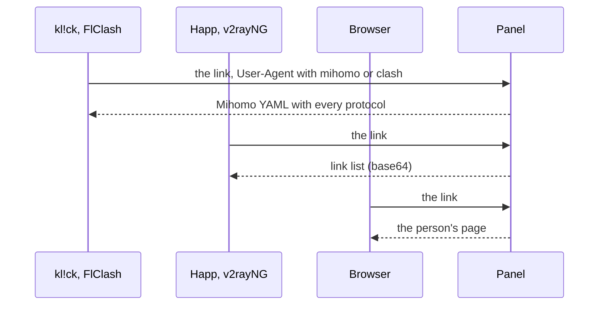

每位用户都有一个订阅链接。同一个链接会向订阅类应用提供服务器列表，向基于 mihomo 内核的应用提供完整配置，向基于 Xray 或 sing-box 内核的应用提供它们各自的 JSON 配置，也会在浏览器中打开该用户自己的页面。**订阅**部分决定每个应用会获取什么，以及用户会看到什么。此部分有五个标签页：**应用与格式**、**下发规则**、**名称与文本**、**用户页面** 和 **DNS**。

## 链接

链接格式如下：

```ini
https://sub.example.com/<secret prefix>/<token>
```

- 面板服务器上的 `mistgate setup` 用于设置链接基础地址，包含保密前缀；**设置** → **域名**会向所有者显示**订阅链接基础地址**。未设置此地址时，系统不会发放链接。参见[安装面板](../getting-started/install-panel.md)。
- 令牌只属于该用户，必须保密。用户卡片上的**订阅链接**会显示链接和二维码；**生成新链接**会替换旧链接，旧链接会立即失效（页面密码也会随之更改）。
- 无人拥有的链接会像站点上的其他未知路径一样响应，因此无法通过猜测找到链接。

## 格式

| 格式 | 内容 | 默认适用对象 |
|:--|:--|:--|
| **链接列表（base64）** | 每台服务器对应一个分享链接，按纯文本列表排列。Happ、v2rayNG、Hiddify 和大多数其他应用都支持。 | 没有匹配规则的应用。 |
| **网页** | 用户页面：包含说明、二维码和用户流量。参见[用户页面](user-page.md)。 | 在浏览器中打开链接的所有人。 |
| **Mihomo YAML** | 适用于 Mihomo 和 Clash Meta 的完整配置，包含用户拥有的所有协议。 | 按 `mihomo` 和 `clash` 规则匹配的基于 mihomo 内核的应用（kl!ck、Clash Meta、FlClash、Clash Verge）。 |
| **Xray JSON** | JSON 数组，每台服务器对应一份 Xray 配置，适用于 v2rayNG、v2rayN 等基于 Xray 内核的应用。 | 无，需先为它添加规则。 |
| **sing-box JSON** | 适用于官方 sing-box 应用（SFA、SFI、SFM）的单个配置：所有服务器在同一个选择器中，并带有用户的 DNS。 | 官方 sing-box 应用，按规则 `sing-box`。 |
| **伪装 404** | 模拟链接不存在。适合按 User-Agent 屏蔽爬虫。 | 尚未设置匹配规则时，无人使用。 |



**应用与格式**标签页会列出各协议支持的应用及其读取格式：Happ 读取链接列表（有规则指定时也读取 Xray JSON），Mihomo / Clash Meta（kl!ck 和其他基于 mihomo 内核的应用）读取 Mihomo YAML，sing-box 读取 sing-box JSON，AmneziaVPN 则不读取订阅（它从用户页面获取 `vpn://` 密钥）。

### Xray JSON 与 sing-box JSON

两者都由与链接列表相同的协议配置和相同的访问权限生成。区别在于各格式能包含哪些内容（参见[各格式支持哪些协议配置](#各格式支持哪些协议配置)），以及应用的工作方式。

- **Xray JSON** 是一个配置数组，每台服务器一份；服务器名称就是该配置的 `remarks`。每份配置都会在 `127.0.0.1:10808` 上开启本地 SOCKS 代理，由应用自己的 VPN 模式把流量送入其中。设备上的其他应用能看到这个端口，部分 VPN 检测会查找它。没有 HTTP 代理、API 和统计端口。DNS 预设会写入每份配置。
- **sing-box JSON** 是一个配置：包含所有服务器的选择器（默认选第一台）、TUN 接口和 DNS 预设。它不会开启本地代理。需要 sing-box 1.12 或更高版本。

名称遵循[名称与文本](#名称与文本)中的模板。Xray JSON 沿用链接列表的 30 个字符限制，Happ 还会收到负载信息；sing-box JSON 保留完整名称，不附带负载。

**计划中**：订阅镜像。

## 各格式支持哪些协议配置

格式无法包含的服务器会直接从该格式中省略，就像链接列表现在省略 Gecko 一样。用户页面根据链接列表生成，不受影响。每个协议配置上的**订阅格式**一行说明的是同样的内容（参见[协议配置](profiles.md#协议配置的订阅格式)）。

| 协议配置 | 链接列表 | Mihomo YAML | Xray JSON | sing-box JSON |
|:--|:--|:--|:--|:--|
| Hysteria2，Let's Encrypt（有或没有 Salamander） | 是 | 是 | 是 | 是 |
| Hysteria2，自签名（固定指纹） | 是 | 是 | 是 | 否 |
| 使用 Gecko 的 Hysteria2 | 否 | 是 | 否 | 否 |
| 使用端口跳跃的 Hysteria2 | 单端口 | 整个范围 | 单端口 | 整个范围 |
| VLESS REALITY，XHTTP（默认） | 是 | 是 | 是 | 否 |
| VLESS REALITY，TCP（RAW + Vision） | 是 | 是 | 是 | 是 |
| VLESS TLS，XHTTP，直连或经 CDN | 是 | 是 | 是 | 否 |
| VLESS TLS，WebSocket，直连或经 CDN | 是 | 是 | 是 | 是 |
| AmneziaWG 2.0 和 3.1 | 否 | 是 | 否 | 否 |
| 以上任一项的 WARP 副本 | 同原协议配置 | 同原协议配置 | 同原协议配置 | 同原协议配置 |

- sing-box 没有 XHTTP 传输，也无法按指纹校验自签名证书。Gecko 仅 Mihomo 支持。
- AmneziaWG 只能通过 Mihomo YAML 或 AmneziaVPN 密钥送达应用。
- WARP 副本是节点的出口，客户端上没有任何变化，因此它与所复制的协议配置表现一致。
- 如果某个格式中一台服务器也没有，用户会收到一条占位记录：参见[没有适用于此应用的服务器时](#没有适用于此应用的服务器时)。

## 下发规则

**下发规则**标签页会按从上到下的顺序列出规则。每条规则包含一段文本和一种格式：User-Agent 中包含此文本（不区分大小写）的应用会获取对应格式。按顺序使用第一个匹配规则。没有匹配项时，使用最后一行**其他所有情况**：浏览器会获取网页，其他应用会获取链接列表。

新面板默认有三条规则：`mihomo` 和 `clash`，两者都使用 **Mihomo YAML**；最后一条 `sing-box` 使用 **sing-box JSON**。官方 sing-box 应用发送的 User-Agent 形如 `SFA (sing-box 1.14.3; language en_US)`，由最后一条规则匹配。

- 在这条规则出现之前创建的面板，会在更新时获得它一次，放在列表末尾。如果已有文本为 `sing-box` 的规则（无论格式），或列表已满，则不会添加；删除后它也不会再回来。
- Hiddify 仍使用 **Mihomo YAML**：它的 User-Agent 包含 `ClashMeta`，而规则 `clash` 排在 `sing-box` 之前。Happ 仍使用链接列表。Xray JSON 只会按你自己添加的规则提供，例如 **User-Agent 包含** `v2rayng`，**提供** **Xray JSON**。
- **添加规则**：设置 **User-Agent 包含**和**提供**。
- 拖动规则或使用箭头调整顺序。更改会立即保存。
- 删除规则后，几秒内可以通过提示消息将其恢复。
- 最多 50 条规则；两条规则不能使用相同文本。

浏览器的判定方法：User-Agent 以 `Mozilla/` 开头，包含浏览器引擎（`AppleWebKit`、`Gecko/`、`Firefox/`、`Trident/`），且未标明已知 VPN 应用（Happ、v2ray、clash、mihomo、hiddify、sing-box、streisand、shadowrocket、karing、flclash、nekobox、okhttp、cfnetwork）。如果某个不常见的应用看起来像浏览器，可以为它添加规则。

**测试 User-Agent**：粘贴应用发送的内容，或选择示例；标签页会显示匹配的规则（「规则 2 匹配 → Mihomo YAML」、「没有匹配的规则，且看起来是浏览器 → 网页」、「没有匹配的规则 → 链接列表」）。示例中包含 `sing-box` 和 `v2rayNG`。

**在单次请求中试用某个格式。** 在订阅链接末尾加上 `?format=xray-json` 或 `?format=sing-box`，即可为这一次请求指定格式，不受规则影响。它用于试用尚无对应规则的应用。它给出的权限不超过规则：无人拥有的链接仍然得到伪装 404，规则为**伪装 404** 的链接仍然是伪装 404，其他取值会被忽略。用户页面从不显示带此参数的链接。

## 订阅类应用的设备上限

应用获取链接时，除 User-Agent 外，还会在 `X-HWID` 标头中发送设备 ID（Happ、Remnawave 和 3x-ui 的通用标准），通常还会发送设备型号和系统。面板按这个 ID 给设备计数：一台设备上的一个应用就是一台设备，在用户的上限中有自己的名额和自己的密钥。不发送 ID 的应用共用一个名额。设备如何出现、如何管理：[用户和分组](users-and-groups.md#设备和设备上限)。哪些应用会发送 ID：[客户端应用](client-apps.md#哪些应用会发送设备-id)。

模式在**下发规则**标签页规则列表下方的**订阅类应用的设备上限**卡片中设置，共有三个选项：

| 模式 | 作用 |
|:--|:--|
| **仅计数** | 不拒绝任何人。设备获得名额和密钥，系统统计设备上限，用户列表会显示谁超出了上限。一个用户最多可以有两倍于上限的设备；超过后，新的应用会使用共用名额，而不是获得自己的名额，这样每次请求都换一个 ID 的应用就无法占满面板。事件「已达到设备上限」只是历史记录。 |
| **限制** | 超出上限的新设备会被拒绝。用户已有的设备保持不变。静默满 30 天的订阅类设备会把名额让给新设备。不提供设备 ID 的应用共用一个名额；上限已满且还没有共用名额时，这类应用同样会被拒绝。 |
| **严格** | 与**限制**相同，并且不提供设备 ID 的应用会被拒绝。切换到这个模式时，所有共用名额会立即移除。 |

默认值取决于面板。已经有用户的面板在更新后使用**仅计数**，这样更新当天不会有人被断开。没有用户的新面板使用**限制**。所有者和协作者可以更改模式；更改会在下次获取订阅时生效。

- 有人超出上限时，切换到**限制**需要确认：「开启限制？」会写明有多少人超出上限，以及他们现有的设备保持不变，在他们腾出名额或你调高上限之前，新设备会被拒绝。
- 切换到**严格**始终需要确认：「切换到严格模式？」会写明目前有多少人在使用不提供设备 ID 的应用。这些应用将无法连接，共用名额会立即移除，这类应用会收到「应用未提供设备 ID」的提示。提供 ID 的应用不受影响。

### 如何从「仅计数」切换到「限制」

1. 打开**用户**，点击**超出设备上限**标签。这些用户的设备数超过了上限。
2. 为需要更多设备的用户调高其卡片上的**设备**，或请其他用户在自己的页面删除不再使用的设备。
3. 把模式切换为**限制**。确认框会显示谁仍然超出上限。之后再考虑切换到**严格**，并且要先弄清谁在使用不提供设备 ID 的应用。

切换之后，告警「有应用因设备数上限被拒绝」会告诉你什么时候真的有人被拒绝（参见[健康检查](../operations/health.md)）。

## 应用会收到什么

每次向应用提供订阅时，除服务器信息外，还会附带订阅类应用会读取的响应头：

| 响应头 | 内容 |
|:--|:--|
| `Profile-Title` | 订阅名称（**应用内显示名称**）。 |
| `Subscription-Userinfo` | 当前周期的上传和下载流量、配额（0 表示不限）以及有效期结束时间（0 表示永不过期）。 |
| `Profile-Update-Interval` | 应用重新获取链接的间隔，单位为小时。 |
| `Profile-Web-Page-Url` | 链接本身，即应用中指向用户页面的按钮。 |
| `Announce` | 公告，或订阅无法使用的原因。 |
| `Support-Url` | 支持链接。 |
| `Routing` | 仅供 Happ 使用，且仅随链接列表发送：用户的 DNS 预设，以 Happ 路由配置形式提供。参见[DNS](dns.md)。其他格式自带 DNS，因此不发送 `Routing`。 |

Mihomo YAML、Xray JSON 和 sing-box JSON 包含相同的响应头，但没有 `Routing`。Mihomo YAML 有包含所有服务器的一个代理组和 `dns:` 部分；Xray JSON 每台服务器一份配置；sing-box JSON 是包含所有服务器的一个选择器。各格式都以自己的形式带上用户的 DNS 预设。

## 名称与文本

| 设置 | 作用 |
|:--|:--|
| **应用内显示名称** | 显示在 Happ 列表顶部，最多 100 个字符。留空时使用面板名称（品牌名）。 |
| **公告** | 显示在服务器列表上方的一到两行文字，最多 1000 个字符；用户页面也会显示此内容。计数器会显示 Happ 展示的字符数：200 个字符。超长文本会在词语边界处截断，并在应用中显示「…」。 |
| **联系链接** | 从「联系我们」按钮打开。可填写 Telegram 链接（`https://t.me/…` 或 `tg://resolve?domain=…`）或网页链接（`https://…`）。 |
| **更新间隔** | 1–72 小时，默认 12 小时：应用重新下载订阅的间隔。 |

**服务器显示名称**是一个最多 100 个字符的模板，由多个部分组成：

| 模板部分 | 生成内容 |
|:--|:--|
| `{flag}` | 节点所在国家的旗帜表情符号。 |
| `{country}` | 节点所在国家的两位字母代码（`DE`）。 |
| `{node}` | 节点名称。 |
| `{profile}` | 协议配置名称。 |

默认模板为 `{flag} {country} · {profile}`，例如：「🇩🇪 DE · Hysteria2」。协议配置名称来自面板，因此可以轻松区分协议变体和 WARP 副本。只有完整名称重复时才会添加编号。没有国家代码的节点只显示协议配置名称；如果名称也为空，则使用节点名称。只有名称以旗帜表情符号开头时，Happ 才会将旗帜用作服务器图标。

链接列表中的名称最多为 30 个字符，这是 Happ 对服务器名称的长度限制（一面旗帜按四个字符计算）：名称过长时，会先缩短协议配置名称开头的协议名（Hysteria2 缩写为 HY2、AmneziaWG 缩写为 AWG、WireGuard 缩写为 WG），然后截断名称。Mihomo YAML 会保留完整名称。

在 Happ 中，服务器名称末尾还会附带当前负载（例如「🇩🇪 DE · Hysteria2 · 64%」）：取 CPU 使用率；如果节点**设置**中填写了**网络带宽**且链路占用率更高，则取接收和发送中较高一方占带宽的比例。其他应用和 Mihomo 配置中的名称不带负载信息：它们会按名称记住用户选择的服务器，名称变化会导致每次更新订阅时都重置选择。

**在应用中的效果**会按 Happ 的显示方式展示服务器列表及其负载，也会使用成员人数最多的分组中的服务器；如果没有分组服务器，则显示虚构服务器。

## 订阅无法使用时

用户已停用、有效期已结束或超出配额时，应用不会收到空列表。它们会收到一条永远无法连接的记录，名称和公告都会替换为面板默认语言中的对应原因：

| 原因 | 文本 |
|:--|:--|
| 有效期已结束 | 「订阅已于9月29日到期。联系我们即可续期」（日期未知时：「订阅已到期。联系我们即可续期」） |
| 超出配额，且有重置时间 | 「流量已用完，10月1日重置」 |
| 超出配额，且没有重置时间 | 「流量已用完。联系我们提高额度」 |
| 已停用 | 「访问已暂停」 |

英语界面对应：「Subscription ended on 29 September. Message us to renew」、「Traffic used up, resets on 1 October」、「Traffic used up. Message us to raise the limit」、「Access paused」。俄语界面对应：「Подписка закончилась 29 сентября. Напишите — продлим」、「Трафик закончился, обнулится 1 октября」、「Трафик закончился. Напишите — увеличим」、「Доступ приостановлен」。

在 Xray JSON 中，这条记录是以原因命名的一份配置；在 sing-box JSON 中，则是只含一条同名记录的选择器。它们都无法连接。

此类用户的更新间隔会缩短到 1 小时，因此问题修复后（延长有效期、提高配额）很快就会同步到应用。用户页面也会以用户使用的语言说明相同情况。

### 没有适用于此应用的服务器时

Xray JSON 和 sing-box JSON 绝不会向活跃用户返回空文档。如果用户的服务器都无法用该格式提供（例如全部使用 XHTTP 而应用读取的是 sing-box，或者用户只有 AmneziaWG，或者根本没有服务器），应用会收到一条无法连接的记录，名称为「这些服务器无法在此应用中使用。适用的应用请在订阅页面查看」。公告中也是同样的文本。

英语界面对应：「Your servers do not work in this app. The subscription page shows which app does」。俄语界面对应：「Ваши серверы не работают в этом приложении. Какое подойдёт — на странице подписки」。

## 设备被拒绝时应用会显示什么

设备被拒绝的应用不会收到错误。响应是正常的（HTTP 200），其中只有一条永远无法连接的占位记录，名称就是原因，与[订阅无法使用](#订阅无法使用时)时一样。公告带有同样的文字，更新间隔缩短到 1 小时，`Profile-Web-Page-Url` 是通往用户页面的按钮，用户在那里腾出名额。文字使用面板默认语言：

| 原因 | 文本 |
|:--|:--|
| 上限已满 | 「设备已达上限：5 / 5。请在订阅页面删除不再使用的设备」 |
| 所有者拉黑了设备 | 「此设备已被所有者停用」 |
| 应用不提供设备 ID（**严格**） | 「此应用未提供设备 ID。请在 Happ 设置中开启 HWID，或改用 kl!ck」 |

英语界面对应：「Device limit: 5 of 5. Remove one you no longer use on the subscription page」、「This device was turned off by the owner」、「This app does not report a device ID. Turn on HWID in the settings of Happ, or use kl!ck」。俄语界面对应：「Лимит устройств: 5 из 5. Удалите ненужное на странице подписки」、「Это устройство отключено владельцем」、「Приложение не сообщает ID устройства. Включите HWID в настройках Happ или возьмите kl!ck」。

响应还带有 Remnawave 和 3x-ui 使用的标头，因此读取这些标头的应用表现一致：

| 标头 | 值 |
|:--|:--|
| `X-Hwid-Active` | 每次拒绝都为 `true`：设备检查已开启。 |
| `X-Hwid-Max-Devices-Reached` | 上限已满时为 `true`。 |
| `X-Hwid-Not-Supported` | 应用没有发送可用的设备 ID 时为 `true`。如果应用的 `X-HWID` 值无法使用（不是 10 到 64 个字母、数字、`=` 和 `-`），面板在响应中也会设置它。 |
| `X-Hwid-Limit` | 用户的设备上限，数字形式。v2RayTun 会读取它。 |

被拉黑的设备只会收到 `X-Hwid-Active` 和 `X-Hwid-Limit`：拒绝的原因不是上限，读取这些标志的应用不应提示用户去腾出名额。具体发生了什么，由公告说明。

SFA 和 SFI 不发送设备 ID，因此在**严格**模式下，它们收到的是拒绝记录（「此应用未提供设备 ID……」，sing-box JSON 格式），无法连接。

各应用显示的内容不同：Happ 会显示公告和记录名称，kl!ck 只显示记录，因为它不读取公告。参见[客户端应用](client-apps.md#哪些应用会发送设备-id)。

## 用户页面

**用户页面**标签页包含页面选项和推荐应用，并提供实时预览。详情参见[用户页面](user-page.md)。

### 用户页面中的应用

页面会按列表顺序为每个平台上的每个应用显示一张卡片。一个平台可以有多个应用。每个应用包含：

| 字段 | 内容 |
|:--|:--|
| 平台和类型 | iOS、Android、Windows、macOS 或 Linux；**订阅链接** 或 **AmneziaWG 密钥**。 |
| **应用名称** | 显示在卡片上。 |
| **下载链接** | `https://` 链接：应用商店页面或文件。 |
| **「添加」链接模板** | 一键打开应用并添加订阅的链接。占位符：`{url}` 表示订阅链接，`{url_enc}` 是 URL 编码后的链接，`{name_enc}` 是编码后的订阅名称。留空时，页面会提供复制链接的选项。会拒绝脚本类 URL scheme（`javascript:`、`data:` 等）。 |
| **卡片上的说明** | 纯文本，最多 80 个字符。留空时，卡片会说明应用的连接方式。 |
| **推荐** | 卡片上的标记；推荐应用会排在该平台应用的前面。 |

**添加应用**时需要选择平台，然后选择**已知应用**（kl!ck、Happ、AmneziaVPN、Clash Verge Rev、FlClash、Clash Meta for Android、Hiddify、v2rayNG、sing-box；系统会填入该平台应用的名称、类型、下载链接和添加链接模板），或者选择一种**接入方式**来创建空白卡片。所有字段都可以编辑。箭头可调整同一平台下应用的顺序。最多可添加 30 个应用。

新面板会在 Windows 和 macOS 上推荐 kl!ck（Happ 排在第二位），在 iOS 和 Android 上推荐 Happ，并在所有五个平台上提供 AmneziaVPN 密钥（手机端提供应用商店链接，其他平台提供 AmneziaVPN 网站链接）。有关各平台适用的应用、应用会获取的内容和一键链接工作方式，参见[客户端应用](client-apps.md)。

### 页面选项

| 选项 | 默认值 | 作用 |
|:--|:--|:--|
| **显示公告** | 开启 | 显示**名称与文本**中的内容。 |
| **联系按钮** | 开启 | 打开支持链接。 |
| **用于第二台设备的二维码** | 开启 | 当用户在手机上打开链接时很方便。 |
| **页面密码** | 开启 | 每位用户的页面都会要求输入密码，每台设备只需输入一次。应用获取订阅时无需密码。 |
| **页面上的设备** | 开启 | 用户可以在自己的页面上添加、重新获取密钥和移除 AmneziaWG 设备，但不能超过设备上限。 |
| **页面上的 DNS 选择** | 关闭 | 用户可以在自己的页面上按服务器选择 DNS，选项来自所有者为每个节点提供的预设。只有 AmneziaWG 密钥支持按服务器选择。参见[DNS](dns.md) 和 [用户页面](user-page.md)。 |

添加、移动或删除规则后会立即保存。**名称与文本**和**用户页面**中的更改需点击底部栏中的**保存**才会生效（点击**放弃更改**会丢弃这些更改）。无论哪种情况，更改都会在下次获取订阅时生效，无需重启。

## 链接保护

- **获取次数**。每个链接每小时最多响应 60 次；超过后会返回「请求过多」。间隔不到 10 秒的请求会获得相同响应。
- **猜测链接**。一分钟内尝试猜测 20 个未知链接的网络（IPv4 为 /24，IPv6 为 /48）会在 15 分钟内只能收到伪装 404，即使使用有效链接也一样。
- **分享链接**。一天内同一个链接被 8 个以上网络使用时，面板会记录事件「一个订阅链接每天在 9 个网络中使用」，并发出「疑似共享订阅」告警。面板只统计网络数，不保存地址。旧链接泄露时，生成新链接。

## 谁可以执行哪些操作

所有管理员都可以查看这些设置并测试 User-Agent。所有者和协作者可以更改设置。DNS 标签页详见[DNS](dns.md)。
