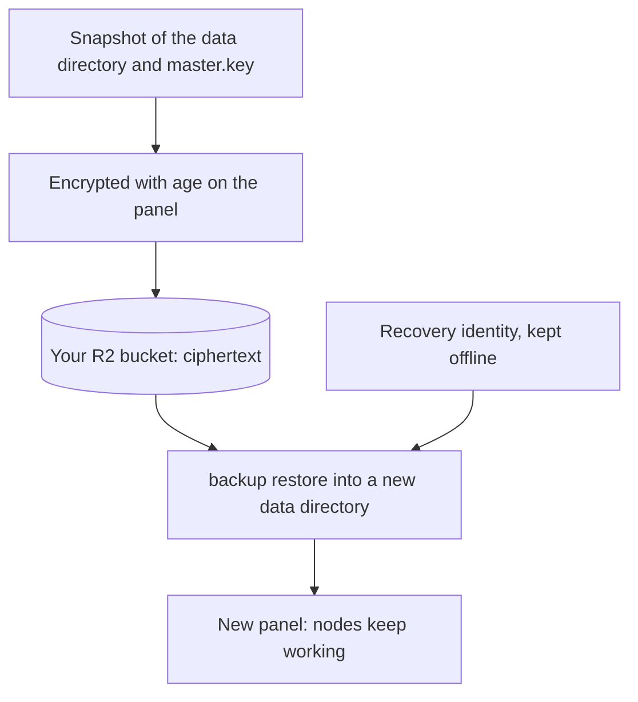

Mistgate 可以将定时或按需创建的面板备份上传到 Cloudflare R2 存储桶。**备份默认关闭，只有所有者配置后才会启用。**每个归档文件都会在离开面板前使用 age 加密；Cloudflare 存储的是密文，而不是数据库内容。

## 开启备份前

### 创建离线恢复私钥（identity）

在一台可信且不作为面板服务器的机器上运行一次：

```sh
mistgate backup keygen --identity-file ./mistgate-recovery.txt
```

此命令会创建一个私有 age 恢复私钥（identity），不会覆盖现有文件，文件权限设为 0600，并输出匹配的 age 公钥（recipient）。该恢复私钥采用后量子混合方案，因此对应的 age 公钥（recipient）以 `age1pq1` 开头；使用 `age-keygen` 创建的 X25519 age 公钥（recipient）（`age1…`）也可接受。将恢复私钥保存在面板和 R2 之外，并另存一份离线副本。只将 age 公钥（recipient）粘贴到面板。没有恢复私钥就无法解密备份。

### 创建 R2 存储桶和令牌

在 Cloudflare R2 中创建存储桶和一个仅限该存储桶的 S3 API 令牌。Mistgate 需要对象的**读取、写入和删除**权限：存储测试会列出备份、写入临时对象、读回对象（恢复时会下载）并删除对象；已配置的保留期限也会删除过期备份。请使用专用令牌，不要使用账户级 API 密钥。

## 配置面板

只有所有者可以配置和运行备份；保存设置、测试存储以及**立即创建备份**都需要重新确认登录。打开 **设置 → 备份**，填写 **Cloudflare 账户 ID**、**存储桶管辖区**（Default、EU、US 或 FedRAMP）、**R2 存储桶名称**、**R2 访问密钥 ID**、**R2 机密访问密钥**以及 **age 恢复公钥（recipient）**。机密访问密钥使用面板主密钥加密，API 不会返回它。如果密钥字段留空，已保存的密钥会保留；**清除已保存的机密访问密钥**会将其删除。

1. 保存设置。
2. 选择 **测试 R2 访问**。面板会列出存储桶，然后写入临时对象、读回并删除它。
3. 将间隔设为 1 到 168 小时（默认 24 小时），并设置保留天数。`0` 表示永不清理；否则保留期限必须为 7 到 3650 天。无论备份多旧，清理都不会删除最新的 3 份，因此即使保留期限与间隔相同，也会留下多份备份。
4. 启用自动备份并保存。首次定时任务会在约一分钟内开始，之后按间隔运行。**立即创建备份**会立即启动一项经所有者确认的备份任务。任务在面板中运行，不依赖浏览器请求；页面会显示任务正在运行，之后显示结果，关闭页面不会停止任务。运行超过 4 小时的备份会被放弃。

面板会创建一致的 SQLite 快照，包含数据目录中的其他文件（包括发布包和 Let’s Encrypt 缓存）以及生效的 `master.key`，再创建带有文件哈希的清单，使用 age 公钥（recipient）加密归档文件并上传到 R2。页面会显示最近一次成功备份、保留期限、最近的错误代码以及存储桶中的近期备份。Mistgate 不会存储私有恢复私钥（identity）。即使 R2 中有备份，也要另存一份恢复私钥。

操作在数据目录内的临时目录中完成，因此磁盘必须有足够空间再存放一份数据库和加密后的归档文件；其他文件会直接读取。定时任务失败后，下一次尝试会等待 2 分钟，然后依次等待 4、8 分钟，最长不超过设置的间隔。保存设置会结束等待。



## 在新面板上恢复

从 R2 下载加密对象，并将对象、恢复私钥（identity）和 `mistgate` 二进制复制到新面板主机。如果 Mistgate 已在运行，请先停止它。将数据恢复到一个**尚不存在的新目录**；命令会拒绝覆盖文件：

```sh
mistgate backup restore \
  --identity-file ./mistgate-recovery.txt \
  --file ./backup.tar.gz.age \
  --data-dir /var/lib/mistgate-restored
```

使用的 `mistgate` 二进制版本必须不早于创建备份的面板版本。如果归档中的数据库包含该二进制不认识的迁移，命令会拒绝恢复并显示创建备份时的版本；较旧的归档可以恢复，面板启动时会将数据库升级到当前版本。

请以面板服务账户运行恢复命令，或者在启动服务前设置恢复目录的所有者。将 systemd 单元指向 `/var/lib/mistgate-restored`，并设置 `serve --data-dir`。恢复的数据包含数据库、面板 CA 和主密钥，因此已注册的节点和面板加密密钥可以继续使用。

如果 systemd 通过 `CREDENTIALS_DIRECTORY` 提供 `master.key`，请在启动 Mistgate 前将该凭据替换为恢复出的 `master.key`。服务必须使用恢复出的密钥才能读取恢复的数据库。

在恢复后的面板成功启动并确认登录、节点和订阅都正常前，请保留旧数据目录。不要将归档恢复到正在运行的数据目录上。丢失恢复私钥（identity）会导致 R2 归档无法使用；丢失恢复出的主密钥会导致面板加密密钥无法读取。

## 失败情况

备份失败时，设置页面会显示错误代码。如果所有者已关联 Telegram，所有者也会收到一次失败通知（无论定时任务重试多少次），并会在下一次备份成功时再次收到通知：参见 [Telegram 告警](telegram-alerts.md)。
