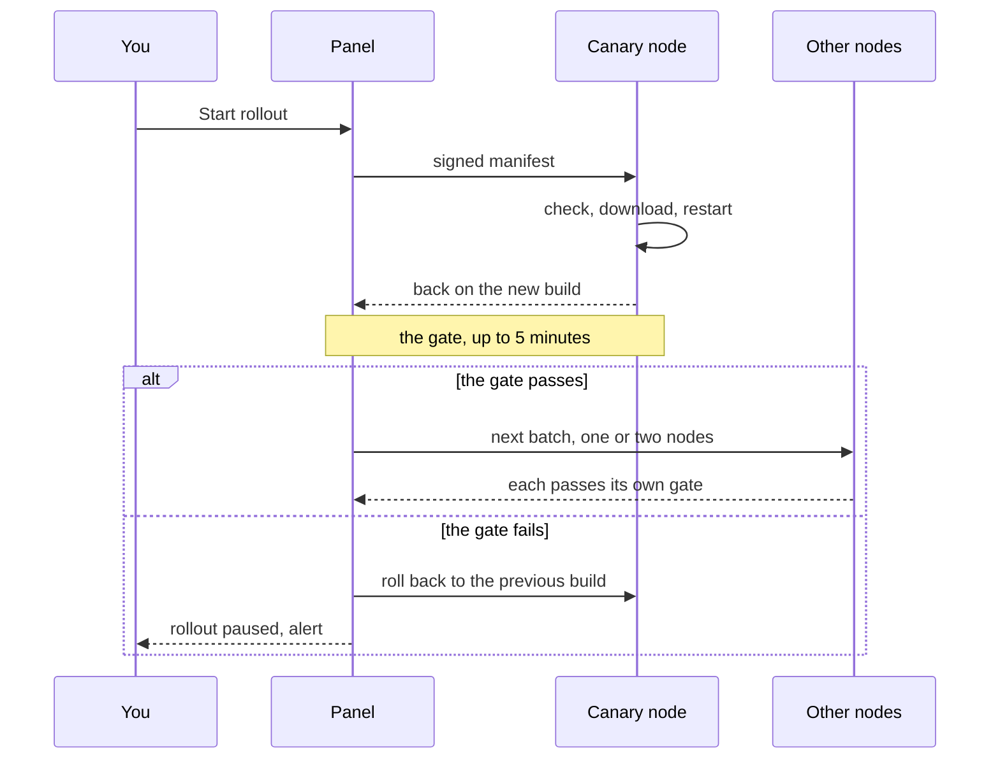

节点 Agent 会自我更新，但只会更新到使用发布密钥签名的构建版本。面板会将已签名的发布包发送给节点；每个 Agent 在替换自身前，都会根据编译进二进制的密钥检查签名。面板不会自行更新节点：要立即更新，请点击**更新 N 个节点**（或节点所在行中的**更新**）；也可以为节点安排一个低峰时段更新。面板本身也可以从更新页面安装较新的正式版本，但同样必须先验证签名。

本页介绍如何运行集群。如何生成发布密钥、为发布版本签名并发布，见[发布版本和签名](releases.md)。

签名的节点发布包中还包含一张 IPv4 和 IPv6 地址段表，附带 ASN 运营商名称，由 iptoasn.com（PDDL 1.0）的数据生成。表中只有网络地址段，没有客户端地址，也没有关于任何人的记录。

## 信任机制

- 只有一对 Ed25519 密钥：**发布密钥**。私钥由签名发布版本的人离线保管；两个二进制在构建时都会写入公钥。官方二进制包含项目的密钥。面板首次启动时也会将密钥保存在 `<data-dir>/release.pub`。
- 每个发布版本有两份已签名清单：节点发布包（`manifest.json` 和 `manifest.sig`）以及面板清单（`panel-manifest.json` 和 `panel-manifest.sig`）。每份清单都列出版本、构建时间、有效期，以及每个二进制的名称、操作系统、架构、大小和 SHA-256。面板清单使用独立的 Ed25519 上下文签名，因此 Agent 不会将其作为更新接受，面板也不会将节点二进制安装为面板自身。
- Agent 会依次检查：签名是否与编译进二进制的密钥匹配、清单格式、有效期、发布版本是否比当前版本更新，以及发布包是否包含适用于其操作系统和架构的文件。它先通过双向 TLS 从面板下载文件（[Cloudflare 版](#在-cloudflare-版中)则通过 Agent 链路）；当 VPS 面板为支持该能力的 Agent 提供 GitHub 时，传输失败后可以继续从 GitHub 下载。Agent 会根据已签名清单检查文件大小和 SHA-256。最终摘要不匹配会明确使步骤失败，不会从其他来源重新下载。任何失败都不会更改已安装的二进制。
- 面板只是传送方：即使面板遭到入侵，也不能让节点运行未经发布密钥签名的代码。
- 发布版本按构建时间排序（即源代码提交的 Unix 时间），而不是按版本字符串排序。构建时间与节点相同时，发布版本显示为「已是最新」；更早的发布版本会被拒绝，不能降级。
- 未使用发布密钥构建的节点 Agent 无法自我更新；`mistgate-node version` 会输出它所包含密钥的指纹。如果编译进面板的密钥与 `release.pub` 不同，面板会记录 `release key mismatch`，在确认新密钥前不信任任何发布包：参见[发布版本和签名](releases.md)中的「轮换发布密钥」。

## 发布包的来源

面板将节点发布包保存在 `<data-dir>/dist` 中。（[Cloudflare 版](#在-cloudflare-版中)没有这个文件夹，使用自己的发布版本；本节和**发布包**一行介绍的是 VPS 面板。）

- **从 GitHub 获取**。包含发布密钥的面板会在启动时检查 `Mistgate/mistgate` 在面板[发布渠道](#发布渠道)中的最新版本，此后每 10 分钟检查一次。如果发布版本中包含的节点发布包通过面板密钥验证，且版本比面板已有的发布包更新，面板就会下载该包、检查所有文件，然后一次性替换 `dist`。使用其他密钥签名的发布版本会被忽略，`dist` 保持不变。下载发布包不会自动更新节点。
- **手动放入**。使用自有密钥构建的面板会读取你签名并复制到 `dist` 的发布包：参见[发布版本和签名](releases.md)中的「使用自有发布包」。面板会在一分钟内重新读取 `dist`；选择**重新读取文件夹**可立即重新读取。

更新页面集群卡片底部的**发布包**一行会显示结果（详细信息位于**详情**中；发布包检查失败或缺失时会自动展开）：

| 状态 | 含义 |
|---|---|
| 签名已验证 | 签名与此面板的发布密钥匹配，清单有效，所有文件都存在且大小和校验和正确。只有此类发布包可以滚动更新，或用于[通过 SSH 安装](../getting-started/ssh-install.md)。 |
| 检查失败 | 发布包存在问题；卡片会说明原因（见下文）。 |
| 未检查 | 此安装没有可用的发布密钥：构建中和 `release.pub` 中都没有密钥，或两者不匹配。面板无法判断发布包是否可信；节点仍会自行检查。 |
| 无发布包 | `<data-dir>/dist` 中没有 `manifest.json`。 |

| 原因 | 处理方法 |
|---|---|
| 面板数据目录中没有节点发布包 | 等待从 GitHub 下载，或将自己的发布包复制到 `<data-dir>/dist`。 |
| 缺少签名文件（manifest.sig） | 也复制 `manifest.sig`。 |
| manifest.json 不是有效的发布清单 | 重新签名；不要编辑清单。 |
| 清单使用了此面板不支持的较新格式 | 先更新面板。 |
| 此面板的发布密钥无法验证签名 | 发布包使用了其他密钥签名，或面板使用了不同密钥构建。 |
| 清单已过期；请重新签名 | 需要更新的签名：维护者会在 GitHub 上续签，或者你使用较新的 `--expires` 重新签名。 |
| 清单列出的文件缺失 | 复制发布包中的所有文件。 |
| 文件与清单不符（大小或校验和） | 复制未完成或文件已被修改；重新复制。 |

面板只会通过 Agent 接入端点向证书有效的 Agent 提供发布包文件；同时最多允许 4 个活动下载。续传同一文件会立即接管该节点的下载位置；旧处理程序会自行完成写入。只有 `dist` 中的常规文件才会计入（不会跟随符号链接）。请一次性替换手动制作的整个发布包；滚动更新期间更改发布包会暂停更新。

## 更新页面

所有人都可以查看此页面。更新、定时、暂停、继续、取消、回滚节点以及**重新读取文件夹**都需要所有者权限和重新验证（参见[安全](security.md)）。

页面分为三层，顶部一排各有一张卡片：**此面板**、**节点 Agent** 和**服务器系统**。每张卡片说明该层的现状并带有状态标记，因此无论打开哪一层，三层的情况都一目了然；选中的层在下方展开。有面板更新时页面默认打开面板层（应先更新面板，再更新节点），否则打开节点 Agent 层；地址会记住所选的层。Cloudflare 版只有前两层。

各层的内容（节点概览卡片、分阶段更新和节点列表都在**节点 Agent** 层；**服务器系统**见[服务器操作系统](#服务器操作系统)）：

- **此面板**：一行显示版本、构建日期、状态和**检查 GitHub**。有新的已签名版本时，卡片会突出显示并提供**更新面板**。发布密钥指纹、SHA-256 和说明位于**详情**中；面板无法自我更新时会自动展开更新步骤。
- **集群卡片**：显示集群状态（例如「已有 2 / 4 个节点运行 v0.1.24」）、每个节点一个区段的状态栏、各状态的节点数以及主要按钮。有可更新内容时，按钮为**更新 N 个节点**；滚动更新运行期间，按钮为**暂停** / **继续** / **取消滚动更新**。最后一行是**发布包**：显示 `<data-dir>/dist` 中的发布包、签名检查结果、版本和日期、**重新读取文件夹**，以及折叠的详情（文件、拒绝原因、手动制作发布包的步骤）。
- **滚动更新**：运行中的更新会紧接集群卡片显示，并按阶段列出（金丝雀节点和批次）及各阶段的节点；兼容的 Agent 下载文件时会显示阶段、进度、已下载大小和最近一段传输速度；最近一次已完成的更新显示在节点列表之后，成功结束时会折叠为一行（**显示阶段**）。
- **节点**：每个节点一行，显示 Agent 版本和构建日期、状态以及最近一次更新。所有者每行有一个主要按钮：**更新**（已有定时任务时显示**定时更新**）；旁边的 **⋯** 菜单中有**定时…** 和**回滚…**。属于当前滚动更新的节点会在所在行显示状态（「排队中 · 第 2 批」「正在更新…」），且不能单独更新或定时；在允许回滚的节点上仍会显示**回滚…**。

| 节点状态 | 含义 |
|---|---|
| 已是最新 | 构建版本不早于可信发布包（没有可信发布包时，以面板自身构建版本为准）。 |
| 有可用更新 | 节点可以自我更新，且当前运行的构建版本较旧。 |
| 正在更新… | 此节点正在更新。 |
| 已回滚 | 最近一次更新以回滚结束；节点运行的是上一版本。 |
| 更新失败 | 节点上的最近一次更新失败。 |
| 手动更新 | 此节点的 Agent 无法自我更新（见下文「旧 Agent」）。 |
| 离线 | 节点未连接；页面显示最近一次已知的构建版本。 |

节点下方显示「没有防止反复崩溃的保护」表示其服务文件没有崩溃循环保护；此时只能依靠 Agent 自带的 5 分钟自回滚机制保护更新。如果「运行状况 → 诊断」提供**刷新服务单元**，请在该处应用修复；Agent 过旧而无法提供修复时，请使用当前二进制运行一次 `mistgate-node install`。

### 更新内容

在集群卡片下方和面板那一行，页面会列出更新带来的变化，方便你决定现在更新还是稍后再说：比你最旧的节点 Agent 更新的每个稳定版本的发布说明，直到面板上的发布包为止（面板自身则是从当前版本到它可安装版本之间的每个版本）。最新版本完整显示，内容较长时有**显示全部**；更早的版本折叠在「以及另外 N 个更早的版本」之后。发布说明使用界面语言显示（该版本没有对应语言时显示英文）。

文本来自 GitHub 上的发布说明，面板按与检查发布版本相同的周期，通过 HTTPS 从官方仓库读取。它只作参考，**未经签名**：只有清单才有签名。除了一个标记之外，不会依据它做任何决定。发布说明中带有**安全**章节（标题为「Security」、「Безопасность」或「安全」）的版本会标记为**安全修复**，卡片会明确说明此次更新包含安全修复、建议尽快更新。没有这样的章节时，页面不会提示紧急程度。没有受信任的发布包，或面板尚未读取发布说明时（在 [Cloudflare 版](../getting-started/install-edge.md)中，点击**检查 GitHub** 时才会读取），该区块不会显示。

## 发布渠道

每个发布版本都属于一个渠道，标签会说明是哪个：`vX.Y.Z` 是**稳定版**，`vX.Y.Z-testing.N` 是**测试版**，`vX.Y.Z-dev.N` 是**开发版**。面板跟随一个渠道，会提供该渠道及所有更稳定渠道中的最新版本：稳定版只看稳定发布，测试版看测试和稳定发布，开发版三者都看。面板自身的更新和节点发布包都跟随渠道；节点仍然只在你发起推送时更新。

| 渠道 | 适用于 |
|:--|:--|
| **稳定版**（默认） | 经过验证的发布，适合所有面板。 |
| **测试版** | 比其他人更早获得下一个版本。可能有错误，请告诉我们。 |
| **开发版** | 开发中的构建：最新的一切，可能会出问题。适合你自己的测试面板。 |

所有者在更新页面更改渠道：面板版本旁边的标签会打开**发布渠道**窗口。更改需要重新验证身份，会写入审计日志，下一次检查会立即使用新渠道。切换到更早的渠道时，会立即提供该渠道的最新版本；切换到更稳定的渠道时不会安装任何更旧的版本：面板和节点会保持当前版本，直到该渠道发布更新的版本，面板条会说明这一点。**更新内容**会标出测试版和开发版发布。使用 `--channel testing` 或 `--channel dev` 安装的面板（参见[安装面板](../getting-started/install-panel.md)）会从该渠道开始。MCP 工具 `updates_status` 会显示渠道，但不能更改。

## 更新节点

### 在一次滚动更新中更新所有节点

点击集群卡片中的**更新 N 个节点**，会打开一个窗口，列出所有可更新节点；每个节点前都有复选框（默认全部选中），并会标出金丝雀节点，即当前在线人数最少的节点。窗口会说明金丝雀节点需要通过 5 分钟检查，其余节点会分批更新（待更新节点少于 5 个时每批 1 个，否则每批 2 个），以及节点检查失败后会回滚到上一版本并暂停滚动更新。在点击**开始滚动更新**前不会执行任何操作。和单节点更新一样，操作会固定到页面显示的发布包，并要求重新验证。滚动更新运行期间、没有可信发布包时，以及非所有者都看不到此按钮；要在指定时间更新的节点需逐个设置定时任务（见下文）。



### 立即更新、加入当前滚动更新或稍后更新

点击节点所在行的**更新**会打开一个对话框，提供两种选择：

- **立即更新**会马上开始更新该节点。如果使用同一版本的另一项更新正在运行，选项会显示为**加入当前滚动更新**：该节点会成为下一阶段，并在当前阶段通过检查后开始更新。必须先继续、完成或取消已暂停的滚动更新，或使用其他版本的滚动更新。
- **选择日期和时间**会保存定时任务。时间按固定的 UTC 偏移量输入，位置为**设置 → 系统 → 节点定时更新的时区**；默认值是 UTC（在该默认值之前安装的面板会保留当时的默认值 UTC+03:00）。更改设置不会调整已有任务：每个任务都保留保存时显示的准确时间和偏移量。最早可选时间为一分钟后；**取消定时**会移除任务。

每次更新都固定到一个发布版本：

- 立即更新会固定到页面显示的发布包版本（MCP 计划会固定到计划中的版本）：如果可信发布包在此期间已被替换，面板会拒绝执行，并要求你检查新版本。
- 定时任务会固定到保存时选定的已签名版本，且计划时间不能晚于该发布包的有效期。如果选定时间到来时无法开始（节点离线或有其他更新正在运行），面板会持续尝试 2 小时；之后所在行会显示定时任务已错过，并且不会自行启动。因此，安排在低峰时段的更新不会在节点恢复连接后自动启动。请重新设置定时任务，或取消它。如果发布包在此之前已被替换，面板不会改用新版本；请重新检查并设置定时任务。

### 单节点更新过程

1. 面板发送已签名清单。Agent 检查清单、下载文件，将当前二进制保留为 `<binary>.prev`，用新二进制替换原文件，并在原位置重启自身（systemd 不会察觉）。节点会离线几秒；管理后台会显示正在更新，而不是节点离线。
2. 对支持 `update-timeout/1` 的 Agent，面板会按设置给出下载窗口（默认 30 分钟，可在「设置 → 系统 → 最大下载时间」中修改）；窗口在发送命令时捕获，连续 90 秒没有数据传输时，下载会从中断处继续，最多三次，仍在窗口内。面板始终先提供自身发布包；若该来源已启用且已针对此发布版本验证，则会将 GitHub 排在其后，发送给支持 `update-sources/1` 的 Agent。修改设置只影响后续步骤。旧 Agent 继续使用内置的 10 分钟限制。Agent 响应后，面板最多等待 3 分钟，直到节点以新构建版本重新连接。
3. 节点重新连接后，**更新后检查**最多运行 5 分钟。以下条件全部满足时检查通过：
   - 新构建版本已提交：Agent 已连接并应用配置，且没有协议配置启动失败；
   - 节点应用的配置与面板一致；
   - 更新前正常运行的协议配置全部正常（协议配置持续失败 30 秒会立即导致检查失败）；
   - 面板能够检测的每个协议配置都在节点恢复连接后通过[客户端视角检测](health.md)（面板会立即启动一轮检测）。[Cloudflare 版](#在-cloudflare-版中)略过这一条。
   - 如果节点上有已启用、经由 WARP 出口的协议配置，WARP 隧道自节点恢复连接起保持正常。
4. 检查通过后，此更新步骤完成。检查失败时会指出未满足的条件：新构建版本未确认更新、节点未应用配置、面板无法读取节点的协议配置、某个协议配置失败，或 WARP 未能连通。检查失败时，面板会要求节点回滚（恢复上一版二进制），此步骤显示为「已回滚」，并暂停整个滚动更新。

**只有面板自身的路径丢包时。** 节点重启或更新后，面板到节点的路径可能丢包，而节点本身正常，其他节点也能连上它。此时客户端视角检测会超时，检查会误判一台健康的节点。对于代理更新和系统更新，检查还有第二条通过的途径，且仅当未满足的条件只有客户端视角检测时才适用：每个失败的轮次都是超时（连接被拒绝、认证错误和 TLS 错误不算），并且失败持续了至少一分钟；节点自报正常（任务已完成或新构建已确认，每个启用的协议配置都在运行，并且节点自己的解析器检测在其回来之后通过）；并且在节点回来之后，由另一个节点（不是面板，也不是节点本身）发起的端口检测看到每个 UDP 端口都能送达，每个 TCP 和 TLS 端口都由该节点应答。这时该步骤带着备注「面板自身到节点的路径正在丢包」通过，节点的「历史」中会出现信息级事件 `panel_path_lossy`。如果另一个节点同样看不到这些端口，或没有其他节点能够检测，检查仍像以前一样失败，备注会说明是哪种情况。这证明了可达性（以及 TLS 监听），再加上节点自己的报告；它不是一次完整的、经过隧道的客户端连接。面板的[合成告警](health.md)保持不变，在面板路径恢复之前可能一直是红色。

### Agent 自带的安全保护

Agent 不会依赖面板撤销有问题的更新：

- 新构建版本启动后 5 分钟内仍未连接并应用配置时，会恢复上一版二进制并重启（`not_committed`）。
- 新构建版本的构建时间与清单不一致时，会立即回滚（`built_mismatch`）。
- 更新待处理期间，服务文件会统计启动次数；连续第 3 次启动时，会在 Agent 运行前恢复上一版二进制（`crash_loop`）。
- 上一版本会在重新连接后报告结果。

### 暂停、继续和取消

更新页面顶部会显示正在运行的更新及其进度；所有者可以选择**暂停**、**继续**或**取消滚动更新**。

- **暂停**：不再开始新步骤。正在执行的步骤会完成并通过更新后检查。已经更新的节点会保持新版本。
- **继续**：继续剩余的等待步骤。失败或已回滚的步骤保持原状；修复原因后，再次更新这些节点。如果磁盘上的发布包已更改，则无法继续；请取消并重新开始。
- **取消滚动更新**：跳过等待更新的节点；正在更新的节点会完成并接受检查；已更新的节点会保持新版本。

滚动更新也可能自动暂停：

| 暂停原因 | 发生情况 |
|---|---|
| 节点没有接受更新 | 节点拒绝了更新（页面会显示原因）。 |
| 节点更新后未通过检查 | 节点未通过更新后检查或没有重新连接；如果可能，面板已将其回滚到上一版本。 |
| 发布包已更改 | `<data-dir>/dist` 中的发布包已更换为另一个版本。请取消并重新开始。 |
| 更新步骤期间面板重启 | 面板无法确定步骤的执行结果。请检查节点，然后继续或取消。 |

第一、第二和第四种情况也会触发「节点更新已停止」告警，直到你继续、取消或开始新的更新。

滚动更新结束后的状态为**已完成**、**已取消**或**已结束，但有问题**（至少一个节点失败或已回滚）。页面会显示当前更新，或最近一次更新。滚动更新记录会保留：始终保留最近 20 项，较早的记录保留 90 天。

常见步骤错误：

| 错误 | 含义 |
|---|---|
| 节点拒绝了签名 | 节点 Agent 信任的是另一个发布密钥。 |
| 此节点的 Agent 构建时未使用发布密钥 | 手动更新 Agent。 |
| 发布版本早于节点当前运行的版本 | 需要更新的已签名构建版本。 |
| 发布包不含适用于此节点操作系统和架构的文件 | 发布包缺少适用于此架构的二进制（例如 `arm64`）。 |
| 节点无法从面板下载文件 | 检查节点到面板的连接。 |
| 节点无法从任何已提供的来源下载文件 | 失败步骤会显示 `sources_failed`，例如 `panel:stalled,github:http_404`；检查节点到面板的连接以及节点访问 GitHub 的情况。 |
| 节点无法在程序文件所在位置写入文件 | 检查节点磁盘；如果「运行状况 → 诊断」提供**刷新服务单元**，请在该处应用修复；也可以使用当前二进制运行一次 `mistgate-node install`。 |
| 节点未在其下载窗口内响应更新命令 | 检查节点和下载进度。 |
| 节点在 3 分钟内没有重新连接 | 检查节点和日志。 |
| 更新后客户端视角检测失败 | 参见[运行状况](health.md)；节点已恢复到上一版本。 |

### 下载来源

VPS 面板默认在**设置 → 系统 → 下载来源**中启用 GitHub 回退。面板始终排在第一位，不能关闭；目前唯一可选来源是 GitHub。只有当面板的发布密钥验证了对应发布标签的已签名清单，且清单中的文件与滚动更新包完全相同时，面板才会提供 GitHub。若重新签名后的清单有效期更晚但文件列表不变，也会接受。自制发布包以及由其他密钥构建的面板所提供的发布包不会从 GitHub 下载。Cloudflare 版不提供此设置。

如果面板正忙、传输速度过慢或面板传输失败，节点可以直接向 GitHub 请求发布二进制。GitHub 会看到节点的公网 IP、发布标签、二进制文件名，以及表明软件名称的 `User-Agent: Mistgate-Update/1`。请求不会带上节点 ID、面板地址、授权标头或面板令牌。更新页面会显示兼容 Agent 当前正在使用的来源；轮询之间来源可能切换。失败下载只列出来源名称和简短错误码，例如 `panel:stalled,github:http_404`。

### 手动回滚

在节点所在行的 **⋯** 菜单中选择**回滚…**（确认对话框会说明要恢复到的版本），会恢复节点之前的二进制（`<binary>.prev`）并重启 Agent。滚动更新之外也可以使用。尚未更新过的节点没有上一版本，无法回滚。如果节点属于正在运行的滚动更新，其步骤会标记为「已回滚」，滚动更新也会暂停。

**上次更新**列会说明是谁回滚节点：「已由你回滚」「面板已恢复上一版本：……」（更新后检查失败）或「上一个版本是按面板的命令恢复的」。

## 旧 Agent：手动更新一次

Agent 无法自我更新时，节点会显示**手动更新**：可能是因为版本早于自我更新功能、构建时没有发布密钥，或运行在第一版服务文件下（该版本的程序目录只读）。节点所在行的**如何更新**会提供两个命令，例如：

```sh
scp /var/lib/mistgate/dist/mistgate-node-linux-amd64 root@de1.example.com:/root/mistgate-node
ssh root@de1.example.com 'chmod +x /root/mistgate-node && /root/mistgate-node install'
```

`install` 会将二进制复制到 `/usr/local/bin/mistgate-node`，写入当前加固服务文件（含崩溃循环保护）并重启 Agent。之后可以从更新页面更新节点。如果面板没有发布包，请使用与面板相同发布版本的 `mistgate-node`。Cloudflare 版中这两条命令不同：见下文。

较旧的 Agent 仍可与较新的面板配合使用：Agent 协议的更改只会添加能力，不会移除已有能力。旧 Agent 缺少某项功能时，面板会在需要使用该功能的地方报告「Agent 版本过旧」。

## 在 Cloudflare 版中

[Cloudflare 版](../getting-started/install-edge.md)的面板同样在此页面更新节点，金丝雀节点、批次、更新后检查、暂停、继续、取消、手动回滚和定时更新的工作方式与上文相同。不同之处如下：

- **发布版本就是面板自己的版本。** 面板提供它部署时所用版本的已签名节点发布包，用编译进面板的密钥验证，不会去找更新的版本。要让节点升级到更新的发布版本，先把它部署到面板，再在此处点击**更新**。如果面板不是发布版本构建，或无法从 GitHub 获取自己的发布版本，集群卡片会说明原因（面板会在一分钟内重试），也无法开始滚动更新。滚动更新期间若部署了另一个版本，且仍有节点在等待，滚动更新会暂停（「发布包已更改」）。这里没有 `dist` 文件夹，因此不会显示**发布包**一行和**重新读取文件夹**。
- **节点通过面板下载。** 更新命令带有一个仅对单个步骤有效的令牌。Agent 带着该令牌请求 `<Agent 连接地址>/update/<节点 ID>/<文件>`，面板的 Worker 再从 GitHub 发布版本中以流的形式返回文件：节点不会连接 GitHub，只需能够访问面板。中断的下载会从中断处继续。替换之前，Agent 会根据已签名清单检查大小和 SHA-256。令牌只对该节点有效，只在它的步骤等待响应期间有效，并且只对滚动更新开始时所用清单中的文件有效。
- **更新后检查不含客户端视角检测。** 此版本的面板暂不运行[客户端视角检测](health.md)，因此更新后检查略过该条件，滚动更新窗口和卡片也会说明这一点。其余条件仍然要求：新构建版本已提交、节点已应用面板的配置、更新前正常运行的协议配置没有失败，并且经由 WARP 出口的协议配置的 WARP 已连通。如果新构建版本的协议配置仍在运行、隧道却已损坏，它也能通过这项检查；金丝雀节点和分批更新可以限制影响范围。
- **步骤按分钟推进。** 此版本的定时任务每分钟推进一次滚动更新，因此决策可能比 VPS 面板晚一分钟以内。等待时限相同。
- **面板本身**在你的电脑上更新，而不是在此页面：`mistgate edge deploy --host panel.example.com --version vX.Y.Z`，`--rollback` 可回到上一版本（参见[更新](../getting-started/install-edge.md#更新)和[回滚](../getting-started/install-edge.md#回滚)）。面板所在行会显示这些内容，而不是**更新面板**。部署之后，节点会显示**有可用更新**。

v0.1.49 及更早的 Agent 暂时无法通过 Agent 连接下载，因此它所在行会显示**手动更新**。**如何更新**会给出两条命令，需以 root 身份在节点上运行一次；页面会根据已签名清单填入版本、适用于节点架构的文件及其 SHA-256：

```sh
curl -fL -o /root/mistgate-node.new https://github.com/Mistgate/mistgate/releases/download/vX.Y.Z/mistgate-node-linux-amd64 && echo "<sha256>  /root/mistgate-node.new" | sha256sum -c -
chmod +x /root/mistgate-node.new && mv /root/mistgate-node.new /root/mistgate-node && /root/mistgate-node install
```

第一条命令输出 `OK` 后再运行第二条。节点只有这一次需要访问 GitHub；如果无法访问，请自行将文件复制到 `/root/mistgate-node.new`，再运行校验和第二条命令。`install` 会保留节点的身份及其与面板的连接信息，写入当前服务文件并重启 Agent。之后节点即可从此页面更新。尚未上报架构的节点会得到 amd64 文件；ARM 服务器请使用发布版本 `manifest.json` 中的 arm64 文件及其 SHA-256。

## 更新面板

本节介绍 VPS 面板。[Cloudflare 版](#在-cloudflare-版中)的面板通过 `mistgate edge deploy` 更新。

更新页面会在启动时检查 `Mistgate/mistgate` 在面板[发布渠道](#发布渠道)中的最新版本，此后每 10 分钟检查一次（与节点发布包的检查频率相同）。有新的已签名版本时，所有非更新页面都会显示一个包含版本号的小卡片。可以将卡片折叠为标记，或关闭卡片直到出现更新版本。选择**检查 GitHub**可立即检查（最近 3 分钟内执行过检查时会直接使用缓存结果，以便将未认证的 GitHub 配额留给发布包下载）。

**更新面板**会先打开一个窗口：说明会发生什么（面板重启约一分钟；节点和用户连接继续工作；新版本无法启动时面板会自动回退），以及备份。如果已设置[备份到 Cloudflare R2](backups.md)，窗口会显示上次备份并提供**立即备份**；否则提供设置链接。**保存到这台电脑**会下载名为 `mistgate-backup-<面板>-<版本>-<日期>.tar.gz.age` 的加密备份：有恢复密钥时用它加密，否则用你为该文件设置的密码加密。**更新**不会等待备份，除非 R2 备份正在进行。

仅当发布版本包含 `panel-manifest.json` 和 `panel-manifest.sig`、签名通过编译进此面板的发布密钥验证（`release.pub` 不计入：面板服务用户可以写入该文件）、清单未过期且构建时间晚于当前面板时，才可以安装面板发布版本。发布版本按构建时间而不是版本字符串排序：如果面板是从标签之后的提交构建的（例如 `v0.1.6-3-gabc1234`），则不会将 `v0.1.6` 视为更新，因此也不会向已执行相应数据库迁移的面板提供降级版本。没有此类清单的发布版本会显示「没有使用此面板的发布密钥签名，无法安装」；清单过期的发布版本会显示为已过期，直到重新签名。卡片会显示发布版本构建日期和适用于此服务器的二进制 SHA-256。**更新面板**会提交该版本和 SHA-256；如果此时最新的已签名发布版本已不同，面板会拒绝更新。

面板以 root 身份运行并由 systemd 管理时，可以自动安装更新。使用非特权服务用户（例如 `mistgate`）运行的面板可以使用下面固定的 root 辅助程序；HTTP 面板本身仍以非特权用户运行。无论哪种情况，所有者都必须重新验证，并且必须先完成当前节点滚动更新。面板会将已确认的版本和 SHA-256 写入 `<data-dir>/panel-update.request`，然后启动辅助程序（root 面板使用临时 systemd 单元 `mistgate-panel-update-<time>.service`，其他面板使用 `mistgate-panel-update.service`）。请求只能缩小辅助程序可以安装的范围。辅助程序会使用编译进已安装二进制的密钥自行验证发布版本的面板清单，确认清单中的版本和 SHA-256 与已确认内容完全相同且构建时间更新，下载二进制并检查大小、SHA-256 和 ELF 架构。只有全部检查通过后，辅助程序才会停止面板、备份数据目录、替换二进制并重新启动面板。

新面板必须在 systemd 未重启它的情况下持续运行 45 秒（设置为 `Restart=on-failure` 时，几秒后的崩溃只会显示为重启）。否则，辅助程序会停止新面板、恢复旧二进制和数据备份（包括原始文件所有权），再启动旧面板。更新成功后，旧二进制会保留为 `<binary>.prev`；数据快照会保存在数据目录旁边，路径为 `<data-dir>.panel-update-backup.tar.gz`。如果辅助程序在未替换面板的情况下退出（检查或下载失败），更新页面会在几秒内显示更新未完成；随后可以重新开始滚动更新或其他更新。`journalctl -u 'mistgate-panel-update*'` 会说明原因。

面板停止后、首次运行新二进制之前，会创建数据备份。如果新面板未能通过 45 秒检查，可能已升级的数据库会被该备份替换，因此旧二进制不会在不兼容的数据库结构上运行；新面板在这几秒内写入的内容会丢失。以后如需手动回滚，请停止面板，从 `<data-dir>.panel-update-backup.tar.gz` 恢复数据目录，放回 `<binary>.prev` 并启动面板；更新后所做的所有更改都会丢失。

### 为非 root 面板服务启用更新

对于使用 `User=mistgate` 的 systemd 面板单元，请安装由 root 所有的辅助单元及其受限 PolicyKit 规则。该规则只允许此账户启动 `mistgate-panel-update.service`；不会授予通用 systemd 控制权限或 root shell。面板单元可以保留 `NoNewPrivileges=yes`。辅助单元只会更新标准目录结构：二进制 `/usr/local/bin/mistgate`、数据目录 `/var/lib/mistgate` 和服务 `mistgate.service`。如果非 root 面板安装在其他位置，选择**更新面板**时会显示包含这些路径的错误；请手动更新。

```sh
install -o root -g root -m 0644 deploy/systemd/mistgate-panel-update.service /etc/systemd/system/mistgate-panel-update.service
install -o root -g root -m 0644 deploy/polkit/60-mistgate-panel-update.rules /etc/polkit-1/rules.d/60-mistgate-panel-update.rules
```

加载辅助单元前请先检查它。其 `ExecStart` 必须指定已安装的二进制、数据目录和面板单元。默认面板单元为 `mistgate.service`；如果你的单元名称不同，请在面板中将 `--update-service` 和辅助单元中的 `--service` 设为相同值。将 `ReadWritePaths` 设为数据目录的父目录和二进制所在目录；回滚时，辅助程序需要使用父目录原子重命名数据目录。如果服务用户不是 `mistgate`，请在 PolicyKit 规则中将 `subject.user` 改为该账户的准确名称。两个文件都应归 root 所有，且面板用户不能写入。

```sh
systemctl daemon-reload
systemctl show --property=LoadState --value mistgate-panel-update.service
```

最后一条命令应输出 `loaded`。主机还必须安装 PolicyKit，并运行其授权服务，才能允许面板用户启动辅助程序。辅助程序由面板按需启动，不应手动启用或启动。如果面板提示无法安排更新，请用 `journalctl -u mistgate-panel-update.service` 检查结果。

### 早期构建和手动更新

`0.1.0-<commit>` 等早期提交构建版本早于面板更新程序：它们可以显示发布版本，但无法安装。请按照下方手动步骤，使用 [GitHub Releases](https://github.com/Mistgate/mistgate/releases/latest) 中当前稳定发布版本对应的二进制替换一次。较新的构建版本可从**设置 → 系统**更新：先选择**检查 GitHub**，然后在有新版本时选择**更新面板**。

对于非 systemd 安装、使用自有密钥构建的面板，或手动更新的备用方式：

1. 使用包含相同发布密钥的二进制。如果面板编译进的密钥与 `<data-dir>/release.pub` 不同，在运行 `mistgate release trust-key` 前，面板不会信任任何发布包（参见[发布版本和签名](releases.md)）；不包含密钥的构建仍使用 `release.pub` 检查节点发布包，但无法安装面板发布版本。
2. 节点滚动更新期间不要更新面板：请先暂停或等待其完成。步骤中途重启会暂停滚动更新（「更新步骤期间面板重启」）。
3. 将新二进制复制到已安装二进制旁边，然后停止面板、备份数据目录、替换二进制并再次启动。以下使用[安装面板](../getting-started/install-panel.md)中的标准路径：二进制为 `/usr/local/bin/mistgate`，systemd 单元为 `mistgate.service`；请按需替换为自己的名称：

```sh
scp mistgate-linux-amd64 panel.example.com:/usr/local/bin/mistgate.new
# 在面板服务器上以 root 身份运行
systemctl stop mistgate
tar czf /root/mistgate-backup-$(date +%F).tgz -C /var/lib mistgate
mv /usr/local/bin/mistgate.new /usr/local/bin/mistgate
chmod 0755 /usr/local/bin/mistgate
systemctl start mistgate
journalctl -u mistgate -n 50
```

4. 面板启动时会迁移数据库；不需要其他操作。日志中的 `mistgate starting` 会显示新版本；更新页面上的**此面板**和 `mistgate version` 也会显示版本。

重启前后会发生以下情况：

- 节点 Agent 会自行重新连接（重试间隔逐渐增加，从 1 秒到 60 秒）。面板停止期间，协议配置会继续运行。
- 启动后的前 90 秒内，面板不会打开「节点无法连接」告警。
- 管理员会话会在重启后保留。

> **警告：** 数据库迁移只会向前执行。旧版面板二进制不保证能与新版迁移过的数据库兼容。如需回滚，请停止面板，从更新前的备份恢复数据目录，放回旧二进制并启动面板。备份之后所做的更改都会丢失。

## 服务器操作系统

“更新”页面的**服务器系统**层显示每台服务器的操作系统：先是面板自己所在的服务器，然后是每个节点。无需逐台登录，就能看出哪些服务器在等待新内核、重启或安全更新。

| 列 | 显示内容 |
|---|---|
| 服务器 | 节点（或**本面板所在的服务器**）以及当前在线人数。 |
| 系统 | 发行版及其版本。 |
| 内核 | 正在运行的内核；如果已安装更新的内核，还会显示重启后将启动的内核。 |
| 更新 | 等待更新的软件包数量、其中安全更新的数量，以及服务器上软件包列表的新旧程度。没有安全更新时，这一列显示**无安全更新**，旁边用一行淡色小字写出有多少普通更新在等待（“18 个普通更新”）。 |
| 状态 | **安全更新已是最新**（绿色）、**有安全更新**（琥珀色）、**需要重启**（琥珀色）、**更新失败**（红色）、**正在更新…**、**离线**、**不可用**或**尚未读取**。 |

状态只说明安全和重启。没有待安装的安全更新、也不需要重启的服务器是绿色的，显示**安全更新已是最新**（什么都不在等待时显示**已是最新**），即使有普通软件包（所有不是安全更新的软件包）在等待：它们是数字旁的备注，而不是状态，这样页面才能出现“一切正常”的样子。琥珀色用于有待安装的安全更新和需要重启，红色用于失败。表格上方的汇总行也这样计算：有多少台服务器需要重启、多少台有安全更新，或者“所有服务器的安全更新均已安装”，并附上有普通更新在等待的服务器数。

每行下方会指出需要处理的事项：为何需要重启（新内核，或要求重启的软件包）、被保留的软件包、被中断的安装、自动安全更新已关闭或未安装、此刻有其他包管理器正在运行，以及尚未为新内核构建 AmneziaWG 模块。在容器中内核属于服务商，该行会注明这一点。

读取方式：

- 节点 Agent 在服务器本机读取：依据磁盘上已有的软件包列表和一次模拟升级（`apt-get -s`）。它不访问软件源，不运行 `apt update`，也不改动服务器上的任何内容。因此数字的新旧取决于列表的新旧：“列表：9 天前”表示服务器已九天没有刷新列表；完全没有列表的服务器需要手动执行一次 `apt update`。
- Agent 每六小时完整读取一次；服务器上发生变化（安装了软件包、刷新了列表、重启过）时会更早读取；连接时发送结果。已连接的节点如果最近一次读取早于 18 小时，会显示**尚未读取**。
- 适用于带 systemd 的 Debian 和 Ubuntu。其他系统以及 Agent 版本早于此功能的节点显示**不可用**并说明原因。
- 只有面板以 root 运行时才会读取面板自己所在的服务器；否则该行会提示手动检查。

面板可以从这一层为单个节点安装安全更新并重启它：参见[更新单个服务器的系统](#更新单个服务器的系统)。普通更新（其余所有软件包）、一次更新多个节点和面板自己所在的服务器暂时不能从这里完成：请通过 SSH 或[在节点上手动运行](#在节点上手动运行)中的命令更新。等待中的普通更新不会改变服务器的状态。Cloudflare 版没有这一层。MCP 工具 `os_updates_status` 返回同样的已保存数据和最近一次系统更新；它不会联系节点。

### 更新单个服务器的系统

所有者可以在面板中为单台服务器安装安全更新，或重启它：在节点的**服务器**标签页（**操作系统**卡片）中，或在**服务器系统**层里该节点所在的行。面板会先要求重新确认，就像对节点上以 root 运行的所有更改一样。

| 按钮 | 作用 |
|---|---|
| **安装安全更新…** | 安装发行版所称的安全更新（`unattended-upgrade`）。选择**需要时重启**（推荐）时，之后若需要重启就重启服务器；选择**不重启**时只安装，在你重启之前服务器会显示**需要重启**。 |
| **重启…** | 只重启服务器，不安装任何东西。 |
| **检查更新** | 刷新服务器的软件包列表（`apt-get update`），让数字保持最新。不安装也不重启。每台服务器 30 分钟一次，同时最多三台。 |

确认窗口会说明将发生什么：有多少软件包在等待、其中多少是安全更新，是否有新内核在等待，是否已经需要重启，服务器上有多少人在线，以及他们会在重启期间断线（通常约两分钟）并自行重新连接。它还会提醒会让服务器拒绝执行的情况：`unattended-upgrades` 被设为自动重启、AmneziaWG 模块尚未为新内核构建、软件包安装到一半。旧内核会保留。

接下来在该服务器的行中会发生：

1. 面板为任务生成新的 id 并发给节点的 Agent；Agent 把它作为独立的系统服务运行，所以 Agent 重启不会中断它。行中显示阶段：检查服务器、等待其他包管理器（最多 15 分钟）、修复被中断的软件包、检查更新、安装更新、为新内核构建 AmneziaWG 模块、重启前检查、重启。
2. 重启后，面板最多等待 15 分钟，让服务器以新的启动回来。节点会检查它是否用刚安装的内核启动、曾使用的 AmneziaWG 模块是否已加载，以及它的协议配置是否已启动。
3. 然后面板做与 Agent 更新后相同的检查：配置已应用、之前正常的协议配置没有出故障、通过 WARP 出口的配置里 WARP 已启动、面板自己的客户端视角检测通过（最多 8 分钟）。等待期间，该行会写明在等什么：尚未通过的协议配置的名称（前五个，之后是“另有 N 个”），如果不是配置，则是面板正在向节点应用设置、WARP 正在启动，或节点正在完成自己的检查；以及已经等了多久、最多会等多久。只有在知道任务如何结束之后，面板才会放行服务器：以新的启动被发现回来、但没有任何任务消息的服务器，会等待任务自己的报告。如果服务器在这次检查期间掉线而没有涉及重启，更新会以“服务器已丢失”停止。之后该行显示**完成**，并给出安装的软件包数和新内核。

**过早的重启不会提供。**节点会拒绝在启动后不到 10 分钟内重启（`too_soon`），也会拒绝面板每小时超过一次、每 24 小时超过三次的重启（`reboot_limit`）。面板两者都知道：节点的启动时间，以及它自己系统更新所做的重启。面板在节点数据里给出重启重新可用的时间（两个限制中较晚的一个），在此之前**重启…**保持关闭，下方写着“12 分钟后可重启”（分钟向上取整，随页面一起刷新）。安装不受影响；此时窗口会预先选中**不重启**并说明原因，因为节点在安装之后搁置的重启会让更新停下。在此之前请求重启的 MCP 方案会因同样的原因（`reboot_wait`）被拒绝。

重启是否安全由节点决定，面板无法绕过它的回答：没有“仍然重启”。节点拒绝时，它已安装的更新会保留（**重启…**不安装任何东西，只会说明服务器没有重启），任务以“失败”结束，并标记重启被**搁置**（held），该行会说明原因和该怎么做。任务的每一种拒绝和失败都使用下面这些相同的说法：

| 代码 | 含义与处理办法 |
|---|---|
| `busy` | 服务器上已有其他任务在运行：请等待其结束。 |
| `too_soon` | 服务器 10 分钟内刚重启过，因此没有再次重启。 |
| `reboot_limit` | 面板在最近一小时内或今天已三次重启过此服务器，因此暂不再重启。 |
| `boot_entry_missing` | `/boot/grub/grub.cfg` 中没有最新内核的菜单条目，重启不会启动它，因此节点没有重启：请在服务器上运行 `update-grub`，或在服务商面板中重启。 |
| `boot_default_custom` | 启动菜单（GRUB）被设为指定或已保存的条目，而不是最新内核，因此节点没有重启：请设置 GRUB_DEFAULT=0，或在服务商面板中重启。 |
| `awg_module_missing` | AmneziaWG 模块尚未为新内核构建，因此节点没有重启：请先构建模块。 |
| `awg_module_build_failed` | AmneziaWG 模块无法为新内核构建；节点没有重启，已加载的模块继续工作：请先修复构建。 |
| `kernel_unknown` | 无法确定服务器将启动的内核，因此没有重启。 |
| `kernel_older` | 下次启动会使用比当前更旧的内核，因此没有重启：请检查启动菜单（GRUB）。 |
| `initramfs_missing` | 缺少启动新内核的文件，因此节点没有重启：请重新安装内核包。 |
| `boot_full` | /boot 分区空间不足以容纳新内核：请删除旧内核。 |
| `apt_lock` | 其他包管理器长时间占用锁：请几分钟后重试。 |
| `dpkg_interrupted` | 软件包安装被中断：请在服务器上运行 sudo dpkg --configure -a。 |
| `dpkg_broken` | 软件包数据库已损坏：请在服务器上运行 sudo dpkg --configure -a。 |
| `disk_full` | 磁盘空间不足：请释放一些空间。 |
| `security_source_failed` | 服务器无法连接其安全更新源：请检查镜像和网络。 |
| `refresh_failed` | 无法刷新软件包列表：请检查服务器的网络和镜像。 |
| `install_failed` | 安装更新失败：请查看服务器上的任务日志（journalctl -u mistgate-os-update）。 |
| `auto_reboot_conflict` | Unattended-upgrades 被设为自动重启，这会绕过检查：请关闭 Automatic-Reboot。 |
| `reboot_failed` | 重启命令被拒绝或服务器没有关机：请在服务商面板中重启。 |
| `kernel_not_switched` | 服务器启动的内核与已安装的不同：请检查启动菜单（GRUB）。 |
| `awg_module_not_loaded` | 重启后 AmneziaWG 模块没有加载：请重新构建，或将后端切换为 Auto。 |
| `inbound_failed` | 重启后部分协议配置没有启动：请查看节点的“配置”标签页。 |
| `unsupported_os` | 此系统无法通过面板更新：请手动更新。 |
| `no_systemd` | 服务器没有 systemd：请手动更新。 |
| `bad_request` | 节点未接受该请求：请更新节点 Agent。 |
| `launch_failed` | 无法启动任务：请检查节点磁盘和 Agent 日志。 |
| `timeout` | 任务耗时过长，已被停止。 |
| `interrupted` | 任务无结果地中断了：请检查服务器。 |
| `cancelled` | 任务在改动任何内容之前被取消。 |
| `unknown` | 节点报告了面板不认识的问题：请查看其历史记录。 |

**不可用**（按钮为灰色，原因写在下面）的情形：服务器离线；其 Agent 太旧，无法运行任务（请在“更新”页面更新 Agent）；系统不是 Debian 12 或 13，也不是带 systemd 的 Ubuntu 22.04、24.04 或 26.04；它是面板自己所在的服务器（重启会让面板下线，请手动更新）；它上面已有另一个任务在运行（更新、AmneziaWG 模块构建、Agent 更新）；尚未从它读到任何信息；没有可安装的安全更新（请使用**重启…**或**检查更新**）；或者正在进行其他更新：另一个节点的系统更新（正在运行，或已停止但尚未关闭）、Agent 滚动更新、面板更新或发布包安装。同一时间只做一件事，避免两次重启或两个包管理器重叠。反过来，系统更新运行期间，Agent 滚动更新、面板更新、发布包安装和定时节点更新都会等待它；仅处于停止状态的系统更新只会阻止下一次系统更新。

**在服务器上已经发生了某些事之后失败时**（任务失败、重启被搁置、服务器没有回来、检查未通过），更新会暂停而不是撤销：软件包无法回滚。该行和“更新”页面会显示带原因的横幅，同时打开告警**节点的系统更新已停止**（`os_update_failed`），为警告级别，服务器没有回来时为严重级别，并发送到 Telegram。点击**关闭**会清除告警并让下一次系统更新可以进行；下一次尝试是一个新任务。如果服务器拒绝了任务而其上什么也没发生，这次运行会自行结束：不暂停、不告警、也不需要点击“关闭”，可以马上重新开始。如果服务器只是请求等一等（`busy`、`apt_lock`、`too_soon`、`reboot_limit`），节点的行上会保留一天一条中性的备注**暂不可用**，附上节点自己的说明。单独的重启只因这些原因被节点搁置时同样如此；对于更新，则是软件包管理器在安装任何东西之前一直被占用的情形。需要查看服务器的拒绝（系统不受支持、磁盘已满）会以红色的**已停止**结束并给出原因，但同样不会阻塞任何东西。因其他原因被搁置的重启，以及任何已经安装了东西或服务器上已发生了某些事的情形，仍会保持暂停，直到你把它关闭。如果服务器在重启后 15 分钟内没有回来，请打开服务商的控制台：如果它卡住了，在 GRUB 的 *Advanced options* 中选择之前的内核（更新永远不会删除旧内核）。

面板把全部状态保存在数据库中，所以更新途中重启面板不会丢失任何东西：它会按 id 找到任务并继续。节点事件 `os_update_started`、`os_update_done`、`os_update_failed`、`os_reboot_started` 以及面板的 `os_step_passed`、`os_step_failed` 显示在节点的**历史**标签页；审计日志记录 `os_rollout_start`、`os_rollout_cancel` 和 `os_refresh`。

### 内核表

节点的“操作系统”卡片（节点 → 服务器）按从新到旧列出已安装的内核，最多 8 个。每行是一个内核，带五个小标记，说明它能否启动：

- **启动**：内核映像在 `/boot` 中，且 initramfs 不小于 1 MiB。
- **GRUB**：`/boot/grub/grub.cfg` 列出了该内核。
- **头文件**：存在 `/usr/src/linux-headers-<内核>`。
- **模块**：已为它构建 AmneziaWG 模块。AmneziaWG 不使用内核模块，或 Agent 看不到构建结果（Debian 上的普通构建）时为灰色。
- **软件包**：该内核的 `linux-*` 软件包已完全配置。

标题下的一行显示“下次启动：就绪”，或“重启会被拒绝：…”并给出第一个原因（`initramfs_missing`、`boot_entry_missing`、`awg_module_missing`、`dpkg_interrupted`、`kernel_older` 或 `boot_default_custom`，与下文重启任务的代码相同）。在“更新”表格中，只有这样的节点才会显示该区块，并且是展开的。只要重启会被拒绝，**重启…** 就会关闭并显示同样的原因。Agent 在自己的沙箱中读取这些文件，不做任何修改；重启任务会以 root 身份重新检查并作出决定，所以这张表是预览，而不是保证。早于此版本的 Agent 会显示“请更新 Agent 以查看内核表”。

“健康”中的“安全更新”检查还会在 `unattended-upgrades` 开启了 `Automatic-Reboot`、而 AmneziaWG 运行在内核模块上时发出警告：这种重启不受 Agent 保护检查的约束，可能落到没有该模块的内核上。请关闭 `Automatic-Reboot`。

### 在节点上手动运行

面板会为单个节点启动同一个任务（参见[更新单个服务器的系统](#更新单个服务器的系统)）。节点自己也可以执行这个任务，所有者可以通过 SSH 在单台服务器上启动它（以 root 运行；Debian 12 或 13，Ubuntu 22.04、24.04 或 26.04，需带 systemd）：

```
mistgate-node host os-update --action upgrade --mode security --reboot if-required        # 只打印计划，不执行
systemd-run --unit=mistgate-os-update --collect --property=KillMode=mixed --property=TimeoutStopSec=600 \
  mistgate-node host os-update --yes --action upgrade --mode security --reboot if-required
```

| 选项 | 取值 |
|---|---|
| `--action` | `refresh`（只刷新软件包列表）、`upgrade`（安装更新；默认）、`reboot`（不改动软件包，只重启）。 |
| `--mode` | `security`（`unattended-upgrade` 所安装的内容；默认）或 `all`（`apt-get upgrade --with-new-pkgs`）。仅与 `upgrade` 一起使用。 |
| `--reboot` | `never`（默认）、`if-required`（仅在需要重启时）或 `always`。`refresh` 只能用 `never`，`upgrade` 用 `never` 或 `if-required`，`reboot` 用 `if-required` 或 `always`。 |
| `--awg-required` | 将 AmneziaWG 内核模块视为必需。只要该模块已加载，命令本来就将其视为必需。 |

不带 `--yes` 时，命令只打印计划。请像第二行那样把它作为独立的 unit 运行，这样断开的 SSH 会话不会打断 `dpkg`。它按顺序执行：检查系统和可用空间；最多等待其他包管理器 15 分钟；若有被中断的软件包安装，先用 `dpkg --configure -a` 完成；运行 `apt-get update`；安装更新；在 Ubuntu 上为新安装的内核构建 AmneziaWG 模块（DKMS）；仅在最后一步、且仅在被要求时才重启。

重启之前，命令会检查，并在以下情况下拒绝：不会重启任何东西，任务以失败结束，重启状态为**已暂缓**：

- apt 或 `dpkg` 正忙（`apt_lock`）；
- 有软件包安装被中断、处于半安装或半配置状态（`dpkg_interrupted`，会列出软件包名）；
- 无法确定下次启动所用的内核（`kernel_unknown`），或它比正在运行的内核更旧（`kernel_older`）；
- AmneziaWG 模块已加载（或给出了 `--awg-required`），而尚未为启动菜单可能进入的每个内核构建：已安装的最新内核，以及每个不比正在运行的内核更旧的较低内核（`awg_module_missing`）；
- 这些内核之一的映像或 initramfs 缺失或不完整（`initramfs_missing`），或内核变更时 `/boot` 可用空间不足 50 MB（`boot_full`）；
- GRUB 可能不会启动第一项：没有 `/boot/grub/grub.cfg`，`/etc/default/grub` 或 `/etc/default/grub.d/*.cfg` 中的 `GRUB_DEFAULT` 不是 `0`，`grub-editenv list` 显示 `saved_entry` 或 `next_entry`，或 `grub-editenv` 无法读取（`boot_default_custom`）；
- `/boot/grub/grub.cfg` 存在，但没有为最新已安装的内核列出 `vmlinuz-<内核>`（`boot_entry_missing`）；
- 服务器启动不足 10 分钟（`too_soon`）：节点不会被循环重启；
- 对面板发送的任务（标识以 `osj_` 开头）：该节点不足一小时前已被此类任务重启过，或 24 小时内已重启三次，或 `os-update.json` 旁边的重启历史无法读取或比时钟更超前（`reboot_limit`）。手动启动的命令不受此限制。

检查通过后，命令会获取 dpkg 锁并一直持有到重启，避免其间有其他包管理器启动。

`--reboot always` 只跳过“是否需要重启”这一问题，不会跳过这些检查。命令从不移除 AmneziaWG 软件包，也不为该模块安装任何软件包，连内核头文件也不装。模块自己的 DKMS 构建失败时，命令以 `awg_module_build_failed` 停止，并指出内核以及其配置会触发构建的 `linux-headers-<内核>` 软件包：不移除任何东西，之后也不再安装任何东西，（若要求重启）重启被暂缓，已加载的模块继续工作到下次启动。请在任何重启之前修复构建（其 `make.log` 位于 `/var/lib/dkms/amneziawg`）。DKMS 因其他原因失败时，例如新内核的头文件未安装，只会使模块缺少该内核的版本并暂缓重启（`awg_module_missing`）。其他拒绝原因：`unsupported_os`（上述列表之外的任何系统）、`no_systemd`、`disk_full`、`security_source_failed`（无法刷新安全软件源；其他失败的源只会被列出）、`install_failed`（会指出软件包）、`auto_reboot_conflict`（`unattended-upgrades` 被设置为自行重启，这会绕过上述检查：请关闭 `Automatic-Reboot` 或使用 `--mode all`）、`busy`（另一个操作系统任务、Agent 更新或模块构建正在进行）。

状态保存在 Agent 状态目录（默认 `/var/lib/mistgate-node`）的 `os-update.json` 中，因此在 Agent 重启和重启本身之后依然保留。重启后，Agent 找到该文件，检查服务器是否回到预期的内核、此前使用过 AmneziaWG 模块的地方该模块是否已重新加载、节点的入站是否已恢复；结果是节点“历史”标签页上的一条事件（`os_update_done`，或带代码的 `os_update_failed`）。`apt` 的输出保留在该 unit 的日志中（`journalctl -u mistgate-os-update`），经过截断且不含地址。安装开始之前可用 `systemctl stop mistgate-os-update` 取消：在 `KillMode=mixed` 下，信号只发给命令本身，已经开始的 `apt` 会让它运行完（至多到 `TimeoutStopSec`）。向 Agent 再次发送相同的任务标识时，返回该任务的结果，不会启动任何东西；被拒绝或失败后，面板会用新的任务标识发送下一次尝试。

它不会做的事：不修改软件源，不运行 `dist-upgrade` 和 `autoremove`（旧内核会保留），不升级发行版，不更改节点的 AmneziaWG 后端设置，也不触碰 Agent 自身的二进制文件。Agent 版本早于此版本的节点没有这个命令。

## 通过 API 和 MCP 更新

任何 API 令牌权限级别都可以读取更新页面（`GetUpdates`）。通过普通 API 无法启动、暂停、继续或取消滚动更新，也无法为节点设置定时任务或回滚节点；拥有管理员权限级别的 MCP 智能体也只能制定计划，所有者必须在管理后台批准每项计划。MCP 的 `rollout_start` 只会更新一个节点，并固定到计划中的版本。同样，节点的系统更新（`StartOsRollout`、`CancelOsRollout`）通过普通 API 会被拒绝，只会以计划 `os_rollout_start`（恰好一个节点：安全更新或重启）和 `os_rollout_cancel` 的形式到达 MCP 智能体，由所有者重新确认后批准；刷新软件包列表（`RefreshOsUpdates`）是所有者在管理后台的操作，不对令牌开放。参见 [API](../reference/api.md) 和 [MCP](../reference/mcp.md)。
