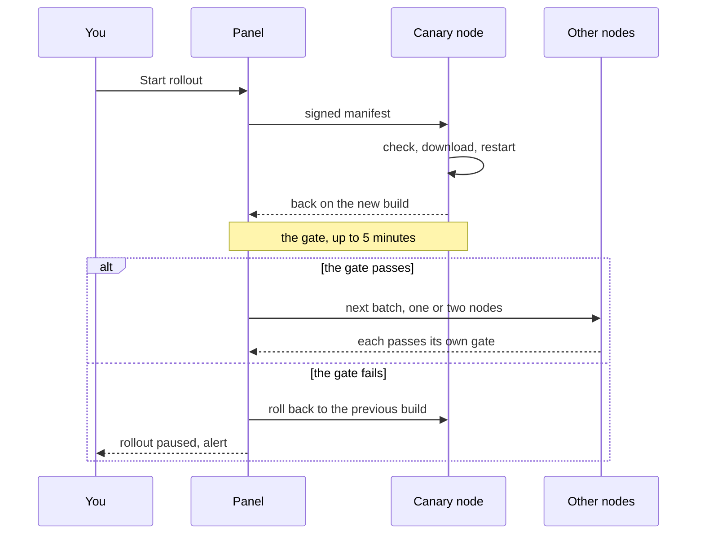

节点 Agent 会自我更新，但只会更新到使用发布密钥签名的构建版本。面板会将已签名的发布包发送给节点；每个 Agent 在替换自身前，都会根据编译进二进制的密钥检查签名。面板不会自行更新节点：要立即更新，请点击**更新 N 个节点**（或节点所在行中的**更新**）；也可以为节点安排一个低峰时段更新。面板本身也可以从更新页面安装较新的正式版本，但同样必须先验证签名。

本页介绍如何运行集群。如何生成发布密钥、为发布版本签名并发布，见[发布版本和签名](releases.md)。

## 信任机制

- 只有一对 Ed25519 密钥：**发布密钥**。私钥由签名发布版本的人离线保管；两个二进制在构建时都会写入公钥。官方二进制包含项目的密钥。面板首次启动时也会将密钥保存在 `<data-dir>/release.pub`。
- 每个发布版本有两份已签名清单：节点发布包（`manifest.json` 和 `manifest.sig`）以及面板清单（`panel-manifest.json` 和 `panel-manifest.sig`）。每份清单都列出版本、构建时间、有效期，以及每个二进制的名称、操作系统、架构、大小和 SHA-256。面板清单使用独立的 Ed25519 上下文签名，因此 Agent 不会将其作为更新接受，面板也不会将节点二进制安装为面板自身。
- Agent 会依次检查：签名是否与编译进二进制的密钥匹配、清单格式、有效期、发布版本是否比当前版本更新，以及发布包是否包含适用于其操作系统和架构的文件。然后通过双向 TLS 连接从面板下载文件，并检查大小和 SHA-256。任何检查失败都不会更改已安装的二进制。
- 面板只是传送方：即使面板遭到入侵，也不能让节点运行未经发布密钥签名的代码。
- 发布版本按构建时间排序（即源代码提交的 Unix 时间），而不是按版本字符串排序。构建时间与节点相同时，发布版本显示为「已是最新」；更早的发布版本会被拒绝，不能降级。
- 未使用发布密钥构建的节点 Agent 无法自我更新；`mistgate-node version` 会输出它所包含密钥的指纹。如果编译进面板的密钥与 `release.pub` 不同，面板会记录 `release key mismatch`，在确认新密钥前不信任任何发布包：参见[发布版本和签名](releases.md)中的「轮换发布密钥」。

## 发布包的来源

面板将节点发布包保存在 `<data-dir>/dist` 中。

- **从 GitHub 获取**。包含发布密钥的面板会在启动时检查 `Mistgate/mistgate` 的最新稳定发布版本，此后每 10 分钟检查一次。如果发布版本中包含的节点发布包通过面板密钥验证，且版本比面板已有的发布包更新，面板就会下载该包、检查所有文件，然后一次性替换 `dist`。使用其他密钥签名的发布版本会被忽略，`dist` 保持不变。下载发布包不会自动更新节点。
- **手动放入**。使用自有密钥构建的面板会读取你签名并复制到 `dist` 的发布包：参见[发布版本和签名](releases.md)中的「使用自有发布包」。面板会在一分钟内重新读取 `dist`；选择**重新读取文件夹**可立即重新读取。

更新页面顶部卡片底部的**发布包**一行会显示结果（详细信息位于**详情**中；发布包检查失败或缺失时会自动展开）：

| 状态 | 含义 |
|---|---|
| 签名已验证 | 签名与此面板的发布密钥匹配，清单有效，所有文件都存在且大小和校验和正确。只有此类发布包可以滚动更新，或用于[通过 SSH 安装](../getting-started/ssh-install.md)。 |
| 检查失败 | 发布包存在问题；卡片会说明原因（见下文）。 |
| 未检查 | 此安装没有可用的发布密钥：构建中和 `release.pub` 中都没有密钥，或两者不匹配。面板无法判断发布包是否可信；节点仍会自行检查。 |
| 无发布包 | `<data-dir>/dist` 中没有 `manifest.json`。 |

| 原因 | 处理方法 |
|---|---|
| 面板数据目录中没有节点发布包 | 等待从 GitHub 下载，或将自己的发布包复制到 `<data-dir>/dist`。 |
| 缺少签名文件（manifest.sig） | 也复制 `manifest.sig`。 |
| manifest.json 不是有效的发布清单 | 重新签名；不要编辑清单。 |
| 清单使用了此面板不支持的较新格式 | 先更新面板。 |
| 此面板的发布密钥无法验证签名 | 发布包使用了其他密钥签名，或面板使用了不同密钥构建。 |
| 清单已过期；请重新签名 | 需要更新的签名：维护者会在 GitHub 上续签，或者你使用较新的 `--expires` 重新签名。 |
| 清单列出的文件缺失 | 复制发布包中的所有文件。 |
| 文件与清单不符（大小或校验和） | 复制未完成或文件已被修改；重新复制。 |

面板只会通过 Agent 接入端点向证书有效的 Agent 提供发布包文件；同时最多允许 4 个下载，并支持分块续传。只有 `dist` 中的常规文件才会计入（不会跟随符号链接）。请一次性替换手动制作的整个发布包；滚动更新期间更改发布包会暂停更新。

## 更新页面

所有人都可以查看此页面。更新、定时、暂停、继续、取消、回滚节点以及**重新读取文件夹**都需要所有者权限和重新验证（参见[安全](security.md)）。

页面从上到下依次显示：

- **顶部卡片**：显示集群状态（例如「已有 2 / 4 个节点运行 v0.1.24」）、每个节点一个区段的状态栏、各状态的节点数以及主要按钮。有可更新内容时，按钮为**更新 N 个节点**；滚动更新运行期间，按钮为**暂停** / **继续** / **取消滚动更新**。最后一行是**发布包**：显示 `<data-dir>/dist` 中的发布包、签名检查结果、版本和日期、**重新读取文件夹**，以及折叠的详情（文件、拒绝原因、手动制作发布包的步骤）。
- **滚动更新**：运行中的更新会紧接顶部卡片显示，并按阶段列出（金丝雀节点和批次）及各阶段的节点；最近一次已完成的更新显示在节点列表之后，成功结束时会折叠为一行（**显示阶段**）。
- **此面板**：一行显示版本、构建日期、状态和**检查 GitHub**。有新的已签名版本时，卡片会突出显示并提供**更新面板**。发布密钥指纹、SHA-256 和说明位于**详情**中；面板无法自我更新时会自动展开更新步骤。
- **节点**：每个节点一行，显示 Agent 版本和构建日期、状态以及最近一次更新。所有者每行有一个主要按钮：**更新**（已有定时任务时显示**定时更新**）；旁边的 **⋯** 菜单中有**定时…** 和**回滚…**。属于当前滚动更新的节点会在所在行显示状态（「排队中 · 第 2 批」「正在更新…」），且不能单独更新或定时；在允许回滚的节点上仍会显示**回滚…**。

| 节点状态 | 含义 |
|---|---|
| 已是最新 | 构建版本不早于可信发布包（没有可信发布包时，以面板自身构建版本为准）。 |
| 有可用更新 | 节点可以自我更新，且当前运行的构建版本较旧。 |
| 正在更新… | 此节点正在更新。 |
| 已回滚 | 最近一次更新以回滚结束；节点运行的是上一版本。 |
| 更新失败 | 节点上的最近一次更新失败。 |
| 手动更新 | 此节点的 Agent 无法自我更新（见下文「旧 Agent」）。 |
| 离线 | 节点未连接；页面显示最近一次已知的构建版本。 |

节点下方显示「没有防止反复崩溃的保护」表示其服务文件没有崩溃循环保护；此时只能依靠 Agent 自带的 5 分钟自回滚机制保护更新。如果「运行状况 → 诊断」提供**刷新服务单元**，请在该处应用修复；Agent 过旧而无法提供修复时，请使用当前二进制运行一次 `mistgate-node install`。

## 更新节点

### 在一次滚动更新中更新所有节点

点击顶部卡片中的**更新 N 个节点**，会打开一个窗口，列出所有可更新节点；每个节点前都有复选框（默认全部选中），并会标出金丝雀节点，即当前在线人数最少的节点。窗口会说明金丝雀节点需要通过 5 分钟检查，其余节点会分批更新（待更新节点少于 5 个时每批 1 个，否则每批 2 个），以及节点检查失败后会回滚到上一版本并暂停滚动更新。在点击**开始滚动更新**前不会执行任何操作。和单节点更新一样，操作会固定到页面显示的发布包，并要求重新验证。滚动更新运行期间、没有可信发布包时，以及非所有者都看不到此按钮；要在指定时间更新的节点需逐个设置定时任务（见下文）。



### 立即更新、加入当前滚动更新或稍后更新

点击节点所在行的**更新**会打开一个对话框，提供两种选择：

- **立即更新**会马上开始更新该节点。如果使用同一版本的另一项更新正在运行，选项会显示为**加入当前滚动更新**：该节点会成为下一阶段，并在当前阶段通过检查后开始更新。必须先继续、完成或取消已暂停的滚动更新，或使用其他版本的滚动更新。
- **选择日期和时间**会保存定时任务。时间按固定的 UTC 偏移量输入，位置为**设置 → 系统 → 节点定时更新的时区**；默认值是 UTC（在该默认值之前安装的面板会保留当时的默认值 UTC+03:00）。更改设置不会调整已有任务：每个任务都保留保存时显示的准确时间和偏移量。最早可选时间为一分钟后；**取消定时**会移除任务。

每次更新都固定到一个发布版本：

- 立即更新会固定到页面显示的发布包版本（MCP 计划会固定到计划中的版本）：如果可信发布包在此期间已被替换，面板会拒绝执行，并要求你检查新版本。
- 定时任务会固定到保存时选定的已签名版本，且计划时间不能晚于该发布包的有效期。如果选定时间到来时无法开始（节点离线或有其他更新正在运行），面板会持续尝试 2 小时；之后所在行会显示定时任务已错过，并且不会自行启动。因此，安排在低峰时段的更新不会在节点恢复连接后自动启动。请重新设置定时任务，或取消它。如果发布包在此之前已被替换，面板不会改用新版本；请重新检查并设置定时任务。

### 单节点更新过程

1. 面板发送已签名清单。Agent 检查清单、下载文件，将当前二进制保留为 `<binary>.prev`，用新二进制替换原文件，并在原位置重启自身（systemd 不会察觉）。节点会离线几秒；管理后台会显示正在更新，而不是节点离线。
2. 面板最多等待 Agent 10 分钟响应（包含下载时间），然后最多等待 3 分钟，直到节点以新构建版本重新连接。
3. 节点重新连接后，**更新后检查**最多运行 5 分钟。以下条件全部满足时检查通过：
   - 新构建版本已提交：Agent 已连接并应用配置，且没有协议配置启动失败；
   - 节点应用的配置与面板一致；
   - 更新前正常运行的协议配置全部正常（协议配置持续失败 30 秒会立即导致检查失败）；
   - 面板能够检测的每个协议配置都在节点恢复连接后通过[客户端视角检测](health.md)（面板会立即启动一轮检测）。
4. 检查通过后，此更新步骤完成。检查失败时，面板会要求节点回滚（恢复上一版二进制），此步骤显示为「已回滚」，并暂停整个滚动更新。

### Agent 自带的安全保护

Agent 不会依赖面板撤销有问题的更新：

- 新构建版本启动后 5 分钟内仍未连接并应用配置时，会恢复上一版二进制并重启（`not_committed`）。
- 新构建版本的构建时间与清单不一致时，会立即回滚（`built_mismatch`）。
- 更新待处理期间，服务文件会统计启动次数；连续第 3 次启动时，会在 Agent 运行前恢复上一版二进制（`crash_loop`）。
- 上一版本会在重新连接后报告结果。

### 暂停、继续和取消

更新页面顶部会显示正在运行的更新及其进度；所有者可以选择**暂停**、**继续**或**取消滚动更新**。

- **暂停**：不再开始新步骤。正在执行的步骤会完成并通过更新后检查。已经更新的节点会保持新版本。
- **继续**：继续剩余的等待步骤。失败或已回滚的步骤保持原状；修复原因后，再次更新这些节点。如果磁盘上的发布包已更改，则无法继续；请取消并重新开始。
- **取消滚动更新**：跳过等待更新的节点；正在更新的节点会完成并接受检查；已更新的节点会保持新版本。

滚动更新也可能自动暂停：

| 暂停原因 | 发生情况 |
|---|---|
| 节点没有接受更新 | 节点拒绝了更新（页面会显示原因）。 |
| 节点更新后未通过检查 | 节点未通过更新后检查或没有重新连接；如果可能，面板已将其回滚到上一版本。 |
| 发布包已更改 | `<data-dir>/dist` 中的发布包已更换为另一个版本。请取消并重新开始。 |
| 更新步骤期间面板重启 | 面板无法确定步骤的执行结果。请检查节点，然后继续或取消。 |

第一、第二和第四种情况也会触发「节点更新已停止」告警，直到你继续、取消或开始新的更新。

滚动更新结束后的状态为**已完成**、**已取消**或**已结束，但有问题**（至少一个节点失败或已回滚）。页面会显示当前更新，或最近一次更新。滚动更新记录会保留：始终保留最近 20 项，较早的记录保留 90 天。

常见步骤错误：

| 错误 | 含义 |
|---|---|
| 节点拒绝了签名 | 节点 Agent 信任的是另一个发布密钥。 |
| 此节点的 Agent 构建时未使用发布密钥 | 手动更新 Agent。 |
| 发布版本早于节点当前运行的版本 | 需要更新的已签名构建版本。 |
| 发布包不含适用于此节点操作系统和架构的文件 | 发布包缺少适用于此架构的二进制（例如 `arm64`）。 |
| 节点无法从面板下载文件 | 检查节点到面板的连接。 |
| 节点无法在程序文件所在位置写入文件 | 检查节点磁盘；如果「运行状况 → 诊断」提供**刷新服务单元**，请在该处应用修复；也可以使用当前二进制运行一次 `mistgate-node install`。 |
| 节点在 10 分钟内未响应更新命令 | 检查节点。 |
| 节点在 3 分钟内没有重新连接 | 检查节点和日志。 |
| 更新后客户端视角检测失败 | 参见[运行状况](health.md)；节点已恢复到上一版本。 |

### 手动回滚

在节点所在行的 **⋯** 菜单中选择**回滚…**（确认对话框会说明要恢复到的版本），会恢复节点之前的二进制（`<binary>.prev`）并重启 Agent。滚动更新之外也可以使用。尚未更新过的节点没有上一版本，无法回滚。如果节点属于正在运行的滚动更新，其步骤会标记为「已回滚」，滚动更新也会暂停。

**上次更新**列会说明是谁回滚节点：「已由你回滚」「面板已恢复上一版本：……」（更新后检查失败）或「上一个版本是按面板的命令恢复的」。

## 旧 Agent：手动更新一次

Agent 无法自我更新时，节点会显示**手动更新**：可能是因为版本早于自我更新功能、构建时没有发布密钥，或运行在第一版服务文件下（该版本的程序目录只读）。节点所在行的**如何更新**会提供两个命令，例如：

```sh
scp /var/lib/mistgate/dist/mistgate-node-linux-amd64 root@de1.example.com:/root/mistgate-node
ssh root@de1.example.com 'chmod +x /root/mistgate-node && /root/mistgate-node install'
```

`install` 会将二进制复制到 `/usr/local/bin/mistgate-node`，写入当前加固服务文件（含崩溃循环保护）并重启 Agent。之后可以从更新页面更新节点。如果面板没有发布包，请使用与面板相同发布版本的 `mistgate-node`。

较旧的 Agent 仍可与较新的面板配合使用：Agent 协议的更改只会添加能力，不会移除已有能力。旧 Agent 缺少某项功能时，面板会在需要使用该功能的地方报告「Agent 版本过旧」。

## 更新面板

更新页面会在启动时检查 `Mistgate/mistgate` 的最新稳定发布版本，此后每 10 分钟检查一次（与节点发布包的检查频率相同）。有新的已签名版本时，所有非更新页面都会显示一个包含版本号的小卡片。可以将卡片折叠为标记，或关闭卡片直到出现更新版本。选择**检查 GitHub**可立即检查（最近 3 分钟内执行过检查时会直接使用缓存结果，以便将未认证的 GitHub 配额留给发布包下载）。

仅当发布版本包含 `panel-manifest.json` 和 `panel-manifest.sig`、签名通过编译进此面板的发布密钥验证（`release.pub` 不计入：面板服务用户可以写入该文件）、清单未过期且构建时间晚于当前面板时，才可以安装面板发布版本。发布版本按构建时间而不是版本字符串排序：如果面板是从标签之后的提交构建的（例如 `v0.1.6-3-gabc1234`），则不会将 `v0.1.6` 视为更新，因此也不会向已执行相应数据库迁移的面板提供降级版本。没有此类清单的发布版本会显示「没有使用此面板的发布密钥签名，无法安装」；清单过期的发布版本会显示为已过期，直到重新签名。卡片会显示发布版本构建日期和适用于此服务器的二进制 SHA-256。**更新面板**会提交该版本和 SHA-256；如果此时最新的已签名发布版本已不同，面板会拒绝更新。

面板以 root 身份运行并由 systemd 管理时，可以自动安装更新。使用非特权服务用户（例如 `mistgate`）运行的面板可以使用下面固定的 root 辅助程序；HTTP 面板本身仍以非特权用户运行。无论哪种情况，所有者都必须重新验证，并且必须先完成当前节点滚动更新。面板会将已确认的版本和 SHA-256 写入 `<data-dir>/panel-update.request`，然后启动辅助程序（root 面板使用临时 systemd 单元 `mistgate-panel-update-<time>.service`，其他面板使用 `mistgate-panel-update.service`）。请求只能缩小辅助程序可以安装的范围。辅助程序会使用编译进已安装二进制的密钥自行验证发布版本的面板清单，确认清单中的版本和 SHA-256 与已确认内容完全相同且构建时间更新，下载二进制并检查大小、SHA-256 和 ELF 架构。只有全部检查通过后，辅助程序才会停止面板、备份数据目录、替换二进制并重新启动面板。

新面板必须在 systemd 未重启它的情况下持续运行 45 秒（设置为 `Restart=on-failure` 时，几秒后的崩溃只会显示为重启）。否则，辅助程序会停止新面板、恢复旧二进制和数据备份（包括原始文件所有权），再启动旧面板。更新成功后，旧二进制会保留为 `<binary>.prev`；数据快照会保存在数据目录旁边，路径为 `<data-dir>.panel-update-backup.tar.gz`。如果辅助程序在未替换面板的情况下退出（检查或下载失败），更新页面会在几秒内显示更新未完成；随后可以重新开始滚动更新或其他更新。`journalctl -u 'mistgate-panel-update*'` 会说明原因。

面板停止后、首次运行新二进制之前，会创建数据备份。如果新面板未能通过 45 秒检查，可能已升级的数据库会被该备份替换，因此旧二进制不会在不兼容的数据库结构上运行；新面板在这几秒内写入的内容会丢失。以后如需手动回滚，请停止面板，从 `<data-dir>.panel-update-backup.tar.gz` 恢复数据目录，放回 `<binary>.prev` 并启动面板；更新后所做的所有更改都会丢失。

### 为非 root 面板服务启用更新

对于使用 `User=mistgate` 的 systemd 面板单元，请安装由 root 所有的辅助单元及其受限 PolicyKit 规则。该规则只允许此账户启动 `mistgate-panel-update.service`；不会授予通用 systemd 控制权限或 root shell。面板单元可以保留 `NoNewPrivileges=yes`。辅助单元只会更新标准目录结构：二进制 `/usr/local/bin/mistgate`、数据目录 `/var/lib/mistgate` 和服务 `mistgate.service`。如果非 root 面板安装在其他位置，选择**更新面板**时会显示包含这些路径的错误；请手动更新。

```sh
install -o root -g root -m 0644 deploy/systemd/mistgate-panel-update.service /etc/systemd/system/mistgate-panel-update.service
install -o root -g root -m 0644 deploy/polkit/60-mistgate-panel-update.rules /etc/polkit-1/rules.d/60-mistgate-panel-update.rules
```

加载辅助单元前请先检查它。其 `ExecStart` 必须指定已安装的二进制、数据目录和面板单元。默认面板单元为 `mistgate.service`；如果你的单元名称不同，请在面板中将 `--update-service` 和辅助单元中的 `--service` 设为相同值。将 `ReadWritePaths` 设为数据目录的父目录和二进制所在目录；回滚时，辅助程序需要使用父目录原子重命名数据目录。如果服务用户不是 `mistgate`，请在 PolicyKit 规则中将 `subject.user` 改为该账户的准确名称。两个文件都应归 root 所有，且面板用户不能写入。

```sh
systemctl daemon-reload
systemctl show --property=LoadState --value mistgate-panel-update.service
```

最后一条命令应输出 `loaded`。主机还必须安装 PolicyKit，并运行其授权服务，才能允许面板用户启动辅助程序。辅助程序由面板按需启动，不应手动启用或启动。如果面板提示无法安排更新，请用 `journalctl -u mistgate-panel-update.service` 检查结果。

### 早期构建和手动更新

`0.1.0-<commit>` 等早期提交构建版本早于面板更新程序：它们可以显示发布版本，但无法安装。请按照下方手动步骤，使用 [GitHub Releases](https://github.com/Mistgate/mistgate/releases/latest) 中当前稳定发布版本对应的二进制替换一次。较新的构建版本可从**设置 → 系统**更新：先选择**检查 GitHub**，然后在有新版本时选择**更新面板**。

对于非 systemd 安装、使用自有密钥构建的面板，或手动更新的备用方式：

1. 使用包含相同发布密钥的二进制。如果面板编译进的密钥与 `<data-dir>/release.pub` 不同，在运行 `mistgate release trust-key` 前，面板不会信任任何发布包（参见[发布版本和签名](releases.md)）；不包含密钥的构建仍使用 `release.pub` 检查节点发布包，但无法安装面板发布版本。
2. 节点滚动更新期间不要更新面板：请先暂停或等待其完成。步骤中途重启会暂停滚动更新（「更新步骤期间面板重启」）。
3. 将新二进制复制到已安装二进制旁边，然后停止面板、备份数据目录、替换二进制并再次启动。以下使用[安装面板](../getting-started/install-panel.md)中的标准路径：二进制为 `/usr/local/bin/mistgate`，systemd 单元为 `mistgate.service`；请按需替换为自己的名称：

```sh
scp mistgate-linux-amd64 panel.example.com:/usr/local/bin/mistgate.new
# 在面板服务器上以 root 身份运行
systemctl stop mistgate
tar czf /root/mistgate-backup-$(date +%F).tgz -C /var/lib mistgate
mv /usr/local/bin/mistgate.new /usr/local/bin/mistgate
chmod 0755 /usr/local/bin/mistgate
systemctl start mistgate
journalctl -u mistgate -n 50
```

4. 面板启动时会迁移数据库；不需要其他操作。日志中的 `mistgate starting` 会显示新版本；更新页面上的**此面板**和 `mistgate version` 也会显示版本。

重启前后会发生以下情况：

- 节点 Agent 会自行重新连接（重试间隔逐渐增加，从 1 秒到 60 秒）。面板停止期间，协议配置会继续运行。
- 启动后的前 90 秒内，面板不会打开「节点无法连接」告警。
- 管理员会话会在重启后保留。

> **警告：** 数据库迁移只会向前执行。旧版面板二进制不保证能与新版迁移过的数据库兼容。如需回滚，请停止面板，从更新前的备份恢复数据目录，放回旧二进制并启动面板。备份之后所做的更改都会丢失。

## 通过 API 和 MCP 更新

任何 API 令牌权限级别都可以读取更新页面（`GetUpdates`）。通过普通 API 无法启动、暂停、继续或取消滚动更新，也无法为节点设置定时任务或回滚节点；拥有管理员权限级别的 MCP 智能体也只能制定计划，所有者必须在管理后台批准每项计划。MCP 的 `rollout_start` 只会更新一个节点，并固定到计划中的版本。参见 [API](../reference/api.md) 和 [MCP](../reference/mcp.md)。
